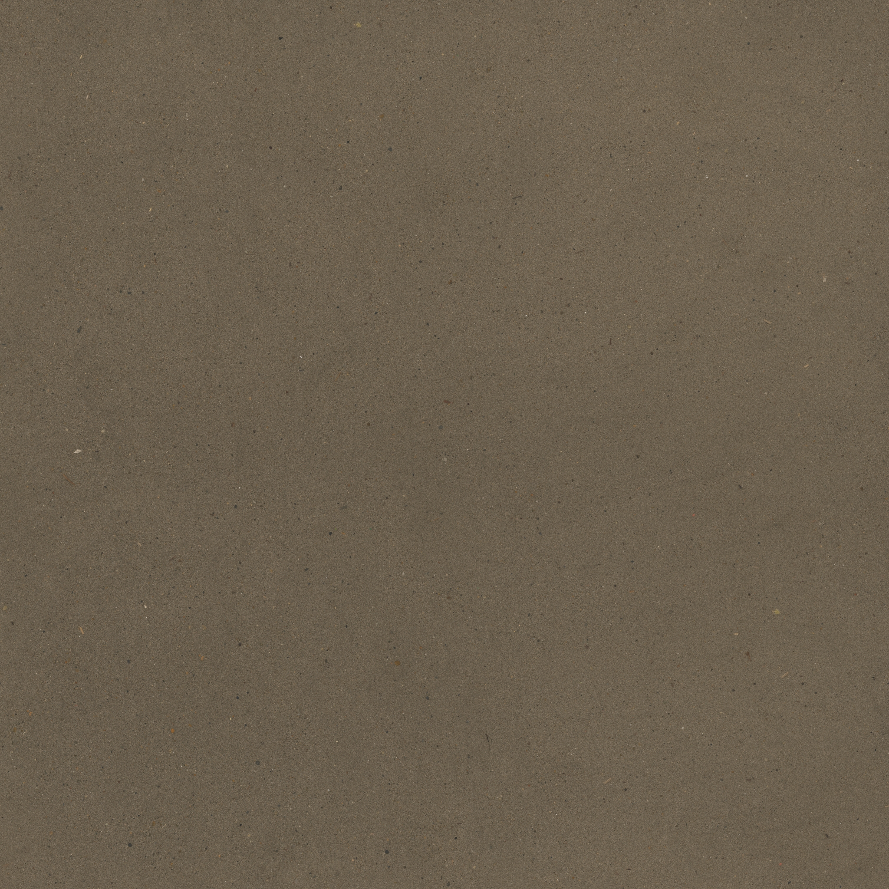
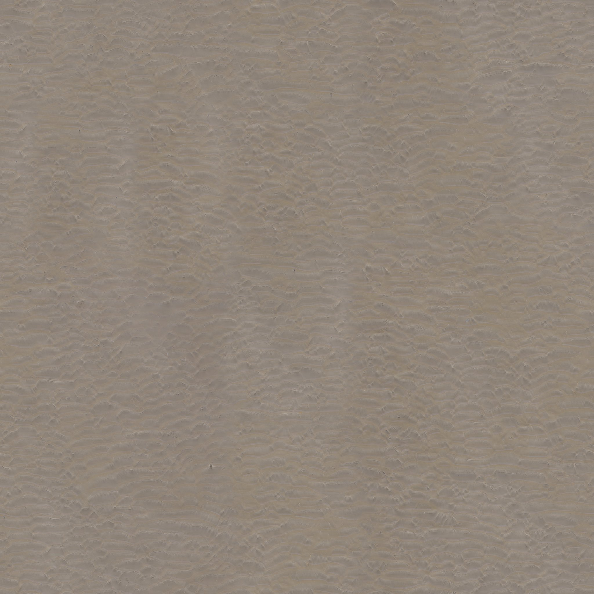

# 沙滩材质选型与接入建议 · 2026-11-07

本文件保留选型与接入依据。现已完成沙滩入水缓坡及正式材质接入，实施范围、截图和实机验收见 [沙滩缓坡记录](beach_slope_1107/README.md)。以下“项目实际情况”描述接入前的基线；水面和植被仍保持不变。

## 美术方向

延续项目明亮的近未来废墟与自然复苏风格：低饱和浅米白细沙、轻微风／水成沙纹，岸边一条较深、更平滑的湿沙带。远景保持大面积清爽色块，近景通过沙粒、法线与粗糙度体现材质。建筑偏冷暖白，沙地可比建筑略暖，与蓝绿色水面形成区别。

建议的颜色关系：干沙浅米白／淡暖灰，湿沙降低明度、略偏暖灰，水下沙底再交给现有水体吸收表现。不要直接把原照片的整片棕灰色当作最终美术配色；保留实拍细节并在材质中控制颜色、对比度和强度。

## 已选素材

下载目录：`assets/environment/beach_sand/`。下载来源、作者、物理尺度、每张图的 URL、字节数、官方 MD5 与本地 SHA-256 均记在 [sources.json](../assets/environment/beach_sand/sources.json)。

| 素材 | 用途 | 原始物理覆盖尺度 | 判断 |
| --- | --- | --- | --- |
| [Sand 03 / Charlotte Baglioni](https://polyhaven.com/a/sand_03) | 近景细颗粒主底材 | 约 2 × 2 m | 颜色图相对均匀，少量天然颗粒；适合保留细节、重设为项目浅沙色 |
| [Aerial Beach 01 / Rob Tuytel](https://polyhaven.com/a/aerial_beach_01) | 中远景沙纹与较大尺度变化 | 约 30 × 30 m | 有较连续的轻沙纹，可低强度混入，不应压缩到 2 m 尺度当细沙 |

两套均下载颜色、OpenGL 法线和粗糙度，具体分辨率与总大小以 sources.json 为准。未下载 Blender 工程、8K 资源、置换、AO 或重复格式。

研究时还比较了 Aerial Beach 02 与 Damp Beach Sand 的官方 1K 颜色贴图。前者带更明显的脚印／痕迹，后者有更明显的湿暗色与杂点；本次没有把它们作为完整生产贴图组下载进 assets。两套已选纹理可以先支持干／湿参数变化，再视实机需求决定是否补一套独立湿沙素材。

原始颜色图预览，**不是已经调色或应用到项目的效果图**：

## 项目实际情况

- `scripts/map_1021.gd::_build_model()` 当前给 Sand 使用纯色 `StandardMaterial3D`，颜色约 `(0.77, 0.71, 0.52)`，粗糙度 `0.98`，没有沙纹或粒度贴图。
- 当前基础地图有四个 Sand 语义对象，包含沙嘴及泻湖水下沙底，不应仅凭“都叫 Sand”就给它们相同的湿度外观。
- 实际 GLB 中四个 Sand 节点仅有 `POSITION` 与 `NORMAL`，没有 `TEXCOORD_0`。直接给默认 UV 材质挂图不足以正确铺满它们。
- 沙嘴有整片位于原生 Z=0／Godot Y=0 的平面，水下沙底范围约为 -0.64～0 m。**只按世界高度计算湿度，会让同一高度的整片沙滩得到相同湿度，不能形成沿岸线的窄湿沙带。**
- 现用水面有独立吸收与反射实现；这次不增加水面视口或改其参数。

## 后续接入建议

1. 保持原网格和碰撞，使用世界 XZ 米制坐标映射。此处沙面主要近水平，先采用简单 XZ 投射；若以后有较陡沙坡，再评估局部三平面映射。
2. 主细节按约 2 m 覆盖，沙纹按约 30 m 覆盖，分别控制强度。降低原照片颜色占比，保留纹理的局部差异并向浅米白色板归一化；先用较弱法线，避免远处闪烁和视觉噪声。
3. 干沙粗糙度可从 0.85～0.98 试起，湿沙从 0.45～0.70 试起，金属度为 0。湿度同时影响颜色、微法线与粗糙度，保持整体柔和。
4. 干湿边界使用岸线距离或美术绘制的湿度遮罩，并区分可见沙嘴与水下沙底。优先离线生成或复用已有边界数据，不在每个像素里遍历整张地图的岸线。
5. 保持单个不透明材质通道；首轮不使用置换、视差搜索、透明叠面或新增反射视口。启用 mipmap 与合适的各向异性过滤，新增采样仍需实际 GPU 对照。
6. 材质只分配给确认的沙地对象，不改地形／建筑语义、草缓存签名或树木存档。只有几何或种植规则真的改变时，才另行处理草地烘焙。

颜色图按 sRGB 读取，法线与粗糙度按数据读取。下载的是 `nor_gl`：Godot 要求 OpenGL 式 X+、Y+、Z+ 法线。参见 [Godot 官方材质说明](https://docs.godotengine.org/en/stable/tutorials/3d/standard_material_3d.html#normal-map)。

## 后续验收

在正式 `scenes/main.tscn` 中固定镜头，分别看沙嘴远景、人物脚边近景、沿水线低角度以及水下沙底。检查平铺重复、真实纹理尺度、色调与建筑区分、贴图拼接、湿沙过渡和法线稳定性。记录相同分辨率下的前后 GPU 时间；采用单个验证实例并在完成后退出。

素材文件完整、来源与许可已核对。后续实施已在正式入口完成画面检查、60 处碰撞采样和 10 处角色跨越，详见上述实施记录；没有进行全地图前后性能基准测试。

## 来源与许可

两套资产页面均标注 CC0；Poly Haven 的 [资产许可说明](https://polyhaven.com/license) 允许使用、修改和再分发，包括商业用途，且不强制署名。作者仍记录在本项目来源清单中。许可针对资产文件；本次没有将网站示例渲染或品牌图当作贴图资源打包。
