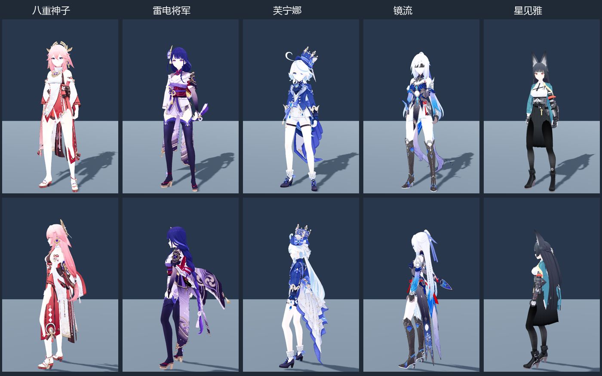
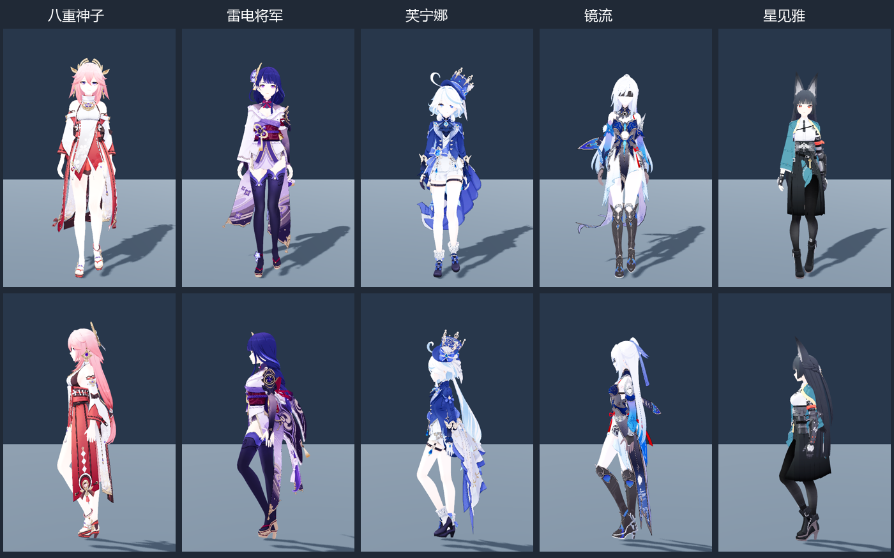
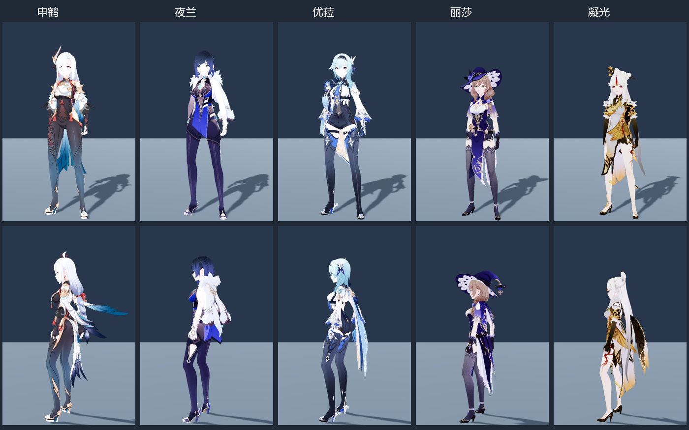

# 米家 MMD 角色批量导入制作指南

更新：2026-11-04。已完成两批共 10 个角色的 PMX → VRM 1.0 → Godot 导入，排除武器与独立道具，保留人物正常服装。加原有 4 个，项目共 **14 个角色**；此前统计的新增 46 个中剩余 **36 个**。首批为八重神子、雷电将军、芙宁娜、镜流、星见雅；第二批为 **申鹤、夜兰、优菈、丽莎、凝光**。

## 查看与复用

**人物检查：** Godot 打开原来的 `scenes/character_roster_review.tscn`，按 F6；或运行 `tools/run_character_roster_review.ps1`。同一窗口从累计 `roster/catalog.json` 切换已入库人物，以及地图待机 A01、地图步行 A05、地图跑步 A06，暂停、拖动时间轴，分别开关头发和服饰物理；右键旋转，滚轮缩放。切换人物保持动作和播放位置。默认 1×，可选择 0.75× / 0.5×；额外的预览接地辅助默认关闭。**步行和跑步均纳入最终场景验收。** 后续批次继续加入这个场景，不另建测试场景。

**原有动作预览：** `scenes/character_mmd_vrm_validation.tscn` 的角色选择从 `shared/manifest.json` 与累计 `roster/catalog.json` 合并读取，目前包含 14 个角色。原中性共享走路组已实际逐个替换新角色验证，动作资源身份和共同时间均保持一致。这是历史样本接入检查，没有重新烘焙已选 MMD 动作，也没有逐组合验收全部接触动作。

**可复用人物：** `scenes/characters/roster/<id>.tscn` 使用同一个共享动作播放器；`assets/characters/roster/<id>/<id>.vrm` 是对应单份成品。正式 F5 地图人物和出生入口未替换，Windows 包未重导出。

## 首批记录

以下批次记录和截图是当时的导入快照。当前的骨盆和循环质量以 [共享移动动作最终验收](character_locomotion_1104/README.md) 为准：已修复预览逐帧取消骨盆侧移及回绕重置物理的问题，并补齐 A06 骨盆水平校准与循环接缝；不能只凭播放器内部来源一致性断言最终画面正确。

| 人物 / ID | Godot 骨骼 | 材质 | 保留形变 | 头部 / 服饰物理链 | VRM 大小 |
| --- | ---: | ---: | ---: | ---: | ---: |
| 八重神子 `yae_miko` | 457 | 25 | 66 | 7 / 19 | 49.37 MB |
| 雷电将军 `raiden_shogun` | 310 | 23 | 64 | 3 / 22 | 39.85 MB |
| 芙宁娜 `furina` | 426 | 32 | 63 | 3 / 25 | 56.21 MB |
| 镜流 `jingliu` | 562 | 31 | 66 | 15 / 23 | 53.73 MB |
| 星见雅 `miyabi` | 437 | 23 | 52 | 9 / 24 | 42.81 MB |

五份成品合计 **241,969,976 B，约 242 MB / 231 MiB**。每人仅一份 VRM；贴图内嵌，保留形变目标。地图基础动作各一份共享资源，五个人物共用；三份动作合计约 2.34 MB。新角色 VRM 使用项目已有的 Git LFS 机制，避免后续几十人物作为普通 Git 大对象积累。





## 第二批记录

申鹤 `shenhe`、夜兰 `yelan`、优菈 `eula`、丽莎 `lisa`、凝光 `ningguang` 已使用相同流程入库，配置为 `tools/character_batch/second_batch_profiles.json`，独立批次清单为 `roster/second_batch.json`，累计清单仍为 `roster/catalog.json`。五份成品约 **175.59 MB**，没有复制共享动作。

见 [第二批详细记录与验收](character_batch_1104_02/README.md)。本批新增经验：凝光 ZIP 的表情贴图路径损坏，通过配置中的精确条目映射修复解包副本；不要全局替换路径分隔符。丽莎帽子保留刚性跟随，头发与衣服使用各自骨链。



## 重要纠正：必须追踪正式甘雨的动作来源

本批第一次预览选错了动作套：使用了原始 `idle-01.vrma`、`walk.vrma`、`run-slow.vrma`，而不是正式地图已经修正的动作。此前只验证时钟为 1×，遗漏了来源核对，不能据此判定播放内容正确。

实际调用链为 `project.godot` → `scenes/map_1021.tscn` → `scenes/characters/world_ganyu.tscn` → `scripts/world_character_controller.gd`。控制器停止模型原有 AnimationPlayer，建立 `WorldMotionPlayer`，加载 `assets/characters/motion_review/` 中的最终资源，并执行 `_center_clip` 去除恒定 XZ 偏移。

| 状态 | 正式资源 | 一圈时长 | 本批共享版本 |
| --- | --- | ---: | --- |
| 待机 | `motion_review/A01.tres` · Idle_Subtle | 2.541667 秒 | `roster/motions/shared_world_A01.tres` |
| 步行 | `motion_review/A05.tres` · Walk_Female | 1.333333 秒 | `roster/motions/shared_world_A05.tres` |
| 跑步 | `motion_review/A06.tres` · Run_Female | 0.791667 秒 | `roster/motions/shared_world_A06.tres` |

误用的旧共享步行一圈为 **0.766667 秒**，相对于正式 A05 的循环频率约为 **1.74 倍**。这是用户感到动作偏快的明确原因。正式 A05 还包含已有的骨盆横移、枢轴与循环接缝修正；不能退回原始 VRMA，或仅靠降低播放倍率代替这些修正。正式移动控制器还会按实际移动速度调整播放速率；预览默认以动作本身 1× 播放。

现在从**实际运行的甘雨控制器**提取姿态，以 120 Hz 加全部原始关键帧时刻采样，保留其最终修正和运行时居中，再生成一次标准人形共享资源。`neutral_clips.json` 记录原资源、控制器、场景和 SHA-256；每人物场景默认引用 `shared_world_A01.tres`。五份 VRM 无需重导。

用同一个甘雨 VRM 对照正式控制器与共享播放器，关闭衣发物理，三份动作各检查 11 个时刻、594 个骨骼姿态：步行最大位置误差 **0.00871 mm**，待机 **0.000261 mm**，当前修正后的跑步 **0.1274 mm**；最大四元数角误差约 **0.000977 rad**。见 [来源一致性检查](character_locomotion_1104/formal_motion_fidelity.json)。这验证共享转换忠实于甘雨；还必须通过最终场景的骨盆轨迹和实际回绕检查，不能替代不同体型的接触与服装观察。

旧预览器 `shared_walk_all` 保留为历史共享机制回归样本，其 `mmd_validation/shared/shared_walk.tres` **不是地图 A05**。本次误生成的 `roster/motions/shared_idle.tres` / `shared_run.tres` 已移至项目外 `research/character_batch_20261104/superseded_samples/`，不再被本批预览引用。模型内嵌旧动作、历史 VRMA 样本、已选 MMD 库和地图正式基础动作各有用途，后续选动作必须从调用链确认，不按文件名猜。

## 源文件选择

源压缩包仍在 `D:/模型/20261008`，未覆盖或修改。工作副本、中间 VRM 和 Blender 诊断报告在项目外的 `D:/Prism Route/research/character_batch_20261104/`，没有在项目内保留处理前 VRM 或整套 Blender 副本。

- 八重神子：`八重神子.pmx`。
- 雷电将军：`雷电将军.pmx`，排除 `武器.pmx`。
- 芙宁娜：本批使用 `【芙宁娜】.pmx`；`【芙宁娜_荒】.pmx` 是另一形态，不作为第二个人物重复导入。
- 镜流：`镜流2.0.pmx`；排除大剑、小剑以及独立裙子文件。主体已含正常服装，实机检查后没有叠加重复裙子。
- 星见雅：`星见雅.pmx`；排除武器和幽灵道具。

每个目录的 `provenance.json` 保留原包与主体 SHA-256、PMX 名称、原始说明和排除列表；VRM 元数据保留实际作者署名与原 PMX 说明。模型提供者为 miHoYo，模型改造／编辑署名分别来自原文件的观海、神帝宇、观海子记录。

## 可以复用的流水线

```text
first_batch_profiles.json
  → 校验源压缩包，在项目外解包，明确人物主体
  → 独立后台 Blender：导入、预检、权重与骨架适配、材质转换
  → 项目外单份中间 VRM
  → UV/Alpha 检查、人物自己的 Spring Bone 元数据、来源记录
  → 每人物一份成品 VRM、复用场景和 catalog 注册
  → Godot 导入，共享动作与衣发物理检查，实机截图
```

**配置入口：** `tools/character_batch/first_batch_profiles.json` / `second_batch_profiles.json`。人物 ID、标签、压缩包模式、主体文件、旧 ZIP 编码和物理骨链前缀均在配置中。`archive_path_overrides` 可精确修复已确认的损坏 ZIP 条目路径；只改变项目外解包副本，不改源包。后续批次继续使用统一转换逻辑，先审查新增配置，不复制几十份转换脚本。

**源包编码不能只按 GBK 猜。** 雷电将军、芙宁娜的一部分无 UTF-8 标志 ZIP 文件名使用 CP932。最初按 GBK 读取会把“体／肌／衣／髮”等解析错，出现贴图缺失。当前按人物配置的旧编码解包；UTF-8 标志的条目仍按其原名处理。任何路径缺失应停止该人物转换，不能靠白色占位材质继续发布。

**D / EX 权重必须条件化修正。** 本批五个模型的标准腿组均无有效权重，D 骨组有权重，标准骨与 D 骨枢轴吻合，因此两侧大腿、小腿、脚踝权重可转移，EX 权重逐顶点相加并入脚踝。若标准组已经有权重、枢轴差超过 1 mm 或骨骼缺失，工具中止，等待审查；不强行覆盖另一套骨架。

**辅助骨不能只留名字而不跟随。** 星见雅还有带权重的膝盖、脚踝辅助骨。本批保留这些骨和权重，将 D 骨改为对应标准骨的子骨，同时保存全局静止矩阵，使辅助骨跟随修正后的腿部。其余模型也执行一致的链接处理。所有人体和控制骨不按名称批量删除。

**材质保持现用 MToon 路线。** 保留 PMX 基础色、贴图和形变目标，贴图内嵌；按实际网格 UV 三角形覆盖范围分析 Alpha，再选 OPAQUE / MASK / BLEND。分析使用最长边 1024 的贴图缩略图作为预检，必须结合实机检查。星见雅眼部叠加层保留 BLEND，镜流默认隐藏的眼部层保留源透明度；不能把所有材质一律设成 MASK。134 个材质在 Godot 中均实际导入为 ShaderMaterial。

**身体动作与物理分离。** 复用 `shared_humanoid_motion.gd`，按该人物实际骨架校准骨盆、骨轴与骨长，不复制角色专属动作。基础动作统一提取正式甘雨控制器实际使用的 A01 / A05 / A06；不能以历史 `shared_walk.tres` 代替正式 A05。

**物理按人物配置一次。** 本批共 150 条链、1,219 个链关节，每个人物 12 个身体碰撞体。按经审查的骨名前缀及父子关系划分链；头部附属耳饰和丝带可随头发组开关。不同人物不复制刻晴的整套骨名和参数。成品内包含 `VRMC_springBone`，单独使用人物复用场景也能初始化物理。

## 重建与验收命令

在项目根目录执行，需本机 Blender 5.1.1（已安装 MMD Tools / VRM 插件）、Godot 4.7.2；系统 Python 需 NumPy 和 Pillow。

```powershell
# 只读取并预检源模型
tools/run_character_batch_1104.ps1 -AuditOnly

# 完整重建首批五个人物并验证
tools/run_character_batch_1104.ps1

# 完整重建第二批五个人物并验证，沿用同一个测试场景
tools/run_character_batch_1104.ps1 -ProfilesFile tools/character_batch/second_batch_profiles.json -WorkRoot 'D:/Prism Route/research/character_batch_20261104_02' -ManifestName second_batch.json -EvidenceDirectory character_batch_1104_02

# 打开中性人物检查器
tools/run_character_roster_review.ps1

# 验证已生成资产
& '.current_map_build/runtime/Godot_v4.7.2-stable_win64_console.exe' --headless --path . --script res://tools/verify_character_roster_1104.gd --fixed-fps 60

# 仅重建共享基础动作，无需重导五个模型，依次执行
& '.current_map_build/runtime/Godot_v4.7.2-stable_win64_console.exe' --headless --path . --script res://tools/character_batch/export_formal_ganyu_motion.gd
python tools/character_batch/build_neutral_clips.py
& '.current_map_build/runtime/Godot_v4.7.2-stable_win64_console.exe' --headless --path . --script res://tools/verify_formal_ganyu_motion.gd

# 实时时钟检查，不传 --fixed-fps
& '.current_map_build/runtime/Godot_v4.7.2-stable_win64_console.exe' --headless --path . --script res://tools/verify_character_preview_clock.gd

# 验证原动作预览器中的新角色选择，使用中性样本
& '.current_map_build/runtime/Godot_v4.7.2-stable_win64_console.exe' --headless --path . --script res://tools/verify_character_roster_1104.gd --fixed-fps 60 -- --existing-review --entry=shared_walk_all
```

可通过启动脚本的 `-BlenderPath`、`-GodotPath`、`-PythonPath` 指定可执行文件。后台转换在独立 Blender 进程进行，不清空用户正在编辑的 Blender 工程。

批次参数只决定要转换的人物和证据目录；测试仍加载 `character_roster_review.tscn`。预览默认展示累计清单，验证工具通过 `--catalog=res://assets/characters/roster/second_batch.json` 聚焦当前批次、`--out=res://docs/character_batch_1104_02/` 分开保存报告。已有基础动作默认复用，确需更新正式来源时传 `-RebuildMotions`，随后必须通过正式甘雨一致性检查。

首批五个角色 × 三份地图基础动作，共 15 组，在 30 / 60 / 120 FPS 导入检查中通过：骨骼姿态有限、段长度稳定、头发／服饰独立开关、跳帧复位与共享资源身份均通过。最大段长度误差低于 **0.006 mm**；腿部权重总量最大误差约 **2.89e-8**。这些早期检查只覆盖导入结构；现在步行和跑步另行通过 [最终场景验收](character_locomotion_1104/README.md)，包含骨盆轨迹、首尾位置与速度、连续回绕和物理状态。

[真实时间播放检查](character_locomotion_1104/playback_clock.json) 在普通启动、不固定模拟帧率下测量：待机、步行和跑步均约 1×；选择 0.75× 时也与选择倍率一致，暂停保持不动。不存在父子播放器同时推进时钟，但必须先选对动作来源并验证最终场景。

实机使用 Forward+ / D3D12 / RTX 5070 Ti，分别检查正面、侧面、步行，以及关闭物理的对照。见 [60 FPS](character_batch_1104/runtime.json)、[30 FPS](character_batch_1104/runtime_30.json)、[120 FPS](character_batch_1104/runtime_120.json)、[实际渲染](character_batch_1104/visual.json)、[步行渲染](character_batch_1104/visual_walk.json)、[原预览器接入](character_batch_1104/existing_review.json)。

## 当前质量边界与下批规则

本批完成基础入库和中性动作接入，衣发物理是骨链近似，仍可能在大幅动作、贴身或坐姿中局部穿插；没有布料自碰撞。形变目标已经保留，但本批没有额外绑定眨眼、口型和表情预设，也没有逐角色精调到原游戏材质效果。

不同体型、鞋底和足部结构仍可能产生接触偏差。预览的“接地辅助”只根据脚／脚尖骨的静止参考点整体抬升人物，**默认关闭**，不修改 VRM 或动作文件；它不是足部 IK，不作为真实玩法接触验收。NPC 目前验收待机、步行和跑步的共享播放；后续玩家角色如萤、开拓者进一步检查启停、转向和脚底接触，复杂接触动作另行检查手部与服装。

后续新增配置先做主体选择、骨架和贴图预检；失败人物单独修正，已通过的项目外中间产物可以保留供断点重跑。不要因一个特殊骨架而降低全部角色的权重／贴图检查门槛，也不要为每个人重新生产整个动作库。

当前规模优先完成基础入库。多人物共有的系统性偏移修复共享适配；个别人轻微滑步、鞋底高度差或局部服装穿插先记录。明显悬空、陷地、腿扭曲或循环跳动必须处理。重要 NPC 与主控角色再按出场需要精修，不为普通 NPC 复制动作库或逐人改骨盆轨迹。
