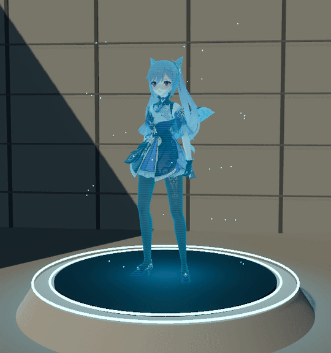
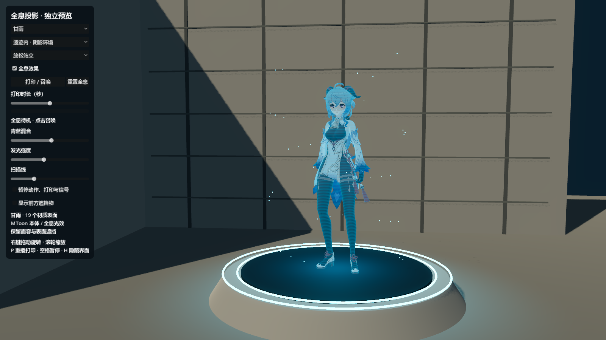
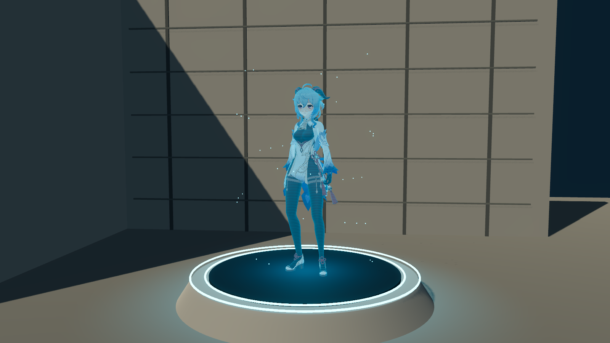
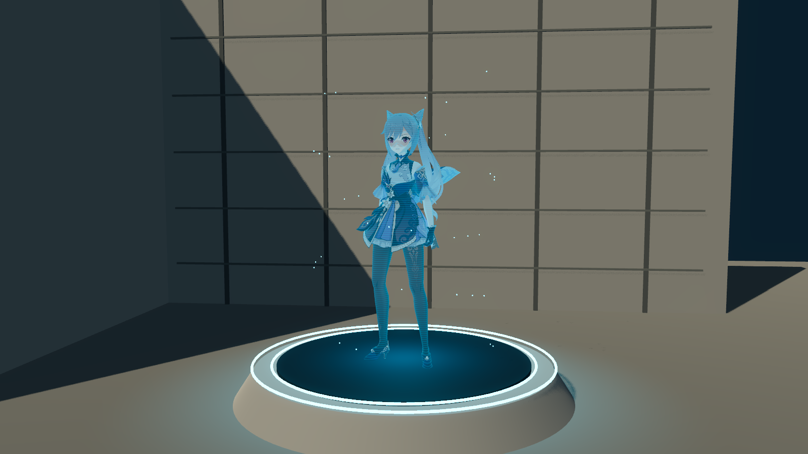
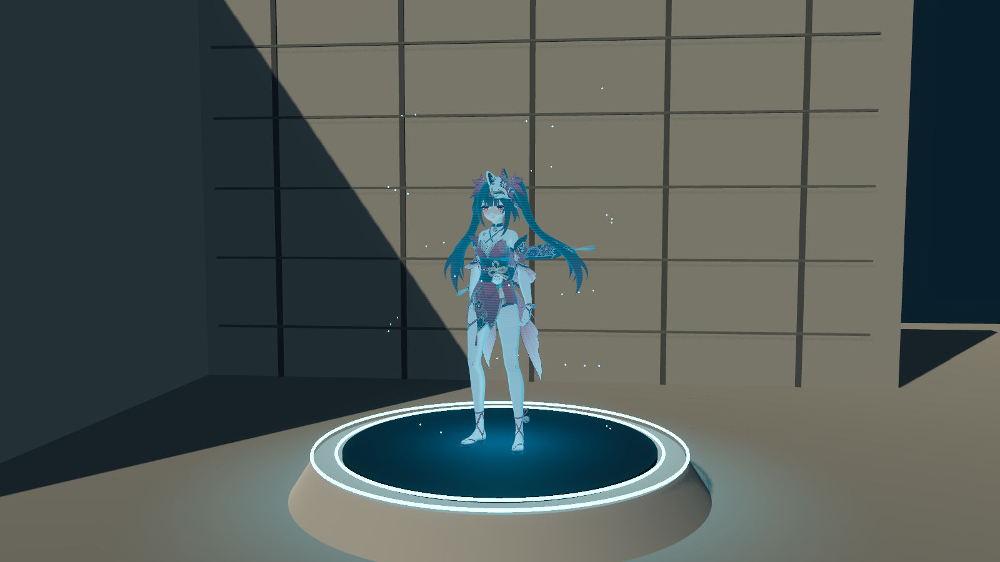
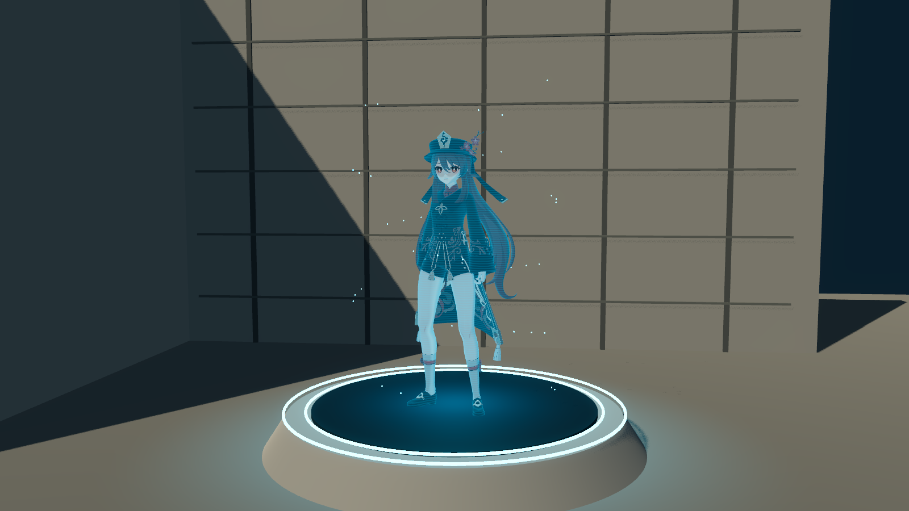

# 角色全息投影：独立场景

2026-10-28。入口：`res://scenes/character_hologram_test.tscn`，在 Godot 打开后按 **F6**，或运行 `tools/run_character_hologram.ps1`。F5 仍进入正式地图，本轮没有接入世界中的遗迹或角色解锁流程。

## 当前角色清点

以下数值来自实际导入资源的运行时清点，不含重复的“处理前”比较版本。

| 角色 | 网格数 | 材质表面数 | 三角形数 | 导入骨骼数 | 状态 |
| --- | ---: | ---: | ---: | ---: | --- |
| 甘雨 | 2 | 19 | 21,111 | 276 | 正式角色源场景可用 |
| 刻晴 | 2 | 20 | 20,103 | 277 | 已转换的本地测试 VRM 可用 |
| 花火 | 2 | 40 | 38,025 | 719 | 已转换的本地测试 VRM 可用 |
| 胡桃 | 1 | 21 | 23,944 | 251 | 已转换的本地测试 VRM 可用 |

四个模型均有自身骨架对应的 A01 站立和 A25 招呼动作。骨骼数含导入辅助骨，不代表性能或完成度排序。资源清点见 [inventory.json](hologram_1028/inventory.json)。

## 效果和操作

根据用户反馈，当前版本改为 **MToon 本体 + 全息光层**。主体保留原贴图、颜色、卡通明暗和正常深度遮挡，避免透明后看到眼球、后脑与衣服内层。青蓝色调、边缘发光、沿世界高度连续的扫描线、缓慢扫光和轻微信号波动通过光层表达；脸部扫描线显著减弱。测试台的发光环、局部青蓝灯和少量漂浮光点均属于独立舞台。

- 下拉菜单切换四个角色、室内／白天、站立／招呼。
- “全息效果”开关恢复或重新应用原实例材质。
- “青蓝混合”“发光强度”“扫描线”滑块调整观感；青蓝混合控制光层颜色强度，不再让整个角色透明。
- 右键拖动旋转观察，滚轮缩放，空格暂停动作与信号，H 隐藏界面。
- “显示前方遮挡物”用于检查投影不会穿过实体。

## 打印／召唤动画

点击 **打印／召唤**，或按 **P**：角色从全息状态开始，一条青蓝扫描边界从头顶匀速下降到脚底，经过的位置恢复为实体 MToon。默认 3.5 秒，可在预览里调整到 1～6 秒；完成后保持实体，按 P 再次重播，或点“重置全息”回到初始状态。空格同时暂停动作、打印和信号，切换模型会重置打印进度。

实现只为现有光层增加高度遮罩，MToon 主体始终负责正常表面遮挡，不会重新暴露眼球、后脑和衣服内层。四个模型各自测量整体高度范围，所有材质共享相同扫描平面；边界默认半宽 2.5 cm。进度达到 100% 后解除光层的 `next_pass`，恢复角色原本的阴影状态；重播时重新挂上光层。投影台的环、灯和光点仍是独立舞台效果。

实例组件可调用 `start_printing(seconds)`、`reset_projection()`，并监听 `printing_started`／`printing_finished`。`set_print_progress(0..1)` 用于暂停定位到某一阶段。当前范围基于模型绑定时的网格包围盒，适用于这里的站立与招呼；未来若做倒立、大幅跳跃或运行时缩放，应重新定义／测量打印范围。



打印验证见 [逻辑报告](hologram_1028/printing_logic_report.json)、[渲染报告](hologram_1028/printing_render_report.json)。四个角色均验证 0／25／50／75／100% 进度、材质同步、暂停、重播和完成信号；GPU 对比验证上半身先成为实体、下半身保持全息，完成时无光层 pass，四个角色的完成帧与稳定 MToon 参考帧 RGB 差值均为 0。像素比较固定姿态并关闭阴影与辉光，演示动图恢复舞台阴影和辉光。

预览同时修正了 VRM 弹簧骨延迟创建时未被原先关闭逻辑覆盖的问题：在创建完成后禁用预览模型的骨骼物理修改器，使暂停与逐帧比较稳定。原始模型和正式角色物理未改动。

```powershell
& '.current_map_build/runtime/Godot_v4.7.2-stable_win64_console.exe' --headless --path . --script res://tools/verify_hologram_printing_1028.gd
& '.current_map_build/runtime/Godot_v4.7.2-stable_win64_console.exe' --path . --rendering-driver d3d12 --script res://tools/verify_hologram_printing_1028.gd -- --capture --animation
```

默认青蓝混合 0.42，发光强度 1.05。MToon 主体按原有实心／镂空用途写入深度，遮住内部结构；光层通过 `next_pass` 叠加，仅通过深度测试的表面可见。角色不投射实体阴影，前方不透明物仍能正常遮挡角色。光层不再做顶点位移，以免与主体表面不一致、漏出内部光片。

原始少量半透明装饰依照源材质保留，但不把脸、头发、身体及服饰整体改成透明。当前是有清楚面容和表面遮挡的投影风格，没有启用全身透视或全身淡出。

[修改前的刻晴](hologram_1028/keqing_before_daylight.png) · [修改后的刻晴](hologram_1028/keqing_daylight.png) · [脸部近景](hologram_1028/keqing_face_daylight.png)











## 实现和复用

`scripts/characters/hologram_effect.gd` 为实例级组件：实例化后调用 `bind(character, profile)`，profile 为上述角色 ID。通过 `set_surface_override_material()` 应用效果，`set_enabled(false)` 暂时恢复，`restore()` 解除绑定并恢复原材质、可见性及阴影状态。

适配输入为 `StandardMaterial3D` 和现有上游 MToon ShaderMaterial。前者使用现有 MToon 工厂创建实例材质，后者复制原 MToon 材质；均不改写源资源。主贴图、主色、UV、卡通明暗及镂空形状保留。甘雨沿用已经审计的实心／镂空 Alpha 用途，脸红覆盖降低光层权重。原材质的描边后续 pass 不接入投影，改为全息光层。未适配的自定义 ShaderMaterial 会报告。当前四个模型共 100 个材质表面全部适配。

光层 Shader 位于 `shaders/characters/hologram*.gdshader*`，单面与双面包装共用一份实现。投影高度使用变形后顶点的世界坐标并相对角色基准高度计算，避免扫描条带在多个材质之间断开。信号扰动只改变光层颜色；没有改写源网格，也不再偏移顶点。`signal_strength` 控制光层信号，降到零时隐藏投影网格；中间值不使主体变成透明模型，禁用效果和解除绑定会恢复原可见性。

本轮保留原 VRM、导入材质、骨架和动作；独立场景使用普通待机／招呼，并关闭弹簧骨物理以便稳定比较。正式角色的 MToon、湿润效果、F5 主入口和正式导出依赖均未修改。复用时应绑定角色显示模型；本轮没有适配正式水面湿润 ShaderMaterial，也没有把此预览挂到玩家控制器。

## 验证

`tools/verify_hologram_1028.gd` 的逻辑与 Forward+ / D3D12 渲染检查通过：

- 四个模型的 19／20／40／21 个表面均转换成功，站立和招呼动作的骨骼姿态有效。
- 多次开关及解除绑定后，原材质引用、材质参数和阴影状态恢复一致。
- 两个角色实例的投影材质独立，一个实例调节浓度不会影响另一个。
- 四个模型分别在室内和白天截图，另含刻晴脸部近景与甘雨招呼动作。
- 前方不透明物遮挡检查通过；主体后的红／蓝背景卡切换不影响主体像素，RGB 差值为 0，未见背景透出。
- 在四个模型头部内部放置红／蓝测试球，每个模型从三个角度观察，12 组检查的内部标记 RGB 差值均为 0，验证内部结构被遮挡。
- 原始模型资源没有因效果改写；正式场景入口和导出列表没有引入全息预览。

证据：[逻辑报告](hologram_1028/logic_report.json)、[渲染报告](hologram_1028/render_report.json)。截图与报告目录带 `.gdignore`，不会作为游戏贴图导入。

本轮为功能与视觉抽样验证，不是性能基准。每个材质增加一个光层 pass，尚未测量大量全息 NPC 同屏的性能。明亮背景下边缘光对比度更低；投影台的舞台灯和光点不是 Shader 自动生成的真实全局光照。测试进程无法写入用户级 shader cache，不影响本次渲染检查。

```powershell
& '.current_map_build/runtime/Godot_v4.7.2-stable_win64_console.exe' --headless --path . --script res://tools/verify_hologram_1028.gd
& '.current_map_build/runtime/Godot_v4.7.2-stable_win64_console.exe' --path . --rendering-driver d3d12 --script res://tools/verify_hologram_1028.gd -- --capture
```
