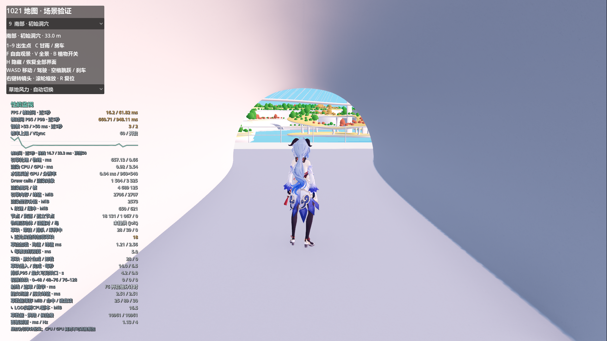
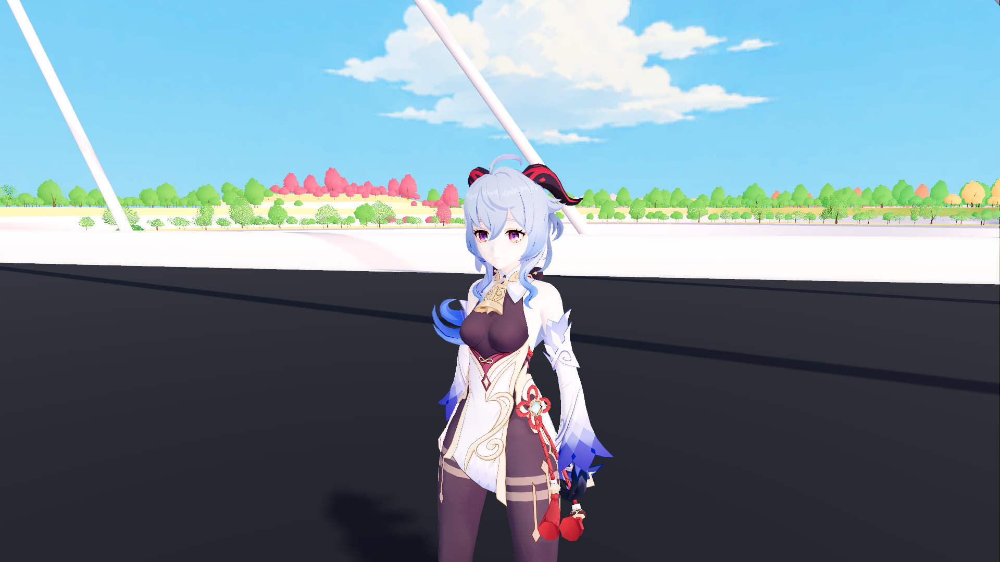

# 正式人物材质：MToon

当前补充：2026-10-27 已在保留 MToon 干燥外观的基础上加入 [局部湿润与离水渐干](CHARACTER_WETNESS_1027.md)，正式依赖 180 项。下文较早依赖数量对应各历史阶段。

2026-10-26。用户已确认采用对照中的 **第2项 B MToon**。F5 直接启动原来的 `scenes/map_1021.tscn`，角色仍从初始洞穴出生，19 个 surface 自动使用同一份已确认的 MToon 参数。

2026-10-27 更新：正式材质按实际 Alpha 用途改为 16 个不透明、2 个镂空、1 个脸红透明，以正确参与水面合成。基础色与光照参数仍一致；下文 10 月 26 日的“全部保留 Alpha Depth Pre-Pass”是历史配置，原实验室 B 保留该配置作为对照。见 [角色入水修复](CHARACTER_WATER_1027.md)。当前导出依赖为 174 项、缺失 0 项；EXE/PCK 尚未重新导出。

## 正式行为

- 保留原基础色、主贴图、阴影纹理、UV、Alpha Depth Pre-Pass 与双面设置。
- 参数与此前第2项一致：`_ShadeToony=0.75`、`_IndirectLightIntensity=0.25`、完整阴影接收；脸/皮肤与其他部位使用原对照的阴影色。没有另做一轮调色。
- 不启用 C0/C1、Face SDF、专用遮罩或轮廓壳。
- 正式 HUD 不增加材质切换、实验室链接或 Shader 设置；原移动、房车切换、出生点和界面隐藏操作保留。

`scripts/characters/mtoon_materials.gd` 提供独立的材质创建函数，由 `world_character_controller.gd` 初始化时应用。正式代码不加载实验 profile 或实验场景。原 VRM、骨架、动作资源与供应商插件未修改。

当前 Windows 导出依赖清单已更新，168 项、缺失0项，包含 MToon 包装与公共代码，不包含实验室、C0/C1、SDF或描边。现有 Windows EXE/PCK 本轮未重新导出；本次正式采用指源工程 F5 入口。

## 验证

`tools/verify_formal_mtoon.gd` 的单角色检查与实际 F5 场景 Forward+ / D3D12 检查均通过：

- 19个材质的shader与关键参数逐项匹配第2项，原导入材质仍为未修改的 StandardMaterial3D。
- 正式启动未缓存实验组件/profile/SDF，无描边壳，界面无实验室或材质控件。
- 初始洞穴人物出生、道路落地、步行、奔跑、跳跃/落地、人物→房车→人物和相机返回通过。
- 导出依赖完整，实验资源未进入依赖清单；原实验室的三路逻辑回归也通过。

报告：[逻辑检查](formal_mtoon_1026/logic_report.json)、[实际F5场景检查](formal_mtoon_1026/world_report.json)。





```powershell
$godotFormalMtoon = 'D:\Godot\Godot_v4.7.2-stable_win64.exe\Godot_v4.7.2-stable_win64_console.exe'
& $godotFormalMtoon --headless --path . --log-file 'D:/Prism Route/prism-route/.godot/formal_mtoon_logic.log' --script res://tools/verify_formal_mtoon.gd
& $godotFormalMtoon --path . --log-file 'D:/Prism Route/prism-route/.godot/formal_mtoon_world.log' --script res://tools/verify_formal_mtoon.gd -- --world --capture
```
