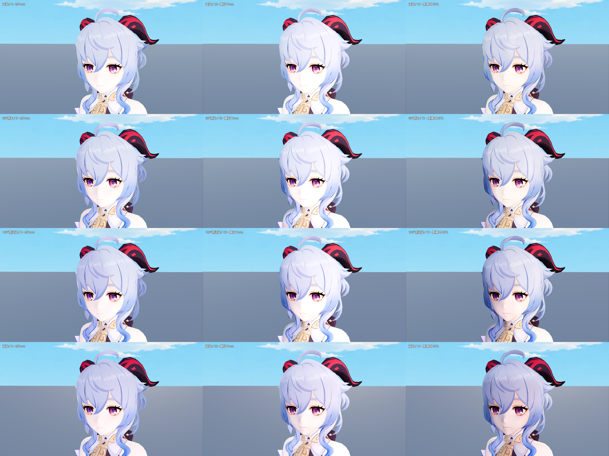
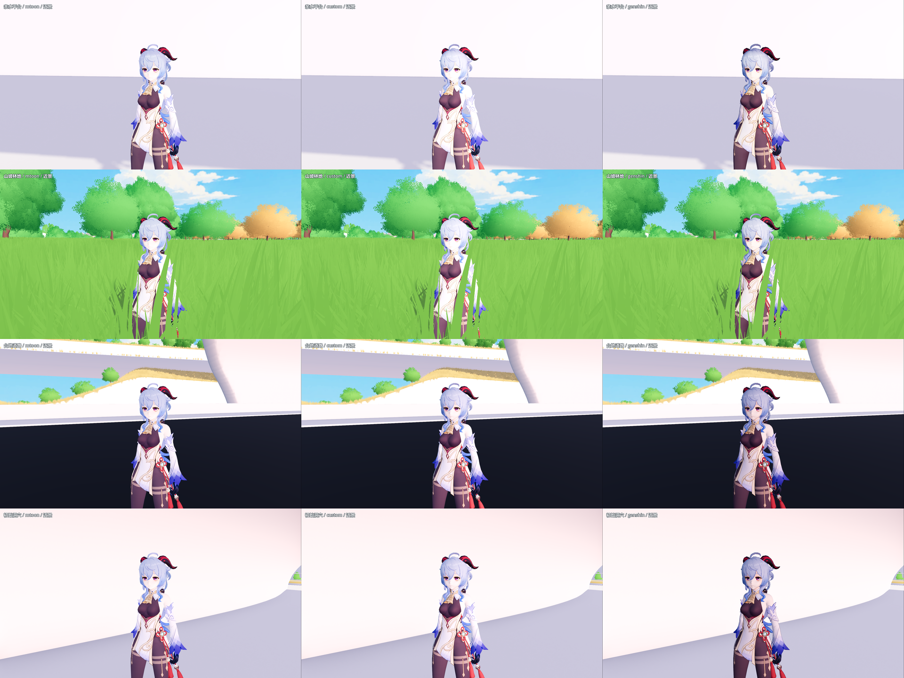

# 甘雨 C1：脸部 SDF、材质分区与细描边

2026-10-26。对应 issue #17 的第二轮实现。目标是验证原神式角色 NPR 的制作方法，不是复刻原游戏管线。当前只适配本项目这份甘雨模型。

## 目前的美术判断

**用户已选择第2项MToon作为正式人物材质，F5直接应用，C1仅保留为独立实验。** 见 [采用记录](CHARACTER_MTOON_1026.md)。C1 的脸部 SDF 可以减少侧光下鼻子和嘴角的碎阴影；但当前暗面偏灰，轮廓线和金色高光并未让整体效果全面优于 MToon。功能验证通过不能替代美术选择。

正式版本没有混入C1的脸部SDF、材质遮罩或描边。

## 打开

在 Godot 打开 `scenes/character_shader_lab.tscn`，F6 运行。实验室为展示本轮结果默认选择 C1；这不代表正式选型。

| 按键 | 材质 |
| --- | --- |
| 1 | A 原始 PBR |
| 2 | B 现有 MToon + 项目映射参数 |
| 3 | C0 上一轮基础 Toon |
| 4 | C1 原神式 NPR 实验 |

左侧可关闭脸部 SDF、关闭彩色细描边，调整轮廓宽度、环境光响应与 C1 发丝高光。色阶选择对 C0/C1 共用；标有 C0 的柔化/高光滑块只控制 C0。右键旋转、滚轮缩放；动作和时间轴保持原测试器操作。

“进入真实地图对照”使用独立包装场景，右下角同样有四种材质。正式 F5 为 `scenes/map_1021.tscn`，使用已确认的MToon；正式HUD不包含这些实验控件。Windows包尚未重新导出，导出依赖已更新。

```powershell
& 'D:\Godot\Godot_v4.7.2-stable_win64.exe\Godot_v4.7.2-stable_win64_console.exe' --path 'D:\Prism Route\prism-route' res://scenes/character_shader_lab.tscn -- --character-shader=genshin
```

## 实际增加的内容

### 匹配 UV 的 Face SDF

`materials/characters/ganyu_npr/face_sdf.png` 是 1024×1024 数值贴图。先从实际导入网格导出面1/面2的 UV 与绑定姿态位置，在脸部正投影平面设计鼻颊边界，计算两侧的欧氏有符号距离，再按三角形重心坐标栅格化到模型 UV。

- R 为光来自头部右侧时的字段；G 为来自左侧时的字段；B 记录 UV 覆盖。双通道由几何镜像生成，不假定所有 UV 岛都能直接用 `1-U` 翻转。
- 使用跟随头骨骼的 forward/right/up；按当前方向光的相对朝向求阈值。接近垂直光时有退化处理，正/背光两侧切换不产生零向量归一化。
- SDF 仅替换脸部直射光的艺术阴影形状；`ATTENUATION` 仍移除被真实遮挡的直射光。环境天空与场景 SSAO 保留，因此鼻部仍可有环境遮蔽，不宣称消除所有几何阴影。
- 贴图为本项目设计的首版边界，不是官方角色 SDF，也不是从基础色自动恢复的原游戏阴影。缺少贴图或关闭开关时回到几何法线光照。

### 身体、头发与配件

`body_material_mask.png` 的 R 是当前衣服图集中的金色候选区域，G 是白色布料区域。由针对这张图集的颜色选择规则生成，并检查过图像；**它不等价于确认每一处金色装饰都是金属**，后续美术选择仍需细化。

C1 将金色候选的暖色高光与布料漫反射分开，降低白布亮部响应；皮肤使用较暖暗色，头发保留偏冷暗色与可关闭的方向性高光。通过材质 AO 系数限制原环境光的贡献，未改全局天空、ACES、曝光或加恒定皮肤自发光。

### 独立平滑法线描边壳

直接使用源法线会放大发片接缝，因此最终使用单独的 outline-only ArrayMesh：

- 原网格、原法线、原材质资源不变；只对轮廓壳按相同位置聚合法线，反向薄面不互相抵消。
- 平滑法线写入壳的 NORMAL，使 GPU 蒙皮按原骨骼变形；不依赖未验证的 CUSTOM0 蒙皮行为。
- 壳共享原 Skin 和骨架路径，保留 60 个形变目标及原位置数据，跟随源网格形变权重。多个相同角色共享派生网格，材质参数各自独立。
- 8 个表面参与轮廓：主脸面、头发、角、衣服及配件等。眼睛、表情层和单独皮肤表面不参与。
- 1080p 初始宽度 0.85 px，脸部乘 0.6；5–12m 按距离衰减。描边壳不投影。当前是视觉衰减，未实现完整角色材质 LOD，远处仍可能提交壳的绘制。

## 直接看效果

下图每行依次为正光、60°侧光、100°侧逆光、背光；列为 **B MToon / C0 / C1**。所有材质保持同一太阳、天空、曝光和待机帧。头像比较采用更近的相机，以便看清鼻颊边界。



最直接的 SDF 检查是：[开启](character_shader_c1/sdf_on.png)与[关闭](character_shader_c1/sdf_off.png)。关闭时鼻子、嘴角的几何法线阴影更碎，开启后边界更集中。比较的是同一套 C1 材质，避免把整体亮度差误当成 SDF 收益。



实景覆盖亲水平台、山坡林地、台地道路与初始洞穴，另外保留 [4.5m 对照](character_shader_c1/world_comparison.png)。山坡林地是现有出生位置，不将它描述为已穷尽树冠阴影测试；真实遮挡另通过固定屋檐/方向光阴影开关验证。

## 验证结果与成本

[logic_report.json](character_shader_c1/logic_report.json)、[render_report.json](character_shader_c1/render_report.json)、[world_report.json](character_shader_c1/world_report.json) 均通过。原 C0 的逻辑回归也通过。

验证包括四路切换不重置动作时间、恢复原材质引用、独立人物参数、角色0–360°方向更新、头部俯仰/侧倾、垂直光、SDF开关、真实遮挡、描边开关、形变权重同步、奔跑弹簧骨代表帧和2× MSAA。

SDF 对照在固定脸部区域检出 2,200 个有差异的隔像素样本；真实阴影开关检出 42,186 个样本；全身描边开关检出 2,775 个样本。它们证明对应功能确实影响画面，不代表美术质量评分。镜头、姿势与方向记录在 JSON 中。

1920×1080 / Forward+ / D3D12 / 4× MSAA / RTX 5070 Ti，小场景 GPU 中位数（ms）：

| 人数 | B MToon | C0 | C1，含描边 | C1 Draw Calls |
| --- | ---: | ---: | ---: | ---: |
| 1 | 0.334 | 0.326 | 0.342 | 69 |
| 5 | 0.430 | 0.404 | 0.463 | 329 |
| 20 | 0.636 | 0.568 | 0.720 | 1,304 |

关闭帧率上限/VSync，各项预热90帧、采样120帧；静止姿势、关闭弹簧骨。20人时比C0增加160个Draw Calls，符合每人8个壳表面的额外提交。没有将这组数据当作大世界/NPC系统性能，也没有宣称自定义更快。显存记录是整进程、含所有候选和缓存，不能归因于某一种材质。沙箱无法写入 `user://` shader磁盘缓存，测试在预热后采样。

## 生成与重跑

```powershell
$godotCharacterNpr = 'D:\Godot\Godot_v4.7.2-stable_win64.exe\Godot_v4.7.2-stable_win64_console.exe'
& $godotCharacterNpr --headless --path . --log-file 'D:/Prism Route/prism-route/.godot/character_npr_export.log' --script res://tools/export_character_npr_inputs.gd
python tools/build_character_npr_maps.py
# 贴图发生改变后，让 Godot 编辑器完成重新导入再运行后续命令。
& $godotCharacterNpr --headless --path . --log-file 'D:/Prism Route/prism-route/.godot/character_c1_logic.log' --script res://tools/verify_character_npr_c1.gd
& $godotCharacterNpr --path . --log-file 'D:/Prism Route/prism-route/.godot/character_c1_render.log' --script res://tools/verify_character_npr_c1.gd -- --render
& $godotCharacterNpr --path . --log-file 'D:/Prism Route/prism-route/.godot/character_c1_world.log' --script res://tools/capture_character_shader_world.gd -- --c1
```

数值纹理采用无损压缩、无sRGB采样、关闭自动3D有损转换；Face SDF不生成mipmap。生成脚本需要numpy、Pillow和scipy，运行游戏不需要Python。输入导出只写 `.godot/character_npr_inputs/`，不覆盖模型源文件。图集/几何SHA-256及通道约定见 `materials/characters/ganyu_npr/build_report.json`。
