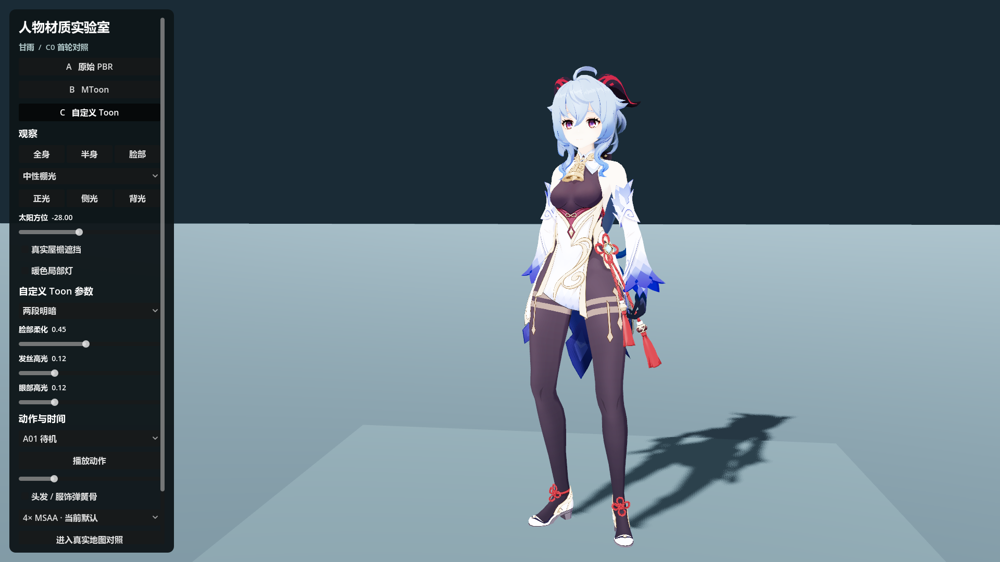
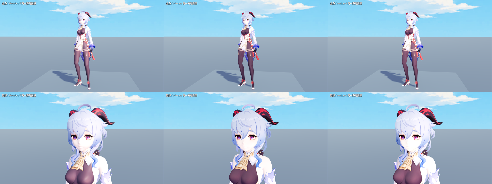
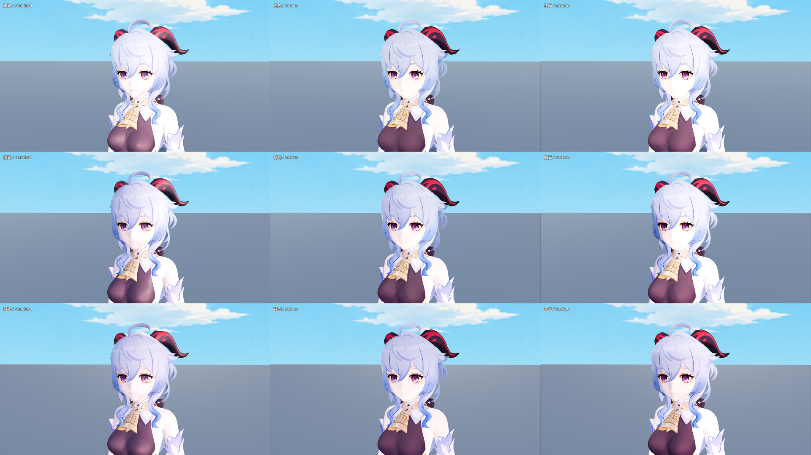
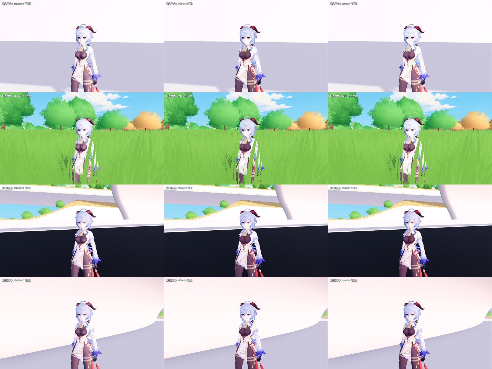

# 人物 Toon Shader：首轮 A/B/C 实验室

> 最终选择：用户已确认第2项MToon，正式F5直接采用，HUD没有实验室链接。见 [采用记录](CHARACTER_MTOON_1026.md)。下方三路图、操作和性能表保留为首轮实验记录；实验室仍可单独打开，包含C1对照。

2026-10-26。对应 [issue #17](https://github.com/maru044/prism-route/issues/17) 的首轮实施：运行时材质盘点、非破坏性对照入口、无 SDF 的 C0 自定义 Toon。Godot 4.7.2 / Forward+ / D3D12，RTX 5070 Ti 实机验证。

## 打开与操作

打开 `scenes/character_shader_lab.tscn`，F6 运行。默认 A 为当前原材质；左侧按钮或键盘 1 / 2 / 3 切换 A 原始 PBR、B MToon、C 自定义 Toon。

- 全身 / 半身 / 脸部切换机位；右键拖动旋转、滚轮缩放。
- 中性棚光与主地图天空/曝光对照；正光 / 侧光 / 背光、太阳方位、真实屋檐遮挡、暖色局部灯。
- C 可调整两/三段明暗、脸部柔化、发丝高光和眼部高光；高光滑块设为 0 即关闭。参数只影响该角色自己的材质实例。
- A01 待机、A05 步行、A06 奔跑、A25 招呼；播放/暂停（空格）、时间轴定位、服饰弹簧骨开关。默认暂停于 A01 的 0.6 秒，便于材质比较。
- 默认 4× MSAA，可切换 2×。`project.godot` 中枚举值 `msaa_3d=2` 代表 4×，不是 2×；当前地图代码也显式设置 4×。
- 左侧内容可滚动；底部“进入真实地图对照”打开 `scenes/character_shader_world_lab.tscn`。右下角切换材质，可返回实验室；地图原有移动、出生点、人物/房车和隐藏 HUD 操作保留。

正式 F5 入口仍为 `scenes/map_1021.tscn`，保持原人物材质。所有效果通过独立测试场景进入，未改世界灯光、曝光、水面、植被、VRM importer 或供应商 MToon 文件。实验室及其材质不在当前正式导出依赖清单内。

```powershell
& 'D:\Godot\Godot_v4.7.2-stable_win64.exe\Godot_v4.7.2-stable_win64_console.exe' --path 'D:\Prism Route\prism-route' res://scenes/character_shader_lab.tscn -- --character-shader=custom
```

`--character-shader=standard|mtoon|custom` 在两个测试场景中均可使用。切换真实地图会重新进入其原有出生流程，不继承实验室的姿势或材质选择。



## 材质与资产盘点

`tools/audit_character_materials.gd` 实际实例化导入后的 `scenes/characters/ganyu.tscn`。最新结果在 [material_audit.json](character_shader_lab/material_audit.json)：

- 同一蒙皮网格有 **19 个 surface，19 个 StandardMaterial3D**，均为 Alpha Depth Pre-Pass、双面、metallic=0、roughness=0.5，无 next_pass、法线贴图或发光。
- 网格保留 **60 个形变目标**，有法线、切线、UV、骨骼和权重；没有 UV2、顶点色或 CUSTOM0–3。
- 源 GLB 有 5 张内嵌图：面、发、服、肌、表情；仅声明 VRM / springBone 扩展，没有 MToon 声明。未发现命名的 SDF / ILM 图及专用通道约定，C0 不将基础色猜作遮罩。
- `materials/characters/ganyu_appearance.tres` 将稳定网格路径及 surface 名称映射到 face / skin / hair / body / eye / accessory / overlay。`服` 表面内部仍混有多个视觉材质，当前没有逐像素金属/布料 ID。

盘点 JSON 中的 blend shape 数量按 surface 重复报告，因为它们共享同一个网格；并非 19×60 个独立表情。当前只保留数据，没有新增表情绑定。

## 实现边界

`scripts/characters/character_appearance.gd` 以 `set_surface_override_material()` 覆写，缓存各 surface 原来的 override 引用。恢复 A 或组件退出时恢复这些引用，不修改 mesh、导入材质、原动作、骨架或弹簧骨配置。

每个角色拥有独立 profile 和 B/C ShaderMaterial；贴图与 Shader 可共享。未知/重名 surface、缺失网格，以及包含尚未支持特性的源材质，会保留原材质并报告警告。当前映射只针对甘雨；其他角色需要单独盘点和 profile。

**B：** 调用项目现有 MIT MToon 的公共代码。新增的薄包装保留源 Alpha Depth Pre-Pass 与双面行为；显式绑定基础色、基础纹理、阴影纹理、UV 和阴影接收参数。插件本身没有被修改或升级。没有启用描边。

**C0：** `shaders/characters/toon_common.gdshaderinc` 为本项目实现。共享轻量光照核心，按部位参数控制脸/皮肤、身体、头发、眼部和配件。

- 基础色只进入 ALBEDO 一次；自定义 `light()` 用 `+=` 累积灯光。
- 两/三段明暗、彩色暗面；遮挡 `ATTENUATION` 衰减直射光，环境/天空贡献作为暗部基础，没有无条件补光或自发光皮肤。
- 脸部直接光法线与头部前向适量混合，是**无 SDF 的柔化 fallback**。头部朝向由绑定姿态校正后跟随当前骨骼，未修改模型法线。
- 头发采用切线方向的轻度高光近似，没有作者提供的发丝流向贴图；眼部和配件有单独的弱高光。
- 保留当前模型源透明语义，未将所有头发/表情层强制改成裁切。透明排序和多 surface 数量仍受原模型结构影响。

这一轮没有 Face SDF、专用 LightMap、描边、透刘海或材质 LOD；它们属于后续审美评审后的增强阶段。尚未选择正式采用 B 或 C。

## 实机画面与阴影证据

以下图片由真实 Forward+ / D3D12 运行生成。同一组 A/B/C 固定相机、角色姿势与太阳/环境，正式世界截图等待可见草块加载完毕，并冻结时间。





世界对照为当前 1021 的亲水平台、山坡林地、台地道路、初始洞穴。亲水平台不是旧 1012 沙滩；本轮未宣称完成全地图或所有天气验收。原有草地会遮挡 4.5m 机位下的人物，因此同时保留近景。



[4.5m 游戏距离对照](character_shader_lab/world_comparison.png)、[实景相机与状态记录](character_shader_lab/world_report.json)。

阴影测试保持同一屋檐几何和环境/SSAO，仅开关方向光阴影，对固定脸部区域比较屏幕亮度。A/B/C 的阴影/无阴影亮度比分别约 **0.927 / 0.938 / 0.896**。这说明本测试位置的真实阴影有可见响应，不是只旋转手绘光；数值是显示颜色亮度，不是物理能量，也不代表所有树叶/建筑阴影都已验收。

## 验证与性能

[logic_report.json](character_shader_lab/logic_report.json)、[render_report.json](character_shader_lab/render_report.json) 和 [world_report.json](character_shader_lab/world_report.json) 均通过：19 部位映射、原引用恢复、按钮/播放暂停/时间轴回调、4 段动作骨骼有限值、切材质保留动作时间、独立人物材质与 profile、未知部位回退、阴影响应、真实地图和 9 个出生点数据保持。

实机还留有三段明暗、局部灯、四个太阳方向、奔跑弹簧骨及 2× MSAA 的截图。这些是首轮代表帧检查，不等于所有动作的连续画面验收。

以下为独立小场景 GPU 中位数，单位 ms，1920×1080 / 4× MSAA / RTX 5070 Ti。关闭 VSync 和 60 FPS 限制，每项预热 90 帧，采样 120 帧：

| 人数 | A 原始 PBR | B MToon | C 自定义 Toon | Draw Calls（三路相同） |
| --- | ---: | ---: | ---: | ---: |
| 1 | 0.326 | 0.338 | 0.330 | 61 |
| 5 | 0.401 | 0.439 | 0.414 | 289 |
| 20 | 0.569 | 0.640 | 0.573 | 1,144 |

这些是小场景相对成本记录，不是大世界帧率或优化收益。角色静止、弹簧骨关闭，第一人为待机姿势，其余为绑定姿势；多人物动画/AI/完整物理成本不在测试内。Draw Calls 含舞台、深度与阴影。预创建全部材质，因此显存指标反映整个进程及逐步预热，不可当成单一路线占用量。P95 和 CPU/墙钟数据见 JSON，存在桌面负载波动。

沙箱运行时 `user://` 缓存目录不可写，日志会报告未启用磁盘 shader cache；图片、运行时 shader 编译及逻辑测试成功，性能数据在各项预热后采样。

## 重跑

在项目目录运行：

```powershell
$godotCharacterLab = 'D:\Godot\Godot_v4.7.2-stable_win64.exe\Godot_v4.7.2-stable_win64_console.exe'
& $godotCharacterLab --headless --path . --log-file 'D:/Prism Route/prism-route/.godot/character_lab_verify.log' --script res://tools/verify_character_shader_lab.gd
& $godotCharacterLab --path . --log-file 'D:/Prism Route/prism-route/.godot/character_lab_render.log' --script res://tools/verify_character_shader_lab.gd -- --render
& $godotCharacterLab --path . --log-file 'D:/Prism Route/prism-route/.godot/character_shader_world.log' --script res://tools/capture_character_shader_world.gd
```

测试覆盖写入 `docs/character_shader_lab/` 的当前报告和图像，不生成历史副本。该目录含 `.gdignore`，不把诊断图片作为游戏贴图导入。

下一次美术评审优先比较 `lighting_comparison.png` 的侧光与背光，再看真实林地和洞穴近景。现有贴图已经画入较多明暗，因此正光下的三路差别较小；C0 的脸部方向性和材质分区仍需评审，不能把初版测试通过等同于人物美术定稿。
