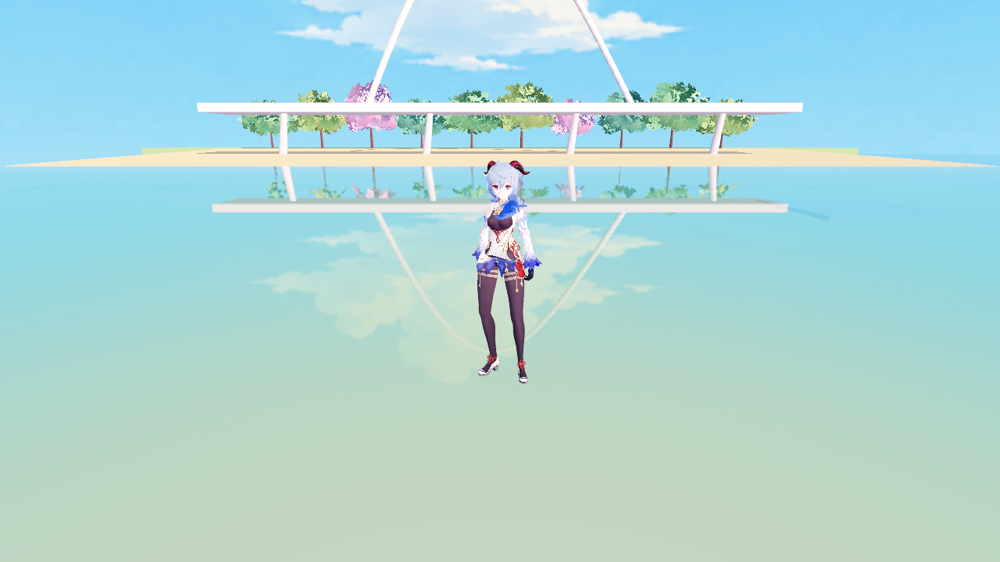
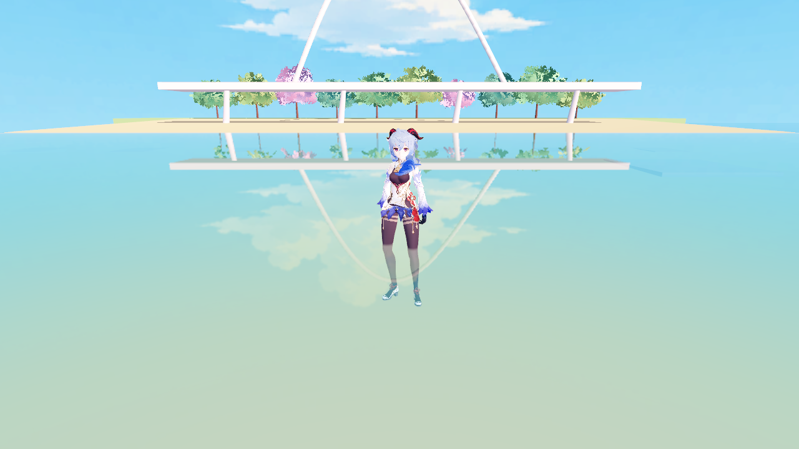
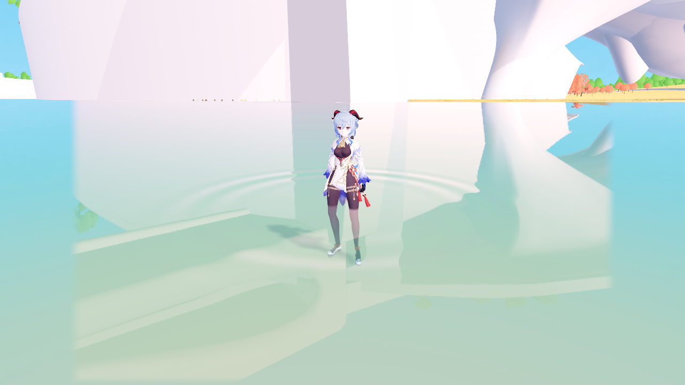
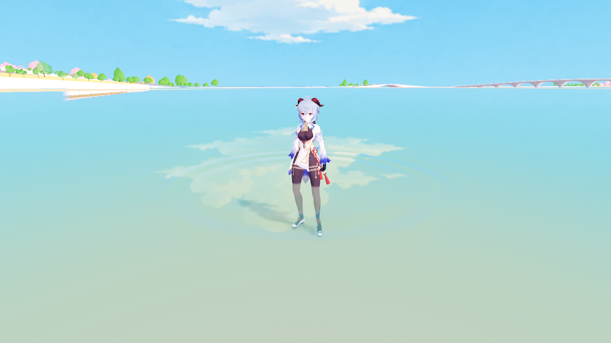

# 角色入水：第一阶段合成修复

2026-10-27。正式 F5 甘雨已接入修复：身体和衣物的水下部分受到现有水面吸收、散射和轻微折射影响；水上部分保留已确认的 MToon 光照。保持初始洞穴出生与简洁 HUD。

后续第二阶段已完成 [局部湿润与离水渐干](CHARACTER_WETNESS_1027.md)，当前正式依赖为 180 项。下文保留第一阶段采用记录与范围。

## 改动

源 VRM 的全部材质被声明为 BLEND，但实际贴图并非全部需要连续透明。按每个 surface 的 UV 覆盖范围审计原始贴图 Alpha 后，正式材质使用：

| 分类 | 部位 | 路径 |
| --- | --- | --- |
| 16 个完全不透明区域 | 面部、睫毛、眉眼、嘴、头发、角、裙摆和配饰等 | 原插件不透明 MToon |
| 2 个含二值镂空区域 | `服`、`肌` | 原插件 Cutout MToon，阈值保留原值 0.5 |
| 1 个连续透明区域 | `脸红` | 保留原透明深度预通道，原始 Alpha 范围 0～80/255 |

`scripts/characters/mtoon_materials.gd` 新增显式的甘雨 Alpha 策略与 `create_formal()`，正式 actor 的 `apply()` 使用该策略；未知 surface 保留源 Alpha 行为。`create()` 默认继续保留历史实验室 B 路径，供干燥外观和旧问题对照。该表只针对已审计的甘雨，不会自动转换其他模型或已导入的 ShaderMaterial。

所有 MToon 光照、主贴图、阴影色、UV、双面、明暗分区及其他美术参数保持原值，只有镂空部位启用原本对应的 Alpha 裁剪。没有修改插件代码、原 VRM、导入材质、网格、骨架、动作或碰撞；没有新增角色渲染 pass、正式 HUD 控件或实验入口。

不透明和镂空部分进入水面能够读取的颜色/深度路径，直接复用水体吸收和散射，不在角色端重复染蓝。所有可能选择的插件 shader 改为显式 preload，使导出依赖解析能收集它们；当前依赖清单 174 项、缺失 0 项。

## 验证

目标环境：Godot 4.7.2 Forward+、Windows D3D12、RTX 5070 Ti，实际截图 1280×720，4× MSAA。

- UV/Alpha 审计确认 16 个 surface 覆盖区域全部 Alpha=255；`服` 和 `肌` 的非二值像素仅占约 0.069% 和 0.502%，主要为边缘过渡；`脸红` 保留连续透明。
- 干燥脸部正面、75° 侧面、180° 背面，逐帧匹配旧 MToon 作比较；全图归一化平均 RGB 误差约 0.000013～0.000020。全身约 0.0000016。已人工查看贴图镂空、眼睛、睫毛、头发边缘与衣物。
- `照れ`（脸红）和 `まばたき`（眨眼）均实际触发并对比；分别有 117 和 1016 个像素相对中性状态响应，原有 60 个 blend shape 保留。
- 固定姿势下，先用无水/隐藏角色对照生成角色轮廓，再在水线以下采样，并排除角色地面阴影干扰。1750 个水下样本中，新路径 1685 个（96.3%）响应高吸收诊断水，旧路径 132 个（7.5%）；水上仅少量轮廓边缘受背景变化影响，未出现整块误染。
- 实际平静水色下，约 0.12m、0.34m、0.56m 三档根节点浸水深度已截图查看。原脚步涟漪事件仍进入水面，强风输入为 1 时水面 shader 风力仍为 0。
- 实际 202 件、10,350,912 三角形地图中，南北泻湖各选一处无遮挡的真实湖床位置，水位均为 0、角色根节点约 -0.60m；两处前后对照已人工查看。七件水面、查询层和角色实体碰撞保持原样。
- 正式启动、洞穴出生、道路步行/奔跑/跳跃/落地、人物与房车切换、相机返回、无实验资源和无材质 UI，由正式 MToon 验证脚本回归。
- 历史实验室模式切换、源材质恢复和实例隔离的逻辑回归通过。

原始证据：[Alpha 审计](water_character_1027/alpha_audit.json)、[独立场景报告](water_character_1027/render_report.json)、[实际地图报告](water_character_1027/world_report.json)、[正式入口报告](formal_mtoon_1026/world_report.json)。截图目录使用 `.gdignore`，不作为游戏素材导入。

| 修复前 | 修复后 |
| --- | --- |
|  |  |

| 南泻湖 | 北泻湖 |
| --- | --- |
|  |  |

## 范围

本阶段修复水体与人物的合成，没有加入额外湿润高光、离水湿痕/干燥、滴水、焦散、动态人物倒影或水下镜头效果。脸红仍为透明叠层，脸部整体浸没与水下摄像机不在当前涉水验收范围；后续需单独处理。

Cutout 使用原插件阈值路径，细小边缘仍可能随距离发生裁剪变化；当前近景检查和 4× MSAA 下未观察到明显退化。本轮没有宣称额外湿润效果已经完成，也未测量整场景的帧率提升。Windows EXE/PCK 本轮未重导出，改动在源工程 F5 生效。

## 复现

在项目根目录运行，Godot 路径按本机调整：

```powershell
$godotWaterCharacter = 'D:\Godot\Godot_v4.7.2-stable_win64.exe\Godot_v4.7.2-stable_win64_console.exe'
& $godotWaterCharacter --headless --path . --log-file .godot/water_alpha_export.log --script res://tools/export_character_npr_inputs.gd
python tools/audit_character_alpha.py
& $godotWaterCharacter --path . --log-file .godot/character_water_verify.log --script res://tools/verify_character_water.gd -- --water-verify
& $godotWaterCharacter --path . --log-file .godot/character_water_world.log --script res://tools/verify_character_water.gd -- --world --water-verify
& $godotWaterCharacter --path . --log-file .godot/character_water_formal_world.log --script res://tools/verify_formal_mtoon.gd -- --world --capture
```
