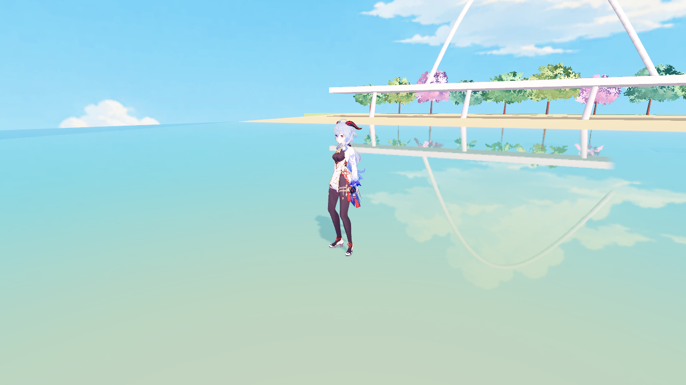
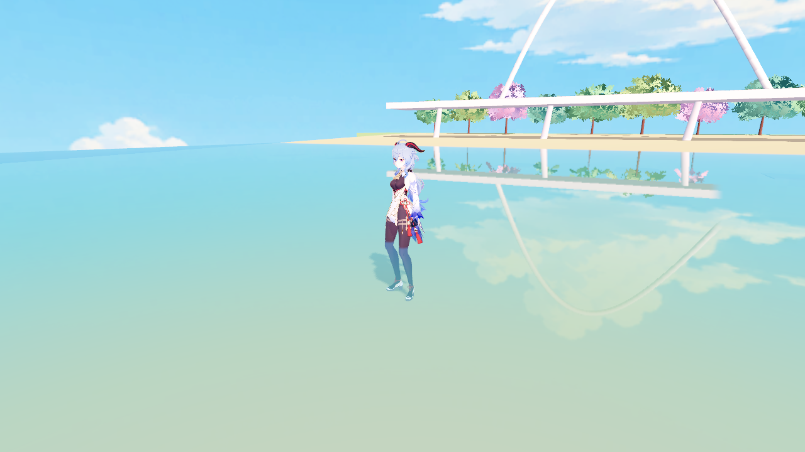
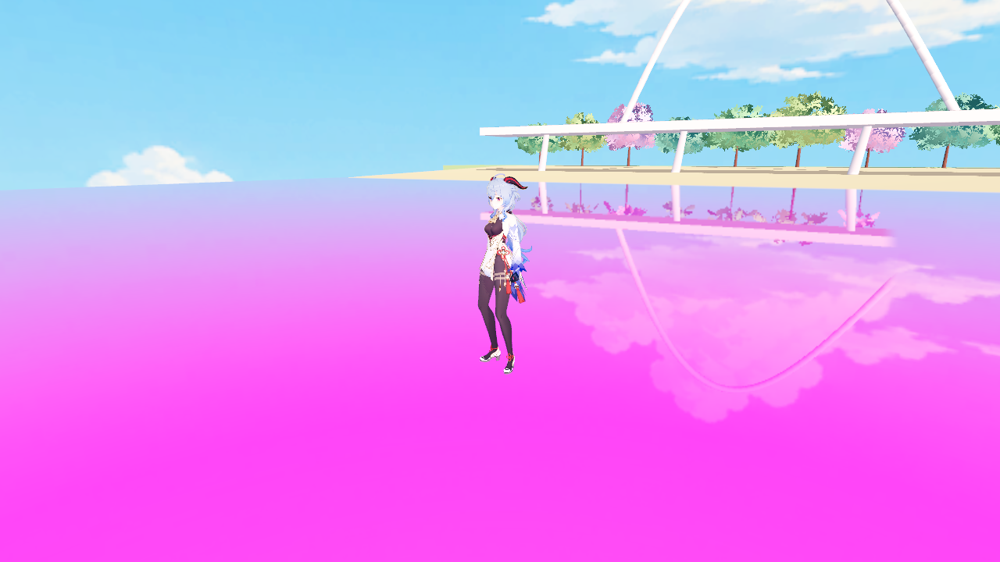
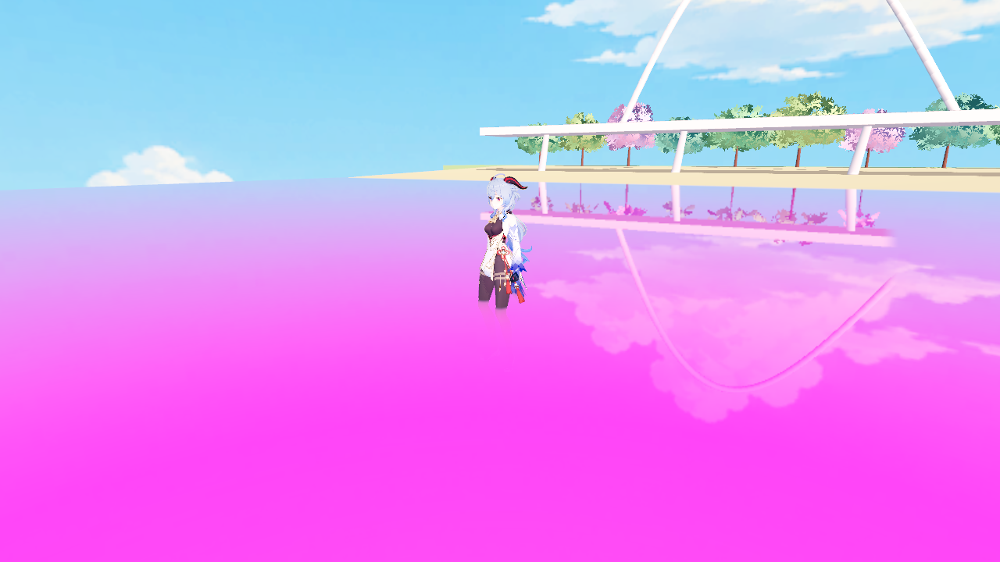

# 角色入水表现调研

日期：2026-10-27。范围：调研、项目检查与临时渲染诊断；尚未修改正式人物或水面着色器。

后续执行：第一阶段已接入正式 F5 人物材质，见 [角色与水体合成修复记录](CHARACTER_WATER_1027.md)。本文保留调研时点的分析与原始诊断截图。

## 结论

推荐保留已确认的 MToon 光照，优先修复角色被水面正确覆盖的问题，然后再加入局部湿润、水线和离水干燥。当前问题不只是缺少湿身参数：角色的透明渲染路径使现有水面吸收与散射没有正确作用到水下角色。

水中观感应分成两件事：水体遮在角色前方时的吸收、散射和折射；材质沾水后的外观改变。前者由水面合成负责，后者由角色材质负责，避免同一段水色衰减在两个着色器中重复计算。

## 项目检查与实际诊断

- 正式甘雨共 19 个 surface，目前全部使用 `mtoon_prepass_cull_off.gdshader`，定义 `ALPHA_BLEND`，写出 `ALPHA`，并使用 `depth_prepass_alpha`。
- `water_surface.gdshader` 读取屏幕颜色、屏幕深度，已经实现水下视线光程吸收、浅深水散射色、轻微折射和 Fresnel 反射。
- Godot 3D 屏幕颜色在不透明绘制之后、透明绘制之前复制，所以一般透明对象不会包含在其中。深度预通道不等于对象已进入不透明颜色纹理。[Godot 4.7 屏幕读取说明](https://docs.godotengine.org/en/4.7/tutorials/shaders/screen-reading_shaders.html)、[空间着色器渲染模式](https://docs.godotengine.org/en/4.7/tutorials/shaders/shader_reference/spatial_shader.html)。
- 角色控制器尚未提供水域 ID、水位、浸没程度或湿润状态。现有 `water_interaction.gd` 只负责落地/移动触发的短时涟漪，限制在角色脚部高度约 -0.90～0.07m；不适合直接作为完整的入水判定。
- 水体已有 UUID、配置、查询碰撞层 4；角色实体碰撞层为 32。正式地图现有水位为 Y=0，但接入时应从命中的水体取得水位，不把全世界 Y<0 都算成水中。
- 当前反射代理只注册地图和树木，没有动态角色。人物镜面倒影属于独立增强项，不是修复水下着色的前提。

诊断使用 Godot 4.7.2、Forward+、D3D12、RTX 5070 Ti，实际截图 1280×720、4× MSAA。在现有独立水面场景中固定姿势和镜头，角色脚部 Y=-0.56m：

1. 原正式 MToon 路径下，小腿和鞋子仍像在水面上方。
2. 临时把水色改为高吸收的洋红色，水面显著变化，角色水下部分仍未正确被覆盖。
3. 保持同一份 MToon 公共光照代码与材质参数，仅在内存中换成不写 ALPHA 的不透明变体，小腿立刻受到洋红水体遮盖。
4. 恢复真实水色后，小腿显示正常的青色衰减，水上部分保留 MToon 外观。

这支持“透明路径与水面合成不兼容”为当前独立场景的直接原因。诊断把所有材质临时改成不透明，只用于定位；尚未检查睫毛、脸红、头发边缘等透明细节，不能把这个粗略切换直接当成正式修复。实际大地图、多模型与多镜头仍需回归。

| 当前正式材质路径 | 临时不透明 MToon，恢复真实水色 |
| --- | --- |
|  |  |

| 原路径，高吸收洋红诊断水 | 不透明路径，相同诊断水 |
| --- | --- |
|  |  |

诊断仅修改临时运行实例，没有保存角色材质、VRM、骨架、动作、水色或插件变更。洋红色仅作覆盖验证，不是美术建议。

## 推荐的表现层次

| 层次 | 目标 | 建议方式 |
| --- | --- | --- |
| 水体覆盖，优先 | 水线以下受水色影响，越深越不清楚；水上外观保持一致 | 让实体部分进入水面可读取的不透明颜色/深度路径，复用现有水体吸收和散射 |
| 水线与接触 | 看得出水面在哪里穿过腿、裙摆 | 用动画后的位置与命中水位计算每像素浸没遮罩，配合已有脚步涟漪；必要时加很淡的窄接触带，避免粗白线 |
| 湿润材质 | 衣料轻微加深，皮肤变化克制；受光处有少量湿润反光 | 在 MToon 基础上加局部湿润响应，各类材质有不同强度 |
| 离水干燥 | 上岸后湿润短暂保留、逐渐恢复 | 独立记录角色湿润状态，避免只用当前水位导致出水瞬间全干 |
| 可选装饰 | 水下缓慢焦散、少量滴水/溅水 | 最后根据画面需要加入，限制强度和出现条件 |

湿润粗糙、多孔或吸水材质通常显得更暗、镜面反射更明显，但光滑材质未必有同样程度的变化，因此不适合把全身统一压暗或做成塑料高光。[Sébastien Lagarde：Physically Based Wet Surfaces](https://seblagarde.wordpress.com/2013/03/19/water-drop-3a-physically-based-wet-surfaces/)。这是参考物理现象后的风格化取舍，具体强度仍需在当前场景验收。

本项目 MToon 公共代码固定 `ROUGHNESS=1`、`SPECULAR=0`，并使用自定义 `light()`。单独降低 roughness 不能保证得到预期湿润高光，需要检查实际光照计算，在保留原明暗分区的基础上接入受控的湿润反光，同时处理自发光、边缘光，避免水下仍有不受控制的发亮部分。

焦散是水面折射聚光形成的明暗图样，可用简化投影制作，但应在覆盖正确后再做。[NVIDIA GPU Gems：Rendering Water Caustics](https://developer.nvidia.com/gpugems/gpugems/part-i-natural-effects/chapter-2-rendering-water-caustics)。它不是修复透明合成的替代方案。

## 实施顺序

### 第一阶段：修复角色与水体的合成

1. 按 surface 审计实际贴图 Alpha 用途，而不是直接继承“19 个材质全透明”的设置。实体皮肤、衣物优先用不透明 MToon；二值镂空用经验证的裁剪路径；确实需要连续半透明的部件单独保留。
2. 保留原 MToon 主贴图、色彩、明暗、UV、双面与阴影行为，只针对合成所需的渲染路径调整。必须检查裁剪阈值、MSAA 边缘、睫毛/眉毛/裙摆/脸红，避免解决水面后破坏面部。
3. 复用现有水面吸收/散射，不再给实体水下部分额外叠加同样的蓝色过滤。确实保留透明的部分，若仍受排序限制，再决定局部水下合成近似或专用渲染路径。
4. 单改 Render Priority 只能影响透明绘制顺序，不能补回缺失的角色屏幕颜色，所以不作为唯一修复手段。Godot 的透明排序按对象位置进行，也有相交排序局限。[Godot 4.7 渲染限制](https://docs.godotengine.org/en/4.7/tutorials/3d/3d_rendering_limitations.html)。

这一阶段通常已能解决“人物像站在水上”的主要视觉问题，不依赖新贴图或另一套人物光照。

### 第二阶段：水域状态和局部湿润

1. 单独建立角色水域状态：水域 ID、水面高度、水体配置、脚部浸没程度、入水/离水与传送事件。静止、跳跃和下沉时都要更新，不能依赖步行涟漪是否触发。
2. 查询真实水域覆盖，必要时以角色多个位置采样岸边。仅测试角色根节点 XZ 是首版近似，裙摆、手臂跨岸时可能需要额外采样。
3. 在角色每像素位置上计算与水面的关系，不能把整个材质或整条腿一口气染色。世界位置必须来自正确的蒙皮/变形后路径；当前 MToon 使用 `skip_vertex_transform` 并手动写入观察空间位置，不能直接把重写后的 VERTEX 当作模型空间再乘 MODEL_MATRIX。
4. 优先用项目内的 MToon 扩展维护接入点，保留供应商原文件。关闭水效果时，应与原认可画面一致；多角色使用各自状态，避免共享材质串色。
5. 如需离水保留湿痕，首版可使用局部高度范围与干燥计时的近似。精确记录摆动手臂、裙摆每个位置的湿润历史需要更细的蒙皮/UV 遮罩状态，单个全身 wetness 浮点值做不到。

建议先完成局部湿润、接触水线和基本离水恢复，再评估溅水、滴水。初版不增加正式 HUD 设置或实验入口。

### 第三阶段：多模型与装饰增强

刻晴、胡桃、花火的源 VRM 已包含 MToon 声明，但材质 Alpha 用途和实际 Godot 渲染路径还需逐一审计。共用水域状态接口与湿润逻辑，每个角色保留自己的材质映射与强度，不能照搬甘雨的材质名称规则。

若确实存在大量无法转换的半透明衣物，再评估专用角色颜色/深度缓冲；它增加渲染通道、动画同步和边缘合成复杂度，当前不优先采用。焦散、动态人物倒影和摄像机进入水下的全屏效果都独立评估，不混进第一阶段。

## 验收建议

- 干燥陆地：人物颜色与已认可 MToon 基线一致；脸、眼、睫毛和透明边缘无退化。
- 脚踝、膝盖、较深浸没：水线跟随姿势，水下渐变自然，水上不误染；裙摆跨水线也正确。
- 静止、步行、奔跑、跳跃、进出水、岸边和桥上：湿润判定与涟漪各自正确，桥上不误判。
- 房车切换、角色隐藏、复位、传送：没有遗留水线或错误湿润状态。
- 多角色：状态不串用；不同水体的颜色与吸收参数正确。
- 第三人称、自由镜头、远近距离：无透明排序跳变、白边或水色重复衰减。
- 保持已关闭的大风水面增强效果；复用现有平静波动、脚步涟漪、透底与镜像。
- 第一阶段实测性能及材质绘制变化；后续额外 pass 或焦散不能只凭推测宣称开销可忽略。

本轮尚未运行上述完整验收，也没有把临时不透明诊断应用到 F5 正式入口。
