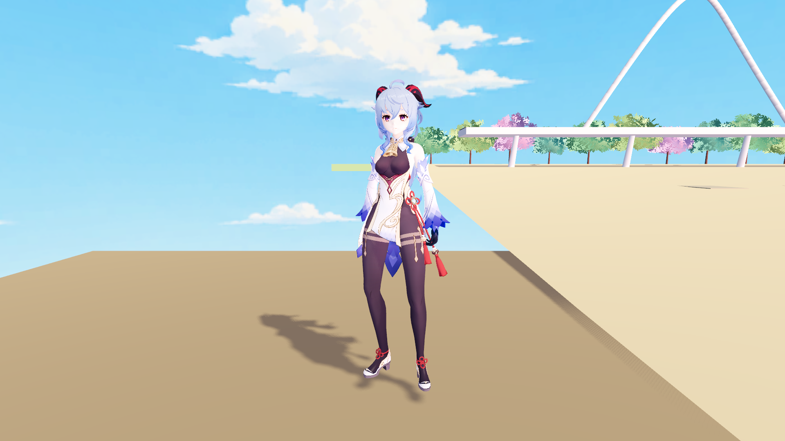
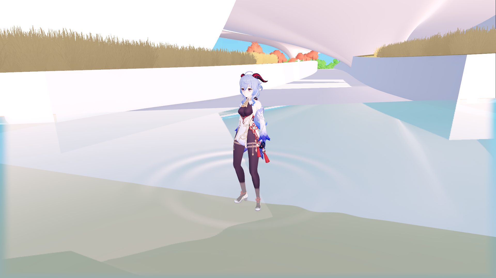
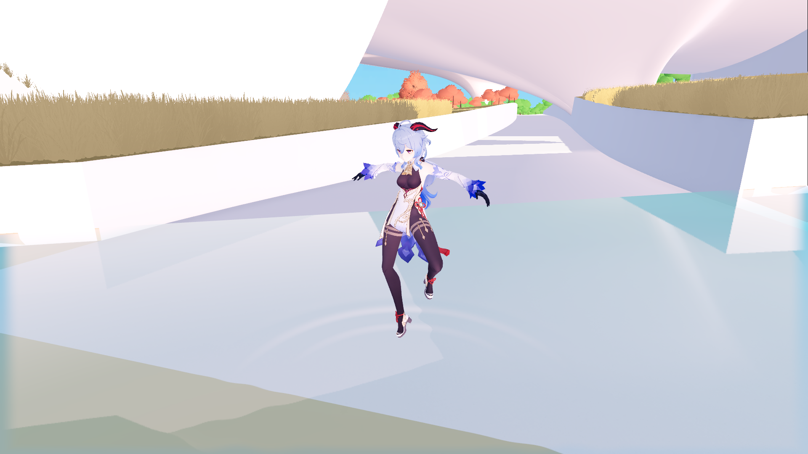

# 人物局部湿润与离水渐干

2026-10-27。第二阶段已接入正式 F5 甘雨：实际沾水的高度范围逐渐变湿，出水后保留局部变暗与克制的湿润反光，约 14 秒恢复干燥。水下颜色覆盖继续由现有水面负责，没有重复给人物叠加水色。

## 正式表现

- 在水中静止也会变湿，不依赖移动或脚步涟漪。
- 约 0.25 秒达到当前浸水范围的湿润程度；浅水只刷新低处，曾浸湿的较高部位仍按自己的进度干燥。
- 24 个高度样本记录湿润历史，范围为角色根节点相对高度 -0.15～2.15m，约 10cm 一档；片元之间平滑插值。
- 皮肤、衣料、头发、面部和配饰使用不同的变暗/高光强度。水膜反光只出现在水面以上，受到实际灯光与阴影衰减控制，不在水下自发光。
- 眼睛、睫毛、眉毛、嘴与脸红叠层保留第一阶段原材质路径；10 个实体/镂空部位接入湿润扩展。19 个材质的基础色、明暗分区、透明用途及双面设置继续保留。
- 跳出水面不会瞬间全干。房车切换隐藏人物时仍继续计时，游戏暂停则停止；超过 6m 的单步位置跳变与显式复位清除旧湿润，防止传送残留。
- F5 仍从初始洞穴启动，无新增正式 UI、实验室入口或快捷键。水面大风增强效果继续关闭。

## 接入方式

`scripts/characters/character_wetness.gd` 是每个人物独立的状态节点。通过现有查询层 4，在角色中心与四个周边位置查询真实水面，15Hz 更新水位和覆盖信息；湿润与干燥按物理帧 delta 推进。没有命中水域时，即使世界 Y 小于零也不会变湿；桥面角色高于水面时也不会被水域平面误染。

`world_character_controller.gd` 仅在正式启用 MToon 时绑定该节点。湿润材质均为每个人物独立实例，不修改共享 VRM 资源。状态节点显式遵守游戏暂停，且不随人物隐藏停止干燥。

`mtoon_materials.gd` 保留历史 `create()`，只在正式 `create_formal()` 的已审计部位使用项目内湿润变体。插件本身不作修改。

`tools/build_wet_mtoon.py` 从已安装的 MIT MToon 公共代码生成 `shaders/characters/wet_mtoon_common.gdshaderinc`，保留原许可。生成器只在明确的四处加入世界高度、漫反射湿润、自发光衰减和灯光高光，其他基础光照沿用原代码；源文件 SHA256 写在生成文件头。上游代码改变导致锚点不匹配时会报错，`--check` 可以验证生成文件与当前源一致。

没有增加网格壳、额外人物 pass、湿润贴图或新纹理采样。四个薄包装覆盖不透明/镂空和单面/双面组合。正式导出依赖为 180 项、缺失 0 项；Windows EXE/PCK 本轮未重导出，源工程 F5 直接生效。

## 验证

逻辑与实际画面使用 Godot 4.7.2 Forward+、Windows D3D12、RTX 5070 Ti。

- 干燥状态：用第一阶段相同 Alpha 路径的原插件 MToon 作对照，1920×1080 匹配截图的变化像素为 0、平均误差为 0。
- 湿润画面：独立验证台中，通过真实查询完成入水，再跨越水域边界出水。沾湿/干燥对照有 21766 个像素发生可见变化；关闭湿润高光后有 433 个像素变化，确认效果实际参与渲染。
- 离水 7 秒：画面介于刚出水与干燥之间；约 14 秒回到重置后的干燥画面，误差在检查容限内。
- 桥上、陆地、负 Y 的无水区不误触发；静止入水、深浅水历史、跳出水面、传送、复位、双角色材质/状态隔离检查通过。
- 隐藏人物后的干燥与游戏暂停经过真实物理帧检查，不只检查参数值。
- 正式 1021 地图中，洞穴出生为干燥状态；在南泻湖静止浸水会沾湿；实际触发跳跃离开水面后，湿润历史仍保留，再逐渐干燥和复位。水体数量、层与大风关闭状态保留。
- 第一阶段人物水体覆盖、干燥面部/全身、眨眼/脸红回归通过；正式移动/跳跃、人物与房车切换、简洁 HUD 与历史实验室逻辑回归通过。

证据：[逻辑](character_wetness_1027/logic_report.json)、[画面](character_wetness_1027/render_report.json)、[正式地图](character_wetness_1027/world_report.json)、[性能](character_wetness_1027/performance_report.json)。截图目录有 `.gdignore`，不作为游戏纹理导入。

| 刚出水 | 离水约 7 秒 | 完全干燥 |
| --- | --- | --- |
|  |  |  |

上表为独立验证台：支撑平台仅用于验证截图，没有加入正式地图。

| 正式地图静止泡水 | 实际跳出水面后 |
| --- | --- |
|  |  |

## 性能与范围

单人物、1920×1080、4× MSAA、关闭水面与镜像、固定姿势与机位，关闭帧率限制，每种路径预热 60 帧、采样 120 帧：原插件、干燥扩展、全身湿润扩展的主视口 GPU 平均计时均约 0.422ms，绘制调用均为 129；这次测量没有分辨出稳定的 GPU 差异，不应把细小数值差别当成确定的性能提升。

600 次状态更新的平均 CPU 时间约 10µs，P95 为 17µs，包含 15Hz×5 射线查询与 10 个响应材质的参数同步。这是当前机器的单人物独立场景测试，不代表完整地图或大量 NPC 的整帧成本。

当前湿润历史是相对角色根节点的高度近似，会跟随身体移动，但没有逐顶点/UV 记录每次接触。手臂和裙摆大幅摆动时，湿痕会随当前高度重新分配；岸边覆盖也只在角色周边取样，未精确裁剪每个衣物片元的水域边界。它适合当前直立涉水，尚非精确布料浸润模拟。其他角色接入时需核对身高范围、材质响应与 Alpha 路径。

本阶段没有加入滴水、溅水、焦散、动态人物倒影、游泳或摄像机水下效果。未来若需要精确保留手臂/裙摆湿痕，再升级为更细的蒙皮或 UV 遮罩历史。

## 复现

在项目根目录运行：

```powershell
python tools/build_wet_mtoon.py --check
$godotWetness = 'D:\Godot\Godot_v4.7.2-stable_win64.exe\Godot_v4.7.2-stable_win64_console.exe'
& $godotWetness --headless --path . --log-file .godot/wetness_logic.log --script res://tools/verify_character_wetness.gd -- --water-verify
& $godotWetness --path . --log-file .godot/wetness_render.log --script res://tools/verify_character_wetness.gd -- --capture --water-verify
& $godotWetness --path . --log-file .godot/wetness_world.log --script res://tools/verify_character_wetness.gd -- --world --capture --water-verify
& $godotWetness --path . --log-file .godot/wetness_performance.log --script res://tools/verify_character_wetness.gd -- --performance --water-verify
```
