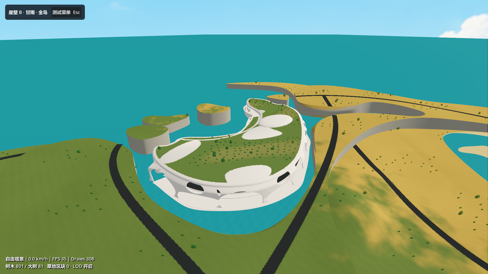
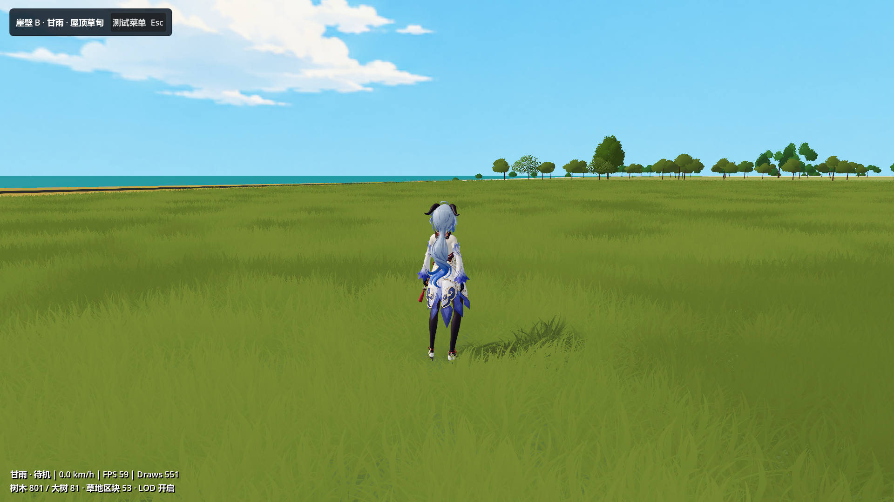
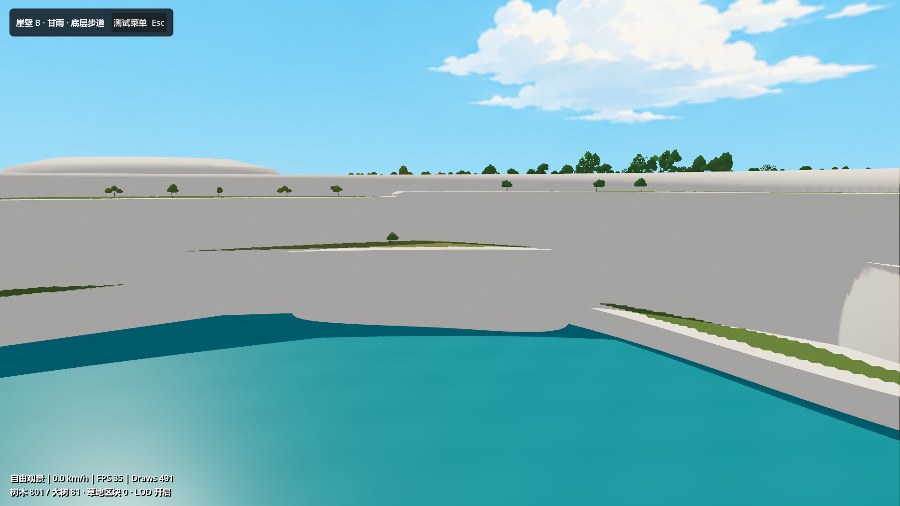

# 崖壁 B 暖白建筑与种植测试

日期：2026-10-14。主入口 `scenes/main.tscn` 现指向 `scenes/cliff_b_gameplay_test.tscn`。这是可体验的材质和种植验证稿；原 `map_1012_drive_test.tscn` 继续保留，可独立运行。

## 打开与操作

在 Godot 停止旧运行后按 F5，默认进入 B 单体的自由全景。按 F 返回屋顶角色，WASD 移动、Shift 奔跑、空格跳跃，右键拖动旋转镜头、滚轮缩放。C 在当前楼层切换房车和角色，R 复位。

| 按键 | 功能 |
| --- | --- |
| 1 | 道路廊道；可按 C 切换房车驾驶 |
| 2 | 底层步道 |
| 3 | 实体侧错层台地 |
| 4 | 屋顶草甸 |
| Tab | B 单体全景 |
| F | 自由观景 / 返回当前控制对象 |
| P | 用较亮绿色显示种植地表范围，再按恢复 |
| V / L | 植被显示 / 树木 LOD 比较 |
| Esc | 原有测试菜单，包含控制、地点、画面和植被 |

从自由观景回到角色后，草地围绕角色逐块加载。自由相机继续使用 WASD、Q/E，Shift 加速。

2026-10-14 修正地点菜单跳转：菜单暂停场景时，碰撞体也暂时停用，旧回调在恢复场景前采样落点，导致跳转失败。现在先关闭菜单并恢复场景，再等待物理帧查询落点。菜单打开时可直接按 1–4 跳转，关闭菜单后的数字键和小键盘 1–4 也可用。修改后先 F8 停止旧运行，再 F5 重启。

`tools/verify_location_navigation.gd` 在 B 场景与原 1012 场景共验证 32 项：实际鼠标点击、正常数字键、菜单中的数字键和小键盘，并检查控制对象及自由相机位置。失败项为空，报告见 `docs/LOCATION_NAVIGATION_TEST_REPORT.json`。原测试菜单的暂停与画面设置回归检查也通过。

## 材质与模型

- 几何从当时打开的 `map/map.3dm` 读取可见的最新版 B 及周边地形，共 66 个几何对象；米制、1:1，仅平移到局部坐标。未改写原 Rhino 文档，也未覆盖先前建模副本。
- `assets/world/cliff_b_test/architecture.tres` 使用暖白人工建筑表面基础色、微法线和粗糙度纹理，以世界坐标三平面投射避免 NURBS 导出模型缺少 UV 的拉伸。细节强度、暖白颜色、法线强度和物理尺度可独立调整。
- 测试场景保留现有可见天空，采用偏中性的环境色及温和暖白日光，避免原落日 HDRI 让白表面偏粉紫。原 1012 场景的照明保持原设置。
- 导入网格关闭自动 LOD 与顶点压缩，保留 CAD 网格精度；原角色、房车及植被资产继续复用。
- 处理后的游戏模型为 `assets/world/cliff_b_test/cliff_b_world.glb`，材质由测试场景赋给各类网格。完整可编辑材质、种植地表和植被实例在 `assets/world/cliff_b_test/source/cliff_b_material_planting.blend`。
- Rhino 副本为 `D:/Prism Route/map/map_cliffB_material_planting_v01.3dm`。其中 `B_种植区域_v01` 为实际种植网格，`B_树位_v01_辅助标记` 为 208 个树冠范围圆；CAD 提供暖白 / 绿色颜色预览，完整 PBR 纹理在 Godot 与 Blender 材质中。

处理后的 CAD 文件也归档在仓库 `assets/world/cliff_b_test/source/cliff_b_material_planting.3dm`。此前风格概念图、白模输入与提示词在 `docs/concepts/cliff_b_material_vegetation_2026-10-13/`；概念图使用的是较早暖白垩方向，实际游戏材质按后续反馈改为人工建筑表面。

## 种植规则

两组种植地表分别贴合屋盖与实体側台地上实际露出的向上表面。对边缘、遮盖、陡面和同层道路进行筛选。种植带从候选顶面边界退让约 6 米，以保留裸露的建筑边缘；较窄的尖端和接头不强行种植。屋顶约 127,744 平方米、台地约 13,701 平方米。

当前 B 内有 208 棵树和 32 株灌木，周边放置 593 棵用于读尺度的稀疏背景树。树群使用已有三档 LOD。屋顶草为原草模型派生出的约 0.4–0.5 米短草，原草资产没有覆盖。

种植地表是比建筑表面高 0.06 米的测试草皮；不是最终覆土构造。网格按 2 米采样，近处区域轮廓仍有格点折线，后续可手工编辑边界。立面不自动长草；草地射线只查询种植层，并按当前控制对象所在高度取样。跨楼层时清除旧草地区块，避免底层视点采样到顶部屋盖。种植范围以当前暴露顶面为准，尚未完成全部平台之间的步行连接设计。

## 已完成检查

Godot 4.7.2 / Forward+ / D3D12 / RTX 5070 Ti 实际渲染通过，最终报告失败项为空：

- 道路、底层、台地、屋顶四个定位点均落地，未被传送到上方楼层。
- 角色在屋顶自动行走约 2.33 米后仍接地，草地能正常加载。
- 廊道房车短距离自动行驶约 4.32 米后仍接地。
- 全部 801 个树根检查到匹配碰撞面，最大高度差约 0.116 毫米。
- 下层台地草地射线命中正确高度，没有采样屋盖。
- 原 1012 场景启动检查通过，仍加载其 20,000 棵树。

本次检查覆盖局部体验和资源接入，不代表全部路线、几何搭接、曲面连续、最终碰撞拓扑或目标设备性能验收。白模尖端、内部搭接面与部分过渡仍待建模深化。实机截图中的即时 FPS 不是性能基准。

报告为 `docs/CLIFF_B_GAMEPLAY_TEST_REPORT.json`。截图保存在 `screenshots/cliff_b_20261014/`：

## 重建

1. Rhino 中以 UTF-8 加载并运行 `tools/export_cliff_b_gameplay.py` 的 `run()`，从当前文档读取可见几何并保存只读来源快照。
2. 普通 Python 执行 `tools/build_architecture_maps.py`，创建周期微法线与粗糙度；基础色图片单独保留，不被重建脚本覆盖。
3. Blender 后台执行 `tools/build_cliff_b_gameplay.py`，输出 GLB、Blender 源文件、种植布局与元数据。
4. 普通 Python 执行 `tools/build_cliff_b_projection.py`，Godot 执行 `tools/import_cliff_b_projection.gd`，重新烘焙同一份几何的道路显示投影。
5. 执行 `tools/create_cliff_b_scene.py` 组装测试场景，然后 Godot `--editor --import` 导入。
6. Godot `--script res://tools/verify_cliff_b_gameplay.gd` 验证；添加 `-- --capture-cliff-b` 且不使用 `--headless` 时输出实机截图。
7. 如需同步 CAD 种植副本，在 Rhino 中执行 `tools/export_cliff_b_native_planting.py` 的 `run()`。

重新导出源模型后必须连同种植、碰撞与道路投影一起重建。来源哈希和构建参数保存在 `assets/world/cliff_b_test/build_metadata.json`。
