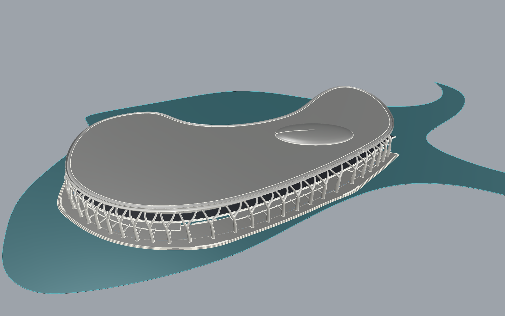

# 崖壁 B 参数化验证模型 v01

2026-10-13：完成道路侧约 981.65 米的完整体量验证。Rhino 新图层为 `崖壁B_参数化验证_v01`，下设 13 个分组图层。原草稿几何保留，只隐藏被替换的部分；无道路侧保留实体体量。

后续复查发现 v01 屋盖接缝边线存在三处自交；下文的有效性与闭合检查未覆盖该问题。该版本保留作对照，屋盖修复与取消管柱基底的连续墙壳方案见 [v02](CLIFF_B_SHELL_V02.md)。



## 文件与视角

- 工作副本：`D:\Prism Route\map\map_cliffB_parametric_v01.3dm`。
- 原模型备份：`D:\Prism Route\map\map_before_cliffB_parametric_v01.3dm`。
- 仓库归档：[原生 Rhino 模型](../assets/world/cliff_b_parametric_source/cliff_b_parametric_v01.3dm)，配套 `generation_state.json` 保存生成对象标识。
- [参数配置](../tools/rhino_cliff_b_parametric.json)、[生成脚本](../tools/rhino_cliff_b_parametric.py)、[检查报告](CLIFF_B_PARAMETRIC_MODEL_REPORT.json)。

模型内保存四个命名视图：`B验证_01_整体道路侧`、`B验证_02_中层道路`、`B验证_03_峡谷底层`、`B验证_04_屋面收边`。对应截图为 [整体](cliff_b_parametric_v01/overview.png)、[道路](cliff_b_parametric_v01/road.png)、[峡谷](cliff_b_parametric_v01/canyon.png)、[屋面](cliff_b_parametric_v01/roof.png)。峡谷截图采用临水侧抬高视点。

## 本轮设计

30 组分叉主肋支承连续厚屋盖，中层道路后侧的实体核心退让，外侧增加步行带与护墙。底层布置连续平台、两级亲水缓阶、四段廊檐和三个带坐凳的停留节点。顶部增加低矮圆滑建筑体量，并用多截面放样形成屋盖的圆滑收边。

屋盖名义厚度参数为 6 米；放样存在起伏，网格采样的全局竖向范围约 7.10 米，不能当作处处等厚的 6 米板。浅水示意沿原峡谷底面生成，暂设水位 0.18 米，后续随水深设计调整。

共生成 136 个对象，其中 133 个为闭合实体，另有一张水面和两条隐藏引导线。构件分别保留为 NURBS 实体，便于调整疏密、支承跨度、核心退让、平台宽度和屋面比例。尺寸以 60 米体量高度为比例基准，主肋沿整条道路安排，并在停留节点附近变化。

## 验证与下一轮

几何有效性、133 个实体的朝外法线均通过；9 个原始对象与备份几何一致。对道路上方 0.10–5.20 米范围的净空体，进行了 61 项核心及上分叉网格相交检查，结果为零相交。检查采用 0.08 米网格容差，并非车辆实机测试。

本轮用于体量、道路开敞和底层空间比例验证，尚未替换 Godot 场景。分叉构件接头目前分别封口并交叠，下一轮需做连续接头、局部光庭、入口、上下层交通和底层人行尺度细化。白垩三平面纹理、水体渲染与游戏碰撞留待导入阶段。

## 参数重建

脚本在 Rhino 的 IronPython 2.7 环境运行。先以 UTF-8 读取源码并编译执行；不要用会误解码中文名称的 `runpy.run_path`。按阶段调用 `run(stage)`，每阶段独立提交 Rhino 撤销记录：

```python
import io
path = r'D:\Prism Route\prism-route\tools\rhino_cliff_b_parametric.py'
ns = {'__file__': path, '__name__': 'cliff_b_recipe'}
exec(compile('\n'.join(io.open(path, encoding='utf-8').read().splitlines()[1:]), path, 'exec'), ns)
```

当前工作状态保存在被 Git 忽略的 `.map_1012_build/cliff_b_parametric_state.json`。修改参数后，先在匹配的模型中调用 `ns['reset_generated']()`，再依次执行 `foundation`、`ribs_0` 至 `ribs_3`、`ground`、`rooftop`、`audit_0` 至 `audit_3`、`finish`、`preview`。重置只识别并移除带本生成脚本标记的对象，恢复原稿可见性。

从仓库归档重新开始时，应先打开配套 `.3dm`，将其 `generation_state.json` 复制到上述工作状态路径，然后调用重置再重建。状态中的文档运行序号不能跨 Rhino 会话沿用，不能直接续跑已完成的阶段。一次执行一个阶段，避免长时间阻塞界面。
