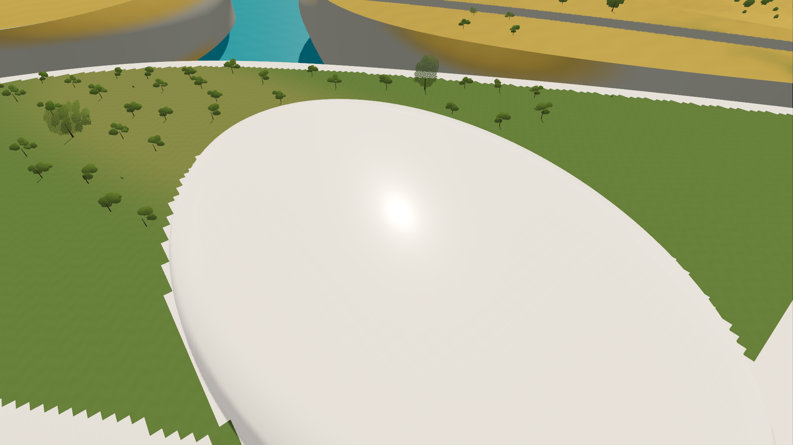
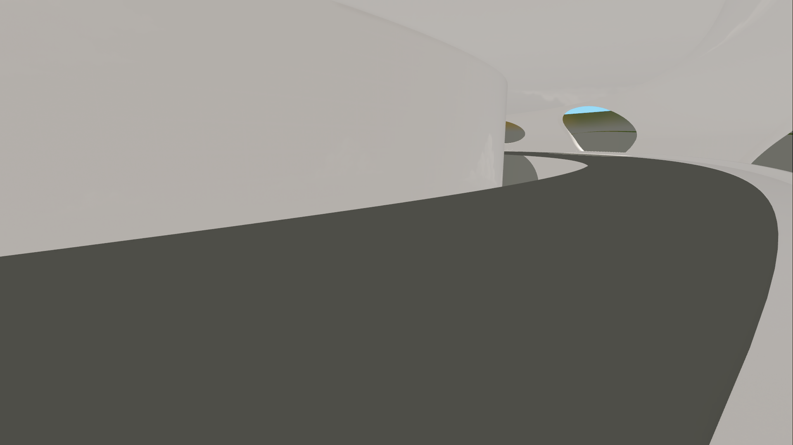
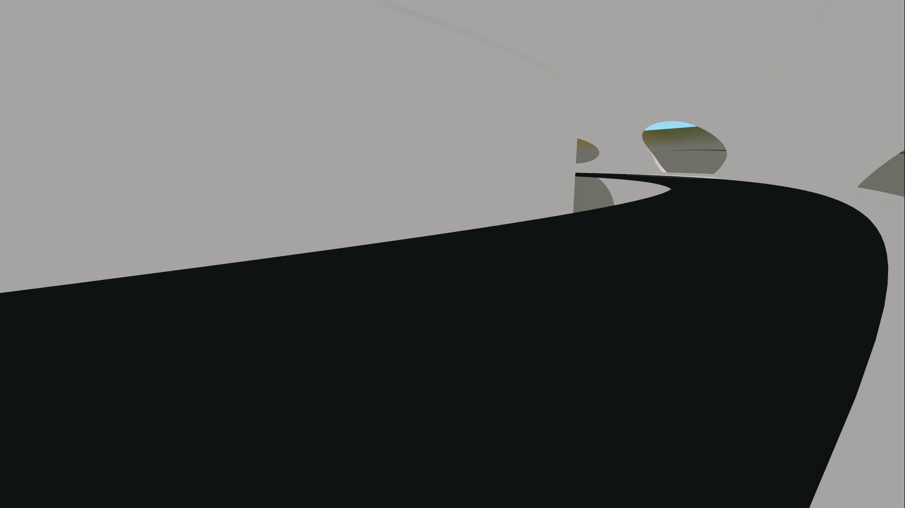

# Cliff B 暖白建筑光照验证（issue #12）

2026-10-14；基线提交 `5f3dfbaa01fdaf0bf98d85efd41a09d8044fc35e`。本次修改游戏实时材质，未修改 CAD、GLB、碰撞、种植布局或角色/植被 shader。当前默认使用新效果，按 **M** 或 Esc → 画面 →「建筑」切回原版；再次操作恢复。停止旧运行 F8 后 F5 重启。

## 已接入的效果

- 新 `architecture_toon.tres` / `.gdshader` 保留暖白底色、1.6 米世界空间三平面纹理及微法线。表面为有柔和高光的人工涂层，非岩石、白垩或金属镜面。
- 粗糙度由原纹理约 0.67–0.79 映射到约 0.28–0.32，介质镜面系数 0.5；薄涂层强度 0.30、粗糙度 0.18。微法线强度由 0.14 降至 0.07，避免细噪声打碎大曲面高光。
- 自定义 `light()` 同时实现暖灰阴影 ramp 和显式 GGX 镜面。阴影填充 0.18、直射增益 0.72、过渡 -0.15～0.45；真实 shadow map 的遮挡仍控制直射和镜面。填充是有意的非物理美术补光，不是真实 GI。
- 只为选定主太阳提供阴影填充；新增方向灯、点光源使用正常衰减，不重复添加填充。双方向灯 + 点光源的实机截图已生成。
- 建筑通过 `RADIANCE` 单独采样已接受的天空 PNG，按粗糙度选 mip，并中和 85% 的蓝色，反射能量 0.45。该近似提供天空反光，不反射附近角色/构筑物；没有启用 SSR、全图 GI 或全局天空反射。环境漫反射、可见天空、太阳方向与曝光维持基线。
- 道路采用 `(0.42, 0.43, 0.42)` 深灰；主太阳阴影填充 0.55。B 专用道路 mesh 与 terrain 投影共享 `road_lighting.gdshaderinc`，贴地道路仍只绘制一次。地形非道路区域使用 Burley/GGX 响应，未改原 1012 shader。

材料参数均可编辑；原 `architecture.tres` / `.gdshader` 是可回退的物理基线。`stylized_architecture=false` 可在运行前直接进入原版。M 切换完整建筑/道路效果；角色、树木、草地、水面与天空配置保持一致。旧 Blender/CAD 副本仍是先前材质预览，本次 NPR 光照实现以 Godot 实机为准。

## 固定机位定位结果

GPU 实机：Godot 4.7.2 / Forward+ / D3D12 / RTX 5070 Ti；1920×1080、4×MSAA、TAA 关闭、ACES 曝光 0.82。同机位固定角色与相机；落点和草地区块加载后冻结 simulation/TIME，避免风、水面和动作造成比较差异。**下表是截图指定矩形区域的平均 sRGB 显示值（0–255），不是物理光照强度或整图平均。** 区域坐标与逐项数值在像素报告中。

| 对照 | 廊道白墙 RGB | 廊道路面 RGB | 底层顶盖 RGB |
| --- | --- | --- | --- |
| 原版 | 165 / 164 / 162 | 15 / 18 / 19 | 165 / 164 / 162 |
| 仅关闭 SSAO | 165 / 164 / 162 | 15 / 18 / 19 | 165 / 164 / 162 |
| 仅环境光 0.60 | 200 / 200 / 198 | 25 / 29 / 31 | 200 / 200 / 198 |
| 仅道路改为 0.34 / 0.35 / 0.34 | 165 / 164 / 162 | 34 / 37 / 36 | 165 / 164 / 162 |
| 仅关闭太阳投影 | 165 / 164 / 162 | 39 / 42 / 40 | 167 / 166 / 164 |
| 新默认 | 179 / 175 / 170 | 78 / 78 / 72 | 183 / 180 / 176 |

结论：选取的大面积白墙主要缺少可控的暖色背光响应；提高全局 ambient 会把受光面一并抬亮。路面则同时受深基色和真实遮挡影响，仅提 ambient 或取消 SSAO 仍很黑。SSAO 对所测大区域影响很小，不是整个廊道黑的主因；局部接缝仍保留 SSAO。不会用此结论排除其他未采样位置的几何问题。

完整矩阵包含 SSAO 半强度、环境光 0.50 / 0.60、天空 ambient、无纹理双面白材质、关投影、暖/中性/冷阴影、宽过渡及建筑单独修改。没有选择全局环境增亮或冷阴影作为默认。

## 高光、结构与回归

实际屋顶构件、相同机位与漫反射设置下，打开/关闭 gloss：屋面 ROI 最大 RGB 增量 **38/255**，有 **27,235 像素**增量超过 8；远处背景最大变化 **0**。转动镜头可见高光位置变化，证明镜面项确实参与实机，而非只设置材质参数。高光截图未做后期修饰。

22 组建筑网格扫描：无非有限顶点、零面积三角形、或平均顶点法线反向于面绕序的三角形。双面固定白材质对照未出现整体剔除缺失。此检查不证明曲面连续、没有重叠面、没有自交或结构设计合格；尖端搭接、格点种植边缘与过大的平面仍是白模深化问题。

截图覆盖廊道、底层、台地、全景、反向低太阳、相机旋转、额外光源以及实际屋面高光。真实接触与投影保留；建筑阴影采用浅暖灰，道路更深但可读。按按钮回退材质、按 M 恢复、22 组材质绑定验证通过。地点跳转回归在 B 和旧 1012 共 32 项，失败 0；局部行走/驾驶、801 个树根及下层草地高度检查继续通过。

## 性能的实际范围

固定台地机位，801 棵树布局、81 棵大树，299 draw calls；冻结 simulation/TIME，禁用帧率上限与 VSync，120 帧预热，随后每轮 1,200 个帧间隔。A/B/A/B 顺序：

| 轮次 | 平均帧时间 ms | 平均 FPS | 1% low FPS | viewport GPU ms |
| --- | --- | --- | --- | --- |
| 原版 A1 | 0.840 | 1190 | 568 | 0.589 |
| 新效果 B1 | 0.854 | 1171 | 518 | 0.613 |
| 原版 A2 | 0.849 | 1178 | 500 | 0.590 |
| 新效果 B2 | 0.847 | 1180 | 577 | 0.613 |

该静态机位 viewport GPU 均值增加约 **0.024 ms（4%）**；帧间隔和 1% low 含桌面调度波动。它是材质固定机位对照，**不是有动作、近景密集草地、全地图流式加载时的游戏帧率**，也不是低端设备验收；不能把这些 FPS 当成游戏性能承诺。

## 文件与复现

- 实机图：`screenshots/cliff_b_rendering_20261014/`，保留原版和全部隔离/调色对照。
- 执行报告：`CLIFF_B_RENDERING_REPORT.json`；像素/法线报告：`CLIFF_B_RENDERING_PIXEL_REPORT.json`。
- 生成独立材质：`python tools/build_cliff_b_rendering.py`；组装主场景：`python tools/create_cliff_b_scene.py`，然后 Godot `--editor --import --quit`。
- GPU 渲染：`Godot --path . --script tools/verify_cliff_b_rendering.gd`（不要使用 headless）；分析：`python tools/analyze_cliff_b_rendering.py`。
- 局部物理回归：`Godot --headless --path . --script tools/verify_cliff_b_gameplay.gd`；地点回归：`tools/verify_location_navigation.gd`。

实现依据：[issue #12](https://github.com/maru044/prism-route/issues/12)、[Godot 4.7 spatial shader 语义](https://docs.godotengine.org/en/4.7/tutorials/shaders/shader_reference/spatial_shader.html)、[环境照明](https://docs.godotengine.org/en/4.7/tutorials/3d/environment_and_post_processing.html)、[Forward+ 源码](https://github.com/godotengine/godot/blob/4.7/servers/rendering/renderer_rd/shaders/forward_clustered/scene_forward_clustered.glsl)。本次 shader 独立实现，未复制外部 Toon shader 包。

