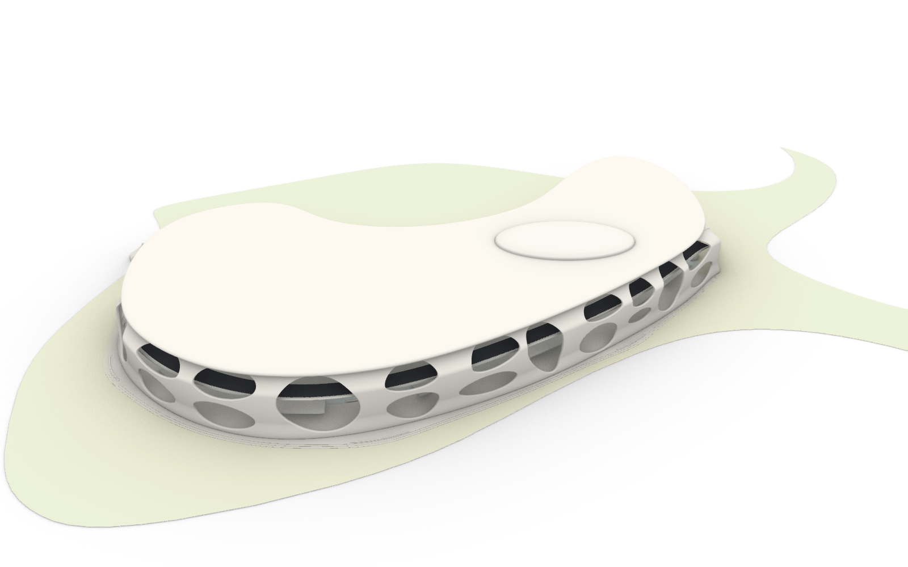

# 崖壁 B 连续曲面表皮 v02

第二版在完整约 981.65 米道路侧，改用开口驱动的连续厚曲面表皮。基底是二维墙壳区域，先扣除大小、倾斜及高度不同的开口，再沿道路曲率映射、改变外挑和顶部收拢，生成前后表面与圆滑开口边缘。支承没有采用圆形或椭圆截面的管柱扫掠。

## Rhino 文件与图层

- 工作副本：`D:\Prism Route\map\map_cliffB_shell_v02.3dm`。
- 修改前副本：`D:\Prism Route\map\map_before_cliffB_shell_v02.3dm`。
- [仓库归档模型](../assets/world/cliff_b_shell_v02_source/cliff_b_shell_v02.3dm)。
- 新图层：`崖壁B_曲面表皮验证_v02`。第一版独立保留，整体隐藏；被替换的原稿对象也保留并隐藏。
- 命名视图：`B曲面v02_整体`、`B曲面v02_峡谷`、`B曲面v02_中层`、`B曲面v02_屋盖`。
- [峡谷近景](cliff_b_shell_v02/canyon.png)、[中层近景](cliff_b_shell_v02/road.png)、[修复屋盖](cliff_b_shell_v02/roof.png)。

## 表皮与屋盖

13 个宽度不同的区域形成 22 个开口，其中 4 个跨越上下层，其余组合为底层拱口和错位的上层采光开口。每个开口的肩部宽窄与中心弯曲不同。开口之间留出宽薄的斜向墙片与连接带；外挑随位置、高度连续变化，底部展开，顶部向屋盖收拢。厚度参数为 2.6 米，成对的上下开口之间保留至少 4.5 米的竖向参数域间隔。

表皮目前是可由参数重建的闭合网格：73,442 个顶点、112,528 个三角形及四边形面，三角化后为 146,968 面。屋盖仍是闭合 NURBS 实体。此轮选择网格验证连续墙壳的整体形态，未将表皮转为 SubD 或 NURBS 补片；不能将它描述为已完成的 NURBS 建筑外皮。

屋盖修复统一了九个闭合截面的控制点数量，重新圆滑放样，消除了 v01 接缝边线上的三处扭结。采样重建轮廓最大偏差约 0.003 米，竖向范围为 56.998–63.002 米。

## 验证

表皮网格有效、闭合且朝外。屋盖有效、闭合；全部边线和 240 条等参数线均未检出自交。另对屋盖检查网格的 74,276 个三角面，以及表皮的 146,968 个三角面，进行了 BVH 候选相交检查；均未发现非相邻三角面穿越，未发现退化三角面。网格检查不包括邻接面和共面重叠，屋盖检查基于采样网格，并非连续曲面的数学证明。

道路上方 0.10–5.20 米净空体与实体核心、表皮的网格相交检查均为零。原始源几何对照修改前副本检查，结果见 [主检查报告](CLIFF_B_SHELL_V02_REPORT.json)。[表皮报告](CLIFF_B_SHELL_V02_MESH_AUDIT.json)和[屋盖报告](CLIFF_B_SHELL_V02_ROOF_MESH_AUDIT.json)记录网格检查范围。

第一次表皮网格试验曾出现局部边缘折叠，已通过在网格边上求解精确裁切点、加宽开口之间的连接修正，归档模型使用修订版本。

## 参数与重建

- [配置](../tools/cliff_b_shell_v02.json)：随机种子、区域数量、墙壳厚度、采样密度与屋盖重建参数。
- [表皮生成器](../tools/build_cliff_b_shell_v02.py)：普通 Python，使用标准库。种子固定，变化可复现。
- [Rhino 生成脚本](../tools/rhino_cliff_b_shell_v02.py)：在 Rhino 的 IronPython 环境按阶段运行，使用 v01 文档中的 UTF-8 源码加载方式。
- [网格检查脚本](../tools/audit_cliff_b_shell_mesh.py)：通过 Blender 的 BVH 检查实际三角面。

完整归档包含 v01 的对照几何。重建到干净的第一版模型时，把归档中的 `road_frames.json` 复制到 `.map_1012_build/cliff_b_v02_road_frames.json`，运行普通 Python 表皮生成器，然后在 Rhino 中依次执行 `foundation`、`shell`、`audit`、`preview`。当前模型已完成这些阶段，不应直接重复执行。`generation_state.json` 是已生成对象清单与检查状态，保留用于追踪；跨 Rhino 会话不能直接续跑其中的文档运行序号。

本轮已实现从管柱到连续厚墙壳的生成方式转换。开口目前仍有较明显的椭圆家族关系，尚未达到概念图里更自由的拱洞和局部曲面融合；表皮、屋盖、道路及基座仍为独立对象，连接处尚未统一拓扑。后续应调整个别开口轮廓、增加真正贯通地面的入口、细化连接与人行尺度，再进行材质及 Godot 导入。本次没有替换游戏场景。
