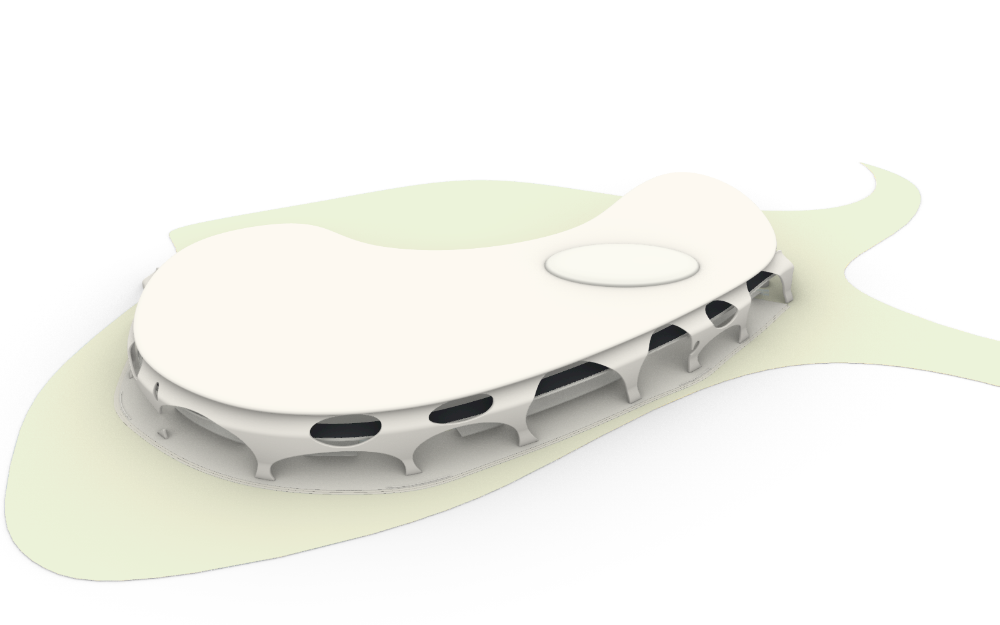

# 崖壁 B 自由开口与架空底层 v03

根据第二版反馈，取消固定上下两排开口，把连续封底改成开放拱口与稀疏的曲面支承脚。完整道路侧仍为约 981.65 米。



## 本轮变化

15 个开口包括 9 个切穿到平台标高的通行拱口、4 个错位悬浮开口和 2 个局部支承采光开口。同一位置可以是单个大开口，也可以组合多个开口；通行拱口最高点分布于约 28–57 米，上部开口随局部剩余实体安排，不再共用上下排的高度规则。

底部没有连续封闭带。约 10 处支承脚包括两端支承，沿全长疏密变化；参数域的地面开口宽度约 68–103 米，合计约 820 米，约占全长 84%。开口切到平台表面，便于从峡谷侧进入建筑下方。近地圆滑收口逐渐减小，避免开口与底部封口之间折叠。

表皮继续使用可重建的闭合网格，未采用管柱基底。第三版表皮有 81,020 顶点、130,912 个三角形与四边形面；三角化为 162,052 面。屋盖沿用第二版验证过的 NURBS 生成方法。

## 文件与视图

- 工作副本：`D:\Prism Route\map\map_cliffB_shell_v03.3dm`。
- 修改前副本：`D:\Prism Route\map\map_before_cliffB_shell_v03.3dm`。
- [归档 Rhino 模型](../assets/world/cliff_b_shell_v03_source/cliff_b_shell_v03.3dm)。
- 新图层：`崖壁B_自由开口与架空底层_v03`；第一、二版独立保留并隐藏。
- [峡谷](cliff_b_shell_v03/canyon.png)、[中层](cliff_b_shell_v03/road.png)、[入口](cliff_b_shell_v03/entrance.png)、[内部](cliff_b_shell_v03/inside.png)。入口与内部采用约 2.5 米高的低视点；入口视点在峡谷侧，用于读完整拱口。
- 命名视图：`B曲面v03_整体`、`B曲面v03_峡谷`、`B曲面v03_中层`、`B曲面v03_屋盖`、`B曲面v03_底层入口`、`B曲面v03_底层内部`。

## 检查

网格有效、闭合且朝外。非相邻三角面候选相交检查未发现穿越，也未发现退化三角面。该检查排除邻接面及共面重叠；详见 [网格报告](CLIFF_B_SHELL_V03_MESH_AUDIT.json)。屋盖全部边线和 240 条等参数线未检出自交，中层道路上方 0.10–5.20 米净空体与核心、表皮相交检查为零。

对 9 个地面拱口分别检查从外侧向内侧的 46 米长通路：宽 1.5 米、平台上方 0.10 米起、净高 2.10 米。测试包括表皮、实体核心及处于行人高度的座椅等构件，全部通路未检出网格相交。用于确认几何通行，不是 Godot 角色实机碰撞测试。[主报告](CLIFF_B_SHELL_V03_REPORT.json)保存每条路径位置、净空结果与原稿对照。

## 重建

[配置](../tools/cliff_b_shell_v03.json)指定 `open_ground_v03` 布局、9 个通行区域和固定种子。普通 Python 中运行：

```python
from tools.build_cliff_b_shell_v02 import build
build('cliff_b_shell_v03.json', 'cliff_b_shell_v03_mesh.json')
```

共享生成器保留第二版布局，第三版使用独立配置及输出。输入道路采样在归档 `road_frames.json`；复制到 `.map_1012_build/cliff_b_v02_road_frames.json` 后可重建。Rhino 中以 UTF-8 加载 [第三版脚本](../tools/rhino_cliff_b_shell_v03.py)，依次运行 `foundation`、`shell`、`audit`、`pedestrian`、`preview`、`walking_views`，每阶段单独执行。当前模型已完成这些阶段；跨会话不应直接续跑带原文档运行序号的生成状态，也不应在已包含第三版的模型中重复生成。

本轮完成开口布局和底层通行修改。支承仍有部分形态家族关系，平台与廊檐仍较连续，局部融合、公共空间节点、材质与景观后续细化。本次保留独立构件，没有将表皮与屋盖统一拓扑，也没有替换 Godot 场景。
