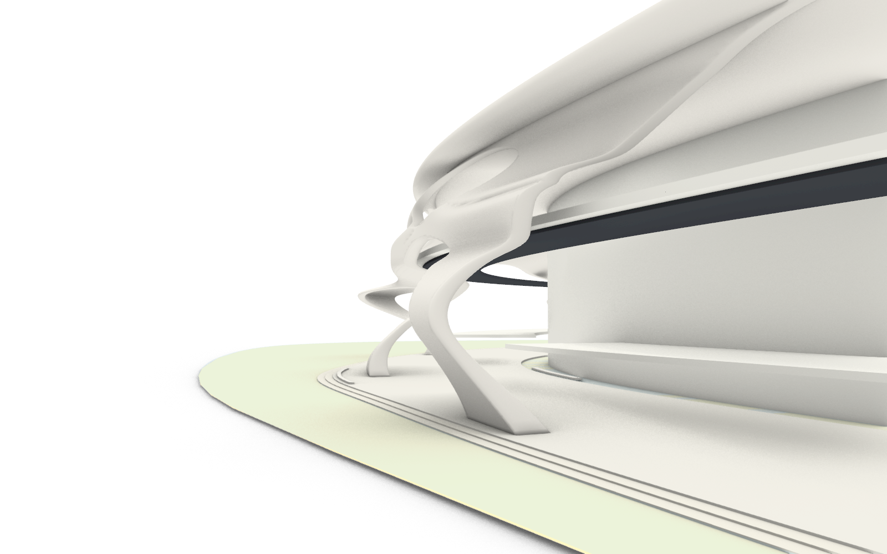

# 崖壁 B 空间曲面与扭转支承 v04

第三版的开口已经不按上下排布置，底层也可穿行，但表皮仍沿道路形成进深变化较小的统一墙壳，侧面较平整。第四版保留其 15 个开口和 9 条底层通路，重点修改三维曲面形态。



## 曲面变化

以 10 处支承脚为局部形态锚点，各自拥有不同的前后弯曲、沿道路方向倾斜、扭转和根部展开参数。影响范围随高度变化，使支承的底部、腰部与顶部不再共用一个包裹轮廓。曲面在道路高度附近约束净空，其他高度允许外挑或向核心内收；顶部逐渐收向屋盖。

内外表面之间的截线厚度随位置变化，并作受控的平面内旋转，不使用圆形截面管柱。为避免较大曲率处的偏移折叠，当前内外表面采用受控厚度方向，不能将该截线长度解释为严格的曲面法向等厚。

与第三版逐顶点对照：81,020 个顶点的平面位移平均约 5.63 米、最大约 28.13 米；90% 分位为约 13.39 米。截线厚度约 2.60–5.83 米。开口参数、拓扑及顶点高度均未改变。详见 [变形量报告](CLIFF_B_SHELL_V04_DEFORMATION.json)。

## 文件与视图

- 工作副本：`D:\Prism Route\map\map_cliffB_shell_v04.3dm`。
- 修改前副本：`D:\Prism Route\map\map_before_cliffB_shell_v04.3dm`。
- [仓库归档 Rhino 模型](../assets/world/cliff_b_shell_v04_source/cliff_b_shell_v04.3dm)。
- 新图层：`崖壁B_空间曲面与扭转支承_v04`，先前版本保留并隐藏。
- [整体](cliff_b_shell_v04/overview.png)、[支承曲面](cliff_b_shell_v04/support_surface.png)、[峡谷](cliff_b_shell_v04/canyon.png)、[中层](cliff_b_shell_v04/road.png)、[屋盖](cliff_b_shell_v04/roof.png)。
- 新增命名视图 `B曲面v04_空间侧面`、`B曲面v04_支承曲面`，另有整体、峡谷、中层与屋盖视图。

## 检查

表皮闭合、有效、法线朝外。162,052 个三角面检查中，没有检出非相邻面穿越或退化三角面；[网格报告](CLIFF_B_SHELL_V04_MESH_AUDIT.json)说明检查排除邻接面及共面重叠。中层道路上方 0.10–5.20 米净空体与核心、表皮的相交检查为零；9 条底层通路仍全部通过宽 1.5 米、净高 2.10 米的几何检查。尚未进行 Godot 实机碰撞测试。

屋盖与第三版几何一致，边线和 240 条等参数线检查未发现自交。8 个被替换的原始对象与修改前副本几何一致。[主报告](CLIFF_B_SHELL_V04_REPORT.json)记录原稿对照、曲面参数和通路结果。

## 参数与重建

[配置](../tools/cliff_b_shell_v04.json)保留第三版的布局种子，新增独立的空间形态种子，以及进深变化、侧向偏移、根部展开和厚度展开参数。配置的进深幅度是变形场输入值，不等于实际最大位移。

普通 Python 调用共享生成器：

```python
from tools.build_cliff_b_shell_v02 import build
build('cliff_b_shell_v04.json', 'cliff_b_shell_v04_mesh.json')
```

道路采样输入保存于归档 `road_frames.json`，工作路径仍为 `.map_1012_build/cliff_b_v02_road_frames.json`。Rhino 以 UTF-8 加载 [第四版脚本](../tools/rhino_cliff_b_shell_v04.py)，在未包含第四版的模型中按阶段运行 `foundation`、`shell`、`audit`、`pedestrian`、`preview`、`spatial_views`。当前模型已完成这些阶段；归档生成状态用于追踪，不应跨会话直接续跑原文档运行序号。

本轮让支承具有明显的前后弯曲、扭转与厚薄变化，但仍是开孔曲面生成的体量草稿，未做独立支承与内核、屋盖之间的拓扑融合。开口边缘和顶部连接仍需艺术调整，内部核心与道路平台暂沿用原验证体量。本次没有替换 Godot 场景。
