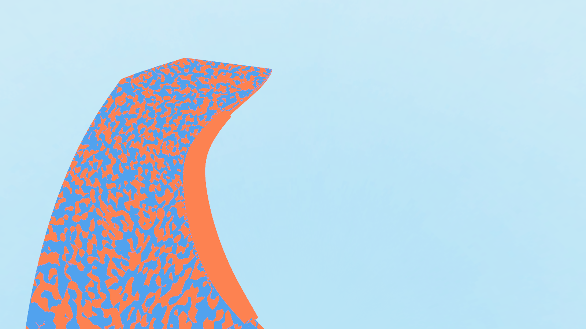
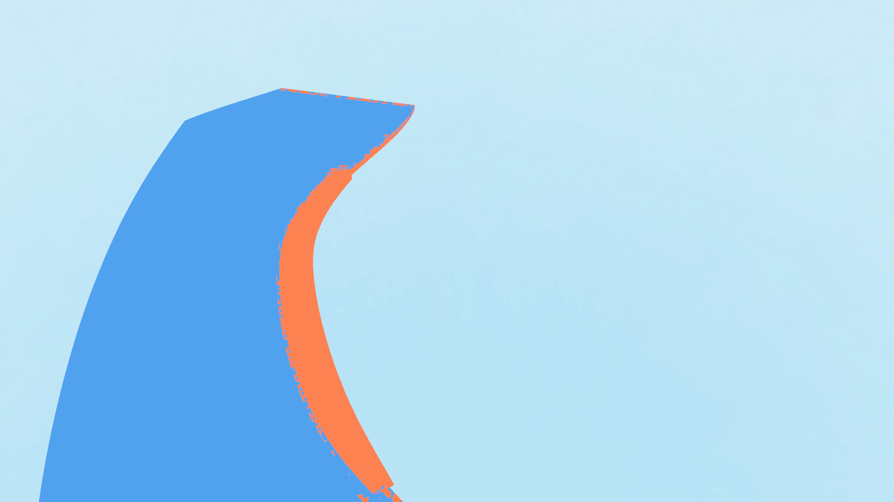

# 当前地图网格修复与 LOD 接入

按本次确认的范围处理反向路肩、已确认的重合面和渲染 LOD。继续使用现有完整三角网格碰撞，不建立独立碰撞代理，不修改草的密度、材质、风动或树木布局。

## 源模型

Rhino `D:/Prism Route/map/map_current.3dm` 已保存并回读。仅 `9571ee7f-ce6e-40f7-b13a-d1a647bb9b66`（`04_洞内连续路肩_1`）的几何发生变化：闭合方向由 -1 改为 +1。顶点位置不动，保留编号、名称、图层、材质选择和用户字符串；263 个 CAD 对象保留。

Rhino 的 `DuplicateMesh` 会携带实体方向缓存，翻转后通过重新建立网格拓扑再检查方向。`Replace` 还可能解析默认材质索引，修复工具显式恢复原属性。

源文件与导出前数据备份位于忽略目录 `.current_map_build/mesh_repair_20261022_before/`。原始 CAD 闭合实体的搭接构造保留，重复外表面在导出步骤处理，避免破坏 NURBS 实体和物件关系。

## 导出重合面处理

`tools/current_map_mesh_repairs.py` 为已审计的六组搭接指定表面所有者。仅当三角形九个 float32 坐标完全一致、绕序相同、材质分类相同时，移除多余副本；不移动顶点、不近似匹配邻近面、不整件删除物件。岛3承托内另外8个同向重复面也一并清除。

- 六组跨物件重合：17,295 个多余三角面。
- 岛3承托内部重合：8 个多余三角面。
- 合计移除：17,303 个三角面。
- 199 件导出物件保持；三角形由 9,345,058 变为 9,327,755。
- GLB SHA-256：`e3bc6a70b163f740fd3e1f6899d302c309f58d2977f54734dc23d1701ab3aee5`。

已用原始导出做几何保全对照：全部物件顶点位置不变，未涉及物件的索引和法线不变；六组搭接的表面并集完全保留。移除副本后仍使用各原件已有的着色法线，避免因为裁剪边界重算法线额外引入接缝。

全图重新审计：物件内部完全重复三角面为0，跨物件完全重复三角面候选为0，没有整体朝内的闭合壳候选。其他未纳入本次范围的局部非流形边、绕序/平滑法线告警仍在，不能把这次结果理解为全图所有拓扑问题已解决。

双色诊断对照：

| 修复前 | 修复后 |
| --- | --- |
|  |  |

边界：此步骤保证已确认的完全重合三角面被清理；不声称穷举并解决不同三角划分的共面重叠或所有实体相交。

## 正式场景接入 LOD

`scripts/map_1021.gd::_build_model()` 改为加载并实例化 Godot 导入的 `PackedScene`，使用导入器生成的 ArrayMesh LOD 和专用阴影网格。UUID 对应的材质分类、道路、种植遮罩、角色和房车控制保持。

实测正式场景中：

- 153 件物体有自动 LOD，共 1,319 层；199 件都有专用阴影网格。
- 碰撞仍为 197 个完整凹三角网格 Shape，共 9,322,795 个三角形。数量减少仅来自本次重复面清除；LOD 不参与碰撞生成。
- 导入器为顶点缓存优化重排了195件物体的三角形序列。通过全部有向三角形的精确多重集比较，确认199件物体的基础几何与直接解析 GLB 完全一致；允许三角形循环换序，不允许反向绕序，不忽略重复次数。

1600×900、RTX 5070 Ti、Forward+，关闭植被，在正式场景内只切换 Viewport 的 mesh LOD 阈值：

| 视角 | 完整细节图元 | 开启 LOD 图元 | GPU 中位耗时：完整 / LOD |
| --- | ---: | ---: | --- |
| 全景 | 9,327,755 | 95,543 | 2.506 / 0.455 ms |
| 主桥 | 10,477,093 | 377,063 | 2.165 / 0.619 ms |
| 开放隧道近景 | 10,117,461 | 8,122,613 | 1.881 / 1.687 ms |
| 双层桥附近 | 8,147,194 | 2,060,622 | 1.718 / 0.647 ms |

每组20帧预热、60帧采样；这不是全游戏 FPS，图元还可能包含额外渲染通道。主桥、洞口与曲面截图抽样检查未发现明显的 LOD 轮廓缺失，近处仍保留较多细节。

## 草地与回归

GLB 指纹变化使旧草地缓存失效，已使用正常构建流程重建当前全图数据。采样依然使用完整物理网格，渲染 LOD 不作为植物支承面。

本轮11,321个分块全部完成并通过SHA-256完整性校验，数据约0.982 GB；八处实景的可见草地均加载完整。八个出生点的人物行走、C切换和房车驾驶/接地回归全部通过，3号开放隧道另测四向各约4 m、前行约12.8 m及驾驶约16.7 m。19,605棵固定树木保留，根部错误为0，最大高度偏差约0.8 mm。

回归记录以 `assets/world/current_map_validation/review/` 内报告为准：

- `cad_mesh_repair_validation.json`：源文件保存、回读及物件属性检查。
- `mesh_repairs.json`：移除数量与各组表面所有者。
- `mesh_repair_preservation.json`：与原始导出逐件比较，表面并集保留。
- `mesh_repair_geometry.json` / `mesh_repair_overlaps.json`：修复后全图数值审计。
- `mesh_repair_imported_faces.json`：导入资源基础几何精确比较。
- `mesh_repair_runtime.json`：正式加载路径、完整碰撞、LOD 与 GPU 对照。
- `validation.json`：八个出生点的行走、C切换、房车驾驶、接地及固定树木布局。
- `issue13_full_bake.json`：本轮全图烘焙完整性和文件指纹。

复现几何验证：先运行 `tools/probe_current_map_import.gd` 导出实际资源的基础面，再运行 `tools/verify_imported_map_faces.py`，最后运行 `tools/verify_current_map_mesh_repairs.gd`。`tools/verify_current_map_repair_geometry.py` 需要保留本地原始导出备份。

没有调整独立碰撞管线或其他未确认的拓扑告警。F5 主场景仍为 `map_1021.tscn`。
