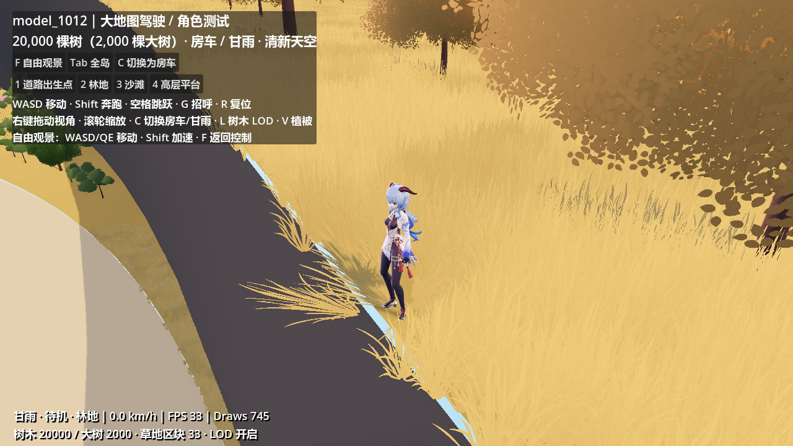
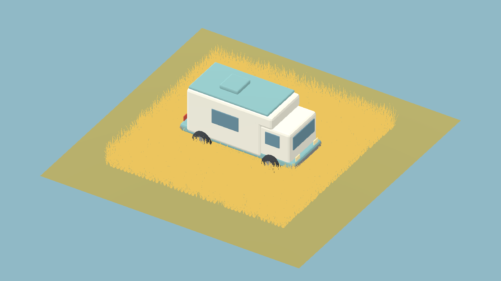

# 草地推开测试（2026-10-12）

## 角色推草减弱（2026-10-24）

1021 与 1012 共用的 `grass_interaction.gd` 已将角色推草强度从 1.0 降为 0.5，
最大弯曲由约 72° 降为约 36°。角色核心半径从 0.65 m 改为 0.45 m，
边缘渐变由 0.65 m 改为 0.35 m，总影响半径从 1.30 m 收至 0.80 m。
草根固定、平滑衰减及 1.6 秒恢复保持；房车胶囊尺寸、满强度与渐变范围保持。
CPU 上传现在实际使用每个来源的 strength，路径残留也按角色的新强度逐渐恢复。
边界盒和 GPU 渐变宽度使用同一参数；仅运行时交互调整，不改变草数据或要求重烘焙。

同机位、原草地网格的 D3D12 GPU 对比通过：旧角色影响改变 868 个像素，
新角色改变 141 个像素，房车仍为 5,029 个像素，恢复后差异为 0。
这些是固定测试画面的位移证据，不代表主观强度或性能比例。
角色/房车切换、自由镜头、移动残留、恢复、传送清理和楼层隔离检查通过。
报告：`.map_1012_build/grass_interaction_verification.json`。

下面保留最初接入说明及当时截图。

1012 大地图的分块草地已接入顶点位移交互。停止当前运行后按 F5 重启，按 C 切换房车 / 甘雨，在林地草丛中走动或驾驶即可观察。原有风动、草地颜色与 LOD 继续使用。

角色周围的草向外弯曲，房车按朝向生成沿车身的长条影响范围；草根固定，草梢向外移动并降低。经过的草短暂保留弯曲，最长约 1.6 秒后平滑恢复。没有生成永久车辙或改变地形、植被分布与碰撞。

自由观景时，交互仍跟随实际人物 / 房车，镜头不会压草。隐藏的另一种控制对象不参与。切换控制对象和远距离传送会清理旧路径；交互有高度限制，避免高空跳跃或上层道路的角色影响下层草地。

## 实现与调整

- `assets/vegetation/shaders/grass_interaction.gdshaderinc`：世界坐标胶囊范围、空间衰减、草根权重及弯曲位移，最大弯曲角 72°。
- `assets/vegetation/shaders/vegetation_wind.gdshader`：将交互位移叠加到既有风动；交互默认关闭，由 1012 草地材质启用。其他使用该着色器的植物保持原先表现。
- `scripts/grass_interaction.gd`：当前胶囊与短暂路径样本，最多 16 个来源，共享到全部草地区块；无逐棵草的 CPU 更新或碰撞查询。
- `scripts/map_1012_vegetation.gd`：每帧更新交互材质，草地区块额外扩展 1.5 米剔除范围。`grass_interaction_enabled` 可用于开关对比。
- `scripts/map_1012_drive_test.gd`：交互对象与实际控制对象同步，独立于自由相机的草地加载目标。

当前角色核心半径 0.45 米、边缘渐变 0.35 米、强度 0.5；房车核心半径 1.30 米，中轴两端距中心各 1.75 米，渐变 0.65 米、强度 1.0。`grass_interaction.gd` 的 `footprint()` 调整体积，`RECOVERY_SECONDS` 调整恢复时长。世界坐标位移转换回每个实例的局部坐标，随机朝向、缩放以及区块边界不会改变向外推开的方向。

## 验证

`tools/verify_grass_interaction.gd` 检查真实 1012 场景的房车 / 人物切换、自由镜头、移动路径、恢复、传送和样本预算。渲染模式额外使用原草地网格、随机朝向 / 非均匀缩放、两个相邻 MultiMesh 区块做图像对比：人物影响、房车影响、恢复至原图及不同楼层隔离。

```powershell
& 'D:\Godot\Godot_v4.7.2-stable_win64.exe\Godot_v4.7.2-stable_win64_console.exe' --headless --path . --script res://tools/verify_grass_interaction.gd
```

实机图像验证去掉 `--headless`，末尾添加 `-- --capture-grass`。完整运行结果保存在 `.map_1012_build/grass_interaction_verification.json`，截图在 `.map_1012_build/captures/grass_push_*.png`。

恢复对比关闭风动以便精确比较；大世界截图使用正常风动。测试不据单张截图的 FPS 判断新增效果的性能成本。

Godot 4.7.2 / Forward+ / D3D12 / RTX 5070 Ti 实机验证通过。固定草地网格与镜头后，人物影响改变 868 个像素，房车影响改变 5,029 个像素；恢复后与原图的差异为 0 个像素（RGB 差异阈值 2/255），另一个楼层的影响也没有改变草地画面。真实大地图的切换、自由观景、移动路径恢复、传送清理与来源预算检查全部通过；完整实机报告为 `GRASS_INTERACTION_TEST_REPORT.json`。




