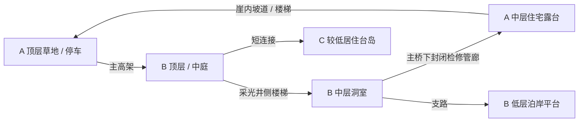

# 岛屿重绘：近未来巨构地形讨论稿

日期：2026-10-01。当前植物基准：已接受的连续树冠受光与覆盖率 mip。
本次保存当前工程的实机截图和地形建议，地图形体仍由用户重绘。

## 已明确的方向

- 北部保持沙滩，南部保持峭壁；岛内山脊和峭壁可以是被土壤与植物
  覆盖、风化后露出人工结构的近未来巨构。
- 南部参考 `56fb0781-7697-467b-878a-cec6b4a3453e.png`：崖体更破碎，
  少量台岛有高架连接，崖内有多层可进入、可居住的空间。
- 降低大面积崖体高度，强调连通性。巨构的尺度感由体量、跨度、
  厚度与重复的人尺度房间共同建立。
- 保留已有的温暖草地、克制的树冠细节与植物色块。

前两张参考图适合参考植被与大形体关系。新图的中层洞室、露台和
对岸可见的入口更适合当前探索目标。三张图中部分圆拱、柱式容易
读成古典建筑；实际方案采用近未来设施的结构和材料语言。

## 从当前实机看到的空间问题

当前工程的岛内主要是连续坡面、大片树林和完整封闭的海岸崖壁。
近景植物已改善，但地形缺少可识别的目的地、穿越空间以及上下层
互相看见的路线。海岸轮廓的弯曲变化还没有转化成探索路径。

首先增加一个清楚的局部探索回路，再将它扩展到全岛。
大面积台地可以保留，以便房车移动、停车和远眺。

## 南部：陆侧崖台 A + 两座台岛 B、C

建议从三个主要体块、两段可见高架开始。A 与主岛连续，B 和 C 是
分离的主要台岛。少量海礁仅作背景，不增加一串同等规模的探索岛。

| 体块 | 可辨认的形状 | 主要体验 |
| --- | --- | --- |
| A：剥落外壳的陆侧台地 | 草坡覆盖的大板块，崖壁一段剥落露出肋板和房间 | 从主岛到达；停车；沿崖内坡道进入中层 |
| B：带采光中庭的台岛 | 顶面一个偏置开口，侧面一个贯穿洞室 | 穿桥进入；由天光找到下层；看见对岸入口 |
| C：较低的居住台岛 | 较矮、较宽的台体，面海凹入露台 | 经过短桥抵达；营地、住宅与安静观海空间 |

三个体块高低错开、沿海湾略作折线布局。A 到 B 用一段主要高架，
B 到 C 用较短连接。开口、中庭和凹入露台集中在少量可识别的位置。
结构底部保留厚重完整段，避免每一面都切成连续网格。

### 先画三个主要探索标高

以下数值只是白模起点，单位为米、相对海平面；没有进行道路测试。

| 空间 | 初步标高 | 用途 |
| --- | --- | --- |
| 低层 | +5～10 | 泊岸平台、小滩、旧设备间、向海的洞口 |
| 中层 | +18～28 | 居住洞室、修理间、阳台、封闭检修管廊 |
| 顶层 | +35～55 | 草地、树林、主要高架、房车停车和观景 |

这三种标高是主要活动带，房间仍使用人尺度层高；活动带之间可以
用设备层、实体结构或局部楼层填充。每个体块不必拥有全部三层。
C 的顶面可降低，靠近 B 的中层。局部设备塔可超过台地顶面，但
应让主体崖台保留可理解的尺度。

## 连通性：从对岸入口走出，而不是原路退出

建议先画清这条步行探索回路：



A、B 中层的“洞穴”可以是人工舱室：入口风化破损，内部仍有平整
顶板、门框和标准房间。跨海连通借助主高架下的封闭检修管廊，
因此玩家可以从 A 的洞口进入、从 B 的洞口出去，同一处跨度也有
两种通过体验。

房车主要经过顶面和高架。步行则能进入中层、下到海边，再回到顶层。
房车停在入口附近后，应能步行绕一圈回到停车点。保留停车空间和
连续缓弯；当前讨论不改变已有道路宽度，也不执行车辆通过测试。

## 三个值得优先设计的空间事件

### 1. 山脊剥落后露出的结构切面

沿中部山脊露出一段重复肋板、设备舱和斜向大屋面。大部分仍被草坡
遮盖，坡脚一个人尺度入口可以通到坡背面的住宅露台。玩家在远处
看到人工切面，靠近后才发现进入路径。

### 2. 崖内面海的居住凹室

中层凹入空间有遮蔽顶板、自然采光和海景。近未来的旧员工居住舱、
修理间或公共厨房可以被再次使用。家具、可关闭的门、局部灯光和
储物痕迹说明这里适合居住；房间之间保留少量封闭门作为之后内容
扩展的位置。外部一眼能看到生活空间，步行路线能真正到达。

### 3. 由洞室进入采光中庭，再走回草地

B 的顶面开口让植物和天光进入中层。由侧面的洞口进入时，先看到
中庭内的树、楼梯和上方天空，再沿边缘回到顶层。中庭和海湾提供
两个不同方向的采光，减少长通道的重复感。

## 全岛仍有清楚的南北变化

- 北部：宽沙滩与浅湾，少量沙中露出的旧防波构件、低矮设施顶板。
- 中部：坡地与树林穿过巨构残存的屋面；一至两处结构切面作路标。
- 南部：A/B/C 台地与台岛、多层居住空间、海上高架。

可以把它们设定成同一座退役的海岸能源与居住设施：岛内坡地覆盖
储水及设备结构，南部是海上承台和居住平台，北部形成沙滩与沉积带。
统一的旧功能有助于决定哪里开洞、哪里保留实体、桥连接到哪里。

近未来特征优先使用圆角矩形大开口、薄壳与肋板、标准服务舱、
复合材料面板、旧导视和设备接头。旧化集中在板缝、断面和失去
维护的局部；植物覆盖较大的平面，仍让结构整体容易读懂。

## 重绘优先顺序

1. 俯视图先确定 A/B/C 的轮廓、海湾和两段高架。
2. 给顶层、中层、低层着三种颜色，画出上述闭合步行回路。
3. 画一张穿过 A、主高架、B 的剖面，明确房间、管廊、楼梯和采光。
4. 再加入北部沙滩与中部山脊的局部结构切面。
5. 最后安排树群、生活细节和旧化；已接受的小树材质作为美术基准。

建模可以从实体块、洞室模块、肋板、高架和坡道开始。局部洞口用
完整的入口与内部遮挡搭建，先验证视线、出入口和上下层关系。

## 本次实机截图

截取自 `scenes/main.tscn`，使用当前已导入的 Rhino 地形、原环境、
已接受的小树和原种植分布。隐藏 HUD、冻结风与房车，方便比较地形。
这是现有工程的截图，没有把本讨论稿的巨构加入场景。

| 文件，位于 `screenshots/terrain_planning_2026-10-01/` | 内容 |
| --- | --- |
| 01_main_entry.png | 当前房车入口视角 |
| 02_forest.png | 岛内林地 |
| 03_hillside.png | 坡地与植物分区 |
| 04_overview.png | 全岛形体俯瞰；保持原有距离裁剪，远处树不显示 |
| 05_shore_negative_z.png | Godot -Z 侧较低海岸 |
| 06_shore_positive_z.png | Godot +Z 侧崖岸 |

当前 CAD 导出没有在工程中明确标注地理北向，截图使用 ±Z 命名，
不将它直接当成用户新地图的南北定义。重绘仍按北沙滩、南峭壁。
位置、镜头与边界记录在同目录 `capture_metadata.json` 中。

复现：

```powershell
& 'D:\Godot\Godot_v4.7.2-stable_win64.exe\Godot_v4.7.2-stable_win64_console.exe' --path . --script res://tools/capture_terrain_planning.gd
```
