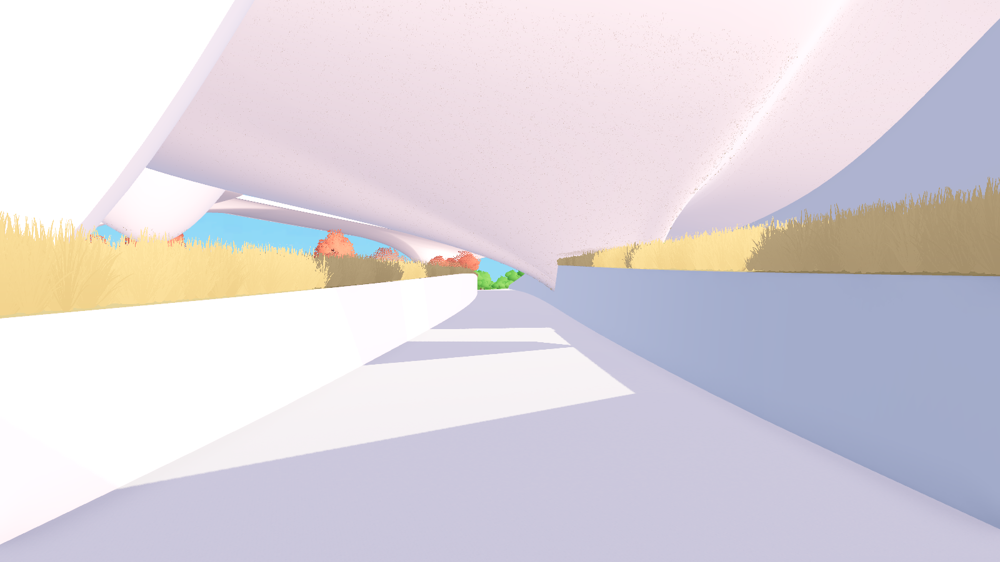
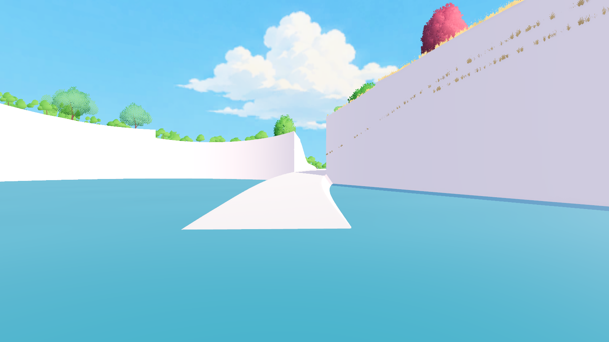
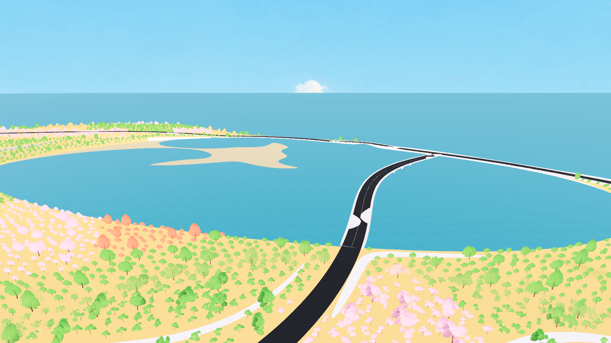

# 泻湖与岸边补面同步 Godot

2026-10-26。源模型 `D:/Prism Route/map/map_current.3dm`；F5 仍运行
`scenes/map_1021.tscn`，默认第 9 个初始洞穴点，角色独自出生。

## 模型与通行

- 只读导出本次 11 件新增或修改的 CAD 对象，移除 6 件淘汰平面沙滩。
  其余 191 件原始网格块逐字节保留。
- 当前 202 个导出对象、10,350,912 个三角形；保留导入器生成的 LOD 与阴影网格，
  Jolt 碰撞仍使用完整基础网格。
- 两个出口使用建筑材质；连续水下湖底为 Sand，不参与草地种植。
  南北水面统一 Z=0，水着色器沿用现有版本。
- 岸边补面已接入原低地实体，游戏中具有实际碰撞支承。
- 固定树木布局贴合新碰撞后保留 19,585 棵，移除 19 个失去有效支承的旧落点。
  其余水平位置、间距、树种及旋转保留；1,760 个根部微调，最大约 3.87 cm。

实际角色测试发现湖底的竖向岸缘收口挡在桥下出口前，高差约 0.43 m。
已局部打开对应宽度的湖底收口，并在原出口前 20 m 内平顺匹配湖底起点。
出口仍为同一个闭合 NURBS 实体，未改动亲水阶梯、未保留隐藏旧版。
早期 CAD 报告中出口从 Z=-0.69 起步的参数已由此处的实际交接修正取代。

## 全图草地

四个离线 worker 使用正式地图及同一 Jolt 采样器和 RNG 完整重烘焙。
逐格验证根记录重建的近远实例缓冲与在线生成逐字节相同；合并时校验全部文件 SHA-256。
配色、密度、大风、LOD 及交互参数保持已确认版本。

| 项目 | 数值 |
| --- | --- |
| 24 m 体积格 | 10,961 |
| 空格 | 1,403 |
| 草实例 | 196,467,768 |
| 压缩根记录 | 967,353,846 字节，约 922.54 MiB |
| 烘焙签名 | `332104410f188f3a2eebca87c177bfc25c12f8de89c4941bb5fa414be7588b8d` |
| 模型 SHA-256 | `fdae80e03e06ed572843a59acaceb65cf7d05df172ab3bb4e7566f528395ad3a` |

覆盖写入现有 `assets/world/current_map_validation/grass_bake/`，未另存历史整套烘焙。
成功发布新清单后清理 408 个未引用旧草块，共 13,174,703 字节；最终未引用草块为 0。
压缩根记录大小不等于常驻显存，仍按原有流式加载和 LRU 使用。

## 验证

- 实际导入模型与 Jolt：南湖底 55 点、北湖底 48 点，最大高度误差分别约
  2.26 mm / 4.59 mm；岸边补面 60 个支承点通过。
- 每个出口检查 177 个地面与 2.3 m 净空位置；角色分别双向走过 39 / 38 个路点，
  四次通行全程保持落地，无卡墙。
- 初始洞穴到顶面 40 个路点、9 个出生点、洞穴建筑材质及洞穴周边树根回归通过。
- 正式 Forward+ 场景读取最新完整烘焙；三处截图均等待可见草块加载完成，损坏草块为 0。
- 这是本次修改区域与已有出生流程的验证，不代表全地图所有位置均已穷尽检查。

报告位于 `assets/world/current_map_validation/review/`：
`lagoon_1026_export.json`、`lagoon_1026_physics.json`、`lagoon_1026_render.json`、
`issue13_full_bake.json` 和 `spawn_cave_1023_validation.json`。

## 更新入口

`tools/rhino_lagoon_sync_1026.py` → `tools/apply_lagoon_1026_export.py` →
`tools/build_current_map_validation.py` → Godot 重新导入 →
`tools/conform_map_1021_trees.gd` → `tools/build_grass_1021.ps1 -Workers 4`。

验证：`tools/verify_lagoon_1026.gd`，可加 `-- --capture` 检查正式植被并截图。
独立 Windows 发布包尚未重新导出。
