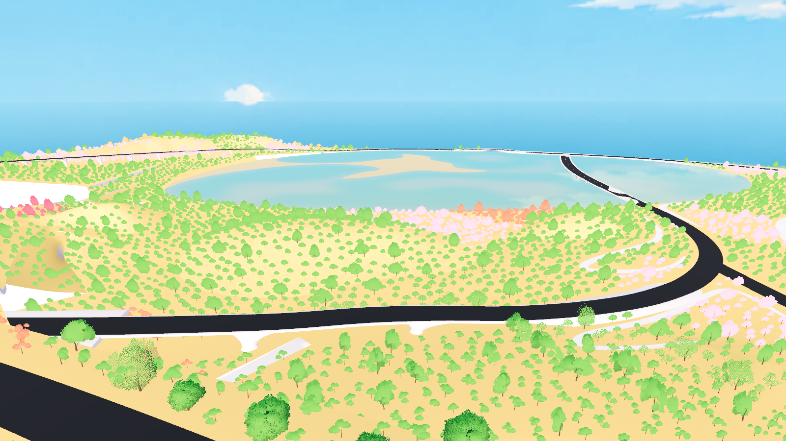
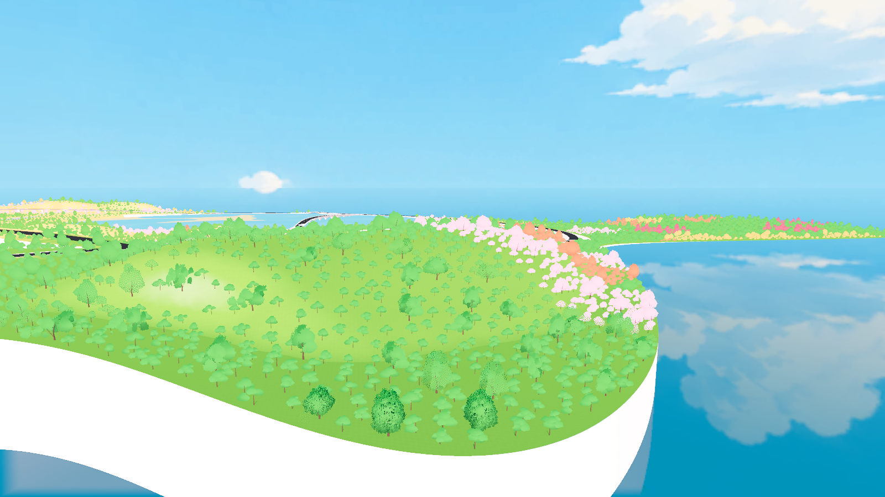
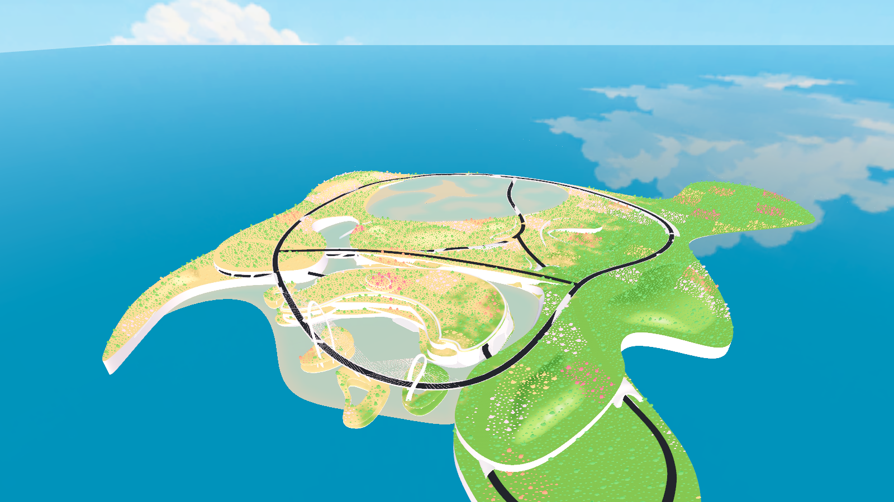

# 手工地形同步 Godot

2026-10-28。源文件仍为 `D:/Prism Route/map/map_current.3dm`；F5 仍进入 `scenes/map_1021.tscn`，角色默认从初始洞穴出生。

## 材质和导入

用户原始 Patch（`a26c788a-585d-4a98-befc-a6c7cc8083e7`）已使用与本批大地形相同的 Rhino 暖白哑光材质。只改变其材质，没有改变该 Patch 的几何、控制曲线或图层，保存并回读验证通过。

同步六个手工地形：用户原始土丘、东侧长山脊、西侧连续双峰、东南高地弯脊、南端岬角高丘和中部鞍脊。沿用用户要求调缓后的造型。

`surface_roles.json` 为 **手工地形** 图层增加 Terrain 语义。因此 Rhino 以暖白材质观察造型，Godot 中则沿用现有地形着色器和草甸色带，参与地形碰撞与种植。没有新建独立地形着色器。

本次只增量导出这六个曲面，新增 195,459 个三角形；其余 202 个对象的原始顶点和索引字节保持一致。当前正式地图共有 **208 个导出对象、10,546,371 个基础三角形**。导入器继续生成 LOD 与阴影网格，Jolt 使用基础网格碰撞。

## 植被

19,585 棵固定树全部保留。2,536 个根部跟随新地形调整，其中 2,450 个抬升超过 0.5 米，最大约 46.96 米。水平位置、间距、树种、旋转与缩放保持不变。

树根适配工具增加显式参数 `--conform-manual-terrain`，只允许当前手工地形导出对象产生已批准的向上修正，保留其他对象原有的楼层检查。种植排除遮罩在实际新落点高度检查。

四个离线进程完成全图草地重新烘焙，并校验每个数据块的 SHA-256 及根记录重建的实例缓冲。当前 **11,436 格、207,631,688 个草实例**，1,424 个空格；压缩数据 1,024,600,474 字节。没有另外保留旧整套烘焙，未引用草块为 0。密度、颜色、风、LOD 和流式加载参数沿用原版本。

模型 SHA-256：`9539169f439699fb2112d7751b0728d0170ae4db0f8561a9235abf5b3522a0cb`。

完整草地签名：`fbff5b4111f4a5b47d716476007ed1d2e00e83d3bf54219c60618738ab6daf9a`。

## 验证

- 六处共 6,348 个独立导出网格重心样本在实际 Jolt 碰撞中全部命中，最大高度差约 9.88 毫米。
- 六处均使用正式地形材质，每处角色走过 12 米的代表性缓坡路线，全部保持落地。
- 固定树根与碰撞匹配，未发现无支承根部或水平布局变化。
- 洞内出生、出洞至顶面 40 个路点、原有九处出生点均通过；洞内材质与约 3 米净空保持正常。
- Forward+ / D3D12 实机加载完整新烘焙，等待可见草块加载完成后截取四张画面，损坏草块为 0。

这是本次地形及已有出生流程的抽样验证，不代表遍历了全场所有坡面，也不是性能基准。受测试进程的目录权限限制，本次 GPU 运行没有写入用户级 shader cache；未修改游戏渲染参数。

报告位于 `assets/world/current_map_validation/review/`：`manual_terrain_1028_export.json`、`manual_terrain_1028_physics.json`、`manual_terrain_1028_render.json`、`issue13_full_bake.json` 和更新后的 `spawn_cave_1023_validation.json`。

## 更新流程

1. 已连接的 Rhino 加载 `tools/rhino_manual_terrain_sync_1028.py`，依次执行 `prepare()`、六次 `export_one(index)`、`finish()`。该流程只读 CAD。
2. 工作站 Python 执行 `tools/apply_manual_terrain_1028_export.py` 和 `tools/build_current_map_validation.py`。
3. Godot 重新导入模型，执行 `tools/conform_map_1021_trees.gd -- --conform-manual-terrain`。
4. 执行 `tools/build_grass_1021.ps1 -Workers 4`。
5. 执行 `tools/verify_manual_terrain_1028.gd` 验证碰撞和行走，加 `-- --capture` 验证正式植被并截图。`--capture --capture-only` 可在同一模型已通过验证后调整截图取景。

本次更新 Godot 工程，未重新导出 Windows 独立包。
