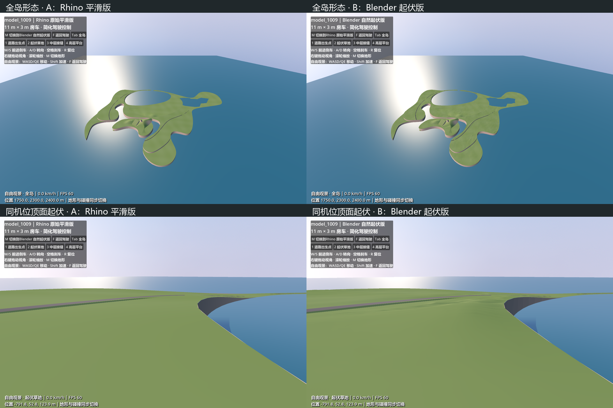
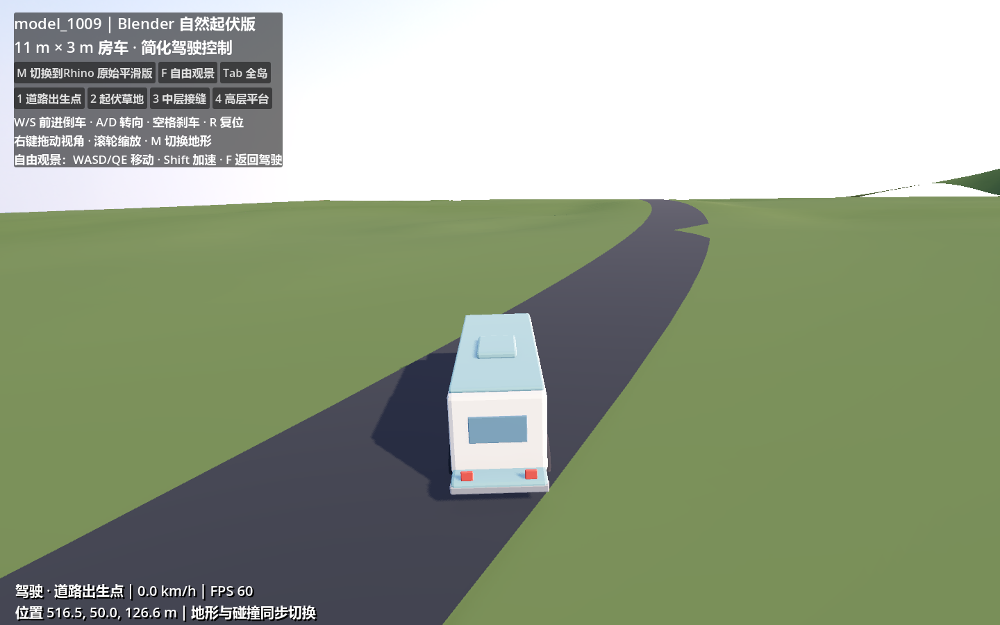
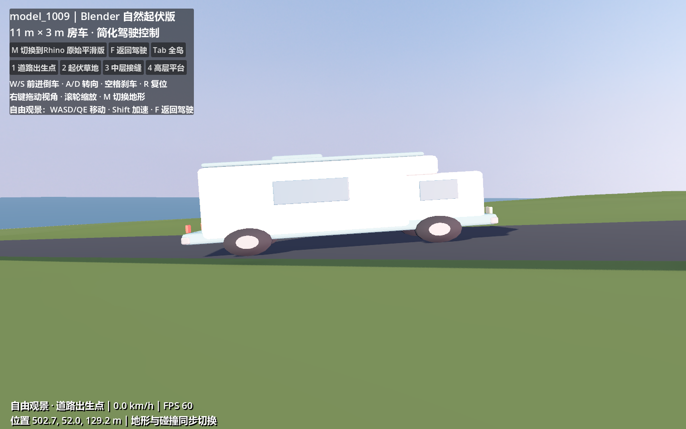

# model_1009 驾驶与自然起伏测试

## 打开与操作

在 Godot 4.7.2 中打开 `scenes/map_1009_drive_test.tscn`，按 F6。

| 操作 | 按键 |
| --- | --- |
| 前进 / 倒车 | W / S |
| 转向 / 刹车 | A、D / 空格 |
| 回到当前定位点 | R |
| 旋转跟车镜头 / 缩放 | 右键拖动 / 滚轮 |
| 切换原始与起伏地形 | M，或左上角按钮 |
| 自由观景 / 返回驾驶 | F |
| 自由观景移动 | WASD、Q/E；Shift 加速 |
| 全岛视角 | Tab |
| 道路、起伏草地、中层接缝、高层平台 | 1–4，或按钮 |

默认从原始平滑版的道路出生点开始。自由观景时按 M 保留机位；驾驶时切换会把车放到新地表并停止车辆，避免切换高度造成穿入地面。

## 场景内容

- 导入本次 `model_1009.gltf` 的全部“地形”和“路面”三角网格。辅助线不参与测试。
- 两个 GLB 都使用米制，平移到地图中心附近，尺寸不缩放。
- 原始版保留导出的地形形状；仅校正少量向下的外部顶面朝向，以便两版共同使用一致的光照。
- 房车占位模型缩放为宽 3 米、长 11 米、高 3.4 米；碰撞盒同样使用 3 米宽、11 米长。复用项目已有的简化运动控制。
- 两版地形和实体路面都由各自可见网格生成静态三角面碰撞。切换时只有当前版本的碰撞启用。
- 草地与峭壁使用相同占位材质、天空和光照。没有布置植被，以便直接观察几何。

这次保留实体路面，供地图驾驶体验验证；道路的长期地形碰撞/遮罩方案仍见 `ROAD_IMPLEMENTATION_PLAN.md`。

## Blender 起伏处理

`tools/build_map_1009_test.py` 读取原导出，在独立 Blender 后台进程生成两个 GLB。没有改写 Rhino 文件或输入 glTF，也没有另存大型 3dm/Blend 副本。

1. 合并地形层，并对噪声副本焊接极近的重复顶点。
2. 从顶向下射线识别外部顶面，避免把底面和洞穴内部也变成起伏地面。
3. 对顶面长边自适应细分，目标边长约 10 米，最多细分 7 轮；清理退化和重复面。
4. 用世界平面坐标计算三层固定偏移的 Perlin 噪声，沿竖直方向真正移动顶点：

| 噪声尺度参数 | 位移系数 | 用途 |
| --- | --- | --- |
| 160 米 | 3.0 米 | 宽缓起伏 |
| 48 米 | 0.9 米 | 中等起伏 |
| 14 米 | 0.12 米 | 微小变化 |

尺度参数是噪声坐标的缩放，不是严格周期；系数也不是最终保证的最大高差。

5. 在道路平面投影内及附近 5 米保持零位移，向外到 28 米逐渐恢复噪声。该保护是保守的平面投影，会同时保护高架路下方同一平面位置。
6. 开放边界、硬折角处保持原位置，约 20 米内渐变；陡坡进一步收弱。共享顶点和相同世界坐标噪声减少新裂缝的风险。
7. 水下区域不位移；在高度 −0.65 到 −0.10 米之间逐渐恢复噪声，低处限制负位移。原模型有一块陆地低于海平面，这是建模问题，本次保留原样，不进行修复。
8. 导出真实变形后的网格，Godot 从该网格生成碰撞；没有采用只改变显示高度的顶点 Shader。

最终实际位移范围约 **−2.22 到 +2.60 米**。原地形约 **12,032 三角面**，起伏版约 **308,017 三角面**，GLB 约 **9.3 MB**。当前用整图资产和整图碰撞验证，生产版需要按区域切块并设定网格预算。

## 验证结果

使用 Jolt Physics，分别检查两版的四个定位点和道路直行，实际 Forward+ 渲染也已检查。

- 两版的八次定位落地均成功。
- 两版都完成约 **14.32 米**的自动直行，结束时仍接触地面。
- 起伏观景点的地面从约 **34.81 米**变为 **37.41 米**，物理射线测得变化约 **2.60 米**。
- 道路保护区最大顶点位移为 **0 米**。
- 修正放大后的轮位探测、横向倾斜方向以及车身高度。此前道路出生点轮胎悬空约 **34–51 厘米**；现在从实际轮胎网格最低顶点测量，静止道路出生点误差小于 **1 毫米**，短距离驾驶终点最大轻微下沉约 **1 厘米**。四个定位点的轮胎高度误差均小于 **6 毫米**，并检查了侧面实机截图。
- 自动检查没有失败项。它只验证定位、切换和短距离直行；完整道路连通性、急弯与所有坡段仍需手动巡查。

车辆是 CharacterBody3D 原型。在完成模型缩放后，从四个实际轮胎网格提取探测点，用地面高度调整车身显示倾斜和竖直位置；四轮地面不共面时，轮胎与轮毂各允许最多 ±0.3 米的显示行程。只在车辆落地时对齐，空中仍遵循重力。碰撞仍为直立车身盒，没有真实轮胎、悬架或发动机物理；陡坡、路肩和障碍物仍可能暴露盒体碰撞与倾斜模型的偏差。因此可以验证地图尺度、路宽、转弯与地形阻挡，不能据此评价最终车辆悬架。

## 对比截图







当前起伏作为比较候选。它打破了平面光照的均一感，实际高差较缓；大结构轮廓仍主要来自 Rhino。是否采用、是否需要更大的局部丘包，应结合驾驶和近处观景判断。

## 重建与检查

```powershell
& 'D:\blender\blender.exe' --background --python tools/build_map_1009_test.py
& 'D:\Godot\Godot_v4.7.2-stable_win64.exe\Godot_v4.7.2-stable_win64_console.exe' --headless --path . --editor --import
& 'D:\Godot\Godot_v4.7.2-stable_win64.exe\Godot_v4.7.2-stable_win64_console.exe' --headless --path . --script res://tools/verify_map_1009_drive.gd
```

加 `-- --capture-map-1009` 并去掉 `--headless` 可生成实机截图。然后用项目 Python 环境运行 `tools/compose_map_1009_captures.py` 合成对比图。临时截图与检查报告位于忽略目录 `.map_1009_build/`。
