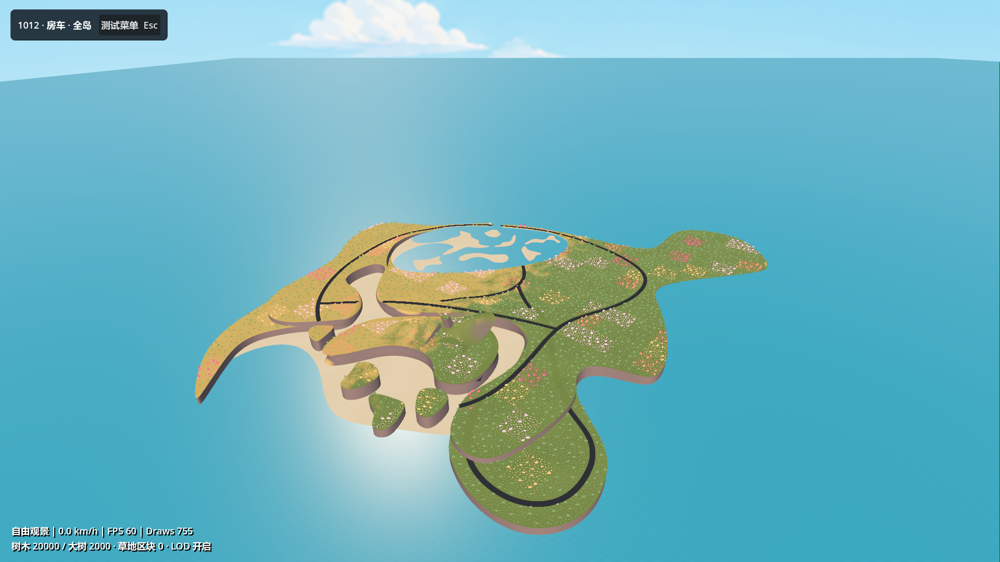
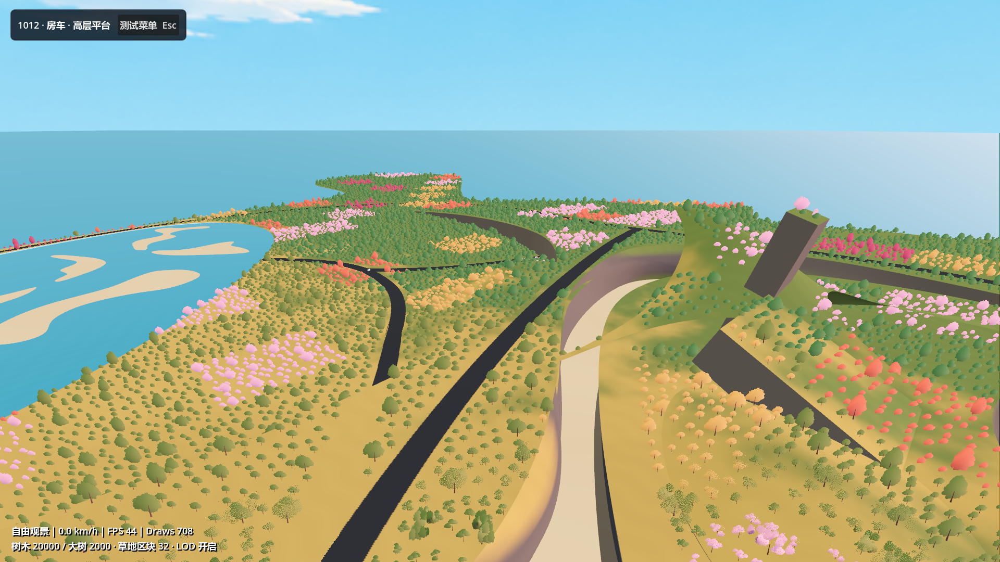
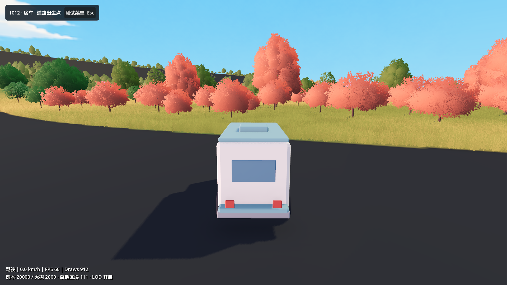
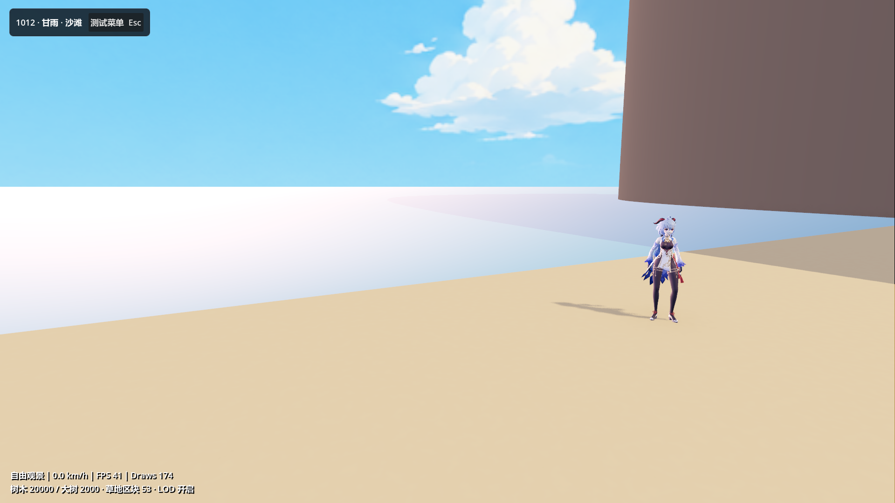

# model_1012 大地图测试（2026-10-12）

已替换为用户重新网格化的 `D:/Prism Route/map/mesh.gltf`，重新导入碰撞、重布植被并重建道路投影。当前 `scenes/main.tscn` 指向该测试，停止旧运行后按 F5 重启；也可打开 `scenes/map_1012_drive_test.tscn` 按 F6。旧 `world_lod_test.tscn` 和 1009 归档保留。

测试菜单“控制”页和 C 快捷键可切换房车 / 甘雨。角色模式可 WASD 移动、Shift 奔跑、空格跳跃、G 招呼；定位和自由观景继续可用。模型、动作和验证记录见 [甘雨大世界测试](WORLD_GANYU_TEST.md)。

## 地图与水面

源文件 SHA-256：`ed7e602d67049f13975105486741cb7eab53ef2134f1403986227468d793f17a`。

| 图层 | 导入三角面 |
| --- | ---: |
| 地形 | 213,216 |
| 路面 | 21,992 |
| 沙滩 | 21,175 |
| 水面 | 109,488 |
| 合计 | 365,871 |

陆地区域约 2.36 × 2.93 公里，高度约 −4.30 到 185.62 米。统一平移到地图中心附近，缩放保持 1:1；没有添加噪声起伏或修改地形轮廓。派生 GLB 修正少量外部顶面朝向，原输入文件保持不变。

本次源 glTF 约 14.44 MB，派生 GLB 约 12.67 MB。大范围远海平面只有 8 个三角面，较细水面集中在岛屿附近。沙滩边界线段长度中位数约 3.19 米、90 分位约 6.00 米，原先明显折角的边界获得更细的采样；人物近景截图用于检查实际轮廓。

四个测试地点固定为原来的源模型 XZ 坐标，并重新采样新网格高度；不再依据最大三角面的中心或随机树木落点重选。林地和高层定位点周围留出 10 米的树木空区，避免重新布置后传送到树干中。道路朝向沿用原测试路线。

**只使用用户手工水面网格**：没有额外海面、补洞平面或高度偏移。水面使用简单青蓝材质和微弱涟漪；沙滩使用浅暖沙色与低对比颗粒。草地、沙滩、水面按导出图层判断，关闭旧地图按海拔转为沙地的规则，低于零米的陆地继续保持草地。

地图 GLB 关闭自动网格 LOD 与顶点压缩，以保留 CAD 网格的顶点精度。树木仍使用原有三档 LOD。

道路与地形存在共面和局部交叉，原先产生灰绿三角斑块及 Z 闪烁。1012 测试现在使用 4096² 的道路范围和双层高度数据：道路与地形高度差小于 2 米的区域，由地形材质显示道路色，实体道路材质在对应地形附近丢弃片元，只绘制一次；悬空道路继续使用实体网格。高度检查避免把高架道路画到下层地面，陡直崖壁也不接受道路投影。原始 CAD 几何、水面和碰撞保持原位，这是测试场景的显示修复，尚未合并贴地道路与地形的碰撞。

## 植被与车辆

- **20,000 棵树，包括 2,000 棵大树**，其余 18,000 棵为小树。
- 按等尺寸网格多轮随机采样，并施加最小间距；取消旧测试的大片噪声密集区筛选。
- 树间最小水平距离 9 米，大树之间至少 22 米；所有树离道路平面投影边缘至少 6 米，并避开沙滩、水面、陡坡及悬空边缘。
- 当前 4,342 棵树落在低于零米的有效陆地上。种植判断使用实际手工水面，而不是把零米当作全图海面。
- 草地复用已有流式加载与距离过渡；自由观景时以观景相机为加载中心。道路投影和沙滩不长草，手工水面只用于遮挡水下植被，不作为可驾驶地面。
- 原有小树、大树模型与粉色、金色、橙红、绿色配色继续使用。远处树冠保留到 6 公里，便于全岛查看。
- 使用用户选定的清新天空中间稿；原 HDRI 继续照明。
- 恢复原款房车模型的原始比例，不再拉伸到 11 米。车身碰撞盒沿用旧大地图的 2.2 × 2.5 × 5.6 米；沿用 1009 的轮胎接地修正和驾驶/观景功能。
- 转向按行驶速度和转弯半径计算：低于 5 米/秒时满舵半径 4.5 米，随后平滑增加到 18 米/秒时的 14 米。原先这两个速度的半径约 10.4 米和 37.5 米；前后退均支持紧凑转弯，静止时不原地旋转。参数位于 `scripts/map_1012_camper.gd` 的 `low_speed_turn_radius` / `high_speed_turn_radius`。

## 操作

| 操作 | 按键 |
| --- | --- |
| 前进 / 倒车、转向 | W/S、A/D |
| 刹车 / 回到当前定位点 | 空格 / R |
| 跟车镜头旋转 / 缩放 | 右键拖动 / 滚轮 |
| 自由观景 / 返回驾驶 | F |
| 自由观景移动 | WASD、Q/E，Shift 加速 |
| 全岛视角 | Tab |
| 道路、林地、沙滩、高层平台定位 | 1–4 |
| 树木 LOD / 中距比较 | L |
| 植被显示 | V |

## 验证与截图

新版地图在 Godot 4.7.2 / Forward+ / RTX 5070 Ti 实际渲染通过，自动检查失败项为空。检查全部 20,000 个植物落点，未落到水面、沙滩、道路或空处；树根与导入碰撞最大高度差约 0.42 毫米。实际最小间距约 9.0004 米，大树之间约 22.0048 米。

四个定位点均成功落地，默认出生点命中路面。自动直行约 10.77 米后仍接地，轮胎最大高度误差约 0.18 毫米。水面面数、位置及碰撞层均已检查，场景不存在额外生成海面。检查覆盖定位与短距离驾驶，尚不代表已巡查所有道路连接和转弯。截图采用当前 4× MSAA，TAA / FXAA 关闭；本次不是完整性能基准测试。

新版地图沿用道路显示修复，并针对当前源文件重新烘焙道路投影；出生点截图未见此前的灰绿交替斑块。额外道路机位工具为 `tools/capture_map_1012_roads.gd`。

新版转向检查完成六组约 180° 掉头，覆盖 2 / 5 米每秒前进、左右转、3 米每秒倒车左右转及 18 米每秒高速转弯。低速车辆中心轨迹的半圈首尾距离约 9.0–11.1 米；高速约 28.0 米，需另计车身占用空间。六组均无失去地面接触的物理帧，结束时轮胎高度误差小于 0.6 毫米。工具：`tools/verify_map_1012_turning.gd`；报告：`docs/MAP_1012_TURNING_TEST_REPORT.json`。

报告：`docs/MAP_1012_WORLD_TEST_REPORT.json`。实机截图：









完整六个机位保存在忽略目录 `.map_1012_build/captures/`。

## 重建

在项目根目录执行：

```powershell
& 'D:\blender\blender.exe' --background --python-exit-code 1 --python tools/build_map_1012_test.py
& 'C:\Users\PC\.cache\codex-runtimes\codex-primary-runtime\dependencies\python\python.exe' tools/build_map_1012_road_projection.py
& 'D:\Godot\Godot_v4.7.2-stable_win64.exe\Godot_v4.7.2-stable_win64_console.exe' --headless --path . --script res://tools/import_map_1012_road_projection.gd
& 'D:\Godot\Godot_v4.7.2-stable_win64.exe\Godot_v4.7.2-stable_win64_console.exe' --headless --path . --editor --import
& 'D:\Godot\Godot_v4.7.2-stable_win64.exe\Godot_v4.7.2-stable_win64_console.exe' --headless --path . --script res://tools/verify_map_1012_drive.gd
```

最后一条去掉 `--headless` 并添加 `-- --capture-map-1012`，即可重新生成实机截图。构建记录与离线布局位于 `assets/world/map_1012_test/`；重新导出 `map/mesh.gltf` 后必须重新运行构建命令。道路构建工具从几何元数据读取同一源路径并校验哈希，避免混用旧版数据。
