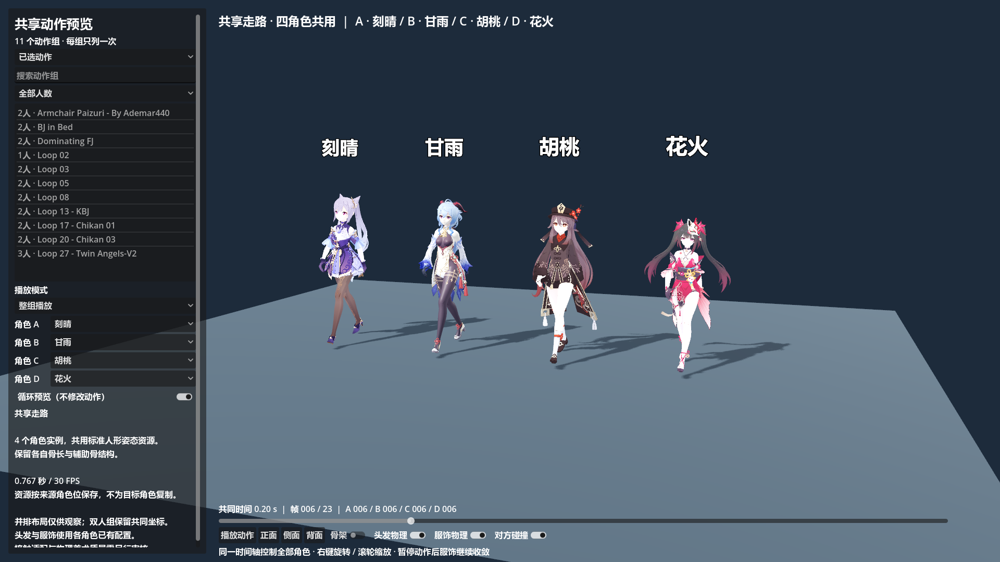

# 已选 MMD 动作库：Godot 导入结果与后续批量制作指南

**固定家具交互接入前必读（2026-11-06）：** [家具定位与交互审计](MMD_FURNITURE_ALIGNMENT_AUDIT_20261106.md)。当前家具预览使用移动道具的标定方式；家具锚点驱动角色组、人物走近与进入／退出流程尚未接通，不应把预览摆放视为正式世界交互已经完成。本次审计仅新增记录，未修改运行逻辑。

更新：2026-11-03。这是当前已执行的生产流程，接续 [共享人形规范](MMD_SHARED_HUMANOID_VALIDATION.md) 和 [总制作指南](MMD_TO_VRM_PRODUCTION_GUIDE.md)。

2026-11-04：角色选择新增八重神子、雷电将军、芙宁娜、镜流、星见雅，共 9 个可选模型。新五个已通过中性共享样本与原预览器选择验证；下文四模型全库结果仍是原验收范围，不代表新增模型的全部接触组合已获验收。见 [首批角色制作与验收](CHARACTER_BATCH_IMPORT_GUIDE.md)。

以用户手写的 [选片 README](motion_selection/README.md) 为制作依据，已导入 **20 组 KEEP、40 条角色位轨道**（包含 12 组前戏与互动基础库，以及 8 组新增本番与站姿亲密动作）。其中 Loop 03 的两条共享资源继续复用，源角色烘焙累计 38 次；一个 MAYBE 没有导入。没有按目标 VRM 分别制作动作。

## 在哪里查看

Godot 打开 `scenes/character_mmd_vrm_validation.tscn`，按 F6；或在项目根目录执行：

```powershell
& tools/run_mmd_vrm_validation.ps1
```

仍是此前的独立预览场景。默认打开已选库中的 Loop 02，正式地图入口保持原有配置。

- **已选动作 / 验证样本**：分开显示生产清单与旧对照样本。主列表每组只列一次，共 20 行。
- **搜索 + 人数筛选**：单人 1 组、双人 18 组、三人 1 组。悬停条目显示完整名称、范围和时长。
- **播放模式**：整组播放，或只看 A / B / C。单角色查看保留共同坐标，切换视图保持播放位置，不增加动作列表条目。
- **角色模型**：每个共享角色位可选刻晴、甘雨、胡桃、花火；切换模型保持时间、查看模式和播放状态，继续引用同一份动作资源。旧的角色专属基线禁用模型替换。
- **时间轴和物理开关**：全组使用同一时钟；衣发物理与对方碰撞可单独开关。拖动时间轴会重置模拟，避免从旧姿势遗留物理状态。其中**对方碰撞默认保持关闭（暂时的选择）**：双人高密度亲密交互时，双方碰撞体持续相互挤压容易引起弹簧骨与裙摆面料不可预测的高频抖动与持续震颤；默认关闭可保证动作观赏平稳纯净，需要调试身体阻挡时可随时手动点亮开启。
- **循环预览**：只控制预览播放方式，不改写动画。默认关闭；未为本批人工修补首尾接缝。

列表作用域可以独立切换，因此切换到“已选动作”时，右侧可能仍显示刚刚查看的验证样本；点击列表中的组即可载入。以下界面截图用中性走路样本展示导航，没有代表各组接触效果已完成美术验收。



## 本批实际范围

以下名称只是源目录标识。伙伴存在“或”选项时，采用 README 中首先列出的版本，与其制作表建议一致；替代版本不叠加为第三演员。

| 源目录 | 角色位 | 共同范围，30 FPS | 处理 |
| --- | --- | --- | --- |
| Armchair Paizuri - By Ademar440 | A / B | 0–2548 | 扶手椅乳交 |
| BJ in Bed | A / B | 0–1990 | 床上口交；B 采用 Maran |
| Dominating FJ | A / B | 0–1120 | 足部支配互动 |
| Loop 02 | A | 0–640 | 单人循环自慰 |
| Loop 03 | A / B | 0–480 | 复用既有两条共享轨道 |
| Loop 05 | A / B | 0–610 | 指部扣弄变体 |
| Loop 08 | A / B | 0–1002 | 双女贝合磨镜 |
| Loop 13 - KBJ | A / B | 0–1119 | 站立受动跪姿口交 |
| Loop 17 - Chikan 01 | A / B | 0–1000 | 背后拥抱随心手交 |
| Loop 20 - Chikan 03 | A / B | 0–1008 | 坐姿怀抱抚弄 |
| Loop 27 - Twin Angels-V2 | A / B / C | 0–2000 | 三角色双人协同口交 |
| Welcome - BJV2 2021 Uptade | A / B | 0–4201 | 主人坐姿受纳口交（单人沙发座高 ~0.45m~0.48m，女仆双膝跪地） |
| Bath House Service V2 | A / B | 0–1834 | 经典仰卧正常位 |
| Just Tonight - By Ademar440 | A / B | 0–7030 | 长篇卧姿骑乘位大作 |
| LHDS V3 - By Ademar440 | A / B | 0–2007 | 经典跪趴后背位 |
| Lap Sitting | A / B | 0–2340 | 首款椅凳背面坐位（座高 0.40m） |
| Loop 07 - Spooning | A / B | 0–909 | 侧卧温存汤匙位 |
| Loop 33 - Suspended Congress | A / B | 0–1000 | 逆火车便当悬空抱操（零道具） |
| TSFB V2 | A / B | 0–1701 | 经典俯身扶桌站姿后背位（双脚踏地 0.0m） |
| Thigh service | A / B | 0–1489 | 站姿相拥与日常素股互动 |

Loop 08 双方都取 0–1002；B 原文件的 1003–1372 尾部不进入输出。没有改原 VMD，没有把较长一方独立缩放到较短一方。

三人组按 README 的槽位顺序保存 A/B/C；参考求解骨架 A、C 使用刻晴，B 使用甘雨。角色位表示来源轨道，最终显示模型可替换。

身体动画资源合计 **99,263,172 B，约 94.7 MiB**，其中新增 95,804,913 B，约 91.4 MiB；其余为已存在的 Loop 03。此数不含 VRM、验证报告与可再生 GLB 缓存，不等于最终发布包体。

## 共享与物理怎么复用

```text
手写选片 README → 校验文件、范围和 SHA256 → 明确的源角色作业
    → 原生 MMD 控制骨架求解 → 无约束逐帧 GLB
    → 骨轴/静止姿态校正 → 共享人形世界旋转差 + 骨盆位移
    → Godot Animation 资源，每条来源角色轨道一份

目标 VRM → 每实例提取自身骨架和静止姿态 → 运行时应用共享姿态
         → 该角色/服装已有的衣发 Spring 配置 → 独立模拟状态
```

共享数据只传递身体姿态和位移；目标骨长不随源动画改变。多人组统一使用 `shared_world`，平移比例为 1，保留源轨道间相对坐标；整组放置应移动共同父节点。不能对每个演员分别归零、分别缩放位移或使用独立计时器。

刻晴复用 21 条 Spring 链，甘雨复用 20 条，每个实例有独立的模拟状态和身体碰撞代理。它们的物理元数据不为每条动作重新烘焙。三人组的对方碰撞掩码涵盖另外两人。

胡桃目前文件有 0 条链，花火只有既有 2 条链。这两个模型通过的是共享身体动画检查；本批没有为其补做完整衣发配置。新角色/新服装仍需一次接入检查，之后才能跨动作复用自己的配置。

本批没有接入源 Morph、口型、自定义形变或床椅等道具，也未逐组修整循环或所有体型的接触。需要这些表现时按实际使用场景补做，不因此扩大到全库修复。共享的数学正确性与衣发模拟不发散，不能替代最终接触和服装画面的审阅。

## 可重复的制作步骤

当前脚本严格针对这份已确认的 11/2 清单，使用固定数量断言，避免解析缺失时静默少导入。以后扩大批次，需要同时更新预期数量与验收断言，并保持清单格式或修改解析器；目前不是对任意 Markdown 都能自动理解的转换器。

在项目根目录执行完整流程：

```powershell
& tools/build_selected_mmd_library.ps1 -BlenderPath 'D:/blender/blender.exe'
```

需要本机 Python + NumPy、Blender + MMD Tools、本项目 Godot 与 VRM 插件，以及清单引用的原始 VMD/PMX/VRM。可通过 `-GodotPath` 指定 Godot；默认使用项目本机运行时。

分步执行便于排错：

```powershell
python tools/prepare_selected_mmd.py
& 'D:/blender/blender.exe' --background --factory-startup --python-exit-code 1 --python 'tools/mmd_pipeline/bake_selected_sources.py'
python tools/build_selected_mmd_library.py
& tools/verify_selected_mmd_library.ps1
```

1. `prepare_selected_mmd.py` 读取手写 README，确定每个源文件、角色位、共同范围，检查源哈希与必要控制骨；同步机器清单。首次覆盖前保留 `mmd_source_selection.before_import_20261103.json`。
2. 独立 Blender 后台进程加载两套参考 PMX 控制骨架。每次导入 VMD 前回到 0 帧，保留 IK、约束和驱动；在副本上逐帧视觉烘焙，导出独立无约束 GLB。
3. 对每条新增轨道，在首尾与中间共 9 个帧位比较源求解骨架和烘焙骨架。结果写入 `bake_journal.json`；失败返回非零退出码。已通过且作业指纹匹配的缓存可跳过，标准化阶段还会校验 GLB 输出哈希。
4. 标准化脚本用原 VRM **节点世界静止矩阵**与 Godot 实际导入静止矩阵校正骨轴，再提取共享姿态。不能用 inverse-bind 矩阵代替节点静止姿态。
5. 写入资源、manifest 和场景 catalog；保留历史验证 ID，将新选片默认显示在“已选动作”。生成后执行 Godot 集成验收。

独立进程不保存、覆盖或关闭用户当前的 Blender 工程。原 VMD/PMX 只读。此流程沿用用户授权的本机 Blender 常规启动脚本，不修改 MCP 安全设置。

### 关键文件

| 路径 | 用途 |
| --- | --- |
| `docs/motion_selection/README.md` | 人工选择和评注的依据，生成器不覆盖 |
| `docs/motion_selection/mmd_source_selection.json` | 已同步的 11 KEEP / 2 MAYBE 机器清单 |
| `tools/prepare_selected_mmd.py` | 将本批手写清单解析为明确作业 |
| `tools/mmd_pipeline/bake_selected_sources.py` | 独立 Blender 原生求解、烘焙与检查点 |
| `tools/build_selected_mmd_library.py` | 生成共享资源、manifest、catalog 与构建报告 |
| `tools/build_selected_mmd_library.ps1` | 本批完整构建入口 |
| `assets/characters/mmd_selected/animations/` | 20 条新增共享 Animation `.tres` |
| `assets/characters/mmd_selected/manifest.json` | 11 组、22 轨、4 模型及来源哈希 |
| `assets/characters/mmd_validation/shared/` | 继续引用的 Loop 03 A/B 及中性对照样本 |
| `assets/characters/mmd_validation/paired/catalog.json` | 独立预览场景的分组索引 |
| `scripts/characters/shared_humanoid_motion.gd` | 目标骨架适配、共享播放及角色独立物理 |
| `tools/verify_selected_mmd_library.ps1` | 本批资源、界面、同步、骨架与物理验收 |
| `docs/validation/mmd_selected_20261103/` | 制作计划、烘焙日志、抽样参考、验收与界面证据 |
| `.model_import_build/mmd_selected/` | 忽略提交的作业与中间 GLB 缓存，可再生 |

不要再运行需要旧自动标记的 `update_mmd_selection_readme.py` 来重建人工 README。Blender 中继续选片后，应显式确认并更新这份制作清单，再生成下一批；两边的编辑不会自动合并成人工评注。

## 实际验收与经验

工具版本：Blender 5.1.1、MMD Tools 4.5.11、Godot 4.7.2。新增 20 次源角色烘焙的处理时间合计约 424.6 秒；这是本机测量，不是所有动作的固定耗时。

| 检查 | 本批结果 |
| --- | --- |
| 源求解 → 无约束烘焙 | 56,799 次骨位置检查；最大误差约 1.02×10⁻⁶ m |
| 组加载与人数 | 11 组全部加载；1 单人 / 9 双人 / 1 三人 |
| 每轨四模型共享 | 22×4=88 次资源身份核对通过，没有目标角色专属动作文件 |
| 姿态检查 | 94,192 次；最大旋转差约 0.020°，主要身体关节约 0.000303° |
| 原参考模型的位置回归 | 刻晴最大约 4.29×10⁻⁶ m；甘雨最大约 2.41×10⁻⁶ m |
| 目标骨长保持 | 局部静止位置变化为 0 |
| 共同时间轴 | 最大误差约 3.33×10⁻⁸ s |
| 角色拆分与模型切换 | 22 个角色查看模式、4 次模型切换通过 |
| 衣发实时模拟 | 每组 12 个真实帧的有限值检查通过，包含三人组；此前中性四模型另有 120 帧检查 |
| 历史回归 | 三份共享样本和原 Loop 03 双人空间/碰撞检查通过 |
| 预览画面 | Godot Forward+ / D3D12 实际渲染，中性样本检查导航与布局 |

详细结果见 [本批验收](validation/mmd_selected_20261103/verification.json)、[构建统计](validation/mmd_selected_20261103/build_summary.json)、[生产输入快照](validation/mmd_selected_20261103/production_plan.json) 和 [源烘焙日志](validation/mmd_selected_20261103/source_bake_journal.json)。姿态参考按每轨约 18 个帧位抽样，并非对所有帧做了美术审阅。

实际渲染仍出现本机既有 `user://` shader cache 目录不可写提示；画面和自动截图正常，当前运行不缓存 shader。此提示未作为动画失败，也没有为此更改用户目录权限。

需要长期保留的经验：

- **先缩小制作集合。** 这一批只处理用户确认的片段，异常尾帧直接裁出生产范围，不替不需要的内容修动作。
- **源角色位与目标模型分离。** 22 条是 22 个来源角色轨道，目标有几十个也不增加动作烘焙数。
- **多人是一组数据。** 共用范围、时钟和世界平移；短一帧可保持末姿势，不各自重定时。
- **先把源控制骨架真正求解，再标准化。** 直接跳过 IK 或提前清理驱动，会产生看似成功但姿势错误的批次。
- **分层验收。** 用源烘焙误差、共享姿态误差、骨长和时钟发现技术故障；接触、道具、专有形变和衣服画面按最终用途审阅。
- **导航按动作组组织。** 整组、单角色和模型选择都是同一组的查看方式，不应展开成几十个重复动作条目。

后续通常只需补充确实要用的动作、完成新角色的一次适配，以及少量重点组合的画面调整；不需要回到“所有动作 × 所有角色”的独立烘焙流程。
