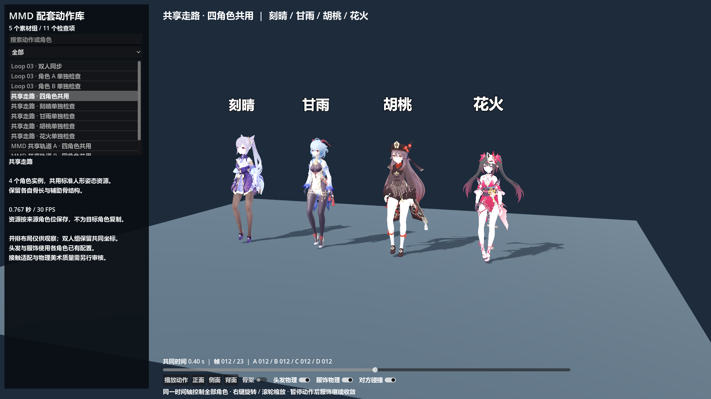

# 共享人形动作：四角色实测与后续制作规范

日期：2026-11-03。验证入口仍为 `scenes/character_mmd_vrm_validation.tscn`。当前 F6 默认打开已选库的 Loop 02；本页中性四模型走路在“验证样本”。

**共享层已扩展到用户确认的 11 组 / 22 轨，全部完成四模型资源与姿态检查。** 本文保留最初三份样本的机制与回归数据；当前批次、导入命令和界面使用见 [已选库制作指南](MMD_SELECTED_LIBRARY_GUIDE.md)。

**共享动作层已实现并通过本次验证。** 刻晴、甘雨、胡桃、花火共用同一个 Animation 资源，保留各自骨长；未为四个目标分别生成身体动作文件，也没有新增 Blender 烘焙。该结果支持采用共享库继续制作普通动作，尚不等于全库或所有角色组合均已验收。

## 1. 实际产物和检查范围

| 共享动作 | 来源 | 采样 | 文件大小 |
| --- | --- | --- | --- |
| `shared_walk.tres` | 项目既有 `walk.vrma` | 24 点，约 0.767 秒 | 97,072 B |
| `shared_mmd_role_a.tres` | 已验证 Loop 03 A 身体动画 | 481 点，16 秒 | 1,743,004 B |
| `shared_mmd_role_b.tres` | 已验证 Loop 03 B 身体动画 | 481 点，16 秒 | 1,715,255 B |

三份资源都分别在四个模型上检查，逐组断言四实例的 `motion.get_instance_id()` 相同，共 12 次资源身份检查。共享 Animation 不在播放时改写，角色只保存自身校正、姿态和物理状态。

走路已用 Godot Forward+ / D3D12 实际渲染并检查正面、运动相位和侧视截图。两份 MMD 资源在四模型上通过数值检查；原刻晴/甘雨的共同坐标配套也通过共享层检查。没有将骨架数值通过当成所有双人接触均已获美术批准。



| 模型 | Godot 骨骼数 | 自动识别骨盆 | 自动识别身体根 | 已有 Spring 链 |
| --- | --- | --- | --- | --- |
| 刻晴物理派生 VRM | 277 | 下半身 | Hips | 21 |
| 甘雨物理派生 VRM | 276 | 下半身 | 腰 | 20 |
| 胡桃 fixed VRM | 251 | 下半身 | Hips | 0 |
| 花火 fixed VRM | 719 | 下半身 | Hips | 2 |

胡桃当前文件没有 Spring 链。本次验证的是四模型的共享身体动作；没有宣称胡桃已有头发/服饰模拟，也没有为其新做物理配置。后续若需要，属于角色/服装一次性的配置，不是每条动作的重复工作。花火仅复用了已有两条链，未新增完整衣发物理质量验收。

## 2. 为什么不能直接共享旧 `.tres`

旧样本同时写入了角色专属辅助骨和局部绝对位置，并依赖特定导入后的骨架。它们是高精度基线，直接用于其他模型会覆盖骨长或找不到轨道。

VRM 的 humanoid 声明还存在语义差异：本项目甘雨的 Hips 对应较高的控制中心，刻晴则对应腰。仅因骨名都被导入器改成 Hips，就把它当作相同的物理骨盆会出错。

共享播放层在角色接入时自动检查父子关系：

- 两个 UpperLeg 的最近共同祖先作为物理骨盆，映射到共享 Hips。
- 物理骨盆和 Spine 的最近共同祖先作为可选 BodyRoot，保留 MMD 上下身的独立分支。
- 标准人形骨使用 Godot 的 humanoid 名称；原模型的额外父骨不强行改名或删除。
- 在上臂→前臂、前臂→手之间查找 `捩` / `twist` 辅助骨，建立四个可选扭转槽位。无对应骨的目标跳过可选槽位，不需要专属动作。

当前自动识别已实测这四套模型。它们虽骨数差异很大，仍都来自类似 MMD/VRM 骨架传统；不同导出器、异常 humanoid 标注或特殊拓扑的新模型须做一次接入检查，不能据此宣称所有 VRM 自动兼容。

## 3. 共享数据与播放方法

共享资源是带语义约定的 Godot Animation，不是可直接挂到任意 Skeleton 的普通局部轨道库。必须由 `shared_humanoid_motion.gd` 采样；仅更换后缀为 VRMA 或改轨道路径并不能得到相同结果。

资源保存：标准人形旋转、可选 BodyRoot/四个扭转旋转、物理骨盆相对参考静止姿态的位移、参考骨盆高度和格式版本。旋转存为骨架空间的世界旋转差：

```text
共享旋转差 = 源求解后世界旋转 × inverse(源世界静止旋转)
目标期望世界旋转 = 共享旋转差 × 目标世界静止旋转
目标局部旋转 = inverse(目标当前父骨世界旋转) × 目标期望世界旋转
```

身体位置和缩放保持目标自身静止值；位移作用于角色模型根节点，并补偿旋转后骨盆位置，使骨盆到达约定轨迹。因此不会通过复制手臂、腿部的局部位置改变骨长。

单人比较使用 `height_scaled`：只把源骨盆位移按骨盆高度比缩放。双人配套使用 `shared_world`：双方位移比例均为 1，保持同一演出空间和时钟；不能各自把全部世界坐标按身高缩放。四人并排时的横向间距只是展示偏移，不是原作四人演出。

Animation 本身只读；角色校正从实际导入的静止骨架提取，每实例绑定时执行一次，换动作不需要人工重映射或再次进 Blender。未来若缓存校正配置，须包含模型和导入设置版本，避免换模型后复用过期配置。

## 4. 扭转骨问题及修复经验

首轮只传人形主骨时，手腕位置最大偏离旧基线约 17.8 mm。原因是目标的前臂和手之间存在非人形扭转父骨，其旋转既影响蒙皮，也影响有偏心量的子骨位置。

加入四个可选扭转槽位后，源刻晴/甘雨复现的全人形关节位置误差降至约 1.5 微米。这些槽位由目标骨架拓扑和常见扭转命名自动绑定，动作仍只有一份，未增加“角色 × 动作”资源。

若新模型的扭转骨不在父链中、名称特殊或由约束驱动，需在角色配置补充规则；不要复制动作文件来修复。纯标准人形目标可只消费主要槽位，扭转蒙皮和接触质量另行检查。

## 5. 验收结果与精度边界

完整报告：[verification.json](validation/shared_humanoid_20261103/verification.json)。

| 检查 | 实测结果 |
| --- | --- |
| 共享资源身份 | 12 次通过，3 动作 × 4 模型 |
| 旋转对照 | 15,724 次 |
| 目标局部位置相对自身静止值 | 最大偏差 0，未覆盖骨长 |
| 主要身体关节旋转误差 | 约 `6.11e-7 rad` |
| 包含深层手指链的最大旋转误差 | 约 `2.92e-4 rad`，约 0.0167° |
| 骨盆轨迹误差 | 约 `6.07e-8 m` |
| 共同时间误差 | 0 |
| 旧源刻晴关节位置复现 | 最大约 `1.18e-6 m` |
| 旧源甘雨关节位置复现 | 最大约 `1.47e-6 m` |
| 回退跳帧 | 3 动作通过 |
| 单角色诊断和恢复四角色 | 4 个入口通过 |
| 原有物理真实帧运行 | 120 帧；已有链推进、未出现非有限姿态 |
| 新目标专属动画 / 新 Blender 烘焙 | 0 / 0 |

旋转使用四元数等价正负号差计算，并另查实际骨轴方向。主要身体门槛为 0.01°，含深层手指的门槛为 0.05°；单精度 Basis/Quaternion 在深层父链累积的微小差异单独记录，不能使用不稳定的 acos 接近 1 比较制造假误差。旧源几何复现门槛为 0.1 mm，本次显著低于门槛。

“源复现”仅比较同一个源目标模型的旧/新链条，不要求胡桃、花火的关节位置与刻晴相同——后者应保留自己的骨长。新体型的接触适配不由这些数值证明。

原专属双人基线另以 `verify_mmd_paired_validation.ps1 -TestFps 60` 回归通过：21/20 条链、共同时间误差 0、对方查询开关正常、234,240 个物理骨帧检查。原有配套与拆分入口保留。

## 6. 文件与复测入口

| 文件 | 用途 |
| --- | --- |
| `scripts/characters/shared_humanoid_motion.gd` | 共享资源采样、自动骨架校正、骨长保留、位移策略和原物理接入 |
| `scenes/characters/shared_humanoid_actor.tscn` | 可复用共享动作角色 |
| `assets/characters/mmd_validation/shared/*.tres` | 三份共享动作，没有四套目标副本 |
| `assets/characters/mmd_validation/shared/manifest.json` | 输入/输出哈希、大小、时长、四模型来源 |
| `assets/characters/mmd_validation/shared/*_reference.json` | 独立数值参考帧 |
| `assets/characters/mmd_validation/paired/catalog.json` | 原入口及共享/单角色检查入口 |
| `tools/build_shared_humanoid_validation.py` | 从既有验证数据构建共享样本，不调用 Blender |
| `tools/verify_shared_humanoid_validation.ps1` | 删除旧报告、带退出码和最大帧数的复测入口 |
| `tools/verify_shared_humanoid_validation.gd` | 共享身份、姿态、几何、位移、同步、物理与切换检查 |

在项目根目录：

```powershell
python tools/build_shared_humanoid_validation.py
./tools/verify_shared_humanoid_validation.ps1
./tools/verify_mmd_paired_validation.ps1 -TestFps 60
./tools/run_mmd_vrm_validation.ps1
```

最后一条启动可交互原场景，默认四角色共享走路，可切换 MMD A/B 的共享检查、共享层双人以及历史专属基线。侧视时先选择单角色诊断，避免并排角色在投影中重叠。

若重新运行历史的 `build_mmd_paired_validation.py`，它会重新生成旧样本 catalog；其后再运行共享构建器恢复共享入口。共享构建器会保留历史入口并替换自己的条目，可重复执行。

运行环境：Godot 4.7.2，项目 VRM 插件 2.5.1。受本机运行目录权限影响，渲染日志可能提示用户目录着色器缓存不可写；本次 Forward+ 与 Compatibility 均实际产出画面，数值复测无此依赖。

## 7. 对批量制作的影响

两条 MMD 共享资源合计约 3.46 MB，旧两条角色专属资源合计约 16.89 MB；这是本样本的结果，不外推固定全库压缩率。增加目标角色不再增加这两份动作资源。

本次为保护已验证链条，从旧专属输出提取共享样本，属于过渡构建入口。**未来新动作应从参考骨架的求解/烘焙结果直接标准化，不为每个目标生成旧专属动画。** 普通动作的昂贵求解按源角色轨道执行，目标只需 VRM，不要求每个目标提供 PMX。

后续选择少量常用普通动作，接入任务化导入与共享标准化即可开始小批试跑；当前脚本仍是样本构建器，尚非全库一键转换器。特殊 IK 和未确认多人关系继续暂缓。

范围限制：没有转换全部动作，没有验证几十个未接入角色，没有完成所有表情/特殊形变、所有衣发物理或所有角色组合的接触适配。共享播放层解决了避免重复制作的关键前提，不把这些后续项目混入本次通过结论。
