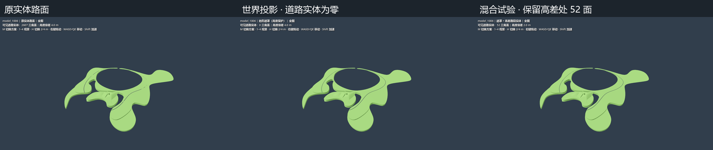
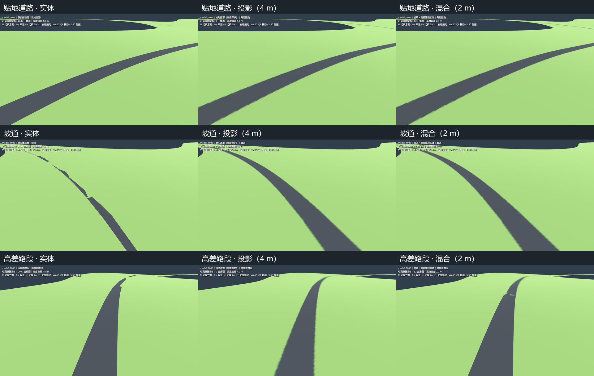
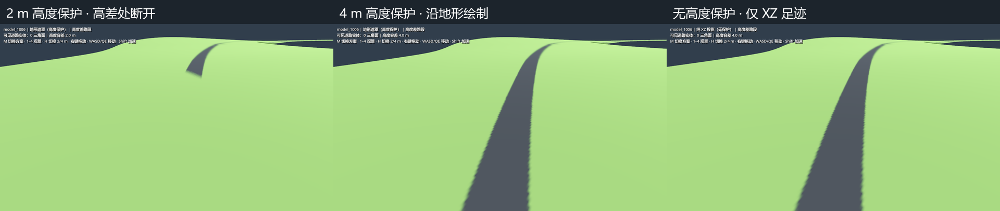

# model_1006 道路投影验证

日期：2026-10-06。独立视觉验证场景，输入为用户的 `map/model_1006.gltf`。
使用 Godot 4.7.2 / Forward+ / D3D12 / RTX 5070 Ti 实际运行、截图。

## 结论

**当前模型可以把贴地道路作为地形上的材质区域，不需要额外显示路面实体。**
默认场景隐藏整个“路面”图层，用世界 XZ 遮罩把“地形”绘成草绿色和深灰色。
全图、普通贴地路、坡道、高差路段均提供同位置实体对照。
这验证了视觉方案；尚未进行道路碰撞、房车行驶或性能优劣测试。

建议后续制作采用：

- 普通贴地道路：地形负责轮廓和碰撞，遮罩负责路面材质。
- 想要平整路床、削坡、填土的地方：先调整地形，遮罩自身不会改变高度。
- 桥梁、悬空连接和需要厚度、桥底、独立边缘的道路：保留实体，明确标记，烘焙时排除其地面涂色足迹。
- 多层道路在同一 XZ 重叠：分层或分块制作遮罩，不能用本次单一最高路面高度场直接覆盖。

**本次不是最终道路美术，也没有把新模型接入主场景。**

## 实机对照







对照图来自同一场景和相机，使用相同环境光、方向光和两个占位贴图。
没有植被或海面遮挡模型；两种方案都关闭投射阴影，以便单独检查材质和几何。
混合模式中的提取网格重新生成向上的法线，实体方案保留导入法线，因此光照存在细微差别。

## 场景与操作

在编辑器中打开 `scenes/road_projection_test.tscn`，按 F6：

| 操作 | 功能 |
| --- | --- |
| M | 地形投影 → 原实体路 → 无保护 XZ 投影 → 投影加高差处实体 |
| 1 / 2 / 3 / 4 | 全图 / 贴地道路 / 坡道 / 高差路段 |
| H | 高度容差在 2 m 与 4 m 之间切换 |
| 右键拖动 | 转动相机 |
| WASD / QE / Shift | 移动 / 升降 / 加速 |

默认投影容差 **4 m**：低于 3 m 的高度差不衰减，3–4 m 渐隐。
这是为当前 CAD 偏差设置的预览参数，不是最终施工或桥梁判定标准。
M 进入混合模式时切到 2 m，其他模式切到 4 m；H 可以独立比较。
无保护模式忽略高度和坡度，仅用于检查 XZ 足迹，不能直接用于多层地形。

## 如何实现

1. 读取 glTF 中“地形”和“路面”的三角面，应用节点变换。辅助线及其他图层不参与。
2. 为改善浮点精度，将两层一起平移至 XZ 中心；Y 与源模型一致，不修改源文件。
3. 把路面三角形垂直投影到世界 XZ。每个位置记录最上方路面的覆盖率和高度。
4. 使用每轴 2 次采样（8192² 栅格）平均到 4096²，改善路边的阶梯形边缘。
5. RG16F 纹理记录 `R=覆盖率`、`G=覆盖率×路面高度`。线性过滤和 mipmaps 后用 G/R 恢复高度，避免边缘混入零高度。
6. 地形 shader 以世界坐标查询遮罩，并用同样的世界坐标平铺两个占位贴图。
7. 高度保护拒绝离路面太远的表面；坡度保护削弱陡壁上的投影。

资产目录：`assets/world/road_projection_test/`。运行不依赖外部 CAD 文件或 Python。
占位贴图是 4×4 常色 PNG：草地 `#66914C`，道路 `#2F3338`；画面明度受场景光照影响。
`road_footprint.png` 是便于检查的覆盖率图，shader 实际读取 `road_projection.res`。
shader 使用 Godot 的 MODEL_MATRIX / MODEL_NORMAL_MATRIX 获取世界位置与法线。
参考：[Godot spatial shader 官方文档](https://docs.godotengine.org/en/stable/tutorials/shaders/shader_reference/spatial_shader.html)。

## 数值检查及解释

数据保存在 `bake_metadata.json`，输入文件副本 SHA-256：
`52155b6c7a6298d1e7b5c398055eb58f1b4d8a274589e8ce002f49a53a90084c`。

| 项目 | 结果 |
| --- | --- |
| 地形 / 原道路三角面 | 9,603 / 2,607 |
| 纯投影模式显示的道路三角面 | 0（源网格保留用于对照） |
| 遮罩尺寸 / 覆盖范围 | 4096² / 约 2.36 × 2.94 km |
| 每纹素世界尺寸 | X 0.577 m、Z 0.718 m |
| 道路覆盖采样点 | 109,233 |
| 与最上方地形高差在 ±2 m 内 | 106,651，约 97.64% |
| 超过 ±2 m 的采样点 | 2,507，约 2.30% |
| 没有地形覆盖的采样点 | 75，约 0.07% |
| 有地形处的路面减地形高差 | −0.553 至 +2.689 m；中位数 +0.038 m；95 分位 +1.488 m |
| 混合模式保守保留的三角面 | 52；其余 2,555 面隐藏 |

面积比例是 4096² 像素中心的近似值，不是精确的 CAD 相交或碰撞结果。
地形比较取每个 XZ 最上方表面，无法判别人工结构底面、内部、隧道的实际用途。
混合网格根据中心或至少两个顶点超出 2 m 容差提取完整三角面，边缘用 3×3 采样保守判断。
**52 面不能直接当作已经识别出的桥梁**；当前模型主要是有地形承载的道路，高差路段不等于真正悬空。

视角 4 的中心高差约 **2.628 m**：

- 2 m 保护会使路面颜色在该处断开，清楚显示道路与地形不贴合。
- 4 m 保护能沿现有地形连续着色，但显示的是地形轮廓，不能保留实体道路的设计高度。
- 原实体路也有部分低于地形（负高差），可能被地形挡住；需要完善路床配合。
- 混合模式补回高差处实体，能展示方向，但自动切割会产生不齐的连接和高度跳变，不能作为最终桥梁资产。

## 当前限制与下一步

- 全岛 4096² 遮罩在近景仍能看到轻微软边和波浪状边界；超采样减轻了问题，没有达到最终道路边缘质量。
  下一步适合在地形分块后烘焙更高局部密度的遮罩，或用距离场控制边界与路肩。
- RG16F 加 12 层 mipmaps 的纹理数据约 **85.3 MiB**，压缩磁盘资源约 1 MiB。
  压缩文件大小不代表 GPU 开销；当前原道路只有 2,607 面，本验证不能证明贴图方案更快。
  正式方案应分块、流送并优化遮罩/高度数据格式。
- 地形和道路在同一 XZ 的多层重叠只保存最上方高度。近距离上下层也可能落入宽松容差，必须按层明确制作。
- 目前场景不创建道路碰撞，未做主场景集成或行驶验证。

## 重建与截图

需要 Python + NumPy + Pillow，以及 Godot 4.7.2。在项目根目录运行：

```powershell
python tools/build_road_projection_test.py --source 'D:\Prism Route\map\model_1006.gltf'
& 'D:\Godot\Godot_v4.7.2-stable_win64.exe\Godot_v4.7.2-stable_win64_console.exe' --headless --path . --script tools/import_road_projection_test.gd
& 'D:\Godot\Godot_v4.7.2-stable_win64.exe\Godot_v4.7.2-stable_win64_console.exe' --headless --path . --editor --import
& 'D:\Godot\Godot_v4.7.2-stable_win64.exe\Godot_v4.7.2-stable_win64_console.exe' --path . --script tools/capture_road_projection_test.gd --resolution 1280x720
python tools/compose_road_projection_captures.py
```

烘焙中间数据和 17 张原始截图位于已忽略的 `.road_projection_build/`。
仓库保留导入资源、可运行测试和 4 张对照图；输入改动后必须重新烘焙。
本轮重建、资源导入和 Forward+ 截图全部成功，最终运行无脚本或 shader 错误。
