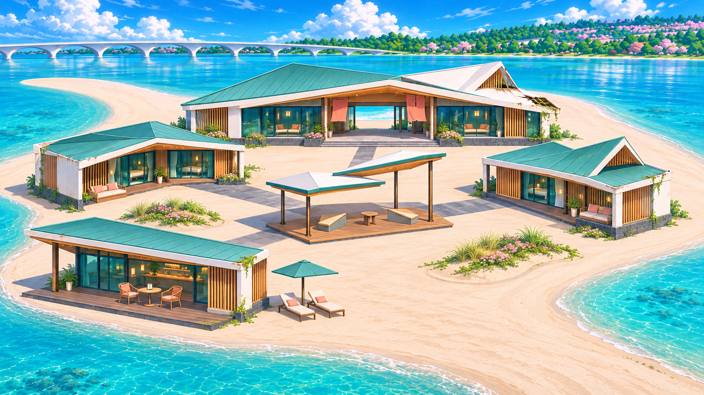
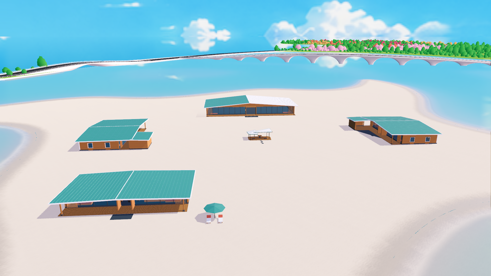
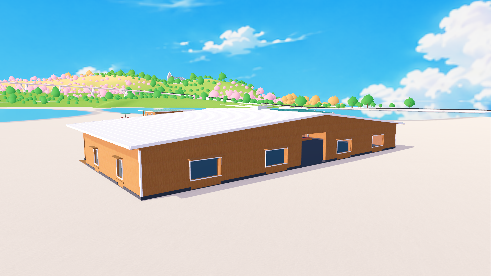
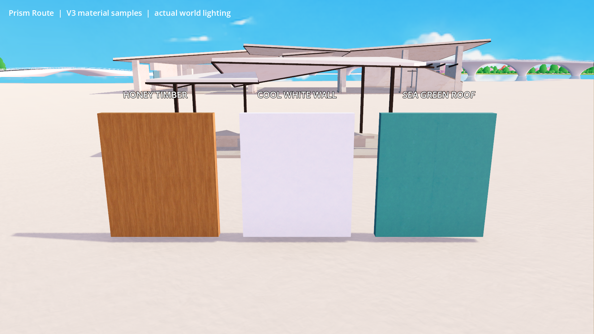

# 沙洲度假遗址与中央双翼亭

2026-11-09。正式入口 `scenes/main.tscn`，地图定位菜单 **「沙洲度假遗址 · 中央双翼亭」**；定位 key `sandbar_pavilion` 和参数 `--sandbar-pavilion-preview` 保持兼容。

## 当前交付：V3 木饰面度假建筑

**已修改 Rhino 并导入正式世界，随后按用户反馈加强侧、背立面。** 当前修订 `finished_resort_v3 / timber_all_sides`。V1/V2曾被用户评价像未完成工地；功能检查通过不代表用户已认可本轮美术。

保持中央双翼亭＋四栋单层建筑布局。木材现在主导围护墙、门廊、吊顶、格栅和露台；海绿屋顶、少量冷白檐口／细窗框与深灰基座形成层次。完整窗面与封齐至屋檐的山墙取代旧残墙。四栋背面各有四处窗洞，两侧各两处窗洞，带内退玻璃、窗套、小挑檐和局部木格栅，避免只有正面完成、背面是大片白墙。

主馆保留中央贯通入口，客房有遮蔽前廊与L形回廊，咖啡馆有偏置柜台和一桌两椅。中央亭保留两座一桌与四块短汀步，增加木平台、吊顶和海绿收边。咖啡馆旁只补两张躺椅与一把遮阳伞。门前仅短铺装；未制作概念中的花岛或大量室内陈设。







| 建筑 | 平面范围 | 最大屋顶高 | 主要处理 |
| --- | --- | --- | --- |
| 接待主馆 | 44×22m | 6.73m | 海绿／冷白折面屋顶、贯通门厅、木饰背墙与窗组 |
| 客房A | 28×23m，含回廊 | 5.18m | 完整木围护、玻璃前廊、L形侧院 |
| 客房B | 27×23m，含回廊 | 5.33m | 不同折顶轮廓、格栅、侧背窗组 |
| 咖啡休息馆 | 28×15m | 4.18m | 木露台、柜台、少量座椅 |
| 中央双翼亭 | 约9.5m宽 | 3.35m | 原双翼轮廓、木面家具和短汀步 |

整组约130×117m，各建筑完成地面仍为Y=.100m，没有整体缩放家具。

## 资源、材质与性能边界

- Rhino源：工作区 `../map/map_current.3dm`，沿用图层 `建筑::沙洲观测亭` 和精确标签 `sandbar_pavilion_1109`。**121个网格＋16个交互点，共137个唯一组件**；其中5个网格是隐藏的平整地面碰撞辅助体。最终重读主文件核对全部网格与标记CRC，并核对组件ID唯一。
- 游戏资源：沿用 `assets/world/sandbar_pavilion_1109/pavilion.glb`、`manifest.json`。**23,024三角面，GLB 1,881,940字节**；116个可见网格，83套碰撞、9,704碰撞三角面。板缝／屋顶立边只显示，避免每块木板增加碰撞。
- 包装：`scripts/world/sandbar_pavilion.gd`，由正式 `scripts/map_1021.gd` 接入。GLB已在世界坐标，包装根保持单位变换，不能重复扣地图原点。
- 所有顶点投影在真实干沙修剪面内，距边界最近约11.4m。**1,709个非本功能对象**的几何和主要属性一致，包含默认枚举遗漏的50个隐藏对象。未改岸线、水底或全图草，无需草地重烘焙。
- 四组玻璃使用透明深度预处理，不开折射；其他材料不透明。复用现有水体倒影管理器，隐藏辅助体不注册倒影。没有增加反射相机或实时灯，灯条只用自发光材质。
- 未做全世界性能基准或重新打包完整Windows游戏。网格数不等于实际draw call，不凭低三角数宣称零成本。

三套贴图现在实际绑定到建筑：

| `materials_v3/`中的资源 | 用途 | 参数 |
| --- | --- | --- |
| `honey_timber.tres` / `honey_timber_albedo.png` | 主要木围护、格栅、吊顶、露台与家具面 | roughness=.64、specular=.24、metallic=0；约1m重复 |
| `cool_white_wall.tres` / `cool_white_wall_albedo.png` | 少量白屋面、檐口和细窗框 | roughness=.86、specular=.22；复用微法线.08；约2m重复 |
| `sea_green_roof.tres` / `sea_green_roof_albedo.png` | 海绿屋面、收边、遮阳伞 | roughness=.52、specular=.40、metallic=0；约2m重复 |

三张PNG均1254×1254底色图，未插值放大，不是完整的新PBR贴图组。启用重复、mipmap、各向异性过滤和VRAM压缩。原材质资源保留本地三向投射能力；运行时复制并关闭三向投射，使用GLB米制UV。木纹按长轴区分竖格栅、横框、吊顶和露台方向，板缝与屋顶立边由几何表达。

2026-11-09 后续回退：按用户要求恢复减淡前的原始木纹材质，移除浅色Detail混合层；albedo_color恢复(.76,.85,1)，roughness=.64、specular=.24。木材倒影近似色与作者脚本调色值同步恢复。原PNG始终未改，GLB未动；manifest已按字节校验恢复到减淡前版本。随后生成的理想效果图仅作对话预览，未应用到游戏。

三个材质与三张底色图已加入既有导出列表，动态manifest沿用include_filter。V2风化shader／图不再被本建筑运行时引用，并移出其显式导出项；源文件保留历史记录。世界共享 `architecture.tres / architecture.gdshader` 未改。



## 家具与定位

按 [家具规范](GENERIC_BENCH_INTERACTION_SPEC.md) 交付 **`anchors_ready`** 资产。尚未绑定具体动作，`motion_profiles`为空；不是NPC导航、占用或进出状态机。室内少量靠墙坐榻为装饰，不开放动作。

| 实例ID后缀，统一前缀 `sandbar_pavilion_1109_` | 数量 | 地面世界高 | 相对接触高 | 表面标记 | 平整可用区 |
| --- | --- | --- | --- | --- | --- |
| `seat_01 / seat_02` | 2 | .100m | .420m | `Anchor_Seat` | .90×.45m |
| `desk_01 / cafe_desk` | 2 | .100m | .838m | `Anchor_Desk_Surface` | 1.10×.45m |
| `cafe_seat_01 / cafe_seat_02` | 2 | .100m | .420m | `Anchor_Seat` | .60×.45m |
| `lounger_01 / lounger_02` | 2 | .000m，干沙 | .460m | `Anchor_Bed_Center` | .65×1.10m，不含斜头靠 |

各实例另有独立 `Anchor_Front`，局部+Z为家具前方，入口面向家具。入口距根依次为1.00／1.22／.85／1.65m，净空和地面支撑按所在完成地面检查。不能把躺椅沙面基准硬改为平台.10m，具体躺姿仍需动作适配。

Rhino Point由作者脚本写入 `manifest.interactions.furniture`，包装器恢复独立 `InteractiveFurniture / Marker3D`；不依赖Point自动导出GLB。CAD `[x,y,z]` → Godot `[x−1450,z,1150−y]`，只转一次。

静态碰撞layer=33、mask=0，兼容正式角色mask32及旧查询层1；不叠加家具碰撞。完成地面高10cm，汀步约5–6.5cm，门前铺装高1.2cm；没有楼梯，不另加楼梯斜坡。

`manifest.buildings`保存入口、室内点、地面源ID、侧背窗检查点及朝向。`court_hub`避开中央亭家具；咖啡馆增加 `approach_waypoints` 经前庭到门口，不直穿已封闭侧房。这些是模型检查数据，不代表寻路系统已接通。

## 重建与验收

复用 `tools/build_sandbar_pavilion_1109.py`，不另造组件3dm、模型副本或导出工具。

1. 在Rhino中以模块作用域执行作者文件，依次调用 `prepare() → apply() → export_source()`。先在内存验证闭合实体与干沙边界，再按精确功能标签更新。
2. 项目根运行 `python tools/build_sandbar_pavilion_1109.py --package`，覆盖既有GLB和manifest。
3. **完成Godot编辑器导入后再运行复查。** 不能在GLB仍是旧导入缓存、manifest已更换GUID时启动，否则会出现 `Unmapped pavilion mesh` 和出生点解析失败。
4. 运行既有 `tools/verify_sandbar_pavilion.gd`，使用正式 `scenes/main.tscn`；通过后看总览、侧背近景和无贴图灰模。最后调用 `save_native()`，保存并重读主文件。
5. 删除该次精确 `.3dmbak` 与忽略目录里的临时文件；只保留本文两张实机图及既有概念／材质样片。

示例，Godot路径使用本机实际控制台程序：

```powershell
python tools/build_sandbar_pavilion_1109.py --package
& 'Godot控制台程序路径' --headless --editor --path . --import
& 'Godot控制台程序路径' --path . --script res://tools/verify_sandbar_pavilion.gd -- --capture
```

`--capture-only`只截图，不输出验收通过。临时输出覆盖 `.current_map_build/sandbar_pavilion_1109/` 中source.json、review.png、detail.png、clay.png与日志。

**隐藏对象清理陷阱：** Rhino默认枚举漏掉隐藏碰撞辅助体，默认 `Delete(Guid,quiet)` 也可能跳过它们。本轮迭代确实出现过20个隐藏地面副本，已在保存前清除。现脚本显式枚举Normal/Hidden/Locked，删除前核对 `pr_feature`，再用 `Delete(RhinoObject,quiet,ignoreModes=True)`；重建后断言数量和component_id唯一。最终重复执行全部137个组件复用，数量不增长。不得删除其他建筑的隐藏碰撞体。

本轮正式世界 **1,087项检查通过**（D3D12／Forward+）：V3材质、逐顶点UV、透明设置；八个家具表面、四角支撑、标记朝向和入口净空；四栋落脚点和通道；32个侧／背窗洞确实通到玻璃碰撞；真实角色走过中央汀步、平台并分别进入四栋。实机与灰模另查屋檐闭合、木材层次及背面完成度，数量不替代美术判断。

编辑器布局仍引用缺失的 `scenes/combat/sparkle_tutorial_combat_demo.gd`，本机还有 `user://` 着色器缓存目录警告，均是既有情况；本轮没有为消除这些日志改动其他代理的战斗文件。未重新导出整套Windows包。

## 历史方向与提示词

V1/V2的大面积白／米色空壳与断墙被用户认为像工地。当前用完整空间、木材和侧背立面层次表达度假建筑。下列提示词保留创作依据；最终以当前manifest、实际场地及本页交付为准，概念中的花岛未实施。

<details>
<summary>v3三张贴图最终提示词（共有前缀＋各材质段，内置imagegen）</summary>

```text
Common prefix (prepend to each material paragraph):
Use case: stylized-concept. PRODUCTION GAME MATERIAL ALBEDO TEXTURE, square single tile, edge-to-edge flat orthographic scan. The reference image is ONLY a color and architectural-art-direction reference: a bright Japanese ACG beach resort. Do not depict any building, scene, furniture or material sphere. Uniform neutral diffuse illumination, no baked highlights, shadows, ambient occlusion, directional light or vignette. Seamlessly repeatable horizontally and vertically, uniform average edge colors, no border, text, grid, watermark or swatch collage. Polished restrained architectural finish with subtle hand-painted simplification, plausible real building materials, not flat featureless clipart and not extreme photoreal grit. Output ONE square color texture only.

honey_timber:
Subject: honey-colored architectural teak / warm ash timber for timber screens, soffits, seat tops and deck boards. Match the reference's medium honey-amber timber, clearly darker and warmer than the sand but avoid saturated orange or yellow. Fine closely spaced straight quarter-sawn grain runs VERTICALLY from top edge to bottom edge, a little gentle long grain undulation, tiny restrained pores, no large knots or loud cathedral grain. Calm, elegant uniform board-scale grain, moderate-low contrast: medium honey base with fine muted caramel-brown lines and occasional pale gold fibers. A lightly oiled matte outdoor timber finish, clean and maintained with very slight natural tone variation. Show continuous wood surface with NO plank joints, gaps, nails, screws, grooves, decking layout, end grain or frame: actual separate wooden members will be geometry. No gray reclaimed wood, rot, peeling, cracks, glossy glare or painterly brush streaks. Keep grain continuous and unobtrusive at all repeat edges.

cool_white_wall:
Subject: cool porcelain-white mineral-coated architectural concrete / fine smooth exterior plaster. Match the reference's completed clean white wall frames, clearly COOLER than warm beach sand: pale cool white with an extremely subtle blue-gray undertone, not beige, cream, yellow or dirty cement gray. Fine evenly distributed mineral speckle and tiny shallow surface pores, gentle restrained broad tonal variation under about 4 percent, mostly smooth continuous coating. Normal building-design aesthetics for a welcoming seaside resort, matte and bright. Do not paint panel seams, slabs, blocks, masonry joints, cracks, chips, peeling plaster, rain stains, mold, exposed aggregate or crumbling areas. Weathering will be localized separately in the game. Clean but tactile surface, no overexposed white clipping, all edges blend in a repeat.

sea_green_roof:
Subject: architectural sea-green / muted petrol-teal coil-coated metal ROOF SURFACE, matching the reference's rich but tasteful teal roof planes. A coherent medium sea-green color clearly different from cyan water and pale beach sand; restrained saturated turquoise-green with a small dark petrol undertone, not neon, emerald grass green, navy or washed-out mint. Fine matte factory-painted metal texture with subtle orange-peel micrograin and extremely gentle long vertical manufacturing variation, very light coastal patina but predominantly intact and finished. No rust, scratches, flakes, chalky gray dust, dark staining or strong streaks. IMPORTANT: this is the color coating tile, NOT a picture of a whole roof: no standing-seam ribs, panel borders, black lines, corrugations, bolts, roof tiles, trim, geometric divisions or baked specular lighting. Real raised standing seams and panel joints will be modeled separately, so the albedo must not counterfeit their shadows. Elegant durable contemporary roof material, uniform seamless surface.
```

</details>

<details>
<summary>V3度假村方向效果图提示词（内置imagegen，实际模型遵循后续木立面反馈）</summary>

```text
Use case: stylized-concept. Create a NEW architectural art-direction concept for a cheerful, welcoming NEAR-FUTURE BEACH RESORT in the Japanese ACG game Prism Route, still gently aged after abandonment.
Reference 1: existing GAME SITE and general building placement only. Reference 2: REJECTED hall appearance; do NOT copy its bare unfinished-construction look. Reference 3: earlier five-building layout and CENTRAL pavilion placement only; its bland sand-colored palette and empty court are also rejected.

Main request: Make this unmistakably a BEACH RESORT worth exploring and relaxing in. The buildings must stand out clearly from the pale sand. Use a strong material hierarchy: cool porcelain-white structural edges, sea-green / petrol-teal roof planes and deep teal glazed room fronts, honey-colored timber screens and soffits, charcoal-gray stone plinths, and restrained coral fabric accents. Preserve luminous turquoise lagoon water and the distant arched bridge. Bright summer sunlight, rich clear blue sky, soft lively shadows, polished Japanese anime environment painting. Elegant, cozy, playful and inviting; NOT a construction yard, warehouse camp, empty ruin shelter or generic luxury apartment development.

Composition: one beautiful wide landscape HERO view, three-quarter elevated architectural perspective, low enough to read inviting interiors and terraces but high enough to see all FIVE buildings at once. Central double-wing pavilion clearly BETWEEN the surrounding four buildings, with a natural sandy arrival neck entering the site. Keep the existing broad irregular sandbar core, long sandy arms and surrounding lagoon. Frame the developed core closely; the entire enormous island need not fit. No software UI, no labels, no text, no site-plan inset.

Five buildings, exactly:
1) Back-center reception/lounge hall, about 40–45 m wide, SINGLE storey: two or three expressive asymmetrical folded roof planes, one broad roof plane in muted saturated sea-green metal and another in cool white, substantial white portal, warm timber-lined deep entrance, enclosed teal glass lounge bays and one open shaded central passage. Finished edges and complete glazing should read clearly.
2) Left guest courtyard lodge, about 28 m long, single storey, an L-shaped volume with just three readable glazed suite bays, sheltered private porch, honey wood sliding screens, and one integrated low seating ledge.
3) Right guest courtyard lodge, similar human scale but different folded roof silhouette, small intimate court, finished teal window fronts and warm timber reveals. One principal coherent building each, not many detached cabins.
4) Front-side waterfront cafe/rest hall, about 28 m long, single storey: completed canopy with a teal fascia, timber soffit, a modest dark timber terrace entirely on dry land, one small cafe table with two chairs, and a clearly framed view of the lagoon.
5) CENTER: retain the small 9.5 m wide double-wing pavilion as the communal focus, two staggered folded roof wings on bronze posts. Place it on a low angular honey-timber deck with two simple built-in triangular seats and a small table. It stays visibly smaller than all four surrounding buildings; do not inflate its furniture.

Landscape and leisure identity: connect building entrances to the central communal space with a FEW short dark timber or cool-gray stone apron segments, keeping large sandy areas open. A coherent shared courtyard rather than five isolated structures dropped on an empty beach. Two modest curved planted dune islands with beach grass / low flowering groundcover provide green relief. One SINGLE compact leisure spot near the cafe with exactly two loungers and one small simple sea-green shade canopy or parasol. The rest remains uncluttered. No rows of tables, no crowded garden, no masses of props. Richness comes from complete architectural rooms, deep porches, contrasting roof colors, shade, material transitions, terraces and readable places to sit and look at the water.

Aging: mostly intact and clearly once finished. Only a few selected chips, restrained patina, a small locally damaged roof corner and sparse growth at old joints, about 5–10% localized wear. Complete eaves, coherent supports, intact room fronts, no exposed construction stubs or half-built walls. Keep brightness; no gray dust coating that blends into the sand. This is a deserted resort with pleasant surviving spaces, not a demolition site.

Practical game modeling: simple strong low-poly forms and a small shared material palette, no elaborate facade grids, no ornamental micro-detail, no hotel towers, no pools, no marina, no new bridges, no piers or platforms projecting over the water, no water-level marker posts, no long stepping-stone roads, no palm-tree tropical-resort cliches, no crowds or cars. Preserve land-based foundations and the existing sandbar shore.
```

</details>

<details>
<summary>v2共享风化纹理最终提示词（内置imagegen）</summary>

```text
Use case: stylized-concept. Production game MATERIAL TEXTURE, not a concept illustration. Create a square seamlessly tileable albedo texture of aged warm ivory architectural concrete for a bright Japanese ACG near-future coastal ruin. Orthographic flat scan covering the ENTIRE image edge-to-edge, absolutely no perspective, no borders, no objects, no text, no directional lighting or baked shadows. Broad off-white / pale cream mineral surface, restrained desaturated ochre weathering and pale warm-gray erosion patches at several scales, gently feathered irregular edges, subtle hairline cracks and small aggregate chips only in a few places. Stylized hand-painted material with simplified readable shapes, clear clean regions over roughly 70% of the tile and weathering over 30%; clean daylight palette, no black grime, no dark dirt, no exaggerated photoreal pores, no moss garden, no panel seams, no bricks. Moderate luminance variation for readable surface aging without making the white building brown. Preserve approximately uniform average brightness across opposite edges so repetition is unobtrusive. One single flat seamless material tile; no material sphere, no collage, no grid of maps. This shared texture will be triplanar-mapped across roofs, thick walls and exposed edges, with fine normals and roughness provided separately by existing project assets.
```

</details>
