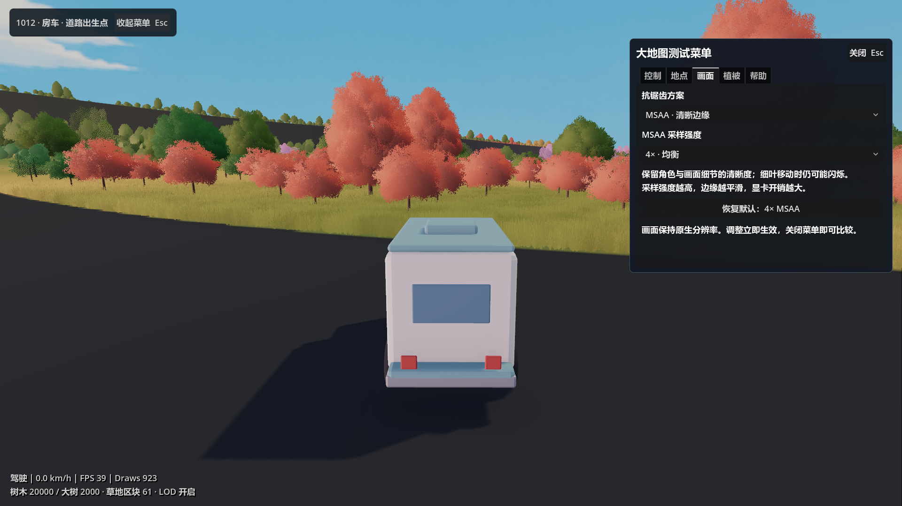
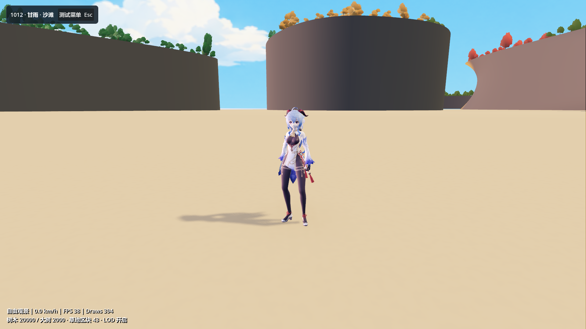
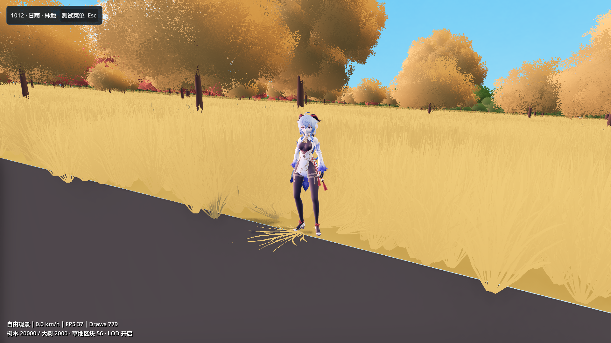
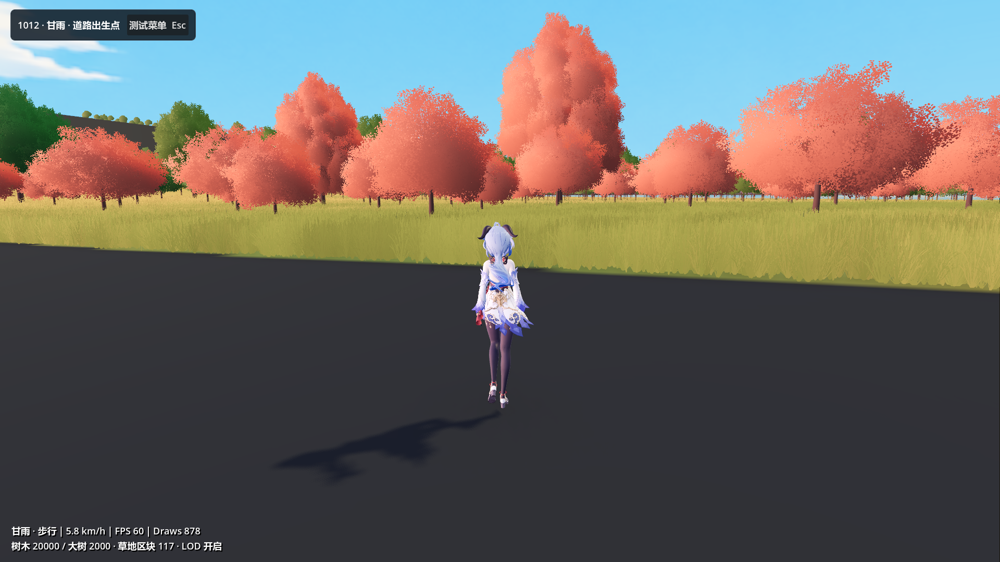

# 甘雨大世界控制测试（2026-10-12）

当前主入口 `scenes/main.tscn` 的 1012 大地图增加房车 / 甘雨切换。停止当前运行后按 F5 重启，按 C，或打开“测试菜单 → 控制”切换。切换在当前地点进行，隐藏并停用另一种控制器；自由观景中切换也保留观景状态。草地加载和角色镜头随当前控制对象切换。

## 操作

| 功能 | 操作 |
| --- | --- |
| 测试菜单 | 顶部入口、Esc；二级页签为控制 / 地点 / 画面 / 植被 / 帮助 |
| 切换房车 / 甘雨 | 测试菜单 → 控制、C |
| 人物移动 | WASD，以镜头方向为基准 |
| 奔跑 | Shift + 移动 |
| 跳跃 | 空格 |
| 招呼 | G，静止站立时播放 |
| 重置到当前角色的定位点 | R |
| 镜头旋转 / 缩放 | 右键拖动 / 滚轮 |
| 自由观景 / 返回当前控制对象 | F |
| 道路、林地、沙滩、高层平台 | 1–4 |
| 全岛 / 植被 / 树木 LOD | Tab / V / L |

地图已替换为 `map/mesh.gltf`。四个定位点固定在原源模型 XZ 坐标上，重新采样新网格高度；林地和高层周围留出 10 米的树木空区。角色模式保留向侧面偏移 4 米的设置，房车保持原先地点。

菜单打开时暂停该测试场景的控制、物理与动画处理，关闭后恢复原控制对象和观景方式；右键拖动状态在关闭时清除，避免松开鼠标后镜头仍转动。画面仍渲染，抗锯齿调整即时生效。详细性能统计默认开启，显示 FPS、Draws、树木数、草地区块数及 LOD 状态，可在“植被”页关闭。

用户优先保留角色渲染清晰度，已回退至原来的 4× MSAA，关闭 TAA / FXAA。“画面”页暂时只提供关闭、MSAA，采样强度为 2× / 4× / 8×，恢复默认按钮为 4× MSAA。关闭抗锯齿时禁用采样控件，所有方案保持原生分辨率。更高采样增加 GPU 开销；植物细叶移动时仍可能闪烁。

画面偏好保存在 `user://world_test_graphics.cfg`，下次进入测试自动读取。旧配置若保存了 TAA 或 FXAA，将自动迁移到 4× MSAA，防止重启后重新启用；退出场景恢复此前的 viewport 配置。自动化验证忽略用户偏好，不覆盖实际玩家的配置。面板实现为 `scripts/world_test_panel.gd`，验证工具为 `tools/verify_world_test_panel.gd`。

面板验证已通过无窗口逻辑检查及 Forward+ / D3D12 实机检查：菜单入口鼠标点击与 Esc、关闭 / MSAA 和三个采样档位、TAA / FXAA 始终关闭、旧偏好迁移、开关期间控制冻结与恢复、菜单中切换人物、偏好保存 / 读取及无效值回退、退出恢复 viewport、960×540 布局与滚动均正常。原人物步行 / 奔跑 / 跳跃和四处定位点回归通过。报告为 `docs/WORLD_TEST_PANEL_REPORT.json`；截图帧率受场景加载及测试切换影响，未用于性能结论。



## 模型与控制器

复用 `scenes/characters/ganyu.tscn`，保持原模型比例、导入材质和已有服饰 / 头发弹簧骨配置。新包装场景为 `scenes/characters/world_ganyu.tscn`，控制器为 `scripts/world_character_controller.gd`。

材质核对（2026-10-12）：运行时 19 个材质均为 `StandardMaterial3D`，使用逐像素标准光照，金属度 0、粗糙度 0.5；均使用 Alpha Depth Pre-Pass，未设置描边的 next_pass。源 VRM 未声明 `VRMC_materials_mtoon`，当前未应用 MToon 或项目专用角色着色器。此前此处将导入材质记为 MToon 有误；二次元观感主要来自原模型与贴图。

控制器使用 CharacterBody3D 和直径 0.48 米、高 1.45 米的胶囊碰撞，重力 22 米/秒²，跳跃初速度 7 米/秒。步行 1.6 米/秒，奔跑 4.2 米/秒；移动方向归一化，模型平滑转向移动方向。镜头使用可碰撞的 SpringArm3D，默认距离 4.5 米。水面仍不作为人物或房车的地面。

复用已烘焙到甘雨骨架的动作，通过 AnimationPlayer 过渡切换：

| 状态 | 动作 |
| --- | --- |
| 待机 | A01 放松站立 |
| 步行 | A05 已修正循环的女性步行 |
| 奔跑 | A06 女性跑步 |
| 起跳 / 空中 / 落地 | A18 / A19 / A20 |
| 招呼 | A25 |

运行时复制动作资源，保持骨盆摇摆和上下动作，只去除水平位置的固定中心；世界移动由碰撞控制器负责。Skeleton3D.motion_scale 为 1，避免对已烘焙的米制位移再次缩放。传送后重建弹簧骨模拟。未覆盖原模型或原动作资源。

这是基础控制器，尚未加入脚部 IK、攀爬、游泳、角色与全部树干的碰撞，以及完整的跳跃动作同步。跑步和落地的脚部姿态仍来自现有动作；当前高草会遮挡下半身，适合用人物视角检查植被尺度。

## 验证

Godot 4.7.2 / Forward+ / RTX 5070 Ti 实机渲染及控制检查通过。实际按钮回调成功切换，动画轨道和骨骼路径全部有效；1.5 秒步行约 2.29 米、奔跑约 6.01 米，跳跃最高约 1.17 米，起跳 / 空中 / 落地 / 待机顺序均出现。转动镜头后移动方向与镜头前向一致，模型朝向同步。

四个定位点均落地。自由观景暂停人物移动，返回后恢复人物镜头；全岛观景中切回房车保持自由相机。额外上层地板测试确认角色切换保留当前层，不跳到头顶上方的最高地面。房车定位、短距离驾驶、20,000 棵树和 2,000 棵大树的回归检查通过。

工具：`tools/verify_world_ganyu.gd`；完整报告：`docs/WORLD_GANYU_TEST_REPORT.json`。

```powershell
& 'D:\Godot\Godot_v4.7.2-stable_win64.exe\Godot_v4.7.2-stable_win64_console.exe' --headless --path . --script res://tools/verify_world_ganyu.gd
```

生成实机截图时去掉 `--headless`，并添加 `-- --capture-world-ganyu`。






