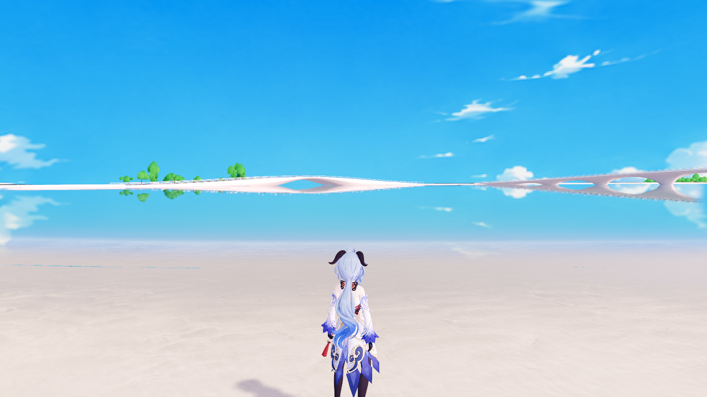
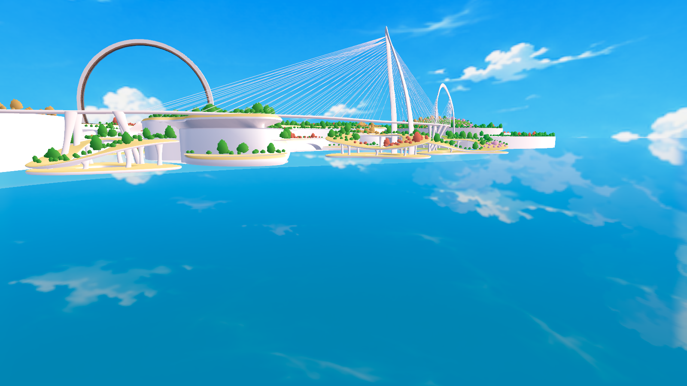

# ACG 夏日天空全景 · 2026-11-07

按用户概念图重新绘制清亮、高饱和的日式 ACG 天空：钴蓝到青蓝的渐变、白色积云、冷蓝阴面与轻薄卷云。生成与修改均使用内置 image_gen；没有对旧图简单提高饱和度，也没有用 Python 重绘或拼接图片。

## 当前选用版本

正式资源为 [acg_summer_panorama_v3.png](../../assets/environment/sky/acg_summer_panorama_v3.png)，原生分辨率 **1774 × 887，严格 2:1**。提示词请求更大分辨率，工具实际返回该尺寸；没有将放大后的图冒称为 4K 原图。它是 LDR 绘制天空，不是提供真实场景辐射强度的 HDRI。

第一版 `acg_summer_panorama_v1.png` 云团过大。用户反馈后，第二版将主要积云的宽、高缩到原约三分之二，云底仍靠近地平线，保留第一版的蓝色、明暗风格与高空卷云，增加蓝天留白。[完整生成与修改提示词](../../assets/environment/sky/acg_summer_generation_20261107.json) 可供后续 agent 继续调整。

第三版按用户追加反馈，再缩小高大的积云，提示词目标为第二版宽、高的约 75%；这是绘制修订而非严格数值缩放。保留薄卷云、色调和天空渐变。用户同时要求在当前朝向上再旋转 180°，当前 `display_yaw` 因此为 **−90°（等效 270°，由原 +90° 追加 180°）**。[本轮提示词与修订记录](../../assets/environment/sky/acg_summer_revision_v3_20261107.json)。

## 接入范围

- `assets/environment/sky/fresh_cumulus_sky.tres`：可见背景改用新全景，原 HDRI、lighting_energy 与 display_energy 保留，背景 yaw 单独调整，过程见末节。
- `scripts/water/water_manager.gd`：已有水面的天空倒影采样同一张新图，避免背景与水中天空不一致。没有新增反射相机或探针，没有改变反射视口更新逻辑。
- `assets/environment/sky/stylized_panorama.gdshader` 与 `assets/water/water_surface.gdshader`：将相同的极点混合保护从贴图高度 20% 收窄到 8%。旧范围会淡化高积云；两处保持一致，左右接缝仍使用已有 1.5% 窄带混合。
- 新 PNG 启用 mipmap，保留原生分辨率和无损导入。PNG 上下半球及左右边缘并非逐像素数学一致，由上述运行时窄带保护处理；不声称原文件天然完全无缝。

原 `fresh_cumulus_panorama_v2.png` 保留，方便回退。沙滩材质、几何、碰撞、Rhino 主模型、草地烘焙、用户种植存档、主世界脚本和太阳／全局曝光参数均未在本轮调整。运行时用户已有的外观设置仍生效，实际曝光读数见报告，不等同于脚本默认值。

## 实机复核

验证入口为 `scenes/main.tscn`，Godot 4.7.2 / D3D12 Forward+。`tools/review_acg_sky_1107.gd` 在固定海岸镜头切换旧贴图与新贴图，保持相同 HDRI、曝光和极点保护；另拍摄仰视、主云团、接缝两侧与天顶。测试只在运行时切换资源，结束后退出。



[旧贴图同镜头](before_shore.png) / [当前仰视](after_sky_up.png) / [当前主云团](after_main_cloud.png) / [第一版过大的主云团](v1_cloud_scale.png) / [接缝左侧](seam_left.png) / [接缝右侧](seam_right.png) / [天顶](zenith.png)。

[实机报告](review.json) 记录实际加载资产、尺寸、HDRI、曝光及水面数量。[范围校验](scope.json) 对照本轮开始的文件指纹；PNG 原图的边缘／极点统计见 [贴图检查](texture_checks.json)。导出依赖由项目原配置工具重新生成，没有制作完整发布包。

复核命令：

```powershell
$godot = '.current_map_build/runtime/Godot_v4.7.2-stable_win64_console.exe'
& $godot --headless --editor --path . --import --quit
& $godot --path . --script res://tools/review_acg_sky_1107.gd --rendering-driver d3d12 --resolution 1600x900
& $godot --headless --path . --script res://tools/configure_export_1021.gd
```

后续调整应先确定是云的角尺寸、色彩、朝向还是场景照明。仅改全景图时不要同时改全局曝光；不要再用覆盖上半球很大范围的极点淡化来缩小云。更换全景时同时核对天空背景与现有水面倒影引用。

## 初始区域朝向微调

用户反馈大云团在初始场景过于显眼，现将 `fresh_cumulus_sky.tres` 的 `display_yaw` 设为 **+90°（π/2）**。对照了 0°／45°／90°／120°，90° 让桥梁与环形地标后方主要呈现蓝天和薄云。此次没有再次修改贴图、云尺寸、太阳方向、HDRI 朝向或全局曝光。

`water_manager.gd::initialize()` 读取天空材质的 `display_yaw`，令水面采样使用 `sky_yaw = environment.sky_rotation.y - display_yaw`，保持可见背景和倒影同步。仅旋转 `Environment.sky_rotation` 会连带旋转 HDRI 光照，因此本次采用背景独立旋转参数。



[原朝向](initial_yaw_0.png) / [45°](initial_yaw_45.png) / [120°](initial_yaw_120.png) / [运行验证](yaw_review.json) / [范围指纹](yaw_scope.json)。验证从正式默认出生点加载，保留其镜头朝向，将测试用自由镜头向洞口外移 26 m，使室外天空可见；没有修改正式出生位置或角色相机配置。初始化后检查全部水面的旋转参数与天空偏移一致。

后续只需调整天空材质的 `display_yaw` 并重新启动场景，水面会在初始化时读取它；不要另外手调一套水面角度。

## 再缩小积云并追加旋转 180°

当前为 v3／−90°。上节 +90° 仅保留为调整历史。主要积云转向地图南侧的东南方向，天空与水面仍使用同一张全景；不旋转 HDRI、太阳或模型。没有再次调整沙滩、植被、曝光或几何。

实机从相同的全景采样方位对照 v2 与 v3：[上一版相同朝向](v2_same_yaw_main_cloud.png) / [当前主积云](after_main_cloud.png)。另保留 [当前初始区域视角](initial_yaw_-90.png)、[朝向与倒影初始化检查](yaw_review.json) 及 [本轮范围校验](v3_scope.json)。主云团方位为依照贴图中心 u≈0.32 估算，实际截图与 `review.json` 可复核其角尺寸和方位。
