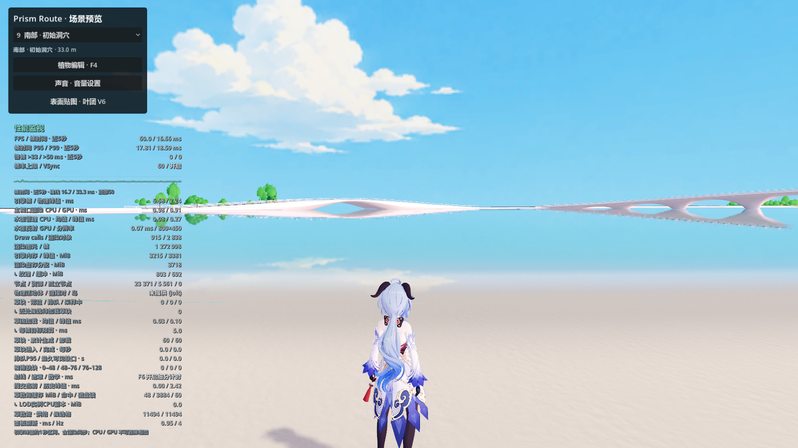
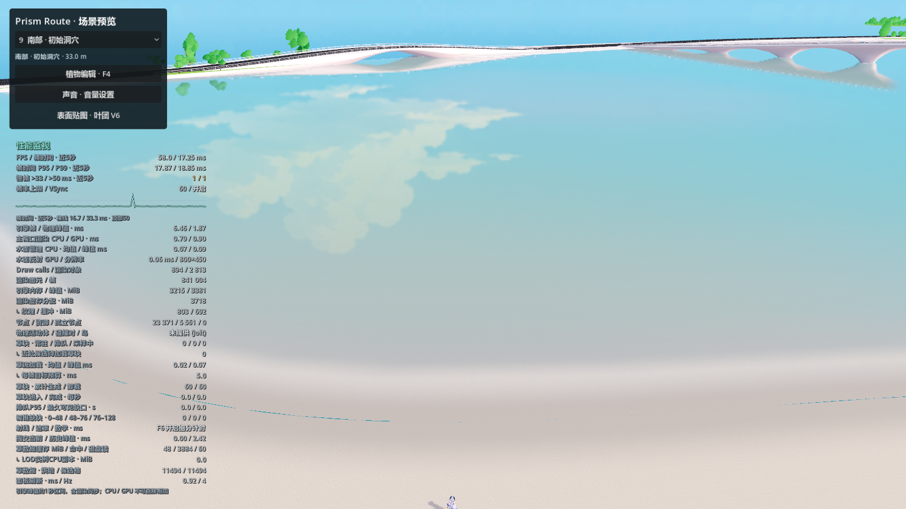
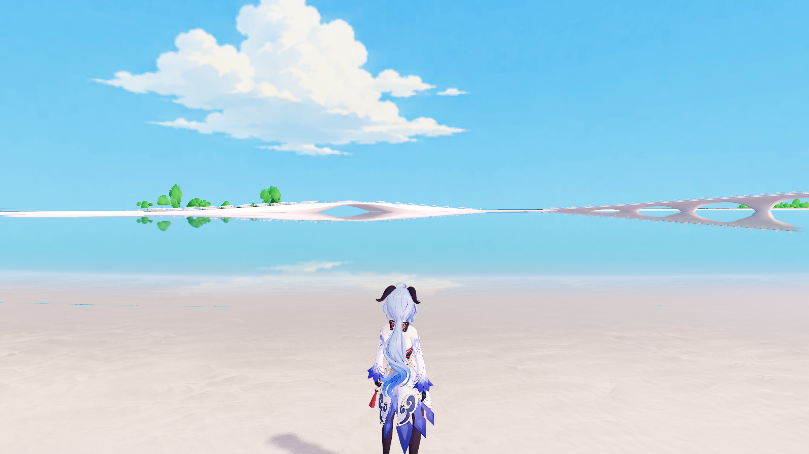

# 沙滩到水下湖底的缓坡与材质

完成：2026-11-07。用户明确要求沙滩到水底的缓坡，与其他地形无关。本次不制作陆地通往沙滩的通道。

## 实际改动

Rhino 主文件是 `D:\Prism Route\map\map_current.3dm`，已保存。1712 个对象中，仅修改北泻湖沙底 `a2b4d386-d01a-4559-a8f7-28e5c8b93563`。其余 1711 个对象的几何与属性指纹不变，目标对象的原属性也完整保留；没有叠加第二套沙底。

原沙底使用接近竖直的侧裙，把 Z=0 沙滩接到约 -0.26 m 的湖底。现移除朝向主沙滩的那一片竖裙，切除旧湖底对应的窄带，用一片连续 NURBS 缓坡连接沙滩与保留湖底。坡带宽约 14 m，沿岸长约 1879 m，端部约 30 m 逐渐收窄，过渡到既有岸壁。抽查的十条剖面落差约 0.32～0.37 m、坡度约 4%～5%；远处湖底仍保持原有起伏与最深约 -0.64 m。

沙滩上缘曲线完整保留，101 个对应参数点误差小于 1e-8 m。其余四片岸壁的底层曲面 CRC 不变；水面、原平面沙滩、道路、建筑与其他地形均未调整。重新 JoinBreps 会重接原短折返边的拓扑，因此不能仅用整个 Brep 的裸边总长度判断沙滩轮廓是否改变。

主模型已保存；本次不保留一份额外完整 Rhino 备份或单独组件 3dm。

## Godot 接入与材质

正式入口仍是 `scenes/main.tscn`。新沙底位于 `assets/world/beach_slope_1107/beach.glb`，约 1.27 MiB、50663 个三角形；替代基础地图中原来的 46135 个三角形，净增 4528 个。`scripts/world/beach_slope.gd` 创建一个 Sand 碰撞体，层为 33（地面查询 1 + 角色实体 32）。基础地图加载时先移除旧 ID 的渲染网格，再建立新对象，避免可见面与旧碰撞重复。

`current_region.glb`、地形遮罩、草地烘焙、用户树木存档和水面逻辑没有修改。Sand 原本不参与草地种植；本次仅改变沙底，不需要重烘焙草。实机确认全图草缓存签名有效，教堂 12 格局部烘焙仍安装成功。后续若改动可种植地形，不能据此跳过重烘焙。

[关键资产指纹](unchanged_assets.json) 保存上述文件的当前 SHA-256。受版本管理的文件对照 Git HEAD：LFS 按内容 OID 比较，文本按 Git 使用的 LF 行尾比较。未纳入 Git 的生成资产只记录当前指纹，不冒充历史字节对照；草地另由实机缓存签名验收。

四个 Sand 语义对象统一使用 `assets/environment/beach_sand/beach_sand.tres`：

- Sand 03 以约 2 m 尺度提供细节，Aerial Beach 01 以约 30 m 尺度提供弱沙纹。
- 照片颜色归一到浅米色，减少明暗反差与微法线强度；原下载纹理字节保留。
- 原网格没有 UV，使用世界 XZ 米制投射。沿岸的 `shore_distance.png` 提供湿沙过渡，避免把整片 Z=0 平面都判为湿沙；水下部分再结合高度判定。
- 单层不透明材质，没有置换、透明覆盖面或新增水面反射视口。只绑定 Sand，不改建筑／地形材质。

完整纹理来源和 CC0 许可见 [素材清单](../../assets/environment/beach_sand/sources.json)。导出资源列表已补齐新 GLB、shader、材质、纹理及源清单，依赖检查为 310 项、缺失 0；没有重新制作完整游戏发布包。

## 验收

[实机报告](validation.json) 基于 Godot 4.7.2、D3D12 Forward+，加载正式 `main.tscn` 后执行：

- 仅一个新沙底碰撞体，旧碰撞不再存在。
- 60 处坡面碰撞检查全部通过，碰撞与原生 NURBS 的最大采样高差约 9.3 mm，小于本次导出 4 cm 网格公差。
- 10 处真实角色跨越全部通过，每处从干沙走入水下坡面至少 3.11 m，没有卡住或掉落。
- 草缓存签名有效，教堂 12 格局部烘焙正常。
- 新沙材质在实际渲染中编译并显示正常；没有做全地图前后 GPU 性能基准，不能将截图中的锁帧读数当作性能改善结论。

精确落在曲面裁剪边界上的零宽射线，可能漏过独立网格化形成的弦边。验证坡面时首点向坡内移动 15 cm，同时使用真实角色跨越检查，不能仅把边界射线失败当作坡体缺失，也不能只改测试而跳过实际跨越。





画面拍摄位置约为 Godot `(-795, 0, -229)`，面向北侧水面。该位置为验证镜头，不改变正式出生点。

## 重建与后续注意事项

`tools/rhino_beach_slope_1107.py` 的 `prepare()` 专用于修改前 CRC=4236641155 的沙底。已经应用后的模型不能再次执行它，脚本会拒绝；它不是随意重建整座泻湖的通用生成器。不要重跑旧 `rhino_lagoon_1025.py`，该脚本包含历史对象创建、旧 ID 和整图备份步骤。

NURBS 过渡使用与原岸线兼容的控制网：横向 XY 线性展开、Z 使用五次平滑剖面，在两端保持水平切向。不要将不同曲线各自的归一化弧长直接配对放样；那样可能造成局部扭曲、宽度变化或面法线翻转。发布前核对曲面有效性、上朝法线、接缝和未修改对象指纹；替换对象后显式恢复原属性，避免 Rhino 自动添加属性数据改变原材质设置。

中间数据只存于忽略目录 `.current_map_build/beach_slope_1107/`，没有复制完整 Rhino 模型。之后若在 Rhino 手工改变此组件，应重新检查并导出该对象，再重建局部 GLB 和岸线距离纹理；材质中的 `shore_origin`、`shore_extent` 必须与 manifest 一致。

在项目根目录执行：

```powershell
python tools/build_beach_slope_1107.py
$godot = '.current_map_build/runtime/Godot_v4.7.2-stable_win64_console.exe'
& $godot --headless --editor --path . --import --quit
& $godot --path . --script res://tools/verify_beach_slope_1107.gd --rendering-driver d3d12 --resolution 1600x900
& $godot --headless --path . --script res://tools/configure_export_1021.gd
```

先确认中间导出数据对应当前 Rhino 组件，不能用旧缓存覆盖后续改动。验证串行运行并自动退出；保持其他 agent 的家具、角色与动作修改不动。

## 2026-11-07：按效果图微调，仅沙滩材质

用户将范围限定为沙滩材质。本轮只调整 `shaders/environment/beach_sand.gdshader` 和 `assets/environment/beach_sand/beach_sand.tres`，同时保留画面对照与记录。没有修改 Rhino、网格、碰撞、草地、水面、灯光或全局曝光，也没有新增反射相机、反射探针或烘焙。

发现原颜色细节几乎被压平：两个 `source_color` 采样返回线性 RGB，但旧代码分别除以 0.55／0.5。贴图的线性平均亮度实际约为 0.1213／0.2438，因此大部分采样落在下限 0.7，纹理颜色差异无法表现。现按线性均值归一，并用较低强度混合。第一轮恢复纹理后近景偏粗，最终降低颗粒对比和微法线，保持柔和色块。

| 参数 | 原值 | 本轮 |
| --- | --- | --- |
| 干沙颜色（sRGB） | 0.87 / 0.82 / 0.71 | 0.90 / 0.835 / 0.735 |
| 湿沙颜色（sRGB） | 0.73 / 0.70 / 0.62 | 0.73 / 0.685 / 0.60 |
| 干／湿粗糙度基值 | 0.94 / 0.66 | 0.92 / 0.30 |
| 湿带完全干燥距离 | 4 m | 5.5 m，复用沙纹作小幅边缘变化 |
| 干／湿微法线强度 | 0.14 / 0.07 | 0.13 / 0.035 |

继续使用既有天空环境反射。湿沙的低粗糙度用于增强柔和光泽，尚未实现概念图中清晰的桥梁／树木倒影，也没有添加浪花、焦散或水面细节。

`tools/review_beach_material_1107.gd` 在正式 `main.tscn` 的四个 Sand 网格上交替绑定修改前快照和当前材质，拍摄人物视角、低角度岸线、俯视三组截图。对照时保持摄像机和世界设置一致，风和水面仍正常动画。过程结束自动退出，不保存测试中的材质切换。

[渲染采样报告](material_review.json) 记录实际设备、分辨率和短时 GPU／渲染 CPU 采样；这不是全图性能基准。[本轮范围校验](material_scope.json) 对比改动前快照，核对地图脚本、水面脚本／shader、沙底 GLB、基础地图 GLB、草地清单和用户树木存档保持不变。



[修改前人物视角](material_before_shore.png) / [修改前低角度](material_before_wet.png) / [修改后低角度](material_after_wet.png) / [修改前俯视](material_before_overview.png) / [修改后俯视](material_after_overview.png)。

复核命令：

```powershell
& '.current_map_build/runtime/Godot_v4.7.2-stable_win64_console.exe' --path . --script res://tools/review_beach_material_1107.gd --rendering-driver d3d12 --resolution 1600x900
```

材质参数已暴露在 `beach_sand.tres`。后续优先修改这些参数；不要为增强湿沙反光而调整整个世界的曝光或破坏已有水面反射的启停逻辑。
