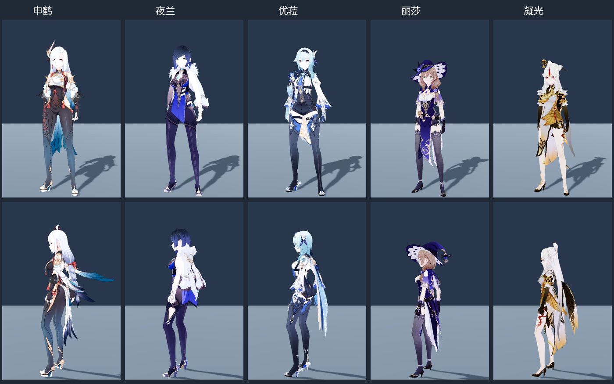
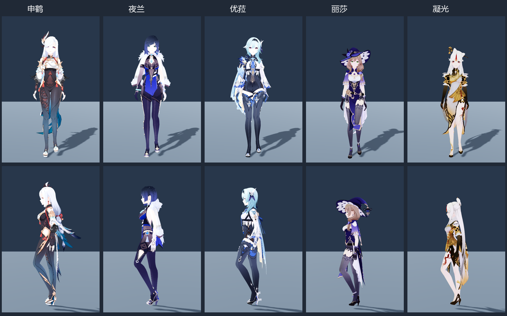

# 第二批角色入库：申鹤、夜兰、优菈、丽莎、凝光

完成日期：2026-11-04。沿用 [角色批量导入指南](../CHARACTER_BATCH_IMPORT_GUIDE.md) 的 PMX → VRM 1.0 → Godot 路线。两批新增 10 个，加原有 4 个，目前共 14 个；待处理角色剩余 36 个。

## 同一个测试场景

继续打开 **`scenes/character_roster_review.tscn`** 按 F6，或运行 `tools/run_character_roster_review.ps1`。没有新增测试场景。菜单现在从累计 `assets/characters/roster/catalog.json` 读取，含首批和第二批共 10 个新角色。原动作库预览器 `scenes/character_mmd_vrm_validation.tscn` 也能选择本批人物，其角色菜单共 14 个。

默认 1×、地图待机 A01，切换地图步行 A05、跑步 A06，头发／服饰物理可独立开关；额外接地辅助默认关闭。本批没有针对单个角色修改骨盆轨迹。后续已统一修正共享预览的骨盆抵消与物理回绕，并将修正后的 A06 纳入验收，见 [最新移动动作验收](../character_locomotion_1104/README.md)。本目录原始渲染与报告保留为导入时快照。

## 成品

| 人物 / ID | Godot 骨骼 | MToon 材质 | 形变目标 | 头部 / 服饰物理链 | VRM 大小 |
| --- | ---: | ---: | ---: | ---: | ---: |
| 申鹤 `shenhe` | 260 | 23 | 65 | 3 / 5 | 41.80 MB |
| 夜兰 `yelan` | 367 | 22 | 62 | 12 / 25 | 39.57 MB |
| 优菈 `eula` | 214 | 25 | 60 | 6 / 8 | 36.61 MB |
| 丽莎 `lisa` | 421 | 14 | 46 | 2 / 22 | 28.50 MB |
| 凝光 `ningguang` | 623 | 14 | 45 | 5 / 30 | 29.10 MB |

五份 VRM 合计 **175,586,100 B，约 175.59 MB / 167.45 MiB**。每人一份 `assets/characters/roster/<id>/<id>.vrm`，贴图内嵌；复用人物场景位于 `scenes/characters/roster/<id>.tscn`，默认引用共享 A01。人物各有 12 个身体碰撞体，本批合计 118 条物理链、1,060 个链关节。保留正常服装；五个源包各有一个主体 PMX，没有合并独立武器和道具。





## 动作来源与检查

直接复用首批纠正后的 `shared_world_A01.tres`、`shared_world_A05.tres`、`shared_world_A06.tres`，没有为五个人物重复生成动作。来源是正式甘雨 `world_character_controller.gd` 实际加载并居中的 `motion_review/A01.tres`、`A05.tres`、`A06.tres`，保留最终骨盆和循环修正。原始 `walk.vrma` 的历史共享样本不作为本批基础步行来源。

- [本批运行检查](runtime.json)：五个人物 × 三份共享基础动作，骨骼有限性、长度稳定、共享资源身份、跳帧复位和衣发开关通过。
- [累计场景检查](cumulative/runtime.json)：仍加载同一个 `character_roster_review.tscn`，两批 10 个角色全部切换检查通过；注册角色共 14 个。
- [待机渲染](visual.json)、[步行渲染](visual_walk.json)、[关闭物理对照](visual_rigid.json)：实际 Forward+ / D3D12 截图，98 个材质均导入为 ShaderMaterial。
- [原动作库角色接入](existing_review.json)：逐个替换五个角色，共享资源身份和双方时钟通过。这使用历史中性共享样本，仅验证接入机制，不替代地图动作来源检查。
- [正式甘雨来源一致性](../character_batch_1104/formal_motion_fidelity.json)：共享转换与正式控制器对照通过，本批复用相同资源。
- [完整性与报告索引](summary.json)：记录本批原压缩包、项目外 PMX、既有九个 VRM、共享动作和本批成品的 SHA-256 检查。

## 本批处理经验

五个人物均符合现有 D / EX 权重转移前提：标准腿组未带有效权重，D 骨与标准骨枢轴吻合。继续使用条件检查和辅助骨跟随处理，未改成按名字无条件覆盖。

**凝光：混合编码损坏路径。** PMX 引用 `凝光/Texture/表情.png`，源 ZIP 的该条目却是 `ï├î⌡/Texture/ò/Åε.png`。Shift-JIS 字节中的反斜杠被写成目录分隔符，单纯切换 ZIP 编码无法恢复。`second_batch_profiles.json` 中用 `archive_path_overrides` 精确映射这个已确认条目，只修复项目外解包副本；不修改原 ZIP，也不全局替换斜杠。最终贴图存在并成功内嵌，映射记录在凝光 `provenance.json`。

**丽莎：帽子保持刚性。** 帽子随头部跟随，头发使用实际发链，衣裙使用各自链条，不把带分支的整顶帽子机械地当成长发链。

**物理与原造型分开看。** 申鹤背部部分装饰本来就向后展开，关闭物理的对照也保留该形态。本批不重塑原始装饰轮廓。身体碰撞和骨链不能保证所有衣物自碰撞；鞋底接触、轻微滑步及贴身动作局部穿插仍留待重要角色精修。

## 重建

在项目根目录执行：

```powershell
# 仅预检第二批
tools/run_character_batch_1104.ps1 -AuditOnly -ProfilesFile tools/character_batch/second_batch_profiles.json -WorkRoot 'D:/Prism Route/research/character_batch_20261104_02'

# 重建第二批成品、注册并在原场景验证
tools/run_character_batch_1104.ps1 -ProfilesFile tools/character_batch/second_batch_profiles.json -WorkRoot 'D:/Prism Route/research/character_batch_20261104_02' -ManifestName second_batch.json -EvidenceDirectory character_batch_1104_02

# 沿用原场景查看
tools/run_character_roster_review.ps1
```

工作副本、Blender 日志、预检与中间 VRM 位于项目外 `D:/Prism Route/research/character_batch_20261104_02/`。项目内只保留成品、人物复用场景、来源配置与验收记录。原作者信息和原 PMX 说明保存在各角色 `provenance.json` 与 VRM 元数据中。正式地图的主控人物、原有模型与已选动作库没有替换。
