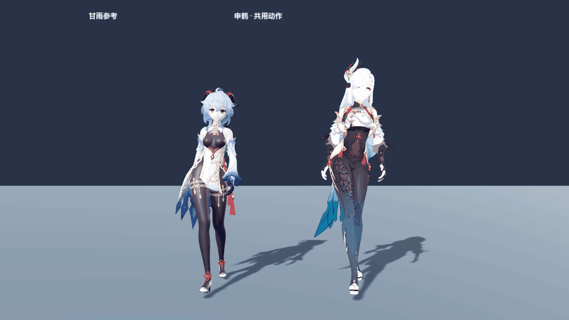
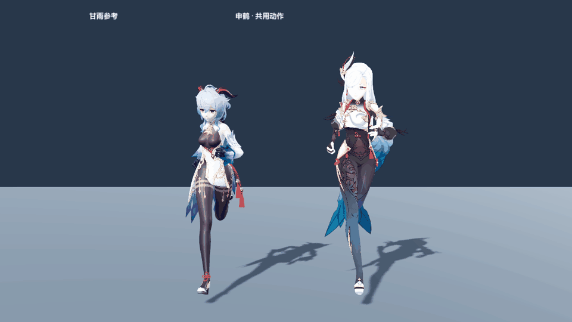

# 共享步行／跑步：骨盆轨迹与循环验收

更新：2026-11-04。继续使用 `scenes/character_roster_review.tscn`；本记录取代早期批次中“跑步仅诊断”和“共享转换通过即代表最终画面正确”的结论。当前累计清单中 11 个角色，加甘雨参考，共 24 个步行／跑步组合通过 30 / 60 / 120 FPS 验收。角色数量和明细以报告所记录的清单为准。

## 原因与修正

1. **预览逐帧抵消了正确的位移。** 共享播放器已计算“目标骨盆枢轴补偿＋甘雨动作的骨盆侧移”，预览器却用 `actor.position = -root_displacement.xz` 把两者再次取消。甘雨参考的步行骨盆轨迹误差最大约 **60.46 mm**，跑步约 **43.20 mm**。现在保持固定展示原点，只保留可选的额外接地辅助；自然侧移和枢轴补偿进入最终画面。
2. **循环时重置物理。** 原预览每次回绕都调用 `actor.seek()`，重新初始化 Spring Bone。现在自动回绕仅更新周期时间并采样，保留衣发的惯性状态；拖动时间轴、换动作等真正跳帧操作仍会复位物理。
3. **A06 本身没有完成循环和水平骨盆校准。** 在原有甘雨转换工具中，将 A05 已使用的解剖骨盆水平校准和四元数 Hermite 接缝处理应用到 A06。保留原周期 **0.79166665 秒**，不靠变速修饰问题；在接缝两侧约 0.165 秒的窗口闭合姿态与离散速度，中间段的关节旋转不改。竖直运动仍按原动作，接缝窗口作连续化处理。

正式资源只更新 `assets/characters/motion_review/A06.tres`，其余 41 段（包括 A01 / A05）保持原 SHA-256。正式地图甘雨和共享预览使用同一份修正后的 A06，再从实际甘雨控制器采样生成一份 `shared_world_A06.tres`，供所有目标角色复用。人物 VRM、贴图、权重与骨架未重导，也不为每个人复制动作。

`neutral_clips.json` 已将 A06 纳入验收，菜单不再显示“暂不验收”。批处理脚本在导入检查后执行最终场景的步行／跑步连续循环验收。

## 验收证据

| 项目 | 结果 |
| --- | --- |
| 最终预览骨盆轨迹对共享源 | 最大误差低于 0.001 mm |
| 跑步首尾骨盆位置差 | 14.25 mm → 闭合 |
| 跑步关键关节首尾角度差 | 修正前最大约 13.84°；修正后低于 0.06° 的数值容差 |
| 头、胸、骨盆、双手、双脚首尾标记位置差 | 全部组合低于 0.001 mm |
| 接缝两侧速度差 | 60 FPS 报告最大约 0.016 m/s，低于 0.15 m/s 门槛 |
| 实际预览时钟连续回绕 | 每组合至少 4 圈；回绕步长不高于周期内最大步长的 1.2 倍 |
| 自动回绕导致的物理重置 | 0 次；衣发持续模拟且姿态有限 |
| 甘雨与共享转换对照 | A05 最大位置误差约 0.00871 mm，A06 约 0.1274 mm |

验收取的是**场景最终世界坐标**，不能只验证共享资源或播放器内部姿态。甘雨参考的步行头部横摆峰峰值约 **2.33 cm**；保留合理的骨盆平衡后，上身会比固定骨盆更稳定。其他体型仍保留各自骨长，数值通过不等于复杂接触动作或足部 IK 已完成。

报告：[修正前](before.json)、[修正后](after.json)、[60 FPS](acceptance.json)、[30 FPS](acceptance_30.json)、[120 FPS](acceptance_120.json)、[甘雨来源一致性](formal_motion_fidelity.json)、[真实时间倍率](playback_clock.json)、[完整性索引](summary.json)。

以下是同一预览场景中的实际渲染，左侧甘雨参考，右侧申鹤；按正常 1× 时间编码，GIF 的毫秒取整累计误差不超过约 5 ms。





两批角色正侧面：[首批步行](first_walk_sheet.png)、[首批跑步](first_run_sheet.png)、[第二批步行](second_walk_sheet.png)、[第二批跑步](second_run_sheet.png)。[步行渲染报告](visual_walk.json) 和 [跑步渲染报告](visual_run.json) 包含当时全部累计角色。

## 重建和回归

在项目根目录依次执行：

```powershell
$godot = '.current_map_build/runtime/Godot_v4.7.2-stable_win64_console.exe'

# 仅需重新生成 A06 时执行；--ids 现在会合并目录清单，保留其余 41 段记录。
& $godot --headless --path . --script res://tools/inspect_motion_skeleton.gd
python tools/build_motion_review.py --ids A06

# 更新一次共享资源，并对照正式甘雨。
& $godot --headless --path . --script res://tools/character_batch/export_formal_ganyu_motion.gd
python tools/character_batch/build_neutral_clips.py
& $godot --headless --path . --script res://tools/verify_formal_ganyu_motion.gd

# 必须经过最终场景，检查骨盆、接缝、连续时钟和物理状态。
& $godot --headless --path . --script res://tools/verify_roster_locomotion_1104.gd --fixed-fps 60
# 帧率回归时，--fixed-fps 与 --test-fps 需一致。
& $godot --headless --path . --script res://tools/verify_roster_locomotion_1104.gd --fixed-fps 30 -- --test-fps=30
& $godot --headless --path . --script res://tools/verify_roster_locomotion_1104.gd --fixed-fps 120 -- --test-fps=120

# 实时倍率检查不传 --fixed-fps，包含待机、步行、跑步和 0.75× 对照。
& $godot --headless --path . --script res://tools/verify_character_preview_clock.gd
```

生成对比动图：用 D3D12、1280×900、固定 60 FPS 运行 `tools/capture_roster_locomotion_1104.gd`，再执行 `python tools/encode_roster_locomotion_1104.py`。编码器使用实际截图并删除临时逐帧 PNG，不保留整套渲染帧占空间。旧 A06 和动作 SHA-256 基线仅保存在项目外 `D:/Prism Route/research/locomotion_fix_20261104/`；不是完整模型备份。

后续批次复用这些共享修正。普通 NPC 不需要逐人修改骨盆；若个别人出现明显接触异常，再调整角色适配。主控角色的启停、转向、脚底接触和更复杂互动另行验收。

## 恋活动作候选（2026-11-14）

运行 `scenes/character_roster_review.tscn`，选择待机、步行或跑步，打开「同屏对比恋活」。左右使用同一个模型，左侧播放现用地图动作，右侧播放恋活候选。播放时各自按原周期循环。暂停后拖动时间轴，两边对齐到各自循环的同一百分比。正式地图继续使用 A01、A05 和 A06。

| 项目 | CharaStudio 条目 | 现用周期 | 候选周期 | 对比 |
| --- | --- | --- | --- | --- |
| 待机 | 待機1 · `f_stand_00_00` | 2.54 s | 4.73 s | 重心变化较慢，适合 NPC 长时间站立。 |
| 步行 | 歩く1 · `f_aruki_00_00_01` | 1.33 s | 2.07 s | 荧的近地支撑脚后扫约 1.58 m/s，现用动作约 0.86 m/s。候选更接近角色控制器的 1.60 m/s。 |
| 跑步 | 走る1 · `f_hasiru_00_00_01` | 0.79 s | 0.73 s | 荧的近地支撑脚后扫约 2.97 m/s，现用动作约 4.13 m/s。候选更适合慢跑，现用动作更贴合 4.20 m/s 的冲刺。 |

这些速度来自原地播放时的脚趾位移估算。荧与绮良良的三段候选均通过首尾姿态和速度检查，首尾标记位置差均小于 1 mm。把候选接入移动控制器前，再做实际移动、启停和转弯的脚底接触检查。

来源为本机 Koikatsu RX22 的 `studio/anime/00.unity3d`。用 `python tools/import_koikatsu_locomotion.py` 重建。每个候选共用一份 30 FPS 资源，在资源元数据中保留片段名、PathID 和包哈希。转换居中水平骨盆轨迹，保留侧摆、竖直位移和原周期，并匹配首尾位姿及速度。
