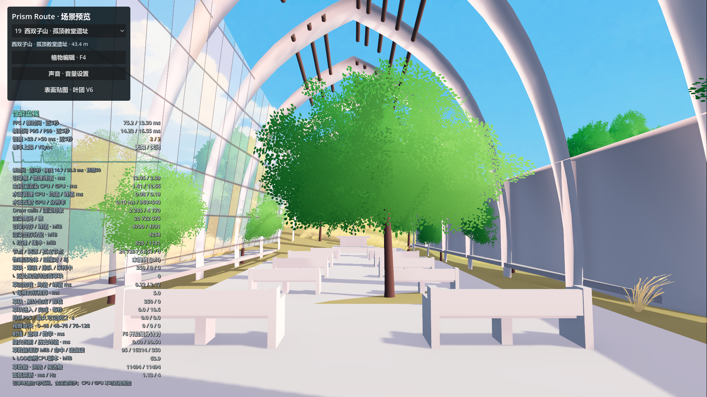

# 孤顶教堂：性能、玻璃与草地修复

给后续 agent：[场景性能排障指南](../SCENE_PERFORMANCE_TROUBLESHOOTING.md) 汇总本案例的根因、代码入口、操作顺序与验收要求；本文件保留实际数据和画面证据。

完成：2026-11-05。正式入口为 `scenes/main.tscn` → `scenes/map_1021.tscn`。本次只修改 Godot 侧的玻璃和局部植被处理；教堂 93 个网格、130,072 个三角形、43 个碰撞体及 Rhino 主模型保持不变，用户树木存档不变。

## 实测结论

主要开销是穿过地板的密集草地，而非教堂本体或五片玻璃。入口视角临时隐藏草地后，帧时间由约 19.2 ms 降至 2.7 ms；隐藏教堂反而因失去遮挡略慢。没有为此删减拱肋、屋顶或远处山坡植被。

在同一开发机 RTX 5070 Ti、Godot 4.7.2、Forward+ / D3D12、1920×1080 下，加载稳定后以相同固定镜头测试。探针单独关闭帧率上限和 VSync，每项采样约 2.5 秒；正式游戏的设置不变。

| 视角 | 修复前 | 修复后 | 帧时间改善 |
| --- | ---: | ---: | ---: |
| 教堂入口／中殿 | 19.18 ms，约 52 FPS | 12.97 ms，约 77 FPS | 约 32% |
| 教堂外部俯视 | 17.79 ms，约 56 FPS | 16.66 ms，约 60 FPS | 约 6% |

这里是固定视角的测量，不代表整张地图所有镜头和首次加载都具有相同帧率。另试验过透明 texel 提前丢弃，配对收益不足以明确区别于波动，未保留该额外优化。

完整数据：[修复前](before.json)、[修复后](after.json)、[对照汇总](performance_comparison.json)。



[修复前入口](before_entry.png)／[修复后俯视](after_overview.png)／[修复前俯视](before_overview.png)。

## 地板下的草已经真正移除并重烘焙

以原始导出缓存中的真实地板、入口及步道三角形生成 0.2 m 精度的高度遮罩，而不是用整座教堂的外包矩形清空周边。边界向外留 0.8 m，避免草簇随机偏移与摆动频繁穿过铺装边缘；高度范围避免误删下层其他空间。建筑覆盖区域约 1,226.84 m²（含边界余量）。

受影响的 **12 个完整草格**另存局部生产烘焙，清除 **10,871 个草根采样点，即 43,484 个草实例**，保留 53,624 个根点。保留根点的位置、法线、顺序和随机状态逐字节不变。运行时将这些完整草格注册为原全图缓存的局部替换；原全图草地缓存没有覆盖或另存一套。

文件位于 `assets/world/church_ruins_1105/`：

- `ground_grass.json`：真实铺装来源、遮罩范围、受影响格及几何 SHA-256。
- `grass_cut.rf`：用于 CPU 种植判定和草着色器的同一份高度遮罩。
- `grass_bake/manifest.json` 与 12 个 `.grass` 文件：清理后重打包的实际草根数据。

CPU 在线生成、正式草着色器和烘焙替换均接入同一规则。着色器提供即时排除保障；实际删除已落在根数据中，性能收益不依赖只把草藏起来。烘焙受全图生成签名、遮罩和教堂几何指纹校验；后续变更铺装后需要重建遮罩与局部烘焙。

## 玻璃

替换原先不透明度 0.6 的均匀蓝色 StandardMaterial，使用 `shaders/environment/church_stained_glass.gdshader`：正面保持通透，掠角增加 Fresnel 反射，保留柔和蓝绿与少量琥珀色玻片、细拼接线和轻微粗糙度变化。原网格没有 UV，纹样使用世界平面坐标，不需重导模型。

五片玻璃关闭不透明投影，不写入不透明深度；没有添加屏幕折射或额外反射视口。天空和内殿可以透过玻璃看见，透光感不靠强发光模拟。

## 验收与后续重建

[验收报告](validation.json) 通过：12 个局部草格实际安装，铺装覆盖区域残留草根为 0，12 格保留根点与随机状态一致；五片玻璃材质及阴影设置正确；原 93 个网格、43 个碰撞体和几何指纹不变。中殿沿线 8 个位置的碰撞与实际可见地板高度吻合；原地板本身有高差，检查没有假定整片地板均为 43.4 m。树木存档与全图草地清单 SHA-256 不变。

在项目根目录执行：

```powershell
python tools/prepare_church_grass_cut_1105.py
$godot = '.current_map_build/runtime/Godot_v4.7.2-stable_win64_console.exe'
& $godot --headless --path . --script res://tools/bake_church_grass_1105.gd
& $godot --headless --path . --script res://tools/verify_church_1105.gd

# 相同镜头的 GPU 性能与画面检查；tag 请使用新的名称，保留本次基线。
& $godot --path . --script res://tools/profile_church_1105.gd --rendering-driver d3d12 --resolution 1920x1080 --disable-vsync -- --church-preview --tag=recheck
```

如果 Rhino 中改动了地板或步道，先更新教堂导出缓存与 `church.glb`，再执行以上命令。未触碰的格无需重烘焙整图。导出配置和配置生成工具已经补齐教堂 JSON、高度遮罩和局部 `.grass` 数据；本次没有重新导出 Windows 整包。
