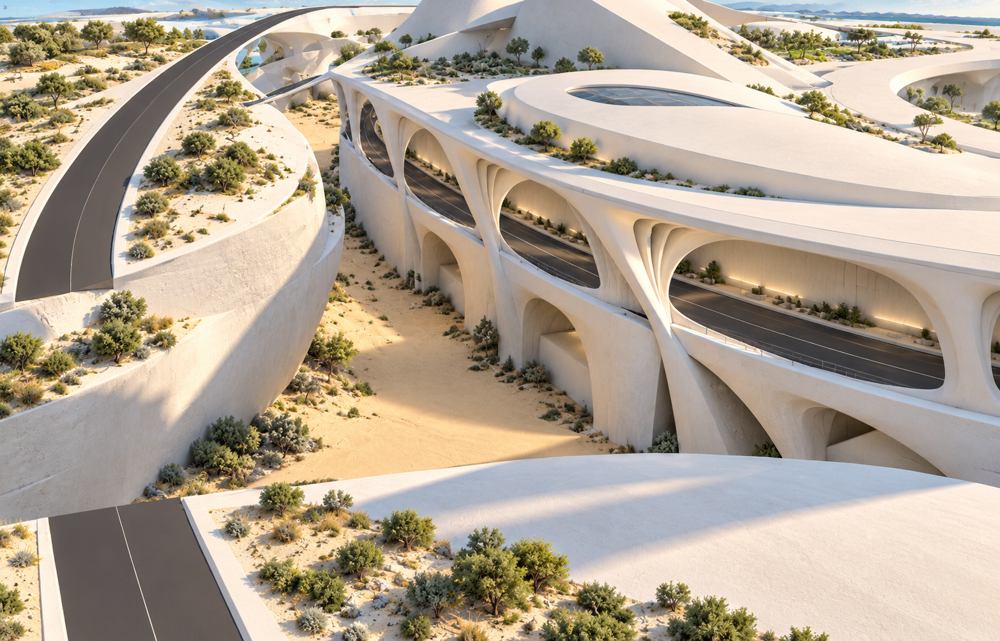
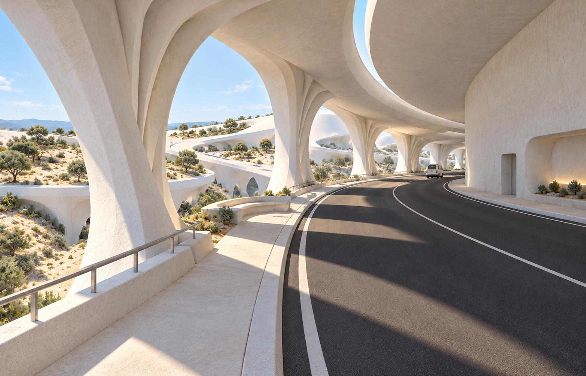

# 崖壁 B：白垩巨构概念首稿

2026-10-13。通过内置 imagegen 生成，依据用户当前 Rhino 截图及只读现场检查。两张图是美术与空间设计参考，尺寸和视角未作施工图级校准；当前 Rhino 模型、Godot 场景及着色器没有修改。

用户随后明确：草稿只表达大体方案，可自由调整形体；道路镂空只出现在部分侧面，另一侧没有道路；峡谷底层也需要完整的近未来建筑空间体验。后续以 [v02 设计方向](DIRECTION_V02.md) 为准。下面的保形、沿包络处理以及参考高度记录属于 v01 首稿，不是后续必须遵循的约束。

v02 已根据补充的“峡谷中央有浅水”绘制三张不同视角，见 [v02 概念图与说明](V02_VIEWS.md)。

## 已确认的现有模型

- 文档：`D:/Prism Route/map/map.3dm`，单位为米。
- 崖壁 B：`80cb2c62-3834-4f12-aeb2-f3fc5bc2b72d`，一张开放 Brep 曲面；外包络约 709.17 × 591.41 米，高度 0–60 米，环形上、下边长度各约 2158.27 米。
- 上、下盖面分别位于 60 米和 0 米。现有外包络不代表已完成内部空间或封闭实体。
- 崖壁内道路：`5b5f7a14-f7e2-4c98-afaa-1516f96d3018`，高程 35 米，两端边宽均为 20 米，两条纵向边分别长约 981.65 和 952.21 米。

## 本稿的设计提案

保留当前大轮廓，将崖壁 B 当作参数化外包络。道路层打开较大的连续采光口，外侧弯曲结构肋连接上方屋面与下方支承；肋之间保留不透明区域，并在道路后方建立厚重内墙和实体核心。下部大部分保留实体，局部退让形成支承之间的空间。

道路沿原路线贯通，结构肋放在车辆净空之外。步行边缘、少量观景停留点和凹入内墙的入口共同形成空间节奏。内侧停留区与车行道分开，屋面底部设置局部采光缝。概念中廊道净高先以 12–16 米探索，需回到模型验证；既有 20 米道路宽度保留，步行及停留空间额外安排。

顶部延续白色建筑屋面，原椭圆凸起转化为低矮的连续屋顶体量，结合局部天窗与步行屋面。材质为哑光暖白的矿物复合材料或白垩质混凝土，以细微颗粒、低对比冷暖变化表现。三平面投射属于后续材质实现，本次图片只表达其目标外观。

## 下一步参数化试段

先取约 60 米长的道路段，连同完整的崖壁高度与屋顶边缘一起制作空间样段。按沿包络曲线的弧长布置主肋，根据曲率、入口和停留节点调整肋间距、倾斜与开口大小。先验证道路净空、行走边缘、内墙退距及阴影，再扩展到完整环形体量。

## 图片与生成提示词

- [外部总体概念](cliff_b_exterior_v01.png)：沿用户截图构图呈现外侧结构、道路与屋面关系。
- [道路内部空间](cliff_b_road_interior_v01.png)：展示可见实体内墙、外侧采光、步行边缘与道路净空。
- [完整提示词](PROMPTS.md)：两次内置 imagegen 的原始提示词及引用关系。

