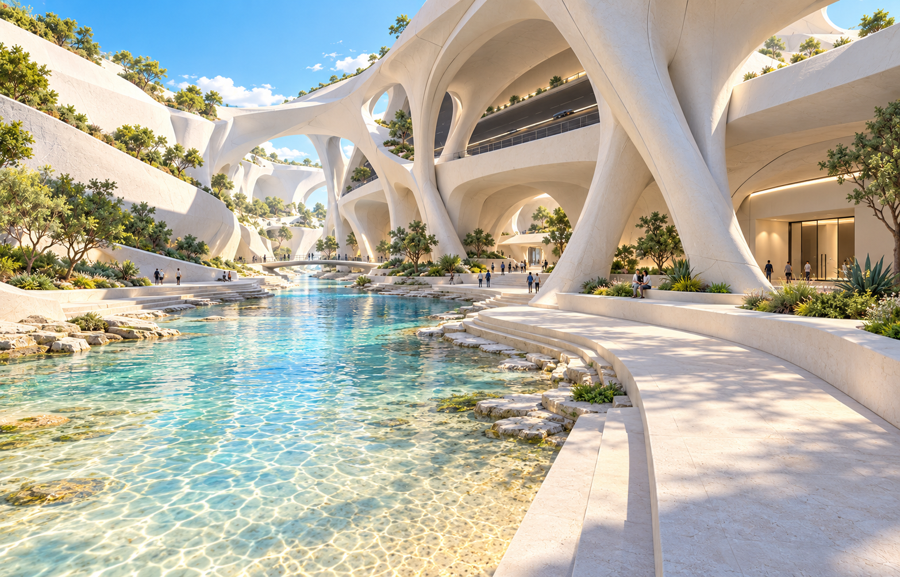
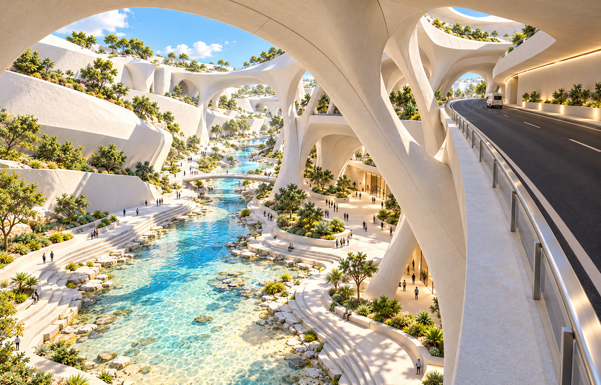
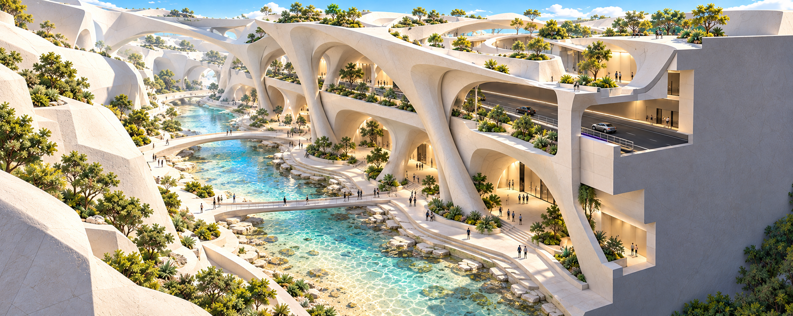

# 崖壁 B：浅水峡谷概念 v02

2026-10-13，使用内置 imagegen 绘制三张不同角度的概念参考。依据用户的大体方案，自由调整形体；保留道路镂空侧、内部实体与白色近未来建筑主题。峡谷中央的浅水为用户明确的既有设定，当前沙滩材质只作占位。

## 1. 峡谷底层人眼视角

[原图](cliff_b_canyon_ground_v02.png)

可见沙底的浅水引导视线，两侧干燥步道、亲水台阶、入口平台和支承脚附近的停留空间构成玩家尺度。上方可见道路廊道，主体仍有厚重的内部墙体。

## 2. 中层道路俯看峡谷

[原图](cliff_b_middle_overlook_v02.png)

车辆路线在道路侧连续通过，外缘有分离的步行带。向下看见浅水、步道与底层庭院；支承与上层开口共同形成高处观景节奏。对侧没有复制中层车辆道路。

## 3. 局部剖透视

[原图](cliff_b_cutaway_v02.png)

侧面局部剖开以表达白色屋面、中层道路、底层公共空间以及后方保留实体的关系。浅水沿峡谷延伸，亲水步道与局部人行跨越连接空间节点。

## 使用范围

三张图是同一设计方向的美术与空间探索，尚未成为统一三维模型。相机、比例、开口位置和剖面边界由生成图表达，不能用来直接量取尺寸。图中可见沙底的清水用于表达浅水；提示词里的水深范围是视觉探索参数，用户尚未确认实际深度。白色细颗粒材质表达目标外观，未实现游戏内的三平面 shader。

游戏场景和 Rhino 模型没有改动。v01 首稿保留。下一步可选定结构形态和底层空间比例，再制作一个连续空间样段；图中的水纹、植物数量与材质细节不作为固定实现要求。

[完整生成提示词](PROMPTS_V02.md)
