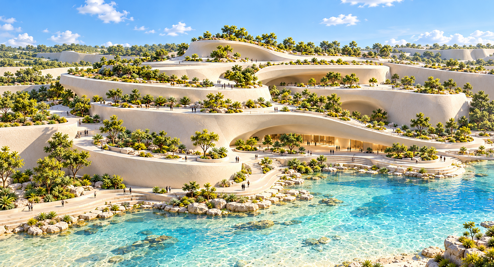

# 崖壁 B 实体侧：自然错层建筑概念

2026-10-13，通过内置 imagegen 生成。依据用户的实体核心 Rhino 截图，以及其指定的道路峡谷概念图左岸建筑。

用户明确：实体侧仍采用扎哈式人工建筑设计，白垩不作为主要设计信息；应形成自然层叠的曲面平台与挡墙，不能简化为几片光秃的墙面。此侧没有道路，不复制道路侧的复杂分枝骨架。

当前提案以五至七层宽缓建筑曲面探索空间：不同区域的高度、退距、厚度和悬挑变化，层面局部合并、渐隐或转入周边地形。平台内保留实体，少量凹入空间与底层亲水路径补充可读尺度。植物用于说明层间空间；后续建模应先验证裸露几何，不能依靠植物遮挡重复或空白。

该图是造型参考，没有经过现场尺度校准。现有第三版 Rhino 模型及 Godot 场景没有修改。早先的自然峭壁方向和过于简单的整面建筑方向已被用户否定，本图取代那些方向，未将被否定图片存入本目录。

使用的完整提示词和参考关系见 [PROMPT.md](PROMPT.md)。
