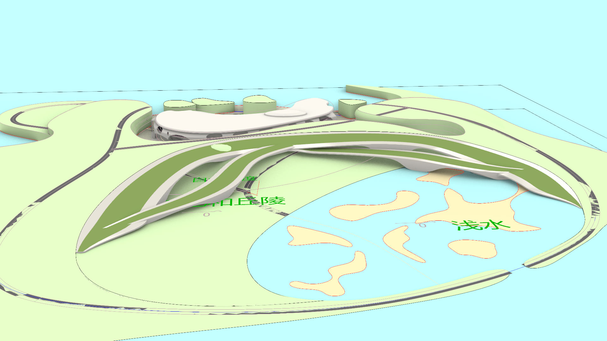
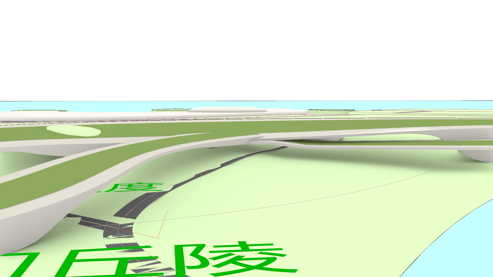

# 崖岸 B 方案：实际 Rhino 曲面设计稿 v01

日期：2026-10-14。根据用户选定的 [B 全景](../B_interwoven_overview.png) 与 [B 近景](../B_interwoven_detail.png)，在当前 `map.3dm` 上建立原生 NURBS 设计。此目录中的四张截图是 Rhino 实际视口输出，无生成式后期修改。

## 当前模型

当前 Rhino 图层根：**`崖岸_交错曲面_B方案_v01`**。

| 图层 | 内容 |
| --- | --- |
| `01_连续抬升主壳` | 沿原顶缘保持高度，向低地展开，起伏并形成架空与落地支承 |
| `02_西侧交错翼` | 从西侧逐渐展开，沿长向升降并与主壳穿插 |
| `03_东侧扭转翼` | 向海湾展开，再扭转下降接回低地 |
| `04_种植顶面` | 三组随曲面升降的草甸种植区域，留有宽白色边带 |
| `05_隧道净空_辅助` | 两条实际道路的弧顶净空扫掠体，默认隐藏，仅作为检查/继续造型的避让范围 |
| `07_原弧面备份` | 原 `1014要修改的弧面`，保留原 GUID 和几何，移入隐藏备份层 |
| `08_端部衔接` | 保留原弧面两端下降到 Z=0 的短段过渡 |

三组主体分别是有效**封闭 NURBS Brep**，每组 6 面。主体最高约 60 / 41.25 / 49.97 米，最低落到地面；采用连续的长向升降、横向倾斜及弯曲支承，未使用 mesh 替换 CAD 曲面。两翼与主壳保持独立对象，便于继续调整；本版尚未把全区域融合、焊接为一个实体。

最高值维持原标记弧面的 **60 米**。主壳接原地形的上缘与原始曲线的 201 点采样最大偏差约 **5.3×10⁻¹² 米**，两端仍采用原始落地趋势。主地形、低地草坡和两条道路的来源几何 CRC 均未改变；当前只替换标记墙面为新设计，未全域重塑地形。

种植区域是独立开放 NURBS 面，有 Rhino 草甸颜色材质；为避免 CAD 显示重叠，顶面抬高 0.30 米，仍在总高 60 米内。它是种植区域设计标识，尚未制作覆土结构或新增树木实例。暖白壳体设置了独立的人工涂层 CAD 材质。

## 两处道路通行

两条道路保持原几何与标高，曲面和支承为它们避让。

- T1 中央穿越点：`(987.077, 594.051, 27.284)` 米。
- T2 东侧穿越点：`(1497.171, 849.655, 15.680)` 米。
- 每处建立沿实际道路长向的弧顶净空扫掠体：道路法向总宽约 28 米，路面以上弧顶约 11 米，检查范围覆盖穿越点前后各约 320 米。
- 两处分别抽样实际路面前后各约 300 米，共 121 站 × 7 个横向位置 = **847 条向上射线**；三组壳体临时网格化仅用于诊断，容差 0.06 米。
- 测得最小竖向净空 **T1 12.71 米 / T2 21.34 米**，低于 9.8 米的样本为 0；报告失败项为空。

这些结果证明本版预留的道路穿行空间在所测位置不被新壳体压住，不能代替完整碰撞、水平侧向净空、结构受力或游戏驾驶验收。当前为开敞廊道/隧道预留空间，还未制作完整的封闭隧道设施。旧路面与地形的重叠显示、局部曲面接头及原地形凸起仍属于后续几何深化。

## 保存与回退

- 当前含全部场景的副本：**`D:/Prism Route/map/map_terrace_interwoven_B_v01.3dm`**。
- 修改前完整备份：**`D:/Prism Route/map/map_before_terrace_interwoven_B_v01.3dm`**。
- 仓库内可携带的原生子集：[source/terrace_B_design_and_context.3dm](source/terrace_B_design_and_context.3dm)，17 个对象，包含设计、原弧面及相关地形/道路，米制；已重新读回检查对象数。它不包含外围所有建筑，完整场景见上面的副本。
- 当前打开文档仍为 `map.3dm`，模型已在其内建立，主文件磁盘未覆盖；Rhino 显示新方案全景。副本已写入最终几何及视图。
- 比较原稿：关闭新图层组的主体、种植与端部层，并打开 `07_原弧面备份`。不应同时显示旧弧面和新壳体来判断空洞。

未在这一步替换 Godot 游戏资产；后续导出必须显式识别本次新增图层，不能沿用只识别旧 Cliff B 图层的导出筛选。

## 记录与复现

- [generation_state.json](generation_state.json)：对象 GUID、参数、原始几何 CRC、备份和副本路径。
- [verification_report.json](verification_report.json)：有效性、高度、道路净空及顶缘偏差。
- [rhino_terrace_interwoven_v01.py](../../../../tools/rhino_terrace_interwoven_v01.py)：原生 NURBS 构造脚本；先 `prepare()` 内存校验，再 `publish()` 一次建立；`refine()` 只替换本配方拥有的对象；`verify()`、`capture_views()`、`archive()` 检查及保存。重复 `publish()` 会拒绝覆盖已有设计或备份。

Rhino 执行脚本时用 UTF-8 `io.open` 读取 Unicode 源码并编译（移除第一行编码声明），以避免旧脚本运行器误读中文。`prepare()` 需要当前场景来源 GUID；后续运行前重新核对当前对象和道路关系。

