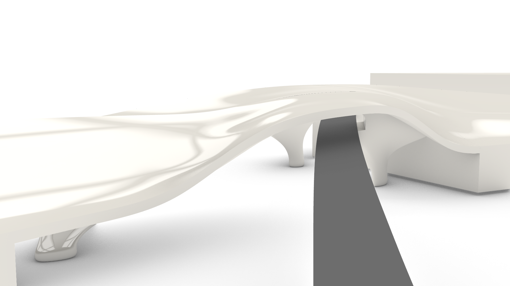
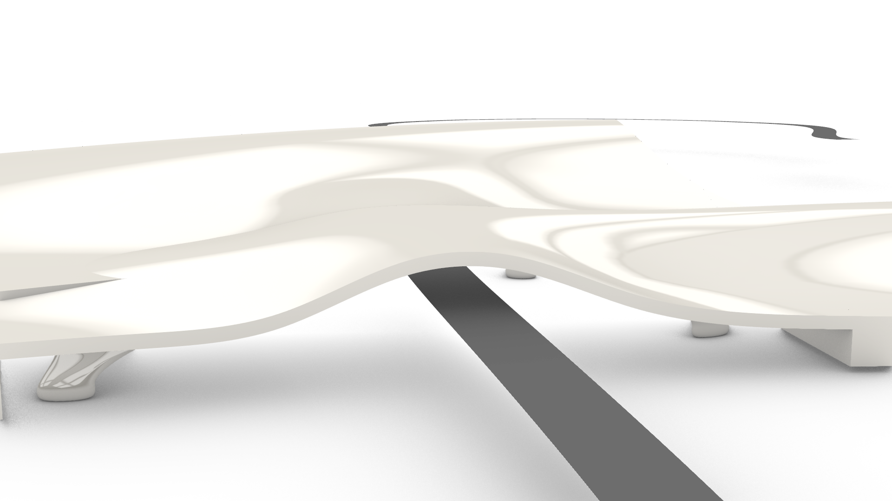

# v05：两处隧道入口的外露曲面支撑

日期：2026-10-15。基于隐藏的 v02 整体轮廓及 v04 实体底层继续修改。

后续局部修正见 [v06 西侧曲面缺口衔接](../west_seam_v06/README.md)。v06 保留本版两处入口结构，继续取消植物分区；最新完整场景为 `map_west_seam_v06.3dm`。

## 修改依据

v04 的局部支撑廊偏离了道路穿越位置，结构被前方实体遮挡，没有形成入口空间。本版把开敞区移到两处实际三维道路穿越点 T1、T2，同时退让前排低台与后排主体的局部底层。两端和普通落地段继续保留实体；原先无道路用途的东侧空廊恢复为实体。

入口采用不同高度的前后曲面单元：支脚向肩部展开，肩部与拱腹、顶面连续。T1 上层受原始修剪顶面限制，采用较窄的单支承展开；T2 保留前后两层支撑。局部侧向空隙让支承从外侧可见，避免只在实心墙里挖一个封闭隧道口。

顶面保留原轮廓，并用原曲面顶壳收住局部开敞区。本版最高点为 60.125 米，没有提高原草稿的整体高度。

用户要求暂缓种植设计：六块暂定植物覆盖面及其图层已隐藏，当前新增建筑曲面顶面统一为暖白高光材质。覆盖面仍保留用于后续重新设计；没有把未经设计的绿色带当作最终种植分区。周边原始草稿地形仍用于场景参照。

## 建模和道路适配

建模脚本：[rhino_exposed_tunnel_portals_v05.py](../../../../tools/rhino_exposed_tunnel_portals_v05.py)。检查与归档脚本：[rhino_portal_review_v05.py](../../../../tools/rhino_portal_review_v05.py)。

1. 从当前 v04 实体复制工作几何，保留其道路出口修正；按原曲面恢复此前不合适的东侧空廊。
2. 以实际道路穿越点为中心，局部退让各层底部实体，保留原顶面及普通实体段。
3. 针对四个局部位置调整连续 SubD 控制网，适配原始顶面的起伏、修剪范围与支脚落位。
4. 初始 SubD 在肩部和腹部仍侵入道路净空。将四个单元转换为原生 Brep，按原实际道路拱形预留体做布尔退让。每个单元保留为一个有效闭合体。
5. 四个未经切割的 SubD 编辑源放在隐藏图层；当前显示和检查使用道路适配后的 Brep，不混用编辑源。
6. 调用 `unify_top_surfaces()` 隐藏暂定种植覆盖面，统一显示暖白建筑顶面；重新捕获实际 Rhino 视图，保存并回读归档。

脚本依赖当前 Rhino 会话中的 v02/v04 场地状态，尚未实现从任意新会话自动恢复。不要直接重复发布或重复添加编辑源。

## 实际视图

下面为隔离周边草稿背景后的实际模型截图，不是生成效果图。包含本版实体、入口结构和实际道路。

带场景视图：[T1 道路接近](01_T1_road_approach.png)、[T2 道路接近](02_T2_road_approach.png)、[整体](03_overview.png)。

## 验证结果与边界

- [几何及道路抽样检查](verification_report.json)：无记录失败，16 个显示用结构部件均有效、闭合，原始几何 CRC 不变。
- T1、T2 分别对实际路面取 903 个向上射线样本；命中结构处的最小净空分别约 10.069、10.079 米，没有低于本次 9.8 米检查阈值的样本。
- [局部侧向视线抽样](portal_sightline_samples.json)：入口附近存在侧向开敞距离；这里只记录特定站点的射线，不代表所有位置都已验证。
- 原实体体积之和保留约 74.90%。这是部件体积之和的比较，不是整场景布尔并集体积，且不包含新增支撑体积。
- 部件交界仍有重叠，尚未完成全局并体、接缝细化、曲率连续性验收或完整自交检查。当前白模与高光材质用于判断空间和轮廓，局部显示纹路还需随接缝及网格细化检查。
- 尚未完成游戏导出、碰撞与实际通行验收，也没有结构承载验证。

## 文件与图层

- 完整场景：`D:/Prism Route/map/map_exposed_portals_v05.3dm`。
- 修改前备份：`D:/Prism Route/map/map_before_exposed_portals_v05.3dm`。
- [局部原生归档](exposed_portals_v05.3dm)：26 个对象，包含 16 个闭合结构部件、6 个隐藏植物覆盖面、4 个隐藏 SubD 编辑源。
- [归档回读检查](archive_readback_report.json)：局部文件和完整场景的本版对象有效，完整文件中原始几何 CRC 保持不变。
- [生成状态](generation_state.json)：对象编号、入口范围、版本来源及顶面设计状态。

当前根图层为 `崖岸_隧道入口外露支撑_v05`；子图层分别为实体段与端部、入口原顶面、入口外露连续结构、隐藏种植顶面和隐藏 SubD 编辑源。v04 和其他旧方案继续保留、隐藏，供比较与回退。
