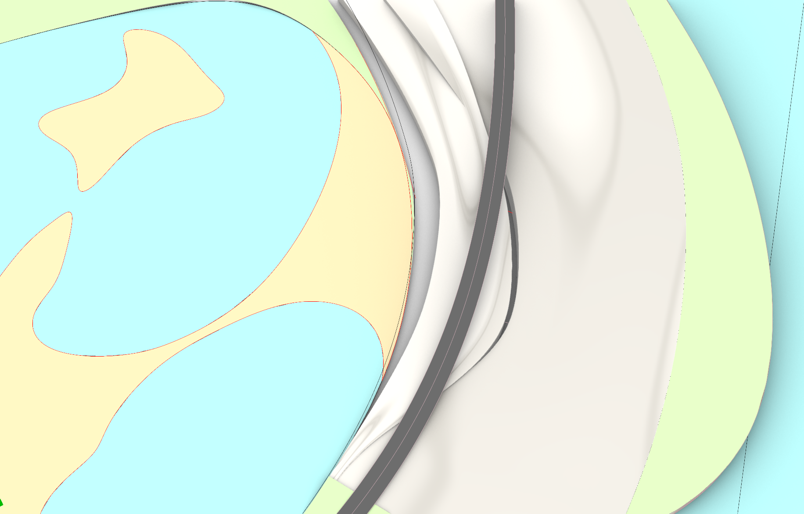
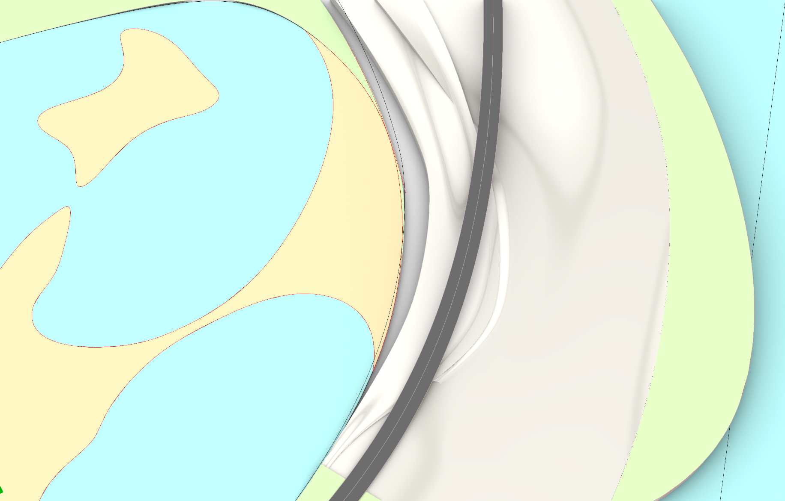

# v06：西侧主台与低台的缺口修补

2026-10-15。对应用户截图中，道路右侧两片暖白曲面之间的尖长黑缝。

## 修改

定位后确认它是主台前缘与低台后缘之间的实际缺口，最宽处平面距离约 7.3 米，不是道路预留口。弧线归一化参数约 0.068–0.181 出现分离。

在两侧顶面各向内取一条边，以 Rhino 原生相切混接曲面构造过渡；局部范围取 0.060–0.194，让两端落入已有衔接区域。过渡保持纵向起伏和横向高度变化，底部接到原 -2 米基准，与西侧主台做布尔并体。低台继续保持独立，原几何不改。

没有强行将两层大体量整体并成一件：它们在其他位置存在接触及重叠，全局布尔结果不能可靠保留原体量。当前只并入局部过渡，并检查原主台的高度、范围和体积保持情况。相切混接是局部构造依据，不代表最终整场景已达到全域 G2 连续。

顶面沿用暖白材质，植物覆盖层继续隐藏。两处隧道入口结构与实际道路几何保持不变。原西侧主台隐藏保留，修补实体放在 `崖岸_西侧曲面衔接_v06` 图层。

## 对照

## 检查和文件

[检查报告](verification_report.json)：原缺口内 255 个竖向射线样本，修补前全部无命中，修补后全部有曲面覆盖。修补后的主台有效、闭合，最高点保持 60.125 米。完整保存文件回读通过，修改前 550 个对象的几何 CRC 保持不变，原主台仅调整可见状态。

本次完成局部缺口与闭合检查，尚未完成整场景曲率、自交或游戏碰撞验收。

- 完整场景：`D:/Prism Route/map/map_west_seam_v06.3dm`。
- [仓库内完整场景副本](map_west_seam_v06.3dm)：与上述经过回读检查的文件字节一致，可直接在 Rhino 中打开查看当前方案及隐藏旧版。
- 修改前备份：`D:/Prism Route/map/map_before_west_seam_v06.3dm`。
- [生成状态](generation_state.json)记录原对象、修补对象及范围。
- [建模脚本](../../../../tools/rhino_west_seam_v06.py)依赖当前 Rhino 会话的场地状态；重新打开文件后尚不能直接重复发布。
