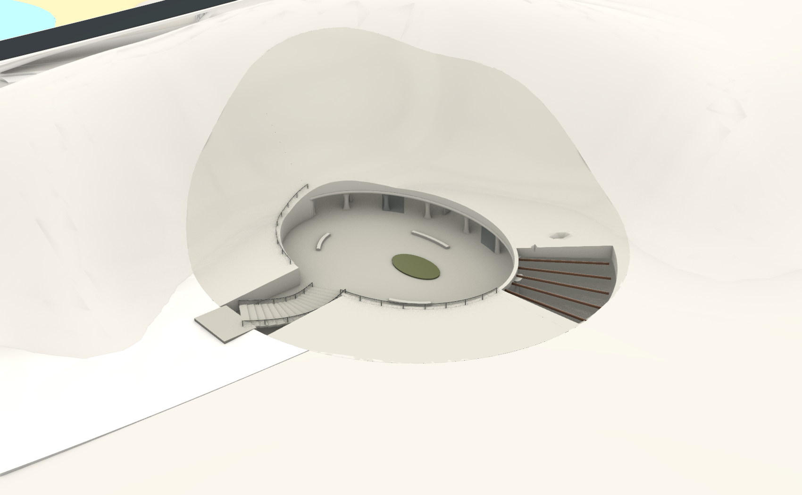
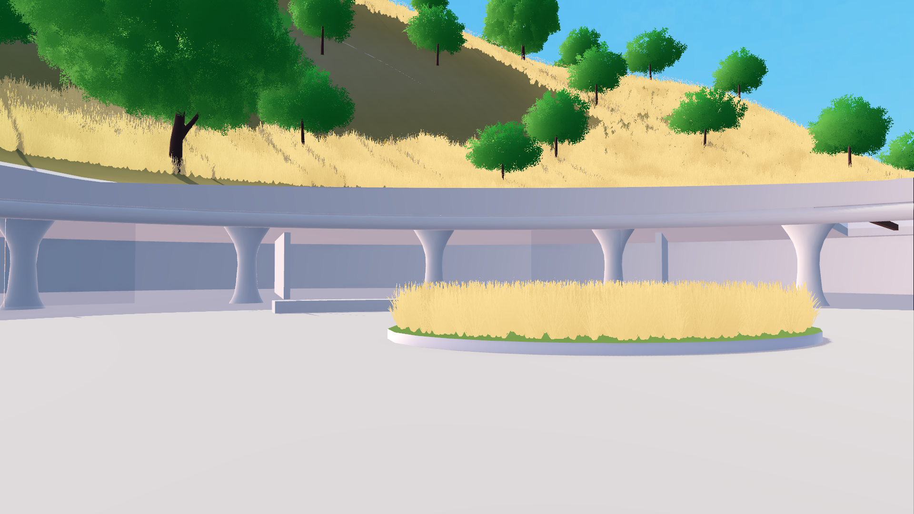

# 下沉环庭遗址 · 实际制作与验收记录

更新：2026-11-03。模型已制作并保存到 **`D:/Prism Route/map/map_current.3dm`**，归入 `建筑::下沉环庭遗址`。Godot 已接入正式 `scenes/map_1021.tscn`，出生点菜单增加“下沉环庭 · 地下展廊”。

## 当前最终范围

- 单层地下环廊，中央露天庭院，少数内向侧厅，局部露梁采光区。
- 主体保留原缓丘覆盖；临海侧封闭，未设置临海低层、窗、露台或出口。
- 依据用户后续修正，**外部长人行路及道路边接入台阶已经撤掉**，只保留门前约 **9 × 6 m** 的短平台。
- 用户在 Rhino 中删除的占位草没有恢复。原土池轮廓保留，Godot 使用项目已有草地着色器及草模型。
- 楼梯可见踏步保留，角色碰撞使用单独的连续 `-colonly` 曲面斜坡。

第一版生成图保留为最初空间语言参考，海向低层、外露体量及长接入均不是本次最终模型目标。下列截图来自真实 Rhino / Godot 模型。

## 查看

在当前 Rhino 文档恢复 `SunkenCourt_overview_1103` 命名视图，或查看相同前缀的 `entry`、`court`、`gallery`、`coast`、`road` 视图。

Godot 正常 F5 后，可在出生点菜单选择新建筑。直接预览可运行：

```powershell
& tools/run_sunken_archive_1103.ps1
```

保持现有默认出生点；上述脚本用 `--sunken-archive-preview` 进入局部观察。





## 场地与空间

本次通过当前视口的正确近/远裁剪方向和实际地形网格射线定位。场地由原低台、原地形及手工缓丘叠合形成，不能只在一张表面上叠放建筑。

| 参数 | 实际制作值 |
| --- | --- |
| 庭院中心 CAD XY | `(98, 1149)` |
| 外侧局部开挖/回填边界 | 椭圆约 86 × 76 m，中心 `(100, 1145)` |
| 庭院净开口 | 约 50 × 36 m |
| 主地坪 | Z=11.50 m |
| 地下屋面顶 | Z=16.15 m |
| 屋面底 / 主廊净高 | Z=15.60 m / 约 4.10 m |
| 入口平台及楼梯上端 | 约 Z=13.988 m |
| 楼梯 | 16 级宽弧形踏步，下接主地坪 |
| 屋面位置 | 主要屋面位于原土层之下，外部恢复原高程趋势 |

中央庭院和入口让出露天开口；后半圈为带顶环廊。土层覆盖面按原地形高程采样恢复，内部挡土面沿真实周缘起伏连续收口。没有整体抬高周围地形。完整屋面与一侧露梁区非对称分布，檐口采用圆转截面，廊柱按腰部收束、顶部展开的连续截面构建。

四个原地形对象仅作局部开挖让位，保留编号：

- `95094d17-bdb0-4407-bdca-d26ab1deaad7`
- `d01b8d98-9f3d-46e7-8737-7b60ad7a5657`
- `012ab31c-3bd7-4f32-8676-9592c584ca4c`
- `de6391b1-e6fa-48bf-978c-b261e0d6d4b4`

审计确认其余 **1,509 个原对象**的几何与属性指纹保持不变。道路源几何未改动。

按用户要求，在主模型保存回读并核对 96 个相关对象后，已删除本次完整回退副本 `archive/sunken_archive_1103/map_before.3dm` 与自动副本 `map/map_current.3dmbak`，合计释放 **462,936,390 B（约 463 MB）**。当前完整主文件保留，不额外导出 Rhino 局部组件，也不继续创建完整文档快照。见 [清理记录](backup_cleanup.json)。

## 草地与旧种植处理

土池在 Godot 中复用当前地形材质及共享草甸色板。草模型直接引用当前 `vegetation.grass_mesh`，即项目 `grass_star_3card_gust_v7.glb` 的现行风草呈现结果；庭院内布置 1,500 个实例，引用同一运行时材质、shader、纹理、色板和风参数，不再使用原生占位叶片。局部明确放置的根点通过自定义数据标识，免受旧根点开挖遮罩影响。

庭院、楼梯、采光缺口及低层占用范围使用局部草遮罩，屏蔽原烘焙根点造成的悬浮草。处于开挖空间中的旧树在呈现层排除；原树位与用户种植编辑文件不改写，顶部仍有真实土层承托的植被保留。用户重新打开种植编辑器时，该空间排除规则继续生效。

## `-colonly` 楼梯碰撞

Rhino 中的 `PR_SunkenCourt_Entrance_stairs_ramp-colonly` 为闭合实体网格，覆盖弧形阶梯。该物件隐藏，导出时仍包含。

GLB 保留 `-colonly` 后缀，Godot 导入器将它转换为**无可见网格的 StaticBody3D**；运行时设置为角色碰撞层 32，并补上来源与地面语义。16 个可见踏步不再创建逐级碰撞，底部落地平台和门口短平台保留正常碰撞。

检查包含自动导入的碰撞体数量、16 个踏步位置的斜坡射线/法线，以及真实角色上下行。碰撞辅助体不会参与材质、草地或水面反射注册。

## 验收结果

| 检查 | 结果 |
| --- | --- |
| 新增原生对象 | 92 个，其中 1 个为隐藏碰撞斜坡 |
| 新增几何有效性 / 闭合 | 全部有效、全部闭合 |
| Godot 原生导入 | 95 个可见 mesh（含 4 个替换后的原地形）及 1 个自动导入的碰撞斜坡 |
| 主环廊地坪 | 35 个位置检查通过；覆盖区最小净高约 4.10 m |
| 楼梯 | 上下行均通过，无悬空/掉地帧；连续斜坡而非逐级碰撞 |
| 环廊 | 正反向行走均通过，无悬空/掉地帧 |
| 门口短平台 | 实际角色通行通过，无悬空/掉地帧 |
| 原地图出生点 | 包括新入口在内的 19 个位置解析检查通过 |
| 旧原地形重复碰撞 | 4 个未开挖旧 mesh 均已从加载流程移除 |
| 项目草模型 | 资源身份相同，1,500 个局部实例 |
| 原地图/种植文件 | 构建时校验的 15 份既有资产未变化 |
| 成品 GLB | 约 12.8 MB；含四个较大原地形替换网格 |

原生证据：[几何检查](native_geometry_check.json)、[对象与保存审计](model_report.json)、[场地参数](site_measurements.json)。Godot 证据：[通行验收](game/verification.json)、[渲染与共享草检查](game/render_report.json)。

本次沿用游戏现有日照、PBR 和植被风格。第一版生成图的写实表面颗粒和每一处旧化纹理不作为逐像素匹配目标；实际效果以这些固定视角及当前游戏风格为准。

## 复测与维护

```powershell
& tools/verify_sunken_archive_1103.ps1
# 实际 Forward+ 渲染与五视角截图：
& '.current_map_build/runtime/Godot_v4.7.2-stable_win64_console.exe' --path . --fixed-fps 60 --script res://tools/verify_sunken_archive_1103.gd -- --capture-sunken
```

第二条命令可加本机绝对 `--log-file`。渲染器仍有既有 `user://` shader cache 目录不可写提示，截图及运行正常；本次未更改用户目录权限。

制作脚本 `tools/rhino_sunken_archive_1103.py` 采用阶段函数和当前会话状态，导出脚本为 `tools/rhino_export_sunken_archive_1103.py`，打包为 `tools/build_sunken_archive_1103.py`。它们是当前资产的可追溯配方；`prep()` 会拒绝重复建造，阶段回退使用内存中的局部原几何，不创建完整文档快照。重新打开 Rhino 后应从现有物件恢复状态再改，不直接重跑全流程。

游戏加载在 `scripts/world/sunken_archive.gd`。主体 GLB 以相对原地图中心 `(1450,1150,0)` 的同一坐标系导出；不要对建筑与四个替换地形分别平移。新增 manifest 与草遮罩已加入导出包含规则，Windows 独立包本次没有重新导出。
