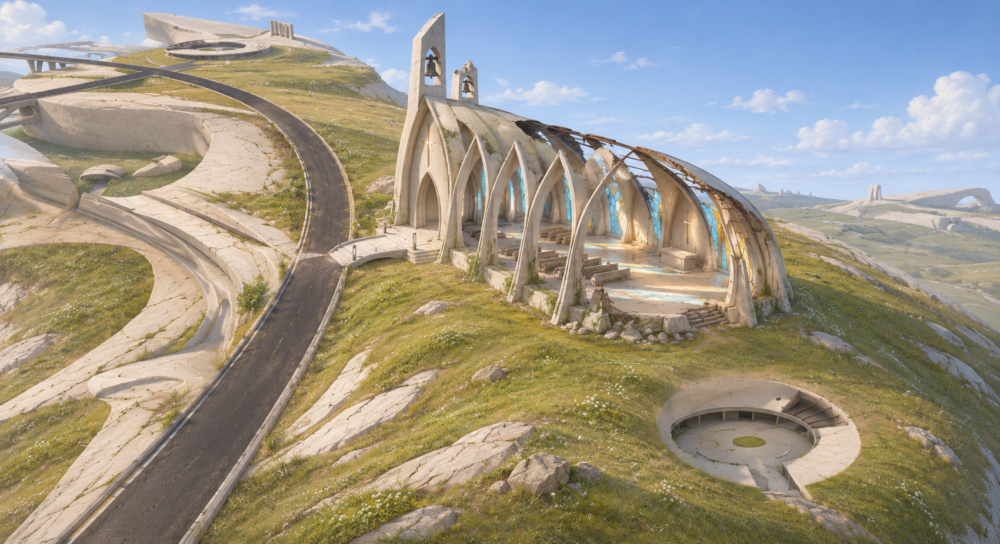

# 山脊教堂概念：裂光圣堂 v1

日期：2026-11-04。使用内置 image_gen 工具，依据用户 Rhino 山体截图生成建筑概念图。本次只绘制并保存美术方向，没有修改 Rhino 模型或 Godot 场景。



## 设计方向

- 沿现有狭长山脊布置单中殿，保留左侧弯曲道路与前方圆形凹槽；以短入口平台联系道路。
- 浅色混凝土尖拱肋架、非对称残存屋面、断裂钟墙，形成可辨认但非传统石砌教堂的轮廓。
- 破损集中在部分屋顶、侧墙与构件边缘。中殿和祭坛可从缺口看见，保留可探索的主要地坪。
- 以日光、天空反光和少量蓝／琥珀色残留彩玻璃营造明亮、安静的废墟；草丛和碎石克制分布。
- 截图青色视为视口背景，概念不增加海岸、海滩或临海平台。

## 后续建模对照

本图用于确认美术方向，不是已经测绘的施工图。制作前需实际量取 Rhino 山脊宽度、道路标高与圆形凹槽边界，再确定建筑长宽高。优先核对建筑在山上的占比、入口可达性、拱肋节奏、破顶范围、明亮内景和材料破损；避免堆砌细节却改变整体轮廓。建筑不能覆盖前方圆形凹槽，也不应以巨型基础平台抹平山体。

## 完整生成提示词

工具：内置 image_gen；输入：用户提供的 Rhino 场地截图，作为地形与相机关系参考。

```text
Use case: stylized-concept.
Asset type: architectural concept art for an existing near-future ruins game, a credible design that can later be modeled in Rhino and Godot.
Input image 1 is a SITE GEOMETRY AND CAMERA REFERENCE: the user's Rhino screenshot. It is NOT a style reference and the software interface must not appear in the output.

Create one polished wide landscape architectural hero rendering of a distinctive abandoned but luminous hilltop Christian chapel, concept name "裂光圣堂" (do not print text). Use approximately the same elevated three-quarter viewpoint as the screenshot, with enough close detail to judge the architecture.

SITE INVARIANTS: The target is the long, narrow raised hill picked out by the yellow wireframe in the middle/right of the reference. Place the church ALONG the crest of that existing hill, toward the upper/middle ridge. Preserve the dark curved road along its LEFT edge, the hill's long sloping landform, and the existing recessed circular structure toward the lower-right foreground; that circular hollow remains separate and unobstructed. Show their relationship clearly. The turquoise regions of the CAD screenshot are background / unfinished terrain, NOT WATER. Present a landlocked grass-and-pale-rock hill with softly suggested neighboring pale ruin landforms and a neutral atmospheric horizon. Do not add an ocean, coast, beach, cliffside balconies or harbor. Do not turn the whole hill into an enormous building platform. A small entrance landing and one short approach from the existing left road are enough.

ARCHITECTURE: Near-future sacred architecture rather than a standard medieval church. A long single nave with six repeated pairs of tapering pale concrete lancet ribs, elongated curved buttresses, and an asymmetrical broken roof. The ribs make a recognizable cathedral-like silhouette, but the detailing is restrained, parametric and contemporary. Part of the roof skin and one side wall have fallen away, revealing the nave and sky. A slender pair of unequal broken bell fins mark one end instead of a conventional steeple; firmly grounded, no floating structures. One end wall is split by a narrow cross-shaped daylight opening. Some incomplete pale blue and amber prismatic stained-glass panels remain between ribs, especially at the apse. Their colored sunlight lands visibly on the pale stone interior floor. A modest altar, broken rows of low pews, and an open central aisle should be glimpsed through the missing roof and side wall. The plan reads clearly as a place of worship, not an alien spaceship, temple, fortress, or abstract sculpture. Church occupies about one-third of the usable ridge length, with generous hill visible around it; landmark scale without overwhelming the existing site.

RUIN LANGUAGE: Real, selective structural loss: chipped corners, exposed dark metal at a few broken edges, missing roof panels, cracked floor joints and a small amount of rubble gathered next to damaged walls. Keep most load-bearing ribs and the main route intact so it looks physically buildable and explorable. Weathered ivory and warm grey concrete, muted oxidized metal, pale glass; low grass and small wild plants reclaim edges. No giant heaps of rubble or vegetation smothering the silhouette.

LIGHT AND MOOD: Bright clear late-morning daylight, blue sky with a little soft cloud, warm sunlight flooding the open nave, soft sky bounce in the shadows, small cyan/amber glass highlights. Quiet, solemn, hopeful, beautiful abandonment. Architectural massing and material damage stay legible; avoid dark horror, soot-black Gothic, night, foggy desaturation, neon cyberpunk or fire.

COMPOSITION: Full-bleed single scene, no panels, no collage, no title, no diagram labels, no CAD UI, no yellow selection wires, no gizmos, no watermark. High-quality environment concept rendering with realistic material surfaces and a restrained game-art sensibility. Main church around the upper-middle/right, curved road left, the original circular sunken structure visible in the lower-right foreground. The viewer should immediately understand how this specific church fits THIS specific hill.
```

