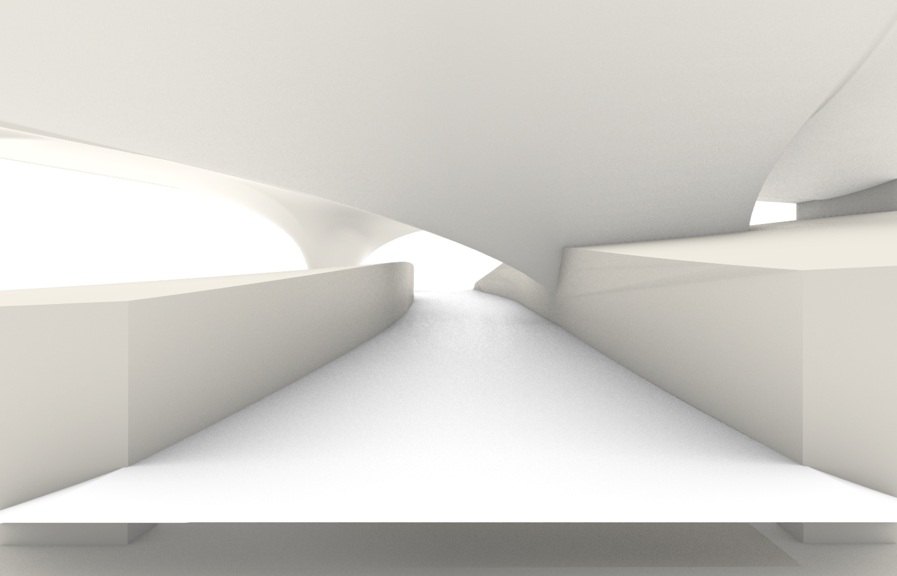
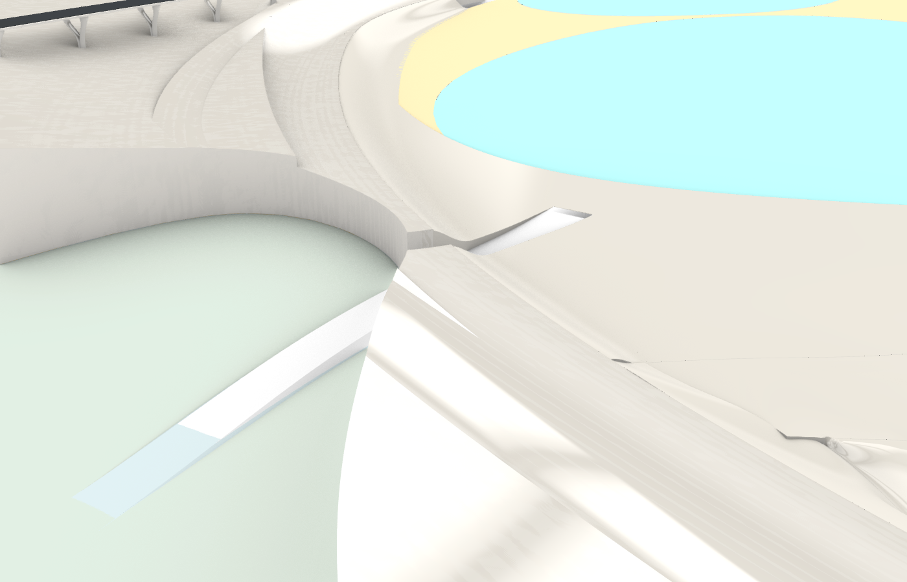

# 南北泻湖湖底与两个外部出口

完成：2026-10-26。工作文件：`D:/Prism Route/map/map_current.3dm`。
此处记录 Rhino 建模阶段；后续已导入 Godot 并验证实际通行。
湖底岸缘与出口起点又做了平顺修正，最终资源及草地记录见
[Godot 同步记录](../../LAGOON_GODOT_1026.md)。水着色器仍沿用现有版本。

后续于 2026-10-26 补齐了南泻湖水面与桥下低地之间的缺口，保留这两条出口；
低地对象的最终几何以 [缺口补齐记录](../lagoon_1026/README.md) 为准。

## 两个出口

按用户截图，亲水阶梯不作为出口，原有阶梯、桥梁和支承构件保持不变。

| 出口 | Rhino 对象 | 参数 |
| --- | --- | --- |
| 桥下洞口 | `e5841b7a-99aa-430f-bef8-daad1ce4bdb8` | 沿现有孔洞接外部低地，中心线约 230 m，主体宽 12 m，最大纵坡 3.51%，终点约 Z=3.61 |
| 封闭端缓坡 | `3ece7c15-82db-4301-920c-2f1cd7097101` | 穿过封闭岸端接外部地形，中心线约 241 m，主体宽 14 m，最大纵坡 4.26%，终点约 Z=4.76 |

原生 NURBS 实体置于 `交通::泻湖出口`。底部始终到 Z=-2，侧坡基脚加宽，
不是随高度抬升的等厚悬空板。落地点横坡采样自现有地形，末端埋入约 15 mm。
出口一只修剪低丘岸体，不切原有桥柱；出口二修剪相关地形实体，保持其闭合性。
曾发现入口道路路基和桥脚会阻挡较靠西的路线，最终路线已避开它们。

验证：每条出口 183 个竖向检查位置，2.3 m 通行高度；另检查三条连续路线，
防止离散射线漏掉薄墙。未发现阻挡。桥下出口中心线检测到的最小上方净高约 5.44 m；
另一条为露天缓坡。这是 CAD 几何检查，尚未在 Godot 内进行角色通行测试。

## 湖底与水面

- 南侧现有沙底替换为连续 NURBS 起伏湖底；北侧新增连续湖底，以六处原沙面轮廓形成浅滩。
- 水下主体表面包围盒深度约 0.19–0.64 m；岸缘另有连续 NURBS 收口到 Z=0。
- 南北水面统一为 Z=0，北侧六处水面内孔填平；旧六片平面沙面已删除，未隐藏保留。
- 湖底位于 `环境::沙滩::水下湖底`，名称避免 `浅水` 关键词，防止旧导出规则误判成 Water。
  原有其余干沙岸带、细小裁切残片及近海/远海对象未动。
- 文件里只保留最终物件，没有中间几何和隐藏旧版。建模前外部快照位于
  `.lagoon_model_build/map_current_before_1025.3dm`，已通过 `.gitignore` 排除。

`model_report.json` 记录最终对象 ID、修剪对象、坡度和检查结果。
按几何 CRC 和属性 JSON 对比，无关物件均未改变。可复现建模脚本为
`tools/rhino_lagoon_1025.py`，中间运算只放在 Rhino 内存，不放进文档图层。
