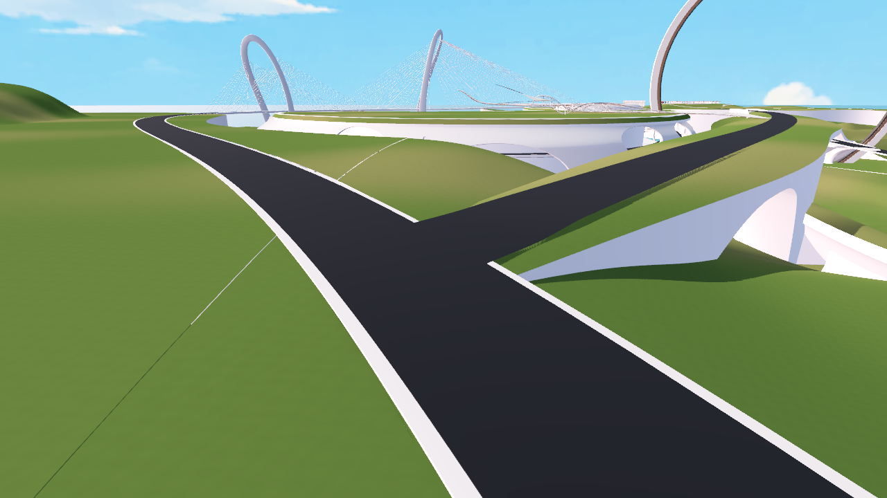

# 艺术桥与东侧岸路接头修正 · 2026-11-04

用户要求只处理截图中的道路交叉错台，保持地图整体、路线和宽度。本次仅修改原生桥面 `0808d32c-6ebc-4105-9258-a0f755ac2752`，名称为“艺术桥_保留实际路面与两端接点”。岸路 `ee277b2d-e4eb-4d39-80e6-c5d8a5d87d70`、路肩、艺术桥承托及其他物件均保留。

主文件：`D:/Prism Route/map/map_current.3dm`。交叉口约在 Rhino `(1677.75, 756.67, 55.78)`，对应 Godot `(227.75, 55.78, 393.33)`。

## 修改与验收

- 原桥面横向近乎水平，东侧岸路存在纵坡，交叉范围实际采样最大错台 **0.603 m**。
- 仅对桥面末端 **55 m** 做 Z 方向平顺变形，最后约 18 m 贴合岸路高度。保持所有 XY 坐标、20 m 路宽、原 UUID 与属性；55 m 之外的曲面误差小于 `2e-12 m`。
- 以岸路精细网格拟合局部高程，再对增加局部节点的 NURBS 控制点求解；940 个实际重合采样点的最大高差 **2.25 mm**。不使用提高车辆越障能力的方式掩盖接头。
- 过渡坡必须检查既有雕塑承托。第一轮坡形曾让承托露出，最终延后落坡，保留原承托几何；密集采样最小净距约 **19 mm**。最终 Rhino 与 Godot 截图均未见支承穿出。
- 原生主文件保存后回读，只有上述桥面几何指纹变化。自动生成的约 233 MB `.3dmbak` 在回读通过后删除；没有另存完整地图或局部 `.3dm` 组件。

Godot 正式 F5 场景 `res://scenes/map_1021.tscn` 已接入修正。新模块先排除旧桥面的渲染和碰撞，再安装 `junction.glb` 的渲染和三角网格碰撞（道路查询层 8、角色实体层 32）。其余基础地图不重导出。新增 GLB 为 **618,236 字节**，24,931 个三角形，继续使用原沥青颜色、LOD 和阴影网格导入策略。独立 Windows 发行包未重建。

实机 Jolt 房车测试共六趟，全部完成，最长连续离地帧数均为 **0**：

| 路线 | 测试速度 |
| --- | --- |
| 桥 → 北侧岸路、北侧岸路 → 桥 | 8 m/s |
| 桥 → 南侧岸路、南侧岸路 → 桥 | 8 m/s |
| 岸路北向直行、南向直行 | 18 m/s |

测试使用原房车碰撞箱和正式控制器，仅自动输入油门与转向，不逐帧搬动车辆。所有路线最大路径偏差低于 1.23 m。

## 维护入口

- [`verification.json`](verification.json)：六趟实际驾驶证据；[`native_save.json`](native_save.json)：原生保存与回读。
- [`game.png`](game.png)：实际 Forward+ / D3D12 游戏画面；[`rhino.png`](rhino.png)：原生局部画面。游戏截图为几何验收，关闭了植被加载。
- `tools/rhino_road_junction_1104.py`：原生准备、局部应用、网格导出及主文件保存。
- `tools/build_road_junction_1104.py`：数值拟合与单桥 GLB 打包；`scripts/world/road_junction.gd`：正式运行接入。
- `tools/verify_road_junction_1104.gd`：可复跑的六向驾驶验证，路径在 `routes.json`。

已修正的原生曲面有 90 列控制点，`prepare()` 会拒绝再次对其拟合，避免叠加修正。历史拟合输入位于忽略目录 `.current_map_build/road_junction_1104/`，只包含本地数值与单桥网格，不是完整 Rhino 备份。正常运行和复跑驾驶测试均不依赖这些拟合输入。

```powershell
& '.current_map_build/runtime/Godot_v4.7.2-stable_win64_console.exe' --headless --path . --script res://tools/verify_road_junction_1104.gd --fixed-fps 60
```


