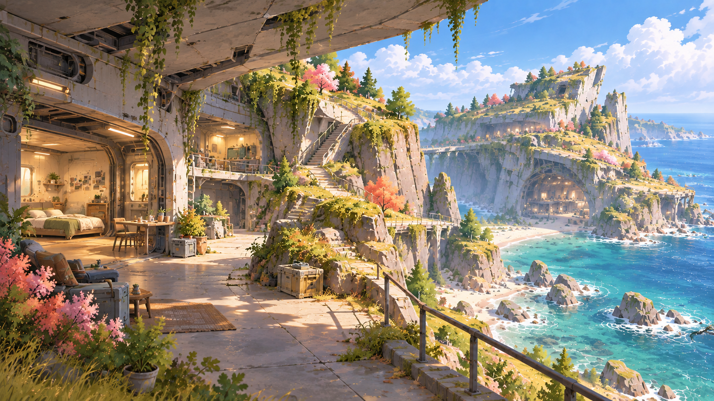

# 巨构地形概念图：不规则形体探索

日期：2026-10-01。使用内置 `image_gen` 生成，共五张本轮候选图。
用户已评价：局部细节可以参考，但总体设计不可用。五张图仅保留为
细部参考，不作为地图整体构图、地形轮廓或路线的制作依据。
整体设计以用户接下来创作的新设计图为准。
目录由 `.gdignore` 排除 Godot 导入。

## 提示词与参考分工

生成前先规划五个视角：整体、高架与管廊、住宅、中庭局部剖切、
山脊结构。参考图 `56fb…` 用于多层空间、连接与居住洞室；`2d3b…`
用于植物、色彩和日照；`a3ac…` 用于岛屿宏观景观。

用户指出第一稿台岛及构筑物太规则，随后重写提示词：加强弯曲、
偏置、倾斜、局部塌陷、海水切口和不均匀的边缘；保持少量主要
区域及可理解的路网。修订后的整体图作为另外四张的追加参考，
使色彩和形体语言相互呼应，但不要求完全一致的地图几何。

- `prompts.json`：最初计划，只有第一张按此计划生成。
- `prompts_v2.json`：用户反馈后调整的五张提示词计划。
- `generation_manifest.json`：五张实际使用的完整提示词、参考路径与保存文件。
- `rejected/01_regular_terraces_v1.png`：被指出过于规则的第一稿，留作对照。

## 1. 不规则南部整体

弯曲陆侧崖体、偏置中庭台岛、较低的居住台岛；海湾、高架与倾斜
结构形成不同的轮廓。远处保留沙滩。

## 2. 错位高架与中层空间

顶层房车通路、破损外壳下的舱室与中层步道。局部路径、桥下管廊
的连续性仍需结合平面和剖面落实，生成图没有完成严格的路网验证。

## 3. 破损崖内的居住空间

厚壳遮蔽下的生活舱、面海露台、自然采光和通往上层的楼梯。

## 4. 台岛内部与采光中庭

以打开部分外壳的视角呈现住宅、楼梯、中庭、顶层道路和低层泊岸。
这是一张内部空间意向，不是可直接建模的精确剖面。

## 5. 山脊中露出的倾斜巨构

草坡覆盖长条结构屋面，局部剥落露出肋板与可进入的空间。

## 本轮观察

外轮廓和破损方式已比第一稿更不均匀，近景生活空间也更容易阅读。
生成图仍带有参考图中的大拱洞和倾斜高板，部分形体高度、桥面坡度、
楼梯衔接没有严格遵守白模尺度。用户已否决这组图片的总体方案，
将继续创作新的设计图。后续可按新设计选择局部舱室、露台、材料等
细节作为参考；整体构图与路线需遵循用户的新图。
