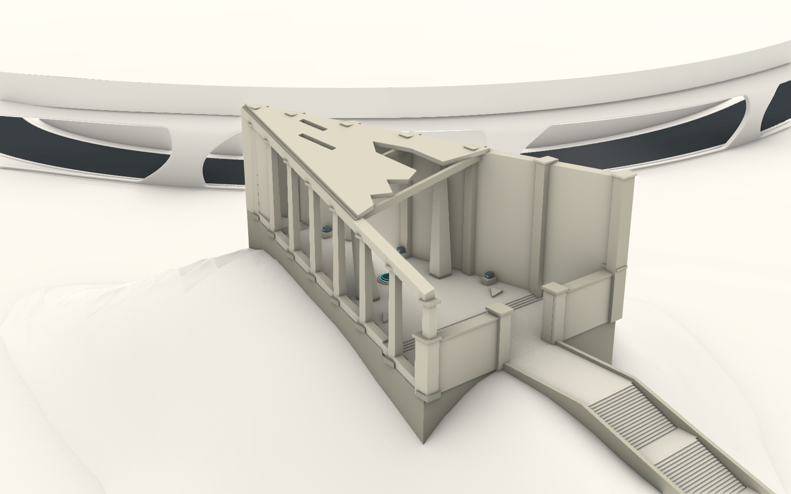
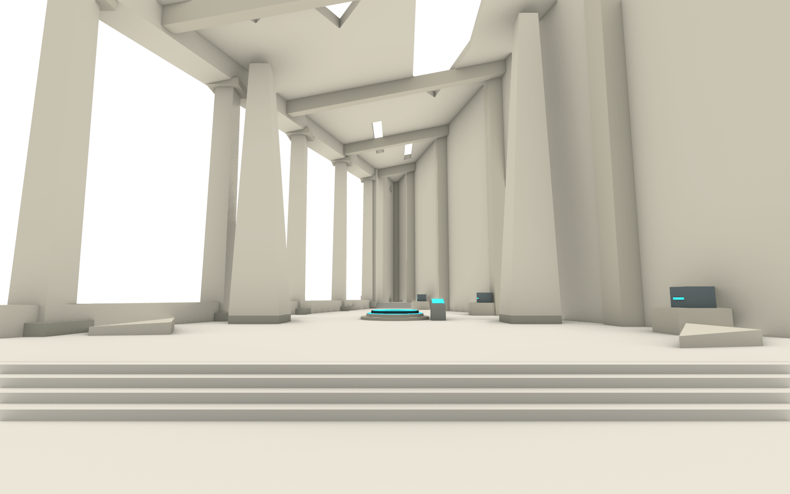
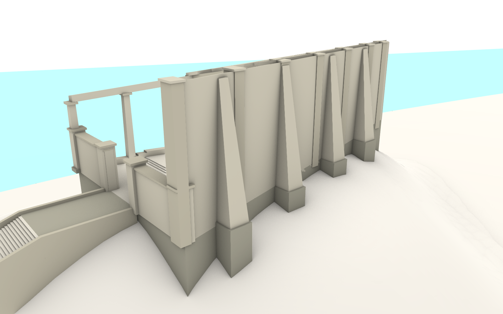
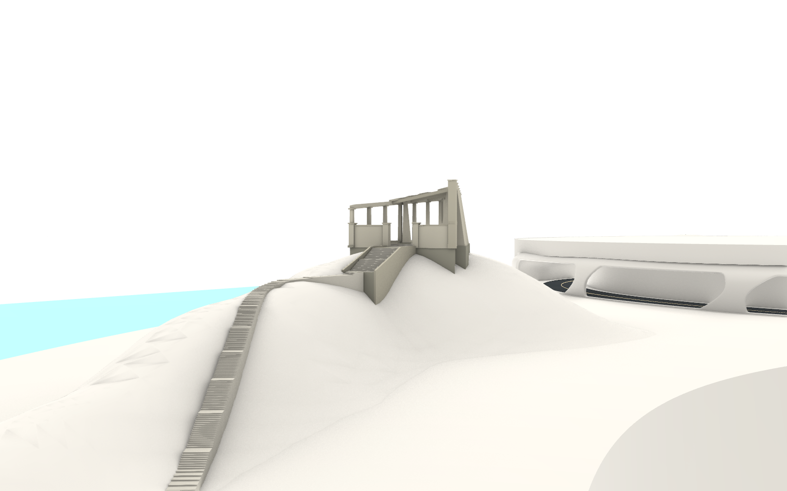
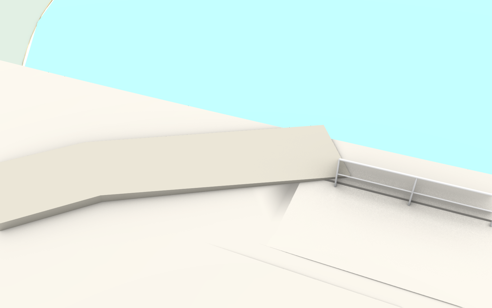

# 初始三角遗迹 · Rhino 首版

2026-10-29。建筑已加入 `D:/Prism Route/map/map_current.3dm`，位于实测南侧山脊。保留原地形，通过分段地基、阶梯台基和上山通路适应高差。

## 打开与检查

- 主地图：[map_current.3dm](../../../map/map_current.3dm)，当前 Rhino 保持此文档打开，定位在遗迹外观。
- [独立检查文件](initial_triangle_ruin_review.3dm)：328 个新构件和 7 个原有地形／洞口步道构件，保留世界坐标和米制单位。没有超大外海水面，适合内部近景检查。这个文件用于检查，不替代主地图。
- 图层：`建筑::初始三角遗迹`，分为地基、入口通路、地面内阶、低墙、侧廊、高墙扶壁、屋盖梁架、召唤台遗物八个子层，另有辅助基准空层。
- 命名视图：`PR_Ruin_01_Exterior`、`PR_Ruin_02_Interior`、`PR_Ruin_03_Foundation`、`PR_Ruin_04_Approach`、`PR_Ruin_05_CaveConnection`。

主地图原有外海水面横跨约 36 km，会使 Rhino 在部分内部近景自动裁切附近地面；单独隐藏该水面后近景正常。截图检查期间暂时隐藏，主地图保存前已恢复可见。检查文件通过省略这个远景对象避免此问题，建筑本身没有缺失地板。

## 建筑构成

- 细长三角平面，前边宽 30 m、进深 60 m，院落投影面积约 900 m²；台基、外扶壁和通路延伸到平面之外。
- 低墙名义高度 6 m，侧廊前端约 12 m，高墙前端约 18 m。两条长边墙顶随同一斜屋盖平面向后端汇合，保留低／中／高的递进关系。
- 8 根侧廊柱、4 道外扶壁、5 道屋盖横肋、两条边梁和两根斜支撑；构件均为闭合 Brep 实体。
- 屋盖厚 0.55 m，前边为不规则破口，另有两个狭长采光口。召唤台中心位于剩余屋盖下面，旁边的缺口敞开。
- 三层圆形召唤台、青蓝环、简化控制台、三个闭合遗物收纳箱和少量散落板片。不放实体人物、神像或拟人浮雕；Rhino 中仅预留全息角色位置，角色 Shader 沿用已有 Godot 实现。

## 台阶与地基

主地基按纵向分成 12 段，底部依据实际地表采样下伸至少约 0.65 m；四道外扶壁另设嵌入地面的独立脚座。没有削平、抬高或改写原地形。

入口两段各 18 级，总抬高 5.40 m；每级高 0.15 m、踏面 0.35 m、净宽 7.20 m，中间平台长 2.40 m。入口地坪标高 60.45 m，主厅为 61.05 m，后部为 61.65 m；两处室内转换各用四级 0.15 m 的台阶。

从原洞口步道到入口下平台，新通路约 171.43 m、宽 3.20 m，含 131 个 0.15 m 高的台阶，中心线最短踏面 0.37 m；每 18 级设置至少 1.80 m 的平台。起点另有约 8.7 m 的浅坡连接板，承接洞口步道，抬高 0.20 m。连接板两端横断面分别对齐旧步道和新通路，已消除转角处的三角缺口。

召唤角色的 Rhino 定位点为 **(434.7152, -105.7881, 61.5000)**，建筑长轴方向为 **(-0.37139, 0.92848, 0)**。坐标尚未套用 Godot 导出轴变换。

## 验证和存档

[验证报告](verification_report.json)记录：

- 原有 233 个对象的几何 CRC、名称和图层保持一致。
- 328 个新构件全部有效、闭合且体积为正。
- 院落 4,080 个地表样点，地面最小高出原地形约 0.276 m；通路实际踏面 1,431 个抽样点，最小高出地表约 0.045 m。
- 从入口到召唤台前的中轴通行区，279 个样点未与墙、柱、散落板片等相交。
- 召唤台上方屋盖和相邻破口分别检查通过。

这是建筑体量、构造和可通行空间的首版几何检查，尚未进行 Godot 碰撞／角色实走验证。本轮未导入 Godot。

建模前完整文档备份：[map_before_initial_ruin_1029.3dm](../../../map/backups/map_before_initial_ruin_1029.3dm)。[保存记录](saved_files.json)包含主地图与检查文件位置。

## 实际 Rhino 截图











## 构件管理

`build_state.json` 记录本轮全部构件 ID；对象带 `pr_ruin_build=PR_InitialTriangle_20261029_v1` 和阶段标签。建模脚本分三阶段，已有阶段禁止重复创建。Rhino 桥接读取脚本时显式按 UTF-8 解码后再执行，避免图层名乱码：

```python
PR_RUIN_PHASE = 'phase1'  # phase1 / phase2 / phase3；已建阶段不要重跑
exec(compile(open(path, 'rb').read().decode('utf-8'), path, 'exec'))
```

`build_initial_ruin.py` 为构造来源，`plan_placement.py` 为落位／通路规划，`verify_initial_ruin.py` 为几何验证，`review_views.py` 为视角，`save_initial_ruin.py` 为保存与检查文件导出。后续修改优先按构件 ID 更新，不修改既有地形对象。
