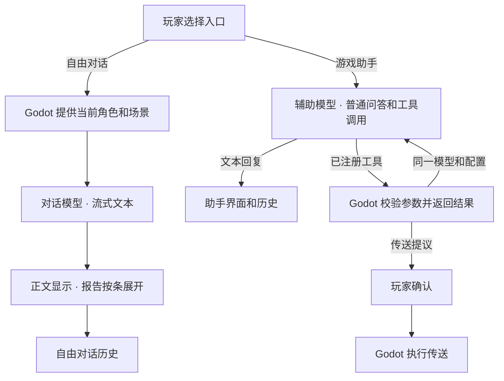

# Prism Route 的 LLM 双入口架构与路线图

> 创建于 2026-11-14

游戏内提供「自由对话」和「游戏助手」两个入口。两者共用一套面板和 HTTP 客户端，分别维护模型配置、消息历史和工具权限。对话额度用于角色扮演，普通问答和游戏操作使用辅助模型。

## 1. 固定路由和权限

| 入口 | 默认模型配置 | 用途 | 请求与响应 |
| --- | --- | --- | --- |
| 自由对话 | Argon | 与当前 NPC 进行角色对话 | SSE 流式纯文本。请求只有文本消息和生成参数，省略 `tools`、`tool_choice`、`functions` 和 `function_call`。收到工具调用时结束请求。 |
| 游戏助手 | Flash | 普通问答、查询游戏状态、提议游戏操作 | 非流式 JSON。开放工具时只提供已注册的游戏工具，由 Godot 校验调用和参数。当前传送由玩家确认后执行。 |

玩家打开的入口决定使用哪个模型。自由对话中的普通问题也会使用对话额度，普通问答从「游戏助手」发起。自然语言、前缀和模型输出都不能改变入口。

- 两个入口分别设置模型 ID、接口地址和密钥。实际模型 ID 以连接设置为准。历史按入口和会话范围保存，切换入口会取消在途请求。请求失败留在当前入口报错。
- 游戏助手发送时锁定本轮的模型、端点和密钥。工具结果回到同一个 Flash 请求链，最多执行三轮工具调用。达到上限后，末次请求只整理回复。
- 自由对话中的 `<game>` 和报告标签仅用于展示。角色动作描写和其他模型文本都没有游戏执行权限。表情、音效、动画和数值变化由 Godot 的既有事件或明确授权的辅助工具驱动。

## 2. 数据流

## 3. 当前实现

- **正式场景入口。** 初始神殿花火的剧情对话面板提供「自由对话」，退出后回到原来的台词。场景预览左侧提供「游戏助手」。自由对话目前传入花火和初始神殿的基本信息。[地图入口](../scripts/map_1021.gd) · [剧情对话面板](../scenes/narrative/dialogue_panel.gd)
- **对话请求。** 客户端从 `reborn.json` 读取生成参数、消息合并模式和 Markdown 启用列表。当前启用 22 段 Reborn 正文和两份世界书条目。Markdown 在运行时按配置加载。[Reborn 运行配置](../assets/ai/reborn.json) · [LLM 客户端](../scripts/ai/game_llm_client.gd)
- **传输和界面。** 现有功能包括 SSE 分片、Unicode 转义解码、超时提示、发送与停止共用按钮、倒回、重新生成、版本切换和续写。报告默认折叠，下一轮和续写回传玩家原文与所选回复的可见正文。[HTTP 传输](../scripts/ai/chat_transport.gd) · [LLM 面板](../scripts/ai/llm_panel.gd)
- **辅助工具。** 已接入 `get_world_status` 和 `propose_teleport`。查询返回实际世界状态，传送提议只接受有效定位点，确认后由 Godot 通过现有流程执行。旧客户端工具手册供查阅，运行时工具定义以代码为准。[工具实现](../scripts/ai/game_llm_client.gd) · [旧客户端参考](../assets/ai/reference/系统工具调用手册.md)

当前回归用本机模拟接口检查 17 项流式行为，以及报告面板和模型路由。真实模型的延迟、额度和回复风格取决于所配置的服务。复跑命令见项目 README。[回归用例](../tools/verify_llm_stream.gd) · [运行与排障](../README.md#流式回复排障)

## 4. 后续路线图

### 第一阶段：补足场景和剧本衔接

- 由 Godot 从当前交互读取地点、NPC、玩家角色和必要的互动状态。已有真实值才注入，避免把占位数值当成场景事实。
- 从树状剧本进入自由对话时，在请求中附上本次交互最近 3～5 句实际播放的台词，有现成记录时可附玩家已选择的选项。保留发言者和顺序，作为只读场景上下文。自由对话的倒回和续写只作用于自由对话回合。
- 用固定的剧本分支验证接续内容，确认不同 NPC、不同交互之间不会串用上下文。这一步由本地代码完成，无需额外模型请求。

### 第二阶段：将 NPC 人设移入角色资产

- 先给花火建立可编辑的角色卡，用稳定的 NPC ID 查找。角色卡包含名称、性格、语气示例和背景。头像、开场语等字段按界面需要加入。
- 多个 NPC 共用加载逻辑和世界规则。接入第二个 NPC 时，通过实际入口验证角色卡、导出资源和会话范围各自正确。

### 第三阶段：按游戏需求扩展 Flash 工具

- 新工具从「游戏助手」调用。Godot 根据工具名、参数和实时世界状态决定是否可以执行，需要玩家确认的操作沿用确认流程。
- 每次新增工具，先验证参数错误、请求中断、达到工具轮数上限和权限检查。自由对话的正文及报告继续用现有文本展示流程。
- 长对话摘要留作独立功能，等上下文长度实际成为问题再评估。若使用 Flash 摘要 AIRP 会话，需要先确认允许将相关历史发给辅助端点。当前版本不会自动跨入口发送历史。
