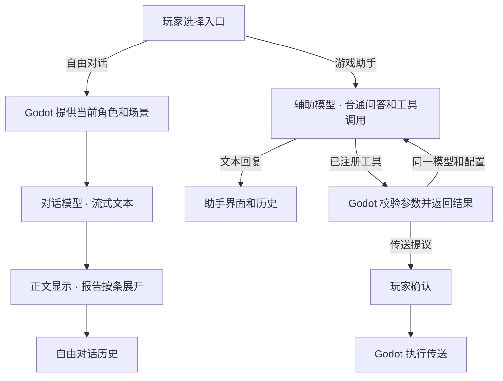

# Prism Route 的 LLM 双入口架构与路线图

> 创建于 2026-11-14

游戏内提供「自由对话」和「游戏助手」两个入口。两者共用一套面板和 HTTP 客户端，分别维护模型配置、消息历史和工具权限。对话额度用于角色扮演，普通问答和游戏操作使用辅助模型。

## 1. 固定路由和权限

| 入口 | 默认模型配置 | 用途 | 请求与响应 |
| --- | --- | --- | --- |
| 自由对话 | Argon | 与当前 NPC 进行角色对话 | SSE 流式纯文本。请求只有文本消息和生成参数，省略 `tools`、`tool_choice`、`functions` 和 `function_call`。收到工具调用时结束请求。 |
| 游戏助手 | Flash | 普通问答、查询游戏状态、提议游戏操作 | 非流式 JSON。开放工具时只提供已注册的游戏工具，由 Godot 校验调用和参数。当前传送由玩家确认后执行。 |

玩家打开的入口决定使用哪个模型。自由对话中的普通问题也会使用对话额度，普通问答从「游戏助手」发起。自然语言、前缀和模型输出都不能改变入口。

- 两个入口分别设置模型 ID、接口地址和密钥。实际模型 ID 以连接设置为准。历史按入口和会话范围保存，切换入口会取消在途请求。请求失败留在当前入口报错。
- 游戏助手发送时锁定本轮的模型、端点和密钥。工具结果回到同一个 Flash 请求链，最多执行三轮工具调用。达到上限后，末次请求只整理回复。
- 自由对话中的 `<game>` 和报告标签仅用于展示。角色动作描写和其他模型文本都没有游戏执行权限。表情、音效、动画和数值变化由 Godot 的既有事件或明确授权的辅助工具驱动。

## 2. 数据流

## 3. 当前实现

- **正式场景入口。** 初始神殿花火的剧情对话面板提供「自由对话」，退出后回到原来的台词。场景预览左侧提供「游戏助手」。自由对话目前传入花火和初始神殿的基本信息。[地图入口](../scripts/map_1021.gd) · [剧情对话面板](../scenes/narrative/dialogue_panel.gd)
- **对话请求。** 客户端按 Markdown 文件头的 `depth` 装配正文。玩家人设有独立文件，角色与场景只读取游戏入口提供的对话对象和地点。世界规则使用深度 4，输出格式使用深度 0。相邻同角色消息合并后发送。[世界书目录](../assets/ai/worldbook) · [LLM 客户端](../scripts/ai/game_llm_client.gd)
- **传输和界面。** 现有功能包括 SSE 分片、Unicode 转义解码、超时提示、发送与停止共用按钮、倒回、重新生成、版本切换和续写。自由对话由玩家手动重试，助手在执行工具前遇到暂时性故障时可自动重试至多两次。报告默认折叠，下一轮和续写回传玩家原文与所选回复的可见正文。[HTTP 传输](../scripts/ai/chat_transport.gd) · [LLM 面板](../scripts/ai/llm_panel.gd)
- **辅助工具。** 已接入 `get_world_status` 和 `propose_teleport`。查询返回实际世界状态，传送提议只接受有效定位点，确认后由 Godot 通过现有流程执行。旧客户端工具手册供查阅，运行时工具定义以代码为准。[工具实现](../scripts/ai/game_llm_client.gd) · [旧客户端参考](../assets/ai/reference/系统工具调用手册.md)

当前回归用本机模拟接口检查流式行为、报告面板、模型路由、上下文预算和传送提议。真实模型的延迟、额度和回复风格取决于所配置的服务。复跑命令见项目 README。[回归用例](../tools/verify_llm_stream.gd) · [运行与排障](../README.md#流式回复排障)

### 3.1 自由对话请求组装修复计划（2026-11-16，待实现）

酒馆实发请求的本地副本在 `D:\Prism Route\tmp\酒馆请求体.txt`。第 2 行是 `contents`，第 376 行与第 431 行分别开始倒数第二条和最后一条消息，第 454 行开始 `systemInstruction`。对照源码在 `D:\Prism Route\assets\Reborn2.4_Miku_pg.json` 和 `D:\Prism Route\assets\spreset\ChatSquash.js`。验收记录只需保留字段、角色和相对位置，可用中性占位文本替换真实对话。

已核实开场示例的 21 段文字保存在 `破限.md` 第 50–70 行，末尾的「防截断」段也与酒馆实发逐字一致。当前差异发生在发包前。游戏把示例并入首条 `system`，酒馆则将示例拆为实际的多轮消息，放在对话历史最前面。样本的核心设定集与当前玩家输入同处后段，末尾格式段在倒数第二条 `model` 消息的文本内，最后一条为 `user`。酒馆与游戏的自由对话请求均未提交工具调用参数。[开场示例](../assets/ai/worldbook/破限.md#L50) · [输出格式](../assets/ai/worldbook/输出格式.md) · [当前组装代码](../scripts/ai/game_llm_client.gd#L268)

**实现顺序**

1. 在自由对话的发包路径增加专门的消息组装步骤。在普通提示词合并之前，按 `破限.md` 中的角色标记拆出示例轮次。OpenAI 兼容请求保留首条 `system`，其后依次接示例轮次和玩家真实历史。深度 999 继续管头部提示词。示例的位置由组装逻辑固定，原文仍只在 Markdown 中维护。
2. 普通提示词继续按 Markdown 文件头的 `depth` 插入。只用实际保留的玩家和助手消息计数，示例轮次与新增的组装消息均不参与深度计算。保留世界规则的深度 4。单独核对核心设定集和当前玩家输入的相对位置，避免短历史把它当作固定头部。玩家人设、角色信息和场景沿用现有读取来源。短历史中多个条目的插入点重合时，明确保持稳定顺序。
3. 将尾部格式段按最终请求的角色和相对位置验收。深度 0 仍表达「真实历史之后」，由最终组装步骤决定实际落在哪条消息。分别处理发送、重生成和续写。续写指令应在组装完成前纳入本轮，避免追加到专门的结尾之后。自由对话始终省略工具字段，沿用当前流式接收、Unicode 解码和报告展示。本轮生成参数保持原配置，便于单独评估消息结构的影响。

**验收**

- 复用 `tools/verify_llm_stream.gd` 的 `CaptureTransport` 获取进入 HTTP 传输前的请求。用中性示例覆盖首轮、历史不足四条、历史超过四条、重生成和续写。检查系统头部、示例顺序、玩家实际输入、核心设定集、深度 4 插入点和最终两条消息的角色与文本位置。
- 将 `_has_final_dialogue_format()` 目前对「最后一条为 `system`」的断言换成对最终组装结构的断言。检查特殊段落各出现一次，真实历史次序稳定，模型名、两入口权限和存档格式沿用现状。回归正文与报告显示、手动停止及 Unicode 分片解码。[现有验收代码](../tools/verify_llm_stream.gd#L505)
- 离线验收确认客户端请求形状。兼容端点如何把 `messages` 转换为 Gemini 的 `systemInstruction` 和 `contents`，以及模型表现是否随之变化，需要在同一端点和模型上另做对照。JSON 对象字段的书写顺序不作为验收条件。

## 4. 后续路线图

### 第一阶段：补足场景和剧本衔接

- 由 Godot 从当前交互读取地点、NPC、玩家角色和必要的互动状态。已有真实值才注入，避免把占位数值当成场景事实。
- 从树状剧本进入自由对话时，在请求中附上本次交互最近 3～5 句实际播放的台词，有现成记录时可附玩家已选择的选项。保留发言者和顺序，作为只读场景上下文。自由对话的倒回和续写只作用于自由对话回合。
- 用固定的剧本分支验证接续内容，确认不同 NPC、不同交互之间不会串用上下文。这一步由本地代码完成，无需额外模型请求。

### 第二阶段：将 NPC 人设移入角色资产

- 先给花火建立可编辑的角色卡，用稳定的 NPC ID 查找。角色卡包含名称、性格、语气示例和背景。头像、开场语等字段按界面需要加入。
- 多个 NPC 共用加载逻辑和世界规则。接入第二个 NPC 时，通过实际入口验证角色卡、导出资源和会话范围各自正确。

### 第三阶段：按游戏需求扩展 Flash 工具

- 新工具从「游戏助手」调用。Godot 根据工具名、参数和实时世界状态决定是否可以执行，需要玩家确认的操作沿用确认流程。
- 每次新增工具，先验证参数错误、请求中断、达到工具轮数上限和权限检查。自由对话的正文及报告继续用现有文本展示流程。
- 长对话摘要留作独立功能，等上下文长度实际成为问题再评估。若使用 Flash 摘要 AIRP 会话，需要先确认允许将相关历史发给辅助端点。当前版本不会自动跨入口发送历史。
