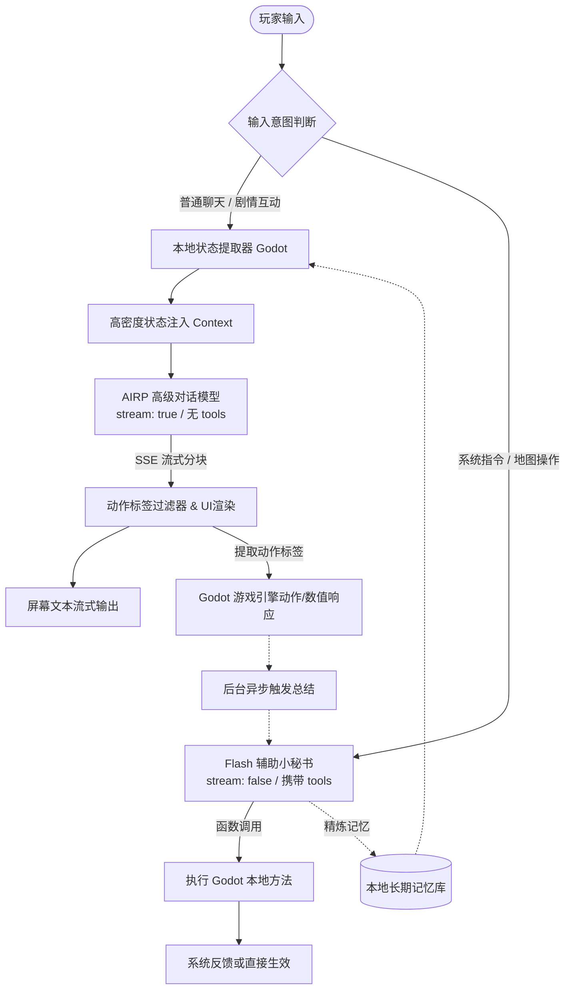

# Prism Route - LLM 双 Agent 架构设计与落地规划方案

> 文档创建时间: 2026-11-14
> 适用工程: `d:/Prism Route/prism-route`
> 核心目标: 实现「高端角色对话模型 (AIRP)」与「快速低成本辅助模型 (Flash)」的职责硬隔离，在保证沉浸式 RP 体验与节省高级额度的前提下，打通游戏状态感知与行动反馈。

---

## 1. 核心设计原则与背景

在游戏运行过程中，模型调用的需求通常呈现两种极端：
1. **沉浸式角色扮演 (AIRP / 高级模型)**：
   - 需求：文笔细腻、人设立体、符合核心设定集与 Reborn 2.4 叙事规则。
   - 痛点：每天调用配额或预算极其有限，单次请求如果携带庞大工具参数或进入 Tool Calling 死循环，不仅严重消耗 Token，还会导致回复机械化。
   - 规范：**纯文本流式输出 (SSE)，严禁在请求中传入 `tools` 或 `tool_choice`**，不执行任何工具调用循环。

2. **游戏状态监控与指令辅助 (Flash / 快速低成本模型)**：
   - 需求：高并发、低延迟 (200~500ms)、成本近乎可忽略、精确提取结构化 JSON / 函数调用。
   - 职责：作为“后台小秘书”，执行游戏世界状态查询、传送提议、玩家意图分类、长对话上下文压缩总结。
   - 规范：**支持非流式 Tool Calling**，在后台默默运转，不干扰角色的正面对话情绪。

### 为什么坚决不做「单工具循环内动态切模型」？
在同一个 OpenAI / Claude 请求上下文生命周期里，让模型根据工具返回动态切换底层引擎会导致：
- 上下文历史中包含的 Tool Call 结构在不同模型提供商或不同参数间格式不兼容。
- 逻辑脆弱，状态机复杂且难以调试。
- 高级模型在面对工具返回时仍然会被动消耗大量上下文输入 Token。

因此，本项目采用 **双通道硬隔离架构 (Hard-Isolated Dual Channel Architecture)**，将对话任务与辅助任务解耦为两条清晰的流水线。

---

## 2. 系统架构与数据流图



---

## 3. 当前实现状态与待补齐断点

### 3.1 当前已完成的基础 (Current State)
1. **客户端双通道分流**：
   - [game_llm_client.gd](file:///d:/Prism%20Route/prism-route/scripts/ai/game_llm_client.gd) 已设立 `ROUTE_DIALOGUE` 与 `ROUTE_ASSISTANT`。
   - `ROUTE_DIALOGUE` 强制 `stream = true`，请求体严格屏蔽 `tools`，自动拼装 Reborn 22 模块、世界规则与核心设定集。
   - `ROUTE_ASSISTANT` 挂载 `get_world_status` 与 `propose_teleport` 工具描述。
2. **底层高吞吐传输层**：
   - [chat_transport.gd](file:///d:/Prism%20Route/prism-route/scripts/ai/chat_transport.gd) 基于 Godot 4 `HTTPClient`，支持 SSE 逐块拼接、跨分块 UTF-8 解码与超时保护。
3. **游戏内交互与神殿初见**：
   - [dialogue_panel.gd](file:///d:/Prism%20Route/prism-route/scenes/narrative/dialogue_panel.gd) 与 [map_1021.gd](file:///d:/Prism%20Route/prism-route/scripts/map_1021.gd) 已成功在花火初见剧情后弹出「自由对话」按钮，唤出 [llm_panel.gd](file:///d:/Prism%20Route/prism-route/scripts/ai/llm_panel.gd)。

### 3.2 待解决的断点 (Missing Links)
1. **角色“失忆”问题 (Lack of Immediate Context)**：
   - 点击自由对话时，AIRP 模型不知道刚才树状剧本中两人说了什么、花火做了什么动作。
2. **世界与角色状态“盲盒”问题 (No State Perception)**：
   - 对话模型不知道当前所处地图、玩家当前快感值、屈服状态、衣着破损度或战斗胜负状态。
3. **角色卡缺乏独立配置 (Hardcoded NPC Info)**：
   - 目前 `{{char}}` 和人设需要从独立的角色资产文件加载，不能写死在全局规则中。
4. **输出反哺游戏机制 (Action Tag Binding)**：
   - 对话模型虽然能描写调戏或施虐，但游戏引擎无法自动播放对应立绘差分、音效或扣减生命值/增加快感。

---

## 4. 落地规划路线图 (Roadmap)

### 第一阶段：本地零延迟状态注入 (Local High-Density State Injection)
> 目标：不浪费高级模型调用，不借助额外 API，由 Godot 本地直接提取游戏当前状态并拼装注入。

1. **状态摘要打包机制**：
   在发起对话前，Godot 收集以下运行时参数，格式化为简短明确的系统附录：
   ```text
   [当前环境与场景状态]
   - 地点: 水之庭院 / 初始神殿 (Map 1021)
   - 对话对象: 花火 (Sparkle)
   - 玩家角色: 开拓者 (穹/星)
   - 身体状态: 轻度疲劳，快感值 65/100，服装状态 轻度凌乱
   - 当前战局/互动: 探索休息中
   ```
2. **树状剧情桥接 (Scripted Context Bridge)**：
   - 当从树状对话 (DialogueManager) 跳转到自由对话时，把刚才最后 3~5 句剧情台词自动加入对话模型的历史消息列表：
     - System: `[刚才发生的剧情进展]`
     - Assistant (花火): `“哎呀，这就被面具吓到了吗？接下来的乐子可多着呢~”`
     - User: `“你到底想做什么……”`
   - 这样对话模型一秒进入情境，不会有割裂感。

### 第二阶段：角色人设卡资产化 (NPC Persona Modularization)
> 目标：每个 NPC 拥有独立的角色卡配置文件，实现模块化即插即用。

1. **资产目录结构**：
   - 在 `assets/ai/characters/` 下建立：
     - `sparkle.json` / `sparkle.md` (花火：愚者、愉悦犯口吻、调戏风格示例、专用动作)
     - `miku.json` / `miku.md` (初音未来：引导者、元气温柔风格示例)
2. **字段标准**：
   - `name`: 角色全名与代称
   - `avatar_path`: 默认立绘路径
   - `first_mes`: 首次打招呼的开场白
   - `personality`: 核心性格特征与说话语气指南 (Few-Shot 对话例句)
   - `world_view`: 专属背景补充

### 第三阶段：输出动作标签引擎 (Action Tag Engine)
> 目标：让 AIRP 纯文本流反向驱动游戏内画面、数值与音效。

1. **标签协议规范**：
   允许并引导 AIRP 在回复末尾或动作描写中携带轻量标签（也可以使用类似 Reborn 预设中的 `<game>` 标签）：
   - 表情差分：`<face: smug>` / `<face: blush>` / `<face: angry>`
   - 角色动作：`<pose: tease>` / `<pose: step_closer>`
   - 游戏数值：`<pleasure: +15>` / `<submission: +5>`
   - 场景音效：`<sfx: giggle>` / `<bgm: playful>`
2. **前端流式过滤处理**：
   - 在 [llm_panel.gd](file:///d:/Prism%20Route/prism-route/scripts/ai/llm_panel.gd) 或专用正则处理器中，在文本渲染到屏幕时将 `<tag: value>` 标签实时剥离，保证玩家看到的是干净优雅的文字。
   - 解析出的标签派发给 Godot 信号系统：
     - `signal character_expression_requested(expr_id)`
     - `signal battle_stat_delta_requested(stat_name, delta)`

### 第四阶段：Flash 后台小秘书接入 (Flash Background Secretary)
> 目标：将所有复杂判断、长文本总结、游戏控制工具全权交给低成本 Flash 模型。

1. **意图路由分流**：
   - 在聊天框中提供前缀或者 UI 模式切换（例如输入 `/cmd 传送水之庭院` 或切换到「系统求助模式」）。
   - 该模式走 `ROUTE_ASSISTANT`，直接调用 `propose_teleport`、`get_world_status` 等工具。
2. **异步记忆压缩 (Asynchronous Memory Compression)**：
   - 当玩家与角色自由对话达到 10~15 轮，上下文即将变长时：
   - 游戏在后台非阻塞启动一次 Flash 请求，将前 10 轮对话概括成一段 80 字以内的「记忆摘要」。
   - 将原先的 10 轮对话折叠，替换为该摘要，从而维持 AIRP 对话模型的极速与极低 Token 消耗。

---

## 5. 项目文件索引与对应关系

| 功能模块 | 文件绝对路径 | 说明 |
| :--- | :--- | :--- |
| **架构方案文档** | [llm_dual_agent_architecture_and_roadmap.md](file:///d:/Prism%20Route/prism-route/plans/llm_dual_agent_architecture_and_roadmap.md) | 本规划规范与落地指南 |
| **LLM 客户端核心** | [game_llm_client.gd](file:///d:/Prism%20Route/prism-route/scripts/ai/game_llm_client.gd) | 双路由管理、参数组装、宏替换 |
| **SSE 传输层** | [chat_transport.gd](file:///d:/Prism%20Route/prism-route/scripts/ai/chat_transport.gd) | 纯底层 HTTPClient 流式事件解析 |
| **对话 HUD 面板** | [llm_panel.gd](file:///d:/Prism%20Route/prism-route/scripts/ai/llm_panel.gd) | 聊天界面、流式渲染、重试与配置弹窗 |
| **核心设定集** | [核心设定集.md](file:///d:/Prism%20Route/prism-route/assets/ai/worldbook/%E6%A0%B8%E5%BF%83%E8%AE%BE%E5%AE%9A%E9%9B%86.md) | 8000字世界底层规则与生理机制 |
| **世界规则设定** | [世界规则.md](file:///d:/Prism%20Route/prism-route/assets/ai/worldbook/%E4%B8%96%E7%95%8C%E8%A7%84%E5%88%99.md) | 叙事基调、文风指引与通用逻辑 |
| **工具参考手册** | [系统工具调用手册.md](file:///d:/Prism%20Route/prism-route/assets/ai/reference/%E7%B3%BB%E7%BB%9F%E5%B7%A5%E5%85%B7%E8%B0%83%E7%94%A8%E6%89%8B%E5%86%8C.md) | 辅助模型参考工具标准定义 |

---

## 6. 后续实施行动清单 (Action Items)

- [ ] **Step 1**: 在 `scripts/ai/game_llm_client.gd` 中新增 `append_scene_state(state_dict: Dictionary)`，将游戏状态打包注入 `ROUTE_DIALOGUE`。
- [ ] **Step 2**: 改造 `scenes/narrative/dialogue_panel.gd`，在跳转自由对话时向 LLM 客户端投递树状剧情末尾的上下文。
- [ ] **Step 3**: 创建 `assets/ai/characters/sparkle.json`，将花火的人设与例句与全局设定分离。
- [ ] **Step 4**: 在 `scripts/ai/llm_panel.gd` 中加入基础正则标签过滤，验证表情切换与快感反馈回路。
