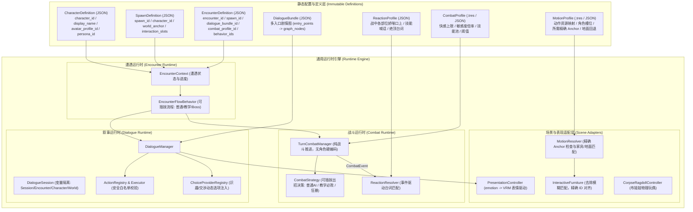
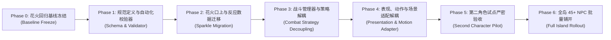

# 全角色口上注入与交互架构升级计划 (v2.0 深度重构版)
(Universal NPC Koujou & Interaction Architecture Plan v2.0)

> **设计依据**：结合 [GitHub Issue #27 源码审计报告](https://github.com/maru044/prism-route/issues/27)，彻底摒弃“单一大 JSON 承载全部数据”和“通用大控制器堆砌 if/elif 状态机”的伪数据驱动陷阱，建立**分层实体解耦（角色/点位/遭遇）、不可变配置与运行时上下文隔离、可插拔行为策略（Pluggable Behaviors）、精确动作兼容性解析**的高扩展性叙事与遭遇战框架。

---

## 一、 核心原则与架构认知纠偏（参照 Issue #27）

在 v1.0 方案中，我们存在将“数据驱动”简单等同于“一个大 JSON 塞满所有东西”、将“通用机制”等同于“所有角色走同一条战斗奉仕流水线”的问题。v2.0 确立以下 5 项根本原则：

1. **复用运行机制，不强行统一角色行为与剧情流程**：
   - 对话推进、变量管理、动作调度、快感数值判定可以 100% 共享。
   - 但日常 NPC、战斗 NPC、教学考官、Boss 的行为策略各不相同，绝不强求所有 NPC 都走相同的战斗与战败惩罚流程。
2. **三层实体明确拆分（Character ≠ Spawn ≠ Encounter）**：
   - `character_id`（角色身份）：人物名称、外观资源映射、通用人设 Persona。
   - `spawn_id`（世界点位）：世界坐标、朝向、所处场景、待机动作、周边可用家具。同一个角色（如花火、夜兰）可在神殿、小镇、沙洲多个点位独立生成。
   - `encounter_id`（遭遇事件）：特定点位下的一次剧情或战斗玩法流程。同一个点位在初遇、教学、日常闲聊中可拥有不同的遭遇配置。
3. **不可变定义与运行时会话隔离**：
   - JSON / Resource 仅作为静态模板只读加载，严禁在运行时向共享定义回写动态数据。
   - 动态数据由生命周期独立的 `DialogueSession`、`EncounterContext`、`CombatSession` 分别管理。
4. **数据驱动行为必须经过白名单 Action Registry**：
   - JSON 数据只能请求预先注册的游戏操作（Action Request），必须经过参数类型校验与上下文合法性检查，严禁直接执行任意代码。
5. **脚本化口上与自由 LLM 对话分流运行**：
   - 确定性剧情、分支选择、战斗口上由 `DialogueRuntime` / `ReactionResolver` 驱动。
   - 开放式自由对话由 `GameLLMClient` 驱动，二者共享角色身份与上下文，但不可将 50 位角色人设全部塞进全局 Worldbook 目录，防止提示词灾难性膨胀。

---

## 二、 目标系统架构蓝图



---

## 三、 配置数据规范与拆分结构

不再使用单个巨型 JSON，而是按职责清晰拆分为小文件集合，组织于 `assets/npc/`：

```
assets/npc/
├── characters/              # 角色身份定义 (CharacterDefinition)
│   ├── sparkle.json
│   ├── keqing.json
│   └── ...
├── spawns/                  # 世界点位生成定义 (SpawnDefinition)
│   ├── initial_temple_sparkle.json
│   ├── cape_town_sparkle.json
│   └── ...
├── encounters/              # 遭遇事件与流程组合 (EncounterDefinition)
│   ├── initial_temple_sparkle.json
│   ├── sandbar_keqing.json
│   └── ...
├── dialogue/                # 剧情对话图 (按角色分目录，按剧情入口拆分文件)
│   ├── sparkle/
│   │   ├── temple_intro.json           # 初遇与日常闲聊
│   │   ├── temple_negotiation.json     # 战中与绝顶边缘交涉
│   │   ├── temple_victory.json         # 战胜处置分支
│   │   ├── temple_settlement.json      # 侍奉与收服
│   │   └── temple_respawn.json         # 识趣重构与重试
│   └── ...
├── reactions/               # 战斗部位娇喘与出招口上 (ReactionProfile)
│   ├── sparkle_temple.json
│   ├── keqing_sandbar.json
│   └── ...
├── combat/                  # 战斗数值与技能包 (CombatProfile)
│   ├── sparkle_tutorial.tres
│   ├── keqing_combat.tres
│   └── ...
├── motions/                 # 动作资源映射 (MotionProfile)
│   ├── sparkle_temple_motions.tres
│   ├── keqing_motions.tres
│   └── ...
└── schemas/                 # 严格校验用的 JSON Schema
    ├── character.schema.json
    ├── dialogue.schema.json
    └── ...
```

### 1. 角色定义 (CharacterDefinition) 示例
```json
{
  "schema_version": 1,
  "character_id": "keqing",
  "display_name": "刻晴",
  "title": "玉衡星",
  "avatar_profile_id": "keqing",
  "persona_id": "keqing_persona",
  "presentation_profile_id": "keqing_default"
}
```

### 2. 遭遇定义 (EncounterDefinition) 示例
```json
{
  "schema_version": 1,
  "encounter_id": "sandbar_keqing_duel",
  "character_id": "keqing",
  "spawn_id": "sandbar_keqing",
  "flow_behavior_id": "standard_duel",
  "dialogue_bundle_id": "keqing_sandbar_bundle",
  "combat_profile_id": "keqing_standard_combat",
  "reaction_profile_id": "keqing_sandbar_reactions",
  "motion_profile_id": "keqing_sandbar_motions",
  "supported_entry_points": [
    "intro_start",
    "mid_combat_negotiation",
    "post_combat_settlement",
    "respawn_chitchat"
  ]
}
```

### 3. 动作与环境绑定规范 (MotionProfile)
摒弃“自动根据家具类型挑动作”的粗放匹配，明确双方角色槽位与所需精确 Anchor：
```json
{
  "schema_version": 1,
  "motion_profile_id": "keqing_sandbar_motions",
  "bindings": {
    "desk_service": {
      "interaction_type": "desk",
      "required_anchors": ["Anchor_Desk_Surface", "Anchor_Front"],
      "role_a_motion": "res://assets/characters/mmd_selected/animations/mmd_fca4bab1635f_a.tres",
      "role_b_motion": "res://assets/characters/mmd_selected/animations/mmd_fca4bab1635f_b.tres",
      "fallback_to_ground": false
    },
    "ground_service": {
      "interaction_type": "ground",
      "required_anchors": [],
      "role_a_motion": "res://assets/characters/mmd_selected/animations/mmd_fcc0340f8227_a.tres",
      "role_b_motion": "res://assets/characters/mmd_selected/animations/mmd_fcc0340f8227_b.tres",
      "fallback_to_ground": true
    }
  }
}
```

---

## 四、 核心运行时重构设计

### 1. DialogueManager 升级
- **引入 DialogueSession**：拥有 `session_id`、独立的局部变量容器（防止跨对话/跨角色变量污染）。
- **四级变量作用域隔离**：
  - `session`：本轮对话瞬态变量。
  - `encounter`：当前遭遇临时进度（如战斗回合数、是否触发濒危交涉）。
  - `character`：角色长期好感与解锁度。
  - `world`：世界大地图解锁进度。
- **ChoiceProvider 动态选项机制**：
  - ChoiceNode 支持配置 `choice_provider_id`（如 `edging_negotiation_provider`）。
  - Provider 根据当前战斗快感与识趣规则动态返回选项，**保持原始静态对话图绝对不可变**。
- **ActionRegistry 白名单安全执行器**：
  - 格式规范为 `domain.action_name`（如 `encounter.start_combat`、`settlement.apply_service`）。
  - 执行器验证参数类型与合法性，支持异步演出返回状态。

### 2. TurnCombatManager 解耦
- **彻底移除花火类强引用**：删除 `preload("res://scripts/narrative/sparkle_tutorial_dialogue.gd")`。
- **纯粹战斗推进器**：
  - 管理玩家与 NPC 的快感数值结算、防御倍率和回合状态切换。
  - 触发战斗事件：`combat_event_emitted(event_type, payload)`（如受刺激部位、快感区间跨越、出招执行）。
- **事件驱动的 ReactionResolver**：
  - 订阅战斗事件，根据当前角色的 `ReactionProfile` 匹配对应台词和表情并推给 HUD，解耦战斗与文本。
- **可插拔 CombatStrategy**：
  - NPC 回合出招逻辑由 `CombatStrategy` 接口决定。
  - 普通 NPC 采用 `StandardSensualAIStrategy`（根据玩家防守随机出招）。
  - 花火教学杀采用专属 `SparkleTutorialTeachingStrategy`（首回合无视防御神级绝技）。
  - 杜绝在通用管理器内编写 `if is_tutorial_round`。

### 3. 家具与动作精准适配
- **修复 InteractiveFurniture 的模糊匹配漏洞**：
  - 废除忽略大小写和子串模糊匹配，改为精确匹配 Anchor 名称。
  - 检查并杜绝场景中重复同名 Anchor。
- **MotionResolver 兼容性裁决**：
  - 检查当前点位绑定的家具是否具备 `required_anchors`。
  - 具备条件才调度家具动作演出；不具备且允许 `fallback_to_ground` 时平滑切入地面姿势；若无兼容动作则优雅退回普通交谈，严禁强行对齐导致飞天穿模。

### 4. 自由 LLM 提示词装配隔离
- **物理路径隔离**：将角色人设移入 `assets/ai/personas/<character_id>.md`。
- **动态按需装配**：`GameLLMClient` 仅扫描 `assets/ai/worldbook/` 内的通用世界与规则文档，自由对话开启时根据当前 `character_id` 精确追加其单一人设，避免 50 个人设一次性灌爆提示词上下文。

### 5. 导出配置与静态文件完整性保护
- 在 `export_presets.cfg` 和 `tools/configure_export_1021.gd` 中，显式将 `assets/npc/**/*.json` 加入 `include_filter`，确保打包版能够无遗漏读取。

---

## 五、 实施路线图与阶段划分



### Phase 0: 冻结当前花火流程的回归基线
- 梳理并列举花火当前所有 8 个入口节点、动作资源与 Action 跳转关系。
- 编写无头回归测试脚本，记录输入与期望输出基线，确保后续重构不破坏原有体验。

### Phase 1: 建立定义目录、JSON Schema 与 Validator
- 建立 `assets/npc/` 目录组织。
- 编写 `tools/validate_npc_content.gd` 校验工具，支持离线检查语法错误、死循环节点、悬空 target、未注册 Action 及缺失的资源路径。
- 将 `assets/npc/**/*.json` 配置加入构建导出预设。

### Phase 2: 迁移花火口上与反应数据
- 将 `scripts/narrative/sparkle_tutorial_dialogue.gd` 中的对话图与敏感反应表抽离为 `assets/npc/dialogue/sparkle/` 与 `assets/npc/reactions/sparkle_temple.json`。
- 升级 `DialogueManager`，支持 `DialogueSession` 上下文与白名单 Action 派发。
- 运行比对测试，确保花火神殿流程文本与选择 100% 吻合。

### Phase 3: 战斗管理器解耦与 CombatStrategy
- 重构 `TurnCombatManager`：完全移除对花火类的依赖，改为事件驱动。
- 实现 `ReactionResolver` 和 `SparkleTutorialTeachingStrategy`。
- 验证普通战斗流程与花火特殊教学杀在同一套战斗管理器下独立共存。

### Phase 4: 表现、动作与场景适配器提炼
- 提炼通用的 `CharacterEncounterController` 基础框架，神殿特定逻辑作为外部 `EncounterFlowBehavior` 挂载。
- 修复 `InteractiveFurniture` 精确 Anchor 匹配，实现 `MotionResolver` 兼容性检查。
- 连接 `DialoguePanel` 的 emotion 信号至 VRM 表现层。

### Phase 5: 第二角色试点严密验收 (架构成立的决定性标准！)
> [!IMPORTANT]
> **验收黄金标准**：不是“花火能通过 JSON 跑通”，而是**“在不改动通用 DialogueManager 和 TurnCombatManager 任何一行代码的前提下，第二个逻辑明显不同的角色能够顺利完成自身全部交互与战斗对决流程”**！
- 选取 **刻晴（keqing）**（沙洲度假遗址，长案桌，好胜傲娇对决，无教学杀，有桌上战败奉仕）作为试点。
- 同步测试无家具点位的优雅地面动作回退。
- 验收通过后，架构正式宣称成立！

### Phase 6: 全岛 45+ NPC 内容批量铺开
- 按照 13 大区域，批量为其余角色生成 Character / Spawn / Encounter / DialogueBundle 配置。
- 配合自动化 Validator 校验每一次提交，确保全岛内容无缝稳健铺开。
