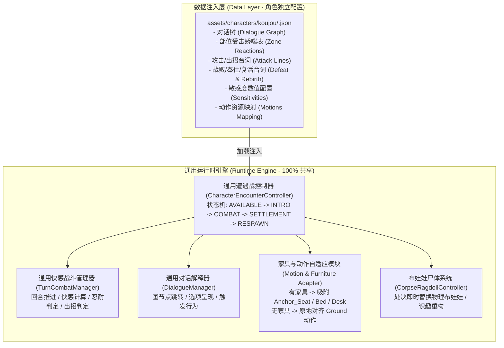
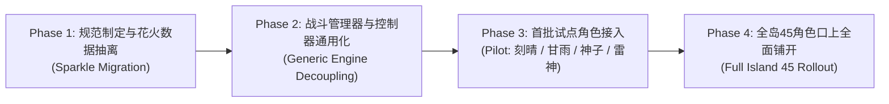

# 全角色通用口上注入与交互架构升级计划
(Universal NPC Koujou & Interaction Architecture Plan)

> **目标**：彻底解耦现有“花火（Sparkle）单例硬编码”的遭遇战与口上逻辑，构建一套**通用、数据驱动、动作自适应**的全角色口上注入框架。后续为全岛 45 位角色创作与接入专属口上时，无需重复编写庞大的 GDScript 控制器，只需编写独立规范的角色配置包（JSON），即可自动驱动完整的世界对话、回合制快感对决、家具/地面战败奉仕及识趣重构全流程。

---

## 一、 现状审查与核心痛点分析

### 1. 当前代码现状
- **控制器高度绑定**：`scripts/world/initial_temple_encounter_controller.gd`（1465 行）直接引入花火脚本、硬编码了花火动作资源路径与神殿特定家具节点。
- **战斗管理器存在单例依赖**：`scripts/combat/turn_combat_manager.gd` 中写死了 `preload("res://scripts/narrative/sparkle_tutorial_dialogue.gd")`，且回合日志和出招逻辑硬编码为“花火”。
- **口上数据与逻辑强耦合**：`scripts/narrative/sparkle_tutorial_dialogue.gd`（707 行）把对话图节点、敏感部位反应字典与技能台词全部写在静态 GDScript 脚本内。

### 2. 核心架构痛点
- **复用成本极高**：全岛共有 45 位角色、66 个点位，若每个角色都复制一份千行控制器脚本，将产生数万行重复样板代码，导致维护灾难。
- **缺乏统一配置规范**：角色的敏感部位倍率、动作偏好、家具对齐逻辑散落各处，缺乏中央元数据。
- **家具强依赖风险**：现有流程假设场景必然存在神殿的椅子和床，而在海岬小镇、教堂或草甸，很多点位没有家具，直接复用原逻辑会导致空节点崩溃。

---

## 二、 架构设计原则：通用管线 vs 差异注入



### 1. 绝对通用的底层机制（一套代码，全员复用）
- **状态机生命周期**：待机交互 → 战前对话 → 切磋战斗 → 绝顶边缘战中交涉 → 战败演出 → 处决或宽恕 → 识趣重构。
- **快感判定与出招循环**：玩家指令计算、敏感带乘数、忍耐高潮检测。
- **环境自适应**：智能探测角色所处环境，有椅子对齐椅子，有床对齐床，无家具在地面自然播放地面体位。

### 2. 属于各个角色的差异化内容（数据包独立注入）
- **台词文学与性格**：傲娇、腹黑、威严、病娇、害羞等文学创作。
- **动作资源清单**：椅子/床/桌子/地面分别映射哪套 MMD 资源。
- **敏感部位数值**：每个角色独特的快感敏感弱点。
- **特性标签（Feature Flags）**：如新手导师教学杀、多阶段霸体等特殊机制。

---

## 三、 角色口上数据包规范 (JSON Schema)

每个角色在 `assets/characters/koujou/<character_id>.json` 中维护一份完整的自包含数据：

```json
{
  "character_id": "keqing",
  "display_name": "刻晴",
  "title": "玉衡星",
  "pleasure_profile": {
    "max_pleasure": 100.0,
    "sensitivities": {
      "mouth": 1.0,
      "nipples": 1.15,
      "clitoris": 1.35,
      "thighs": 1.5,
      "anal": 1.1
    }
  },
  "motions": {
    "chair": "res://assets/characters/mmd_selected/animations/mmd_781d8c87fd79_a.tres",
    "bed": "res://assets/characters/mmd_selected/animations/mmd_43916ffe3d35_a.tres",
    "desk": "res://assets/characters/mmd_selected/animations/mmd_fca4bab1635f_a.tres",
    "ground": "res://assets/characters/mmd_selected/animations/mmd_fcc0340f8227_a.tres"
  },
  "combat_flags": [],
  "dialogue_graph": {
    "start": {
      "type": "text",
      "speaker": "刻晴",
      "text": "剑光如我，斩尽芜杂！你就是新来的旅行者吗？",
      "emotion": "serious",
      "next": "main_choices"
    },
    "main_choices": {
      "type": "choice",
      "speaker": "刻晴",
      "text": "找我有什么事？现在可是工作时间。",
      "choices": [
        { "text": "【日常闲聊】关于这片沙洲度假遗址……", "target": "chat_beach" },
        { "text": "【切磋对决】请刻晴小姐与我进行身心对决！", "action": "enter_combat" }
      ]
    }
  },
  "in_combat": {
    "attack_lines": {
      "skill_1": { "name": "迅捷剑挑", "text": "别分神，看招！", "raw_damage": 16.0, "emotion": "serious" }
    },
    "zone_reactions": {
      "thighs": {
        "low": { "text": "呀！大腿……别碰那里！", "emotion": "blush" },
        "mid": { "text": "唔嗯……手放开……好奇怪的感觉……", "emotion": "pain" },
        "high": { "text": "哈啊……站不住了……快停下……！", "emotion": "climax" }
      }
    }
  },
  "defeat": {
    "surrender": { "text": "我认输……随你怎么处置好了……", "emotion": "blush" },
    "service_virgin": { "text": "轻一点……本小姐也是第一次……", "emotion": "shy" },
    "service_honban": { "text": "唔……这就是败者的惩罚吗……", "emotion": "climax" },
    "kill": { "text": "竟然……是真的下杀手……", "emotion": "pain" },
    "reconstruction": { "text": "咳！刚才只是切磋中的意外失手，本小姐可没被杀死！", "emotion": "angry" }
  }
}
```

---

## 四、 实施路线图 (Phased Implementation Roadmap)



### Phase 1: 规范定义与花火数据迁移 (Sparkle Migration)
1. **建立口上数据目录**：创建 `assets/characters/koujou/`。
2. **迁移花火口上**：将 `scripts/narrative/sparkle_tutorial_dialogue.gd` 内的 700 多行对话、部位娇喘与出招配置完整抽取为 `assets/characters/koujou/sparkle.json`。
3. **保持 100% 体验兼容**：确保花火的对话分支、教学杀特权标签（`tutorial_teaching_kill`）、奉仕动作不变。

### Phase 2: 战斗管理器与控制器通用化 (Generic Engine Decoupling)
1. **重构 `TurnCombatManager`**：
   - 移除 `const SparkleDialogueClass` 硬编码依赖。
   - 改为通过 `setup_npc_profile(profile_dict)` 注入当前 NPC 的出招表、台词与敏感度。
2. **提炼通用遭遇战控制器 `CharacterEncounterController`**：
   - 剥离原神殿专用逻辑，改为接收 `character_id`、站位点 `Marker3D` 和点位绑定的家具列表。
   - 引入 **动作与家具自适应模块**：
     - 若点位存在 `chair` → 播放 `motions.chair` 并吸附 `Anchor_Seat`。
     - 若点位存在 `bed` → 播放 `motions.bed` 并吸附 `Anchor_Bed_Center`。
     - 若点位存在 `desk` → 播放 `motions.desk` 并吸附 `Anchor_Desk_Surface`。
     - 若无绑定家具 → 优雅回退到 `motions.ground`（如跪地侍奉、背德跪趴），原地平滑播放，零崩溃。
3. **回归验证**：在神殿对决花火，验证通用控制器驱动花火配置的完整流程无缝运作。

### Phase 3: 首批试点角色接入与验证 (Pilot Characters)
选取具有代表性的 4 个不同场景与家具特征的角色作为试点：
1. **刻晴（keqing）**：沙洲度假遗址（绑定桌子 `desk_01`）+ 傲娇好胜性格口上。
2. **甘雨（ganyu）**：沙洲度假遗址（绑定椅子 `seat_01`）+ 温柔害羞性格口上。
3. **八重神子（yae_miko）**：海岬小镇神社（绑定神案 `shrine_table`）+ 腹黑调逗性格口上。
4. **雷电将军（raiden_shogun）**：海岬小镇（**无绑定家具 / 地面站立对决**）+ 威严人偶性格口上。
- 实机验证桌子、椅子、地面三种不同形态下的对话、切磋、绝顶与战败惩罚演出！

### Phase 4: 全岛 45 位 NPC 口上与动作矩阵全面铺开 (Full Island Rollout)
1. 依据 13 大区域，分批创作其余角色的专属口上 JSON。
2. 整合布娃娃尸体物理替换与“识趣重构”复活机制。
3. 建立口上 JSON 格式自动化检查测试脚本，确保全员配置无缺失字段。

---

## 五、 关键设计决策与考量

1. **为什么选择 JSON 而非 GDScript 字典？**
   - **零语法编译开销**：写纯文本对话时，避免因为 GDScript 缩进或字符串转义导致游戏编译失败。
   - **热重载与工具支持**：可以在游戏运行中热更新台词，也可以轻松对接外部编辑工具或 LLM 辅助校验。
2. **特殊角色逻辑如何兼容？**
   - 95% 的角色通过纯数据即可完全驱动。
   - 对花火的新手教学杀等特异逻辑，使用 `"combat_flags": ["tutorial_teaching_kill"]` 声明式标签；控制器内按需执行特殊分支，既保持控制器纯净，又支持特异机制。
3. **家具与地面演出的无缝回退**：
   - 角色配置中配齐 `chair`、`bed`、`desk`、`ground` 4 种动作。
   - 控制器自动根据当前点位绑定的家具选出最佳动作；无家具点位直接使用 `ground`，完美契合主人“家具只为增加沉浸感、并非必要”的总体方针！
