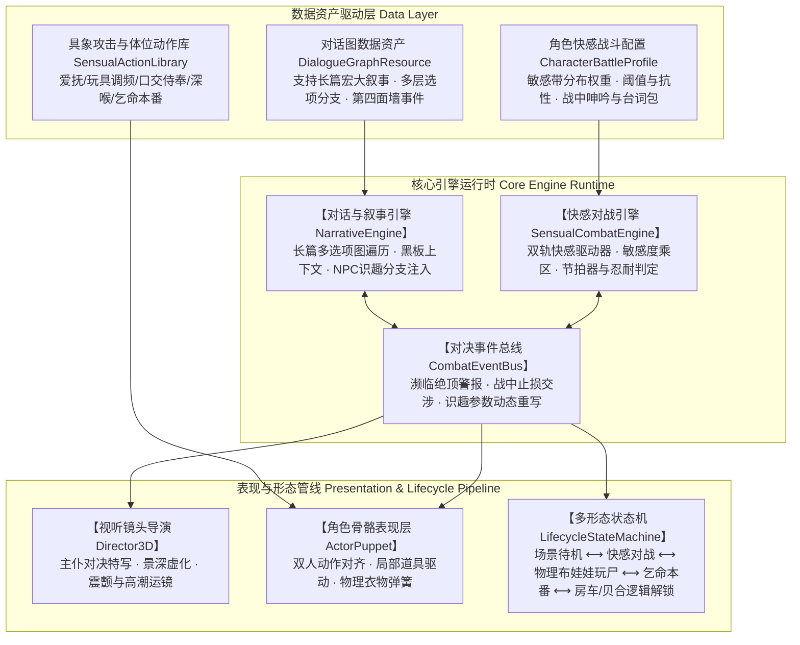

# 《Prism Route》通用情色叙事与快感对战引擎规范
## Sensual Combat & Narrative Engine Architecture Specification

> **版本**：v1.0 (2026-11-09)  
> **制定**：Master & Miku (古菌工作室 Archaea)  
> **工程归档位置**：`D:\Prism Route\plans\sensual_combat_and_narrative_engine_spec.md`  
> **核心定位**：全游戏通用的二次元主仆情色交互、长篇多选项对话、快感对决与多形态生命周期底层引擎

---

## 零、 Master 指导原话实录（Verbatim Directives）

### 1. 关于引擎级架构与长篇多选项对话定位（2026-11-09 01:01）
> “嗯嗯，请你记录一下文件，不过战斗前的对话显然我们是需要做成更长的，你刚才说只是简单对话，我们需要的是多选项对话。不过这不关键，都是通用的。”

### 2. 关于 Battle Fuck 本质与新手关卡全流程（2026-11-08 01:55）
> “Battle fuck不是战斗动作，而是就进行我们的比如口交动作播放，以谁败北高潮作为失败条件。我们的初始地图就是初始洞穴到初始神庙那里。假设我们以花火作为新手BOSS。玩家和她见面对话-花火：‘主人，欢迎来到我们的游戏，你还是第一次见到我吧，要我介绍一下游戏吗’‘我是新手BOSS哦，我已经等不及和主人Battle Fuck了’选择：战斗-聊天。聊天：‘主人还不开始吗，程序可是写了必须完成新手关卡才能探索其他地方哦，所以快来和花火爱爱吧’选择：战斗。战斗播放口交动作，花火和主人轮流攻击，主人的攻击比如爱抚、玩弄乳头、玩弄肛塞、操控跳蛋等，战斗中可以对话。但是我们设定必然需要让主人先失败一下，因为设定很强，需要走新手教学。失败后重生并再次对话。花火‘哼哼，主人这是第二次挑战了呢，刚才的败北射精真是不像话呢。要花火让让主人吗，或者主人直接命令花火败北也可以哦’选项可以调整游戏参数，这样可以修改角色属性。战斗中，如果主人还是快要败北了，可以继续触发对话。花火‘杂鱼主人，花火让让主人主人还是要输了吗，真是杂鱼’‘要继续公平战斗还是命令花火走流程直接败北呢？’这样也可以调整到作弊参数让主人的快感条不会到顶，这样就不会失败。这样赢了之后：花火‘嗯嗯，去了去了’‘嘻嘻，恭喜主人过了新手关卡呢’‘接下来要杀了我吗，还是算了？杀了我的话主人可以体验玩弄尸体哦，不用担心，主人走出范围后，花火就重新刷新了哦，我们的游戏机制就是这么写的，嘻嘻’选择：杀掉-放过。放过:花火‘嗯哼，主人不玩花火的尸体吗？’选项：要求乞命侍奉。花火‘咦，你居然选择了这个选项，好恶心。不过没办法，那么花火就侍奉主人，处理主人的性欲吧’-播放本番动画”

### 3. 关于识趣机制而非外部作弊开关（2026-11-08 01:59）
> “不是作弊开关哦，不是玩家按的。是对话中花火提供的，玩家选择后开启，你应该注意我表现和说明的，NPC自己的识趣玩法。看起来你还是有点没有把握住我们的设定”

---

## 一、 系统定位与架构全景

本系统决不仅是一个局部关卡的 Demo 脚本，而是《Prism Route》承载所有角色交互的核心基石：

1. **统一数据驱动**：所有对话、选项、招式、属性、胜负形态均由数据资产驱动，严禁将具体业务逻辑硬编码在控制器中；
2. **支持全角色接入**：当前以花火为新手关试点，未来加入八重神子、雷电将军、芙宁娜、镜流、星见雅、刻晴、甘雨等角色时，无需重写任何底层框架；
3. **支持全场景模式**：可在神殿遗迹、海岛沙滩、房车生活区、自建别墅内随时启动；支持主仆对战以及宝可梦式双女贝合对战。

---

## 二、 对话引擎架构（Narrative Engine）

对话系统针对 Master 提出的长篇多选项交互需求进行工业级设计：

### 1. 节点式对话图模型（DialogueGraph）
对话是一棵带环的通用有向图，由以下基础节点组合而成：
- **TextNode（台词节点）**：
  - 属性：`speaker_id`（说话者）、`text`（支持富文本与变量插值）、`voice_id`（配音资源）、`expression`（VRM 表情口型驱动）、`camera_preset`（镜头机位）；
- **ChoiceNode（多选项分支节点）**：
  - 属性：`options`（选项数组）；
  - 每个选项包含：`text`（展示文本）、`target_node`（目标跳转节点）、`condition`（准入条件评估器）、`style`（普通选项/色情挑逗/命令特权）；
- **MetaInjectionNode（第四面墙识趣注入节点）**：
  - 核心灵魂机制：NPC 根据对局上下文（如检测到主人濒临败北或二周目挑战），动态向 ChoiceNode 注入讨好放水选项；
- **ActionNode（指令动作节点）**：
  - 触发引擎底层事件：如无缝切入 Battle Fuck、调整物理重力、调用布娃娃玩弄等。

### 2. 长篇战前对话流规范
战前长篇对话不仅提供世界观介绍与新手教程，更承载主仆性格磨合与情色拉扯：
1. **引导与寒暄层**：介绍遗迹环境、海岛探索机制与第四面墙游戏设定；
2. **多层试探与闲聊层**：玩家可深入询问游戏底层规则、花火的身世设定与性奴定位，花火以毒舌戏谑又乖巧的口吻回应；
3. **情趣拉扯与催促层**：若玩家迟迟不开启战斗，花火展现出迫不及待的求欢反应，通过多选项引导玩家直奔 Battle Fuck 主题；
4. **战前决意层**：正式确认进入快感对决，镜头由广角探索平滑转入情色特写机位。

### 3. 黑板上下文系统（Dialogue Blackboard）
- 存储交互状态：`first_encounter`（初遇）、`defeat_count`（败北射精次数）、`meta_cheat_active`（识趣作弊状态）；
- 动态变量插值：台词中支持 `{master_name}`、`{defeat_count}`、`{current_pleasure_pct}`，使台词与战斗惨烈度即时联动。

---

## 三、 快感对战引擎架构（Sensual Combat Engine）

彻底抛弃传统血量扣除机制，确立以快感增长与敏感刺激为主轴的对决体系：

### 1. 快感双轨组件（PleasureComponent）
挂载于参战双方实体上的独立组件：
- **核心属性**：
  - `current_pleasure: float`（当前快感值，0.0 到 1.0）；
  - `edging_threshold: float`（极限忍耐线，默认 0.85，越过该线触发高潮边缘喘息）；
  - `sensory_map: Dictionary`（敏感区域加权映射：口腔、乳头、阴部、菊花、道具接口）；
  - `resistance_rate: float`（快感抗性衰减率，受识趣选项直接修改）；
  - `lock_climax: bool`（锁定快感上限布尔值，用于主人作弊防败北）。
- **状态枚举**：
  - `STATE_IDLE`（平静待机）；
  - `STATE_AROUSED`（情动喘息）；
  - `STATE_EDGING`（极限忍耐高潮边缘）；
  - `STATE_CLIMAX`（绝顶高潮败北）。

### 2. 具象攻击行为资产（SensualActionResource）
拒绝抽象攻防姿态，所有招式均为具象情趣玩弄：
- **主人攻击库**：
  - `Action_CaressSensitive`：爱抚敏感区域（增加基础快感）；
  - `Action_PinchNipples`：玩弄乳头（高频局部刺激）；
  - `Action_ToyVibrationCtrl`：调节跳蛋震频（按节拍施加持续快感）；
  - `Action_AnalPlugPlay`：玩弄菊花玩具（大幅降低对方抗性）。
- **NPC 攻击库**：
  - `Action_OralTongueTease`：舌尖舔舐缠绕（平缓快感累积）；
  - `Action_DeepThroatGag`：深喉全吞包裹（爆发性快感冲击）；
  - `Action_EyeContactMoan`：抬头对视娇喘（精神级暴击快感）。

### 3. 战中识趣交涉总线（Combat Event Bus）
- 快感跨越阶段（30%、70%、90%）触发战中短评（Mid-Battle Barks）；
- **濒临败北打断机制**：当主人快感达到 95% 时，NPC 暂停侍奉攻势，触发第四面墙战中对话框，由花火主动娇声提醒并提供放水选项，杜绝挫败感。

---

## 四、 多形态生命周期管线（Lifecycle & Morphing Pipeline）

战斗结束后的角色生命周期与场景表现解耦：

### 1. 阶段状态流转图
1. **遭遇待机**：场景中作为 `StaticBody3D` 阻挡实体驻场待机；
2. **对决状态**：镜头拉近、快感 HUD 激活、性爱循环动画播放；
3. **败北绝顶**：输家绝顶痉挛，胜负裁定；
4. **双分支结算**：
   - **分支 A【杀掉 · 物理玩弄尸体】**：
     - 停用动画与衣物弹簧，移交控制权至 `CorpseRagdollController`；
     - 角色无缝软化为物理布娃娃，玩家可通过交互按键拖拽脚踝移动尸体；
     - 场景范围检测：玩家携带或离开超过预设半径后，布娃娃销毁，神殿原位静默刷新全新花火；
   - **分支 B【放过 · 乞命侍奉】**：
     - 触发娇羞求饶对白，动作平滑过渡为深度本番体位；
     - 全局存档持久化标记：逻辑解锁花火为可用角色（房车随行召唤、双女贝合对战角色）。

---

## 五、 实装落地分步规划

1. **第一阶段：引擎数据结构与基础交互（Narrative & Pleasure Core）**
   - 建立 `scripts/narrative/` 与 `scripts/combat/` 核心类库；
   - 实现通用长篇多选项对话 UI 与黑板系统；
   - 实现 `PleasureComponent` 快感双轨计算逻辑。
2. **第二阶段：花火神殿教学关实机挂接（Tutorial Wiring）**
   - 编写花火专属的长篇多选项战前台词图资产；
   - 挂接神殿交互触发器（按 E 唤出长篇对话与 Battle Fuck 选项）；
   - 实现教学杀数值配置与二周目花火识趣放水逻辑。
3. **第三阶段：物理玩尸与乞命侍奉结算闭环（Settlement Closure）**
   - 将战胜分支无缝移交至 `CorpseRagdollController` 物理布娃娃系统；
   - 接入放过分支的本番动作与逻辑解锁通知。
